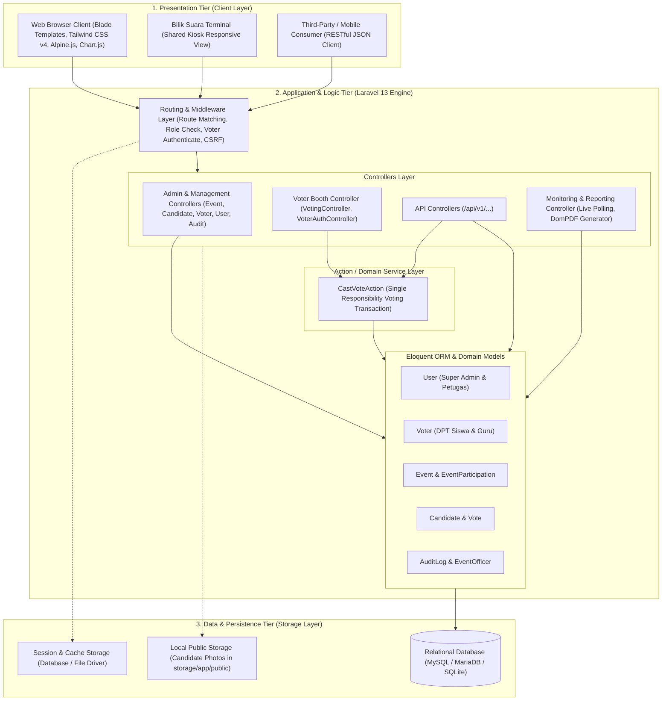
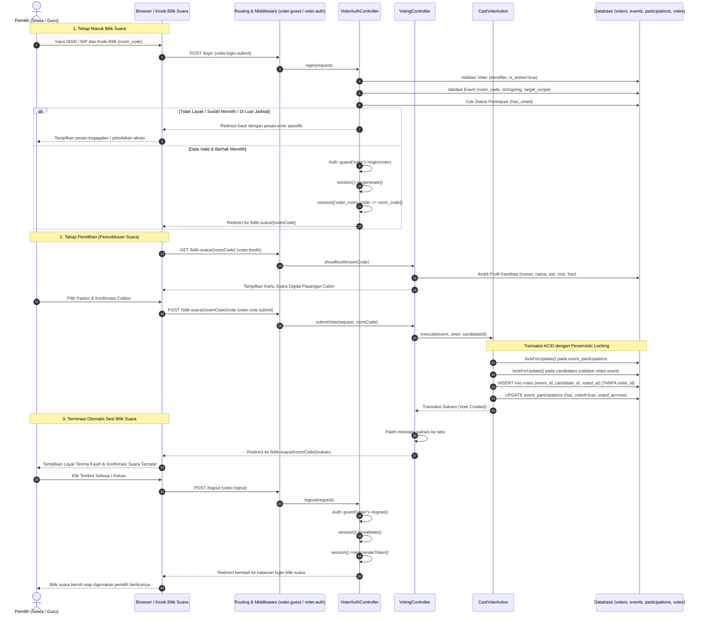
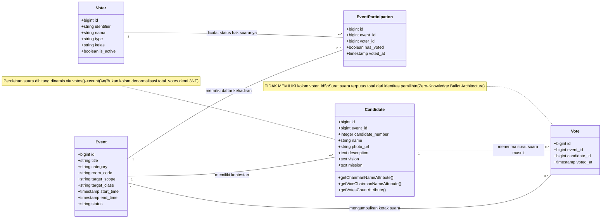

# BAB III: PERANCANGAN SISTEM DAN ARSITEKTUR PERANGKAT LUNAK

Bab ini menyajikan rancangan teknis arsitektur perangkat lunak, sistem keamanan, model data, serta perancangan antarmuka pengguna pada aplikasi *E-Voting* berbasis web. Seluruh perancangan disusun secara sistematis, terperinci, dan faktual sesuai implementasi basis kode riil sistem. Penyusunan ini mengacu pada standar kompetensi SKKNI Pemrogram Junior, khususnya unit kompetensi **J.620100.016.01 (Menulis Kode dengan Prinsip Sesuai Guidelines dan Best Practices)**, **J.620100.017.02 (Mengimplementasikan Rancangan Entitas dan Keterkaitannya)**, dan **J.620100.009.01 (Menggunakan Spesifikasi Program)**.

---

## 3.1 Perancangan Arsitektur Sistem dan Keamanan

Sub-bab ini menguraikan arsitektur sistem berlapis (*multi-tier architecture*), penerapan pola rancangan perangkat lunak (*software design patterns*), arsitektur autentikasi ganda (*multi-guard authentication*) yang memisahkan ranah administrator dan pemilih bilik suara, serta implementasi prinsip keamanan pemungutan suara digital yang menjamin asas LUBER-JURDIL (Langsung, Umum, Bebas, Rahasia, Jujur, dan Adil) melalui rancangan kotak suara anonim (*Zero-Knowledge Ballot*) dan isolasi transaksi basis data (*ACID Transaction with Pessimistic Locking*).

---

### 3.1.1 Arsitektur Multi-Tier & Pola Perangkat Lunak (MVC + Action Pattern)

Sistem *E-Voting* ini dirancang menggunakan arsitektur modular tiga lapis (*Three-Tier Architecture*) yang membagi sistem ke dalam tiga lapisan tanggung jawab utama: *Presentation Tier*, *Application & Business Logic Tier*, dan *Data & Persistence Tier*. Pendekatan ini memastikan prinsip *Separation of Concerns* (SoC), skalabilitas tinggi, kemudahan pengujian, serta pemeliharaan kode jangka panjang.



#### 1. Uraian Lapisan Arsitektur (Multi-Tier Architecture)

1. **Presentation Tier (Lapisan Presentasi / Antarmuka Pengguna):**
   - **Blade Templating Engine:** Menyediakan antarmuka web interaktif yang di-*render* secara *server-side* dengan struktur tata letak modular (`layouts/app.blade.php`, `layouts/navigation.blade.php`, dan komponen parsial).
   - **Tailwind CSS v4:** Digunakan untuk penataan gaya visual yang modern, konsisten, dan sepenuhnya responsif di berbagai resolusi layar (desktop, tablet, hingga ponsel pintar) melalui integrasi Vite modern (`@tailwindcss/vite`).
   - **Alpine.js & Chart.js:** Memberikan reaktivitas antarmuka pada sisi klien tanpa membebani browser dengan *single page application framework* yang berat. Digunakan secara khusus pada modal dialog konfirmasi coblos, tabulasi data, menu navigasi *mobile*, serta grafik batang/lingkaran perolehan suara *real-time* pada modul *live monitoring*.
   - **RESTful API Client:** Mendukung interoperabilitas dengan aplikasi eksternal atau perangkat klien lain melalui pertukaran data berformat standar JSON pada jalur rute `/api/v1`.

2. **Application & Business Logic Tier (Lapisan Logika Bisnis):**
   - **Routing & Middleware Pipeline:** Mengatur gerbang masuk seluruh permintaan HTTP (`routes/web.php` dan `routes/api.php`). Mengintegrasikan rantai proteksi seperti verifikasi token CSRF, pembatasan laju akses (*rate limiting / throttling*), otentikasi sesi ganda, dan otorisasi wewenang berbasis peran (*Role-Based Access Control*).
   - **Controller Layer:** Bertindak sebagai orkestrator yang menerima HTTP *request*, mengeksekusi validasi masukan menggunakan *Form Request Validation*, memanggil lapisan domain/layanan, dan mengembalikan respon berupa tampilan Blade atau respon JSON terstruktur.
   - **Action Layer (`CastVoteAction`):** Enkapsulasi logika pemungutan suara ke dalam satu kelas khusus berprinsip *Single Responsibility*. Kelas ini memastikan logika pencoblosan dapat dipanggil secara seragam baik oleh antarmuka web bilik suara maupun oleh rute API tanpa duplikasi kode (*Don't Repeat Yourself / DRY*).
   - **Eloquent Object-Relational Mapping (ORM):** Memetakan relasi antar entitas bisnis ke dalam objek PHP yang aman dari manipulasi sintaks SQL (*SQL Injection*), serta menyediakan *query scopes* dinamis untuk pengelolaan status agenda secara terpusat.

3. **Data & Persistence Tier (Lapisan Penyimpanan Data):**
   - **Basis Data Relasional (RDBMS):** Mengelola integritas data struktural menggunakan mesin basis data SQL (MySQL/MariaDB untuk lingkungan produksi, didukung SQLite untuk pengujian otomatis). Menjamin integritas referensial antar tabel serta mendukung isolasi transaksi ACID (*Atomicity, Consistency, Isolation, Durability*).
   - **Sistem Penyimpanan Berkas (*Public File Storage*):** Menyimpan berkas foto profil dan poster pasangan calon kandidat pada direktori terisolasi `storage/app/public/candidates/` yang dapat diakses publik secara aman melalui tautan simbolik (*symbolic link*).
   - **Session & Cache Storage:** Mengelola penyimpanan status sesi aktif pengguna internal dan pemilih bilik suara secara aman, didukung mekanisme pembersihan cache sistem (*artisan optimize:clear*).

---

#### 2. Penerapan Pola Perangkat Lunak (Software Design Patterns)

Aplikasi *E-Voting* ini menerapkan standar pola rancangan perangkat lunak modern guna memastikan kode tetap bersih (*clean code*), terstruktur, dan mudah diuji:

1. **Pola Model-View-Controller (MVC):**
   - **Model:** Menangani aturan bisnis, struktur skema, relasi antar tabel, dan manipulasi data (`User`, `Voter`, `Event`, `Candidate`, `Vote`, `EventParticipation`, `AuditLog`, `EventOfficer`).
   - **View:** Menangani penyajian data dan antarmuka interaksi pengguna menggunakan berkas template Blade.
   - **Controller:** Mengelola alur kontrol aplikasi, memisahkan logika antarmuka dari logika komputasi data.

2. **Action Pattern (Single Responsibility Action):**
   - Alih-alih menempatkan transaksi penyimpanan surat suara yang kompleks di dalam *Controller*, logika tersebut diekstraksi ke dalam kelas tunggal `App\Actions\CastVoteAction`.
   - Pola ini memastikan bahwa proses kritis seperti penguncian baris pesimistik (*pessimistic locking*), validasi pencegahan memilih ganda, pemotongan hak pilih, dan pencatatan suara anonim terisolasi secara mandiri dan dapat diuji secara terpisah (*unit testing*).

3. **Form Request Pattern (Dedicated Input Validation):**
   - Validasi data masukan dari pengguna dienkapsulasi ke dalam kelas *Form Request* terpisah (seperti `StoreEventRequest`, `UpdateEventRequest`, `StoreCandidateRequest`, `UpdateCandidateRequest`).
   - Pola ini memastikan bahwa pengontrol (*controller*) hanya menerima data yang telah terbukti valid, bersih, dan sesuai tipe data yang diharapkan sebelum memproses logika bisnis lebih lanjut.

4. **Query Scopes & State Synchronization Pattern:**
   - Model `Event` menerapkan *local query scopes* (`scopeOngoing()`, `scopePublished()`) untuk menyeleksi agenda yang memenuhi kriteria operasional.
   - Dilengkapi fungsi sinkronisasi status dinamis `syncDynamicStatus()` yang secara otomatis menyesuaikan status siklus hidup agenda (`DRAFT`, `PUBLISHED`, `CLOSED`) berdasarkan waktu server saat ini (*server current time*) terhadap atribut `start_time` dan `end_time`.

---

### 3.1.2 Arsitektur Autentikasi Multi-Guard & Manajemen Sesi Bilik Suara

Salah satu aspek arsitektur terpenting pada sistem *E-Voting* ini adalah pemisahan total antara jalur masuk staf panitia/administrator dengan jalur masuk pemilih (siswa dan guru). Sistem tidak menggabungkan data akun panitia dan data pemilih dalam satu tabel pengguna, melainkan mengimplementasikan mekanisme **Multi-Guard Authentication** pada berkas konfigurasi `config/auth.php`.

#### 1. Konfigurasi Multi-Guard & Provider Otentikasi

Arsitektur autentikasi sistem mendefinisikan 4 (empat) penjaga (*guards*) yang bekerja secara independen:

| Nama Guard | Driver | Provider | Model Entitas | Sasaran Pengguna & Ranah Akses | Mekanisme Kredensial |
| :--- | :---: | :---: | :--- | :--- | :--- |
| **`web`** | `session` | `users` | `App\Models\User` | Super Admin & Petugas (Panel `/admin/*`) | Email / Username dan Password (Bcrypt) |
| **`voter`** | `session` | `voters` | `App\Models\Voter` | Pemilih Bilik Suara (`/bilik-suara/*`) | Nomor Induk (NISN/NIP) & Kode Bilik (`room_code`) |
| **`users`** | `sanctum` | `users` | `App\Models\User` | Administrator via RESTful API (`/api/v1/admin/*`, `/api/v1/petugas/*`) | *Bearer Token* Personal Access Token Sanctum |
| **`voters`** | `sanctum` | `voters` | `App\Models\Voter` | Pemilih via RESTful API (`/api/v1/voter/*`) | *Bearer Token* Personal Access Token Sanctum |

Konfigurasi ini menjamin bahwa kebocoran sesi atau kesalahan kredensial pada portal pemilih tidak akan pernah memberikan akses ke portal administratif panitia, begitupun sebaliknya.



---

#### 2. Pipeline Middleware Otorisasi & Pencegat Tamu

Sistem meregistrasikan alias *middleware* khusus pada `bootstrap/app.php` untuk mengamankan setiap gerbang akses:

1. **Middleware `role` (`App\Http\Middleware\CheckRole`):**
   - Memeriksa apakah pengguna yang sedang terautentikasi pada guard `web` memiliki nilai kolom `role` yang sesuai dengan parameter yang diizinkan (misalnya `role:SUPER_ADMIN` atau `role:PETUGAS,SUPER_ADMIN`).
   - Apabila peran pengguna tidak cocok, sistem secara tegas menggagalkan akses dengan melemparkan eksepsi HTTP 403 (*Unauthorized Action / Forbidden Access*).

2. **Middleware `voter.auth` (`App\Http\Middleware\VoterAuthenticate`):**
   - Mengamankan seluruh rute bilik suara (`/bilik`, `/bilik-suara/{roomCode}/*`).
   - Memastikan bahwa pengguna terautentikasi melalui guard `voter`, berstatus aktif (`is_active = true`), dan memiliki hak akses ke kode bilik suara yang dituju. Jika tidak terautentikasi, pengguna dicegat dan dialihkan ke formulir login bilik suara.

3. **Middleware Tamu Terisolasi (`admin.guest` dan `voter.guest`):**
   - `admin.guest` (`RedirectIfAdminAuthenticated`): Mencegah administrator atau petugas yang telah memiliki sesi login aktif membuka kembali formulir `/admin/login`. Jika terdeteksi sudah login, otomatis dialihkan langsung ke `/admin/dashboard`.
   - `voter.guest` (`RedirectIfVoterAuthenticated`): Mencegah pemilih yang telah masuk bilik suara mengakses kembali halaman login bilik suara, mengalihkannya langsung ke ruang pemilihan aktif (`/bilik`).

4. **Intelligent Guest Redirection Engine (`redirectGuestsTo`):**
   - Pada `bootstrap/app.php`, alur *redirect* pengguna yang belum terautentikasi disesuaikan secara kontekstual berdasarkan pola URL:
     ```php
     $middleware->redirectGuestsTo(function (Request $request) {
         if ($request->is('api/*') || $request->expectsJson()) {
             return null; // Mengembalikan respon JSON 401 Unauthorized
         }
         if ($request->is('admin*') || $request->is('events*') || $request->is('dashboard*')) {
             return route('admin.login'); // Mengarahkan staf internal ke login admin
         }
         return route('voter.login'); // Mengarahkan pengguna umum ke login bilik suara
     });
     ```

---

#### 3. Siklus Hidup Sesi Bilik Suara (Voter Session Lifecycle)

Untuk menjamin keamanan pemungutan suara di lingkungan sekolah—di mana satu perangkat komputer (bilik suara fisik / *shared kiosk*) digunakan secara bergantian oleh ratusan siswa—siklus hidup sesi pemilih dikelola melalui 4 fase ketat:

1. **Fase Inisiasi Kredensial:**
   Pemilih memasukkan Nomor Induk (`identifier`) dan Kode Bilik (`room_code`). Pengontrol memverifikasi status keaktifan pemilih, jadwal agenda, kesesuaian target pemilih (siswa/guru/kelas), serta memeriksa apakah pemilih telah terdaftar sudah mencoblos.

2. **Fase Regenerasi Sesi (*Session Fixation Prevention*):**
   Saat pemilih berhasil diautentikasi, metode `$request->session()->regenerate()` dieksekusi detik itu juga. Hal ini menghasilkan ID sesi baru secara acak untuk menggagalkan upaya peretasan berbasis pembajakan sesi (*session fixation attack*).

3. **Fase Akses Bilik Terisolasi:**
   Pemilih berada di dalam bilik suara virtual. Nilai `voter_room_code` disimpan di sesi untuk memastikan pemilih tidak dapat menyusup atau menembus agenda pemilihan lain selain agenda yang kode biliknya telah divalidasi.

4. **Fase Terminasi Otomatis & Penghangusan Sesi (*Session Destruction*):**
   Setelah surat suara masuk dan tercatat di basis data, sistem mengarahkan pemilih ke halaman sukses (`voter.success`). Ketika pemilih menekan tombol "Selesai" atau sistem mencapai batas waktu tunggu (*timeout*), pengontrol menjalankan:
   ```php
   Auth::guard('voter')->logout();
   $request->session()->invalidate();
   $request->session()->regenerateToken();
   ```
   Seluruh data sesi, *cookie*, dan token CSRF segera dimusnahkan dari memori server dan peramban, memastikan bilik suara bersih dan siap digunakan pemilih berikutnya tanpa risiko hak pilih disalahgunakan.

---

### 3.1.3 Prinsip Keamanan & Desain Anonimitas Kotak Suara (Zero-Knowledge Ballot & Transaksi ACID)

Aspek terpenting dari sebuah sistem pemilihan umum digital adalah jaminan terhadap prinsip kerahasiaan pilihan pemilih serta keabsahan data hasil perolehan suara. Sistem *E-Voting* ini dirancang secara khusus untuk memenuhi asas **LUBER-JURDIL** tanpa celah pelacakan balik (*ballot anonymity*) dan kebal terhadap kondisi balapan data (*anti-race condition*).

#### 1. Perancangan Anonimitas Surat Suara (Zero-Knowledge Ballot Design)

Dalam sistem konvensional yang dirancang secara keliru, tabel suara sering kali menyimpan kunci tamu `voter_id` untuk mencatat siapa yang memilih kandidat tersebut. Pendekatan keliru tersebut melanggar asas **Rahasia** karena administrator basis data dapat dengan mudah menelusuri pilihan individu pemilih melalui kueri SQL sederhana.

Sistem *E-Voting* ini memecahkan tantangan tersebut dengan menerapkan **Pemisahan Fisik Relasional Terputus (*Decoupled Relational Separation*)** antara data kehadiran hak suara dengan data isi surat suara:



- **Tabel `event_participations` (Daftar Hadir Pemilih):**
  Hanya bertugas mencatat bahwa pemilih $A$ telah menggunakan hak suaranya pada agenda $X$ (`has_voted = true`, `voted_at = timestamp`). Tabel ini berfungsi sebagai gerbang pencegah agar pemilih tidak dapat mencoblos untuk kedua kalinya.
- **Tabel `votes` (Kotak Suara Digital Anonim):**
  Hanya mencatat bahwa satu surat suara masuk untuk agenda $X$ pada kandidat $Y$ (`event_id`, `candidate_id`, `voted_at`).
- **Jaminan Kerahasiaan Mutlak (*Untraceable Secret Ballot*):**
  Tabel `votes` **SAMA SEKALI TIDAK MEMILIKI** kolom atau relasi `voter_id`. Tidak ada tautan langsung (*direct foreign key*) maupun metadata tidak langsung yang dapat menghubungkan surat suara tertentu ke pemilih tertentu. Dengan rancangan ini, integritas privasi pemilih terjamin 100%, bahkan jika seluruh isi basis data diekspos ke publik.
- **Normalisasi Penuh Model Paslon (Normal Form 3NF):**
  Pada tabel `candidates`, identitas pasangan calon disimpan pada kolom tunggal `name` (format: `Nama Ketua & Nama Wakil`). Pengontrol dan antarmuka memanfaatkan *Eloquent Accessor* dinamis (`chairman_name`, `vice_chairman_name`) untuk memisahkan nama calon ketua dan wakil secara elegan saat dibutuhkan. Selain itu, sistem tidak menyimpan kolom denormalisasi `total_votes` pada tabel fisik `candidates`, melainkan mengagregasikannya secara langsung melalui relasi `votes()->count()` atau *eager loading* `withCount('votes')`. Hal ini menjamin konsistensi data absolut dan mencegah diskrepansi antara jumlah surat suara fisik di tabel `votes` dengan nilai akumulasi pada profil kandidat.

---

#### 2. Pencegahan Balapan Data (Anti-Race Condition) dengan Transaksi ACID & Pessimistic Locking

Dalam skenario pemilihan sekolah yang padat, terdapat risiko ancaman pemungutan suara ganda (*concurrent double-voting attack*), yaitu ketika seorang pemilih membuka sistem secara bersamaan di dua tab peramban atau perangkat berbeda dan menekan tombol coblos pada milidetik yang sama (*race condition*). Jika sistem hanya mengandalkan pengecekan kondisi biasa (`if (!$voter->has_voted)`), kedua permintaan konkuren dapat melewati validasi secara simultan sebelum status *flag* tersimpan, mengakibatkan pemilih dapat mencoblos lebih dari satu kali.

Sistem mengatasi masalah ini pada kelas `App\Actions\CastVoteAction` dengan memanfaatkan **Transaksi Basis Data Berorientasi ACID** yang dipadukan dengan **Penguncian Baris Pesimistik (*Pessimistic Row Locking*)**:

```php
public function execute(Event $event, Voter $voter, int $candidateId): Vote
{
    return DB::transaction(function () use ($event, $voter, $candidateId) {
        // 1. Kunci baris partisipasi pemilih secara pesimistik (Pessimistic Row Locking)
        $participation = EventParticipation::where('event_id', $event->id)
            ->where('voter_id', $voter->id)
            ->lockForUpdate()
            ->first();

        // Buat data partisipasi baru jika belum terdata sebelumnya
        if (! $participation) {
            $participation = EventParticipation::create([
                'event_id' => $event->id,
                'voter_id' => $voter->id,
                'has_voted' => false,
            ]);
            $participation = EventParticipation::where('id', $participation->id)
                ->lockForUpdate()
                ->first();
        }

        // 2. Evaluasi hak suara: Tolak seketika jika pemilih sudah terdata memilih
        if ($participation && $participation->has_voted) {
            throw new \RuntimeException('Anda sudah pernah memilih pada event ini!');
        }

        // 3. Kunci data kandidat dan verifikasi kepemilikan agenda
        $candidate = Candidate::where('event_id', $event->id)
            ->where('id', $candidateId)
            ->lockForUpdate()
            ->first();

        if (! $candidate) {
            throw new \RuntimeException('Kandidat tidak valid untuk event ini.');
        }

        $now = now();

        // 4. Masukkan surat suara ke kotak suara digital (ANONIM tanpa ID pemilih)
        $vote = Vote::create([
            'event_id' => $event->id,
            'candidate_id' => $candidate->id,
            'voted_at' => $now,
        ]);

        // 5. Hanguskan hak suara pemilih pada agenda ini
        $participation->update([
            'has_voted' => true,
            'voted_at' => $now,
        ]);

        return $vote;
    });
}
```

Analisis kepatuhan karakteristik **ACID (Atomicity, Consistency, Isolation, Durability)** pada implementasi ini:
1. **Atomicity (Keterpaduan Mutlak):** Seluruh blok transaksi dieksekusi sebagai satu kesatuan utuh. Apabila terjadi kegagalan jaringan atau galat server saat proses penyimpanan suara atau pembaruan status, seluruh operasi di-*rollback* otomatis ke kondisi semula. Tidak akan pernah terjadi kondisi di mana suara tersimpan tetapi pemilih masih tercatat belum memilih, atau pemilih tercatat sudah memilih tetapi suaranya tidak masuk ke kandidat.
2. **Consistency (Konsistensi Data):** Sistem memastikan jumlah surat suara sah pada tabel `votes` selalu sama persis ($1:1$) dengan jumlah baris `event_participations` yang berstatus `has_voted = true`.
3. **Isolation (Isolasi Transaksi Tingkat Tinggi):** Melalui klausa `lockForUpdate()`, mesin basis data menerapkan *Exclusive Row-Level Lock* pada baris partisipasi pemilih. Jika ada *request* kedua yang tiba di waktu bersamaan, *request* tersebut dipaksa mengantre (*blocked/waiting*) hingga transaksi pertama selesai di-*commit*. Saat *request* kedua akhirnya dieksekusi, ia akan membaca status `has_voted = true` yang telah ter-*commit* dan seketika ditolak dengan eksepsi `RuntimeException`.
4. **Durability (Ketahanan Data):** Setelah blok `DB::transaction` sukses diselesaikan, seluruh perubahan data suara dan status hak suara disimpan secara permanen di media penyimpanan persisten (*disk storage*), kebal terhadap kegagalan memori aplikasi sesaat sesudahnya.

---

#### 3. Strategi Pertahanan Keamanan Web Aplikasi Berstandar OWASP

Selain keamanan pemungutan suara, sistem mengadopsi standar pertahanan keamanan aplikasi web komprehensif mengacu pada prinsip *OWASP Top 10 Mitigation Guidelines*:

1. **Pencegahan Injeksi Basis Data (SQL Injection Prevention):**
   Sistem tidak pernah menggunakan kueri mentah (*raw string concatenation*). Seluruh interaksi basis data dieksekusi melalui Eloquent ORM dan *Query Builder* yang secara baku menggunakan *Prepared Statements* dan *PDO Parameter Binding*.

2. **Perlindungan Pemalsuan Permintaan Antar-Situs (CSRF Protection):**
   Seluruh formulir interaktif berbasis HTTP POST, PUT, PATCH, dan DELETE mewajibkan penyertaan direktif token kriptografis `@csrf`. Token ini divalidasi oleh *middleware* internal framework Laravel untuk memastikan bahwa setiap permintaan yang masuk berasal dari formulir sah yang diterbitkan oleh aplikasi, bukan dari serangan tautan pihak ketiga.

3. **Perlindungan Serangan Skrip Lintas-Situs (XSS Protection):**
   Setiap data dinamis yang ditampilkan ke antarmuka Blade menggunakan kurung kurawal ganda `{{ $variable }}` yang secara otomatis menjalankan sanitasi fungsi PHP `htmlspecialchars()`. Hal ini mencegah injeksi skrip JavaScript jahat (*Stored XSS / Reflected XSS*) dari input nama kandidat, visi misi, atau pesan kesalahan.

4. **Mitigasi Serangan Brute Force (Rate Limiting / Throttling):**
   Gerbang autentikasi dilindungi oleh *rate limiter* internal framework yang membatasi frekuensi percobaan pengiriman formulir login per satuan waktu, mencegah serangan penembakan kata sandi massal secara terotomasi.

5. **Pengacakan Kata Sandi Kriptografis (Cryptographic Password Hashing):**
   Kata sandi seluruh akun pengguna staf internal dienkripsi menggunakan algoritma `Bcrypt` dengan *work factor* adaptif bawaan framework Laravel (`Hash::make()`), yang kebal terhadap serangan kamus (*dictionary attack*) maupun *rainbow table attack*.

6. **Jejak Audit Kebal Manipulasi (Tamper-Evident Audit Trail):**
   Melalui model `App\Models\AuditLog`, sistem secara otomatis merekam setiap peristiwa administratif krusial, meliputi:
   - Waktu tepat peristiwa (*timestamp*).
   - Identitas staf pelaksana (`user_id`).
   - Kategori aksi (`LOGIN_SUCCESS`, `LOGIN_FAILED`, `EVENT_CREATED`, `EVENT_UPDATED`, `VOTER_IMPORTED`, `VOTE_RESET`, `SYSTEM_CACHE_CLEARED`).
   - Rincian muatan data kontekstual dalam format JSON (`payload`).
   - Alamat IP asal koneksi (`ip_address`) dan tanda pengenal peramban (*User-Agent*).
   Rekaman jejak audit ini memberikan akuntabilitas penuh bagi pengawas pemilihan dan Super Admin untuk mendeteksi anomali operasional.

7. **Segel Integritas Digital Dokumen Berita Acara (Digital Integrity Hash Seal):**
   Pada saat pengunduhan Berita Acara Rekapitulasi Suara resmi format PDF melalui `MonitoringController::downloadPdf`, sistem menghitung tanda tangan *hash* kriptografis **SHA-256** yang menggabungkan parameter kritis pemilihan dengan kunci rahasia aplikasi:
   $$\text{Integrity Hash} = \text{SHA-256}(\text{EventID} \parallel \text{TotalVotes} \parallel \text{LeaderCandidateID} \parallel \text{AppKey})$$
   Sebanyak 32 karakter heksadesimal pertama dari nilai *hash* ini dicetak secara permanen pada lembar Berita Acara sebagai **Kode Segel Integritas Digital (*Digital Tamper Seal*)**:
   ```php
   $rawVerification = $event->id . '|' . $stats['totalVotes'] . '|' . ($stats['leader']->id ?? 0) . '|' . config('app.key');
   $integrityHash = hash('sha256', $rawVerification);
   $reportNumber = 'BA-EVT/' . date('Y') . '/' . str_pad($event->id, 4, '0', STR_PAD_LEFT);
   $digitalSeal = strtoupper(substr($integrityHash, 0, 32));
   ```
   Fitur ini memastikan bahwa setiap lembar fisik Berita Acara yang dicetak dapat diverifikasi keabsahan dan keasliannya, serta tidak dapat dimanipulasi secara sepihak di luar sistem e-voting.
