# BAB III: PERANCANGAN SISTEM DAN ARSITEKTUR PERANGKAT LUNAK

Bab ini menyajikan rancangan teknis arsitektur perangkat lunak, sistem keamanan, model data, serta perancangan antarmuka pengguna pada aplikasi *E-Voting* berbasis web. Seluruh perancangan disusun secara sistematis, terperinci, dan faktual sesuai implementasi basis kode riil sistem. Penyusunan ini mengacu pada standar kompetensi SKKNI Pemrogram Junior, khususnya unit kompetensi **J.620100.016.01 (Menulis Kode dengan Prinsip Sesuai Guidelines dan Best Practices)**, **J.620100.017.02 (Mengimplementasikan Rancangan Entitas dan Keterkaitannya)**, dan **J.620100.009.01 (Menggunakan Spesifikasi Program)**.

---

## 3.1 Perancangan Arsitektur Sistem dan Keamanan

Sub-bab ini menguraikan arsitektur sistem berlapis (*multi-tier architecture*), penerapan pola rancangan perangkat lunak (*software design patterns*), arsitektur autentikasi ganda (*multi-guard authentication*) yang memisahkan ranah administrator dan pemilih bilik suara, serta implementasi prinsip keamanan pemungutan suara digital yang menjamin asas LUBER-JURDIL (Langsung, Umum, Bebas, Rahasia, Jujur, dan Adil) melalui rancangan kotak suara anonim (*Zero-Knowledge Ballot*) dan isolasi transaksi basis data (*ACID Transaction with Pessimistic Locking*).

---

### 3.1.1 Arsitektur Multi-Tier & Pola Perangkat Lunak (MVC + Action Pattern)

Sistem *E-Voting* ini dirancang menggunakan arsitektur modular tiga lapis (*Three-Tier Architecture*) yang membagi sistem ke dalam tiga lapisan tanggung jawab utama: *Presentation Tier*, *Application & Business Logic Tier*, dan *Data & Persistence Tier*. Pendekatan ini memastikan prinsip *Separation of Concerns* (SoC), skalabilitas tinggi, kemudahan pengujian, serta pemeliharaan kode jangka panjang.

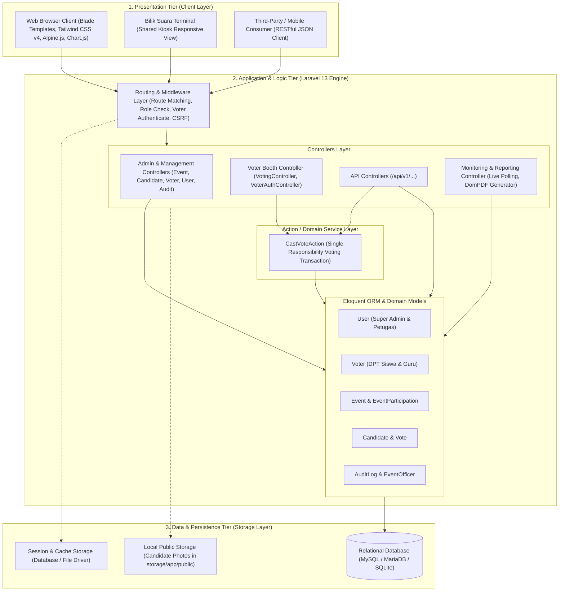

#### 1. Uraian Lapisan Arsitektur (Multi-Tier Architecture)

1. **Presentation Tier (Lapisan Presentasi / Antarmuka Pengguna):**
   - **Blade Templating Engine:** Menyediakan antarmuka web interaktif yang di-*render* secara *server-side* dengan struktur tata letak modular (`layouts/app.blade.php`, `layouts/navigation.blade.php`, dan komponen parsial).
   - **Tailwind CSS v4:** Digunakan untuk penataan gaya visual yang modern, konsisten, dan sepenuhnya responsif di berbagai resolusi layar (desktop, tablet, hingga ponsel pintar) melalui integrasi Vite modern (`@tailwindcss/vite`).
   - **Alpine.js & Chart.js:** Memberikan reaktivitas antarmuka pada sisi klien tanpa membebani browser dengan *single page application framework* yang berat. Digunakan secara khusus pada modal dialog konfirmasi coblos, tabulasi data, menu navigasi *mobile*, serta grafik batang/lingkaran perolehan suara *real-time* pada modul *live monitoring*.
   - **RESTful API Client:** Mendukung interoperabilitas dengan aplikasi eksternal atau perangkat klien lain melalui pertukaran data berformat standar JSON pada jalur rute `/api/v1`.

2. **Application & Business Logic Tier (Lapisan Logika Bisnis):**
   - **Routing & Middleware Pipeline:** Mengatur gerbang masuk seluruh permintaan HTTP (`routes/web.php` dan `routes/api.php`). Mengintegrasikan rantai proteksi seperti verifikasi token CSRF, pembatasan laju akses (*rate limiting / throttling*), otentikasi sesi ganda, dan otorisasi wewenang berbasis peran (*Role-Based Access Control*).
   - **Controller Layer:** Bertindak sebagai orkestrator yang menerima HTTP *request*, mengeksekusi validasi masukan menggunakan *Form Request Validation*, memanggil lapisan domain/layanan, dan mengembalikan respon berupa tampilan Blade atau respon JSON terstruktur.
   - **Action Layer (`CastVoteAction`):** Enkapsulasi logika pemungutan suara ke dalam satu kelas khusus berprinsip *Single Responsibility*. Kelas ini memastikan logika pencoblosan dapat dipanggil secara seragam baik oleh antarmuka web bilik suara maupun oleh rute API tanpa duplikasi kode (*Don't Repeat Yourself / DRY*).
   - **Eloquent Object-Relational Mapping (ORM):** Memetakan relasi antar entitas bisnis ke dalam objek PHP yang aman dari manipulasi sintaks SQL (*SQL Injection*), serta menyediakan *query scopes* dinamis untuk pengelolaan status agenda secara terpusat.

3. **Data & Persistence Tier (Lapisan Penyimpanan Data):**
   - **Basis Data Relasional (RDBMS):** Mengelola integritas data struktural menggunakan mesin basis data SQL (MySQL/MariaDB untuk lingkungan produksi, didukung SQLite untuk pengujian otomatis). Menjamin integritas referensial antar tabel serta mendukung isolasi transaksi ACID (*Atomicity, Consistency, Isolation, Durability*).
   - **Sistem Penyimpanan Berkas (*Public File Storage*):** Menyimpan berkas foto profil dan poster pasangan calon kandidat pada direktori terisolasi `storage/app/public/candidates/` yang dapat diakses publik secara aman melalui tautan simbolik (*symbolic link*).
   - **Session & Cache Storage:** Mengelola penyimpanan status sesi aktif pengguna internal dan pemilih bilik suara secara aman, didukung mekanisme pembersihan cache sistem (*artisan optimize:clear*).

---

#### 2. Penerapan Pola Perangkat Lunak (Software Design Patterns)

Aplikasi *E-Voting* ini menerapkan standar pola rancangan perangkat lunak modern guna memastikan kode tetap bersih (*clean code*), terstruktur, dan mudah diuji:

1. **Pola Model-View-Controller (MVC):**
   - **Model:** Menangani aturan bisnis, struktur skema, relasi antar tabel, dan manipulasi data (`User`, `Voter`, `Event`, `Candidate`, `Vote`, `EventParticipation`, `AuditLog`, `EventOfficer`).
   - **View:** Menangani penyajian data dan antarmuka interaksi pengguna menggunakan berkas template Blade.
   - **Controller:** Mengelola alur kontrol aplikasi, memisahkan logika antarmuka dari logika komputasi data.

2. **Action Pattern (Single Responsibility Action):**
   - Alih-alih menempatkan transaksi penyimpanan surat suara yang kompleks di dalam *Controller*, logika tersebut diekstraksi ke dalam kelas tunggal `App\Actions\CastVoteAction`.
   - Pola ini memastikan bahwa proses kritis seperti penguncian baris pesimistik (*pessimistic locking*), validasi pencegahan memilih ganda, pemotongan hak pilih, dan pencatatan suara anonim terisolasi secara mandiri dan dapat diuji secara terpisah (*unit testing*).

3. **Form Request Pattern (Dedicated Input Validation):**
   - Validasi data masukan dari pengguna dienkapsulasi ke dalam kelas *Form Request* terpisah (seperti `StoreEventRequest`, `UpdateEventRequest`, `StoreCandidateRequest`, `UpdateCandidateRequest`).
   - Pola ini memastikan bahwa pengontrol (*controller*) hanya menerima data yang telah terbukti valid, bersih, dan sesuai tipe data yang diharapkan sebelum memproses logika bisnis lebih lanjut.

4. **Query Scopes & State Synchronization Pattern:**
   - Model `Event` menerapkan *local query scopes* (`scopeOngoing()`, `scopePublished()`) untuk menyeleksi agenda yang memenuhi kriteria operasional.
   - Dilengkapi fungsi sinkronisasi status dinamis `syncDynamicStatus()` yang secara otomatis menyesuaikan status siklus hidup agenda (`DRAFT`, `PUBLISHED`, `CLOSED`) berdasarkan waktu server saat ini (*server current time*) terhadap atribut `start_time` dan `end_time`.

---

### 3.1.2 Arsitektur Autentikasi Multi-Guard & Manajemen Sesi Bilik Suara

Salah satu aspek arsitektur terpenting pada sistem *E-Voting* ini adalah pemisahan total antara jalur masuk staf panitia/administrator dengan jalur masuk pemilih (siswa dan guru). Sistem tidak menggabungkan data akun panitia dan data pemilih dalam satu tabel pengguna, melainkan mengimplementasikan mekanisme **Multi-Guard Authentication** pada berkas konfigurasi `config/auth.php`.

#### 1. Konfigurasi Multi-Guard & Provider Otentikasi

Arsitektur autentikasi sistem mendefinisikan 4 (empat) penjaga (*guards*) yang bekerja secara independen:

| Nama Guard | Driver | Provider | Model Entitas | Sasaran Pengguna & Ranah Akses | Mekanisme Kredensial |
| :--- | :---: | :---: | :--- | :--- | :--- |
| **`web`** | `session` | `users` | `App\Models\User` | Super Admin & Petugas (Panel `/admin/*`) | Email / Username dan Password (Bcrypt) |
| **`voter`** | `session` | `voters` | `App\Models\Voter` | Pemilih Bilik Suara (`/bilik-suara/*`) | Nomor Induk (NISN/NIP) & Kode Bilik (`room_code`) |
| **`users`** | `sanctum` | `users` | `App\Models\User` | Administrator via RESTful API (`/api/v1/admin/*`, `/api/v1/petugas/*`) | *Bearer Token* Personal Access Token Sanctum |
| **`voters`** | `sanctum` | `voters` | `App\Models\Voter` | Pemilih via RESTful API (`/api/v1/voter/*`) | *Bearer Token* Personal Access Token Sanctum |

Konfigurasi ini menjamin bahwa kebocoran sesi atau kesalahan kredensial pada portal pemilih tidak akan pernah memberikan akses ke portal administratif panitia, begitupun sebaliknya.

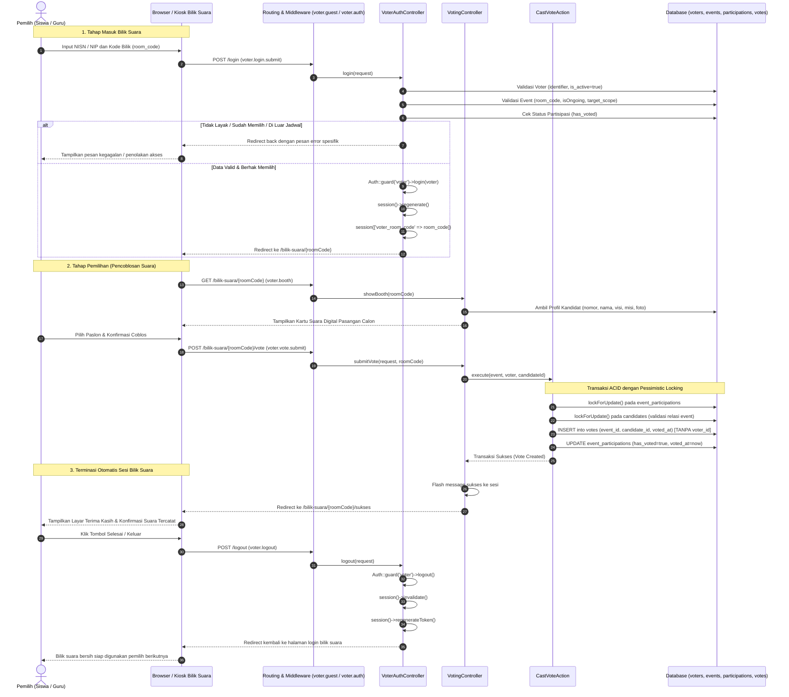

---

#### 2. Pipeline Middleware Otorisasi & Pencegat Tamu

Sistem meregistrasikan alias *middleware* khusus pada `bootstrap/app.php` untuk mengamankan setiap gerbang akses:

1. **Middleware `role` (`App\Http\Middleware\CheckRole`):**
   - Memeriksa apakah pengguna yang sedang terautentikasi pada guard `web` memiliki nilai kolom `role` yang sesuai dengan parameter yang diizinkan (misalnya `role:SUPER_ADMIN` atau `role:PETUGAS,SUPER_ADMIN`).
   - Apabila peran pengguna tidak cocok, sistem secara tegas menggagalkan akses dengan melemparkan eksepsi HTTP 403 (*Unauthorized Action / Forbidden Access*).

2. **Middleware `voter.auth` (`App\Http\Middleware\VoterAuthenticate`):**
   - Mengamankan seluruh rute bilik suara (`/bilik`, `/bilik-suara/{roomCode}/*`).
   - Memastikan bahwa pengguna terautentikasi melalui guard `voter`, berstatus aktif (`is_active = true`), dan memiliki hak akses ke kode bilik suara yang dituju. Jika tidak terautentikasi, pengguna dicegat dan dialihkan ke formulir login bilik suara.

3. **Middleware Tamu Terisolasi (`admin.guest` dan `voter.guest`):**
   - `admin.guest` (`RedirectIfAdminAuthenticated`): Mencegah administrator atau petugas yang telah memiliki sesi login aktif membuka kembali formulir `/admin/login`. Jika terdeteksi sudah login, otomatis dialihkan langsung ke `/admin/dashboard`.
   - `voter.guest` (`RedirectIfVoterAuthenticated`): Mencegah pemilih yang telah masuk bilik suara mengakses kembali halaman login bilik suara, mengalihkannya langsung ke ruang pemilihan aktif (`/bilik`).

4. **Intelligent Guest Redirection Engine (`redirectGuestsTo`):**
   - Pada `bootstrap/app.php`, alur *redirect* pengguna yang belum terautentikasi disesuaikan secara kontekstual berdasarkan pola URL:
     ```php
     $middleware->redirectGuestsTo(function (Request $request) {
         if ($request->is('api/*') || $request->expectsJson()) {
             return null; // Mengembalikan respon JSON 401 Unauthorized
         }
         if ($request->is('admin*') || $request->is('events*') || $request->is('dashboard*')) {
             return route('admin.login'); // Mengarahkan staf internal ke login admin
         }
         return route('voter.login'); // Mengarahkan pengguna umum ke login bilik suara
     });
     ```

---

#### 3. Siklus Hidup Sesi Bilik Suara (Voter Session Lifecycle)

Untuk menjamin keamanan pemungutan suara di lingkungan sekolah—di mana satu perangkat komputer (bilik suara fisik / *shared kiosk*) digunakan secara bergantian oleh ratusan siswa—siklus hidup sesi pemilih dikelola melalui 4 fase ketat:

1. **Fase Inisiasi Kredensial:**
   Pemilih memasukkan Nomor Induk (`identifier`) dan Kode Bilik (`room_code`). Pengontrol memverifikasi status keaktifan pemilih, jadwal agenda, kesesuaian target pemilih (siswa/guru/kelas), serta memeriksa apakah pemilih telah terdaftar sudah mencoblos.

2. **Fase Regenerasi Sesi (*Session Fixation Prevention*):**
   Saat pemilih berhasil diautentikasi, metode `$request->session()->regenerate()` dieksekusi detik itu juga. Hal ini menghasilkan ID sesi baru secara acak untuk menggagalkan upaya peretasan berbasis pembajakan sesi (*session fixation attack*).

3. **Fase Akses Bilik Terisolasi:**
   Pemilih berada di dalam bilik suara virtual. Nilai `voter_room_code` disimpan di sesi untuk memastikan pemilih tidak dapat menyusup atau menembus agenda pemilihan lain selain agenda yang kode biliknya telah divalidasi.

4. **Fase Terminasi Otomatis & Penghangusan Sesi (*Session Destruction*):**
   Setelah surat suara masuk dan tercatat di basis data, sistem mengarahkan pemilih ke halaman sukses (`voter.success`). Ketika pemilih menekan tombol "Selesai" atau sistem mencapai batas waktu tunggu (*timeout*), pengontrol menjalankan:
   ```php
   Auth::guard('voter')->logout();
   $request->session()->invalidate();
   $request->session()->regenerateToken();
   ```
   Seluruh data sesi, *cookie*, dan token CSRF segera dimusnahkan dari memori server dan peramban, memastikan bilik suara bersih dan siap digunakan pemilih berikutnya tanpa risiko hak pilih disalahgunakan.

---

### 3.1.3 Prinsip Keamanan & Desain Anonimitas Kotak Suara (Zero-Knowledge Ballot & Transaksi ACID)

Aspek terpenting dari sebuah sistem pemilihan umum digital adalah jaminan terhadap prinsip kerahasiaan pilihan pemilih serta keabsahan data hasil perolehan suara. Sistem *E-Voting* ini dirancang secara khusus untuk memenuhi asas **LUBER-JURDIL** tanpa celah pelacakan balik (*ballot anonymity*) dan kebal terhadap kondisi balapan data (*anti-race condition*).

#### 1. Perancangan Anonimitas Surat Suara (Zero-Knowledge Ballot Design)

Dalam sistem konvensional yang dirancang secara keliru, tabel suara sering kali menyimpan kunci tamu `voter_id` untuk mencatat siapa yang memilih kandidat tersebut. Pendekatan keliru tersebut melanggar asas **Rahasia** karena administrator basis data dapat dengan mudah menelusuri pilihan individu pemilih melalui kueri SQL sederhana.

Sistem *E-Voting* ini memecahkan tantangan tersebut dengan menerapkan **Pemisahan Fisik Relasional Terputus (*Decoupled Relational Separation*)** antara data kehadiran hak suara dengan data isi surat suara:


- **Tabel `event_participations` (Daftar Hadir Pemilih):**
  Hanya bertugas mencatat bahwa pemilih $A$ telah menggunakan hak suaranya pada agenda $X$ (`has_voted = true`, `voted_at = timestamp`). Tabel ini berfungsi sebagai gerbang pencegah agar pemilih tidak dapat mencoblos untuk kedua kalinya.
- **Tabel `votes` (Kotak Suara Digital Anonim):**
  Hanya mencatat bahwa satu surat suara masuk untuk agenda $X$ pada kandidat $Y$ (`event_id`, `candidate_id`, `voted_at`).
- **Jaminan Kerahasiaan Mutlak (*Untraceable Secret Ballot*):**
  Tabel `votes` **SAMA SEKALI TIDAK MEMILIKI** kolom atau relasi `voter_id`. Tidak ada tautan langsung (*direct foreign key*) maupun metadata tidak langsung yang dapat menghubungkan surat suara tertentu ke pemilih tertentu. Dengan rancangan ini, integritas privasi pemilih terjamin 100%, bahkan jika seluruh isi basis data diekspos ke publik.
- **Normalisasi Penuh Model Paslon (Normal Form 3NF):**
  Pada tabel `candidates`, identitas pasangan calon disimpan pada kolom tunggal `name` (format: `Nama Ketua & Nama Wakil`). Pengontrol dan antarmuka memanfaatkan *Eloquent Accessor* dinamis (`chairman_name`, `vice_chairman_name`) untuk memisahkan nama calon ketua dan wakil secara elegan saat dibutuhkan. Selain itu, sistem tidak menyimpan kolom denormalisasi `total_votes` pada tabel fisik `candidates`, melainkan mengagregasikannya secara langsung melalui relasi `votes()->count()` atau *eager loading* `withCount('votes')`. Hal ini menjamin konsistensi data absolut dan mencegah diskrepansi antara jumlah surat suara fisik di tabel `votes` dengan nilai akumulasi pada profil kandidat.

---

#### 2. Pencegahan Balapan Data (Anti-Race Condition) dengan Transaksi ACID & Pessimistic Locking

Dalam skenario pemilihan sekolah yang padat, terdapat risiko ancaman pemungutan suara ganda (*concurrent double-voting attack*), yaitu ketika seorang pemilih membuka sistem secara bersamaan di dua tab peramban atau perangkat berbeda dan menekan tombol coblos pada milidetik yang sama (*race condition*). Jika sistem hanya mengandalkan pengecekan kondisi biasa (`if (!$voter->has_voted)`), kedua permintaan konkuren dapat melewati validasi secara simultan sebelum status *flag* tersimpan, mengakibatkan pemilih dapat mencoblos lebih dari satu kali.

Sistem mengatasi masalah ini pada kelas `App\Actions\CastVoteAction` dengan memanfaatkan **Transaksi Basis Data Berorientasi ACID** yang dipadukan dengan **Penguncian Baris Pesimistik (*Pessimistic Row Locking*)**:

```php
public function execute(Event $event, Voter $voter, int $candidateId): Vote
{
    return DB::transaction(function () use ($event, $voter, $candidateId) {
        // 1. Kunci baris partisipasi pemilih secara pesimistik (Pessimistic Row Locking)
        $participation = EventParticipation::where('event_id', $event->id)
            ->where('voter_id', $voter->id)
            ->lockForUpdate()
            ->first();

        // Buat data partisipasi baru jika belum terdata sebelumnya
        if (! $participation) {
            $participation = EventParticipation::create([
                'event_id' => $event->id,
                'voter_id' => $voter->id,
                'has_voted' => false,
            ]);
            $participation = EventParticipation::where('id', $participation->id)
                ->lockForUpdate()
                ->first();
        }

        // 2. Evaluasi hak suara: Tolak seketika jika pemilih sudah terdata memilih
        if ($participation && $participation->has_voted) {
            throw new \RuntimeException('Anda sudah pernah memilih pada event ini!');
        }

        // 3. Kunci data kandidat dan verifikasi kepemilikan agenda
        $candidate = Candidate::where('event_id', $event->id)
            ->where('id', $candidateId)
            ->lockForUpdate()
            ->first();

        if (! $candidate) {
            throw new \RuntimeException('Kandidat tidak valid untuk event ini.');
        }

        $now = now();

        // 4. Masukkan surat suara ke kotak suara digital (ANONIM tanpa ID pemilih)
        $vote = Vote::create([
            'event_id' => $event->id,
            'candidate_id' => $candidate->id,
            'voted_at' => $now,
        ]);

        // 5. Hanguskan hak suara pemilih pada agenda ini
        $participation->update([
            'has_voted' => true,
            'voted_at' => $now,
        ]);

        return $vote;
    });
}
```

Analisis kepatuhan karakteristik **ACID (Atomicity, Consistency, Isolation, Durability)** pada implementasi ini:
1. **Atomicity (Keterpaduan Mutlak):** Seluruh blok transaksi dieksekusi sebagai satu kesatuan utuh. Apabila terjadi kegagalan jaringan atau galat server saat proses penyimpanan suara atau pembaruan status, seluruh operasi di-*rollback* otomatis ke kondisi semula. Tidak akan pernah terjadi kondisi di mana suara tersimpan tetapi pemilih masih tercatat belum memilih, atau pemilih tercatat sudah memilih tetapi suaranya tidak masuk ke kandidat.
2. **Consistency (Konsistensi Data):** Sistem memastikan jumlah surat suara sah pada tabel `votes` selalu sama persis ($1:1$) dengan jumlah baris `event_participations` yang berstatus `has_voted = true`.
3. **Isolation (Isolasi Transaksi Tingkat Tinggi):** Melalui klausa `lockForUpdate()`, mesin basis data menerapkan *Exclusive Row-Level Lock* pada baris partisipasi pemilih. Jika ada *request* kedua yang tiba di waktu bersamaan, *request* tersebut dipaksa mengantre (*blocked/waiting*) hingga transaksi pertama selesai di-*commit*. Saat *request* kedua akhirnya dieksekusi, ia akan membaca status `has_voted = true` yang telah ter-*commit* dan seketika ditolak dengan eksepsi `RuntimeException`.
4. **Durability (Ketahanan Data):** Setelah blok `DB::transaction` sukses diselesaikan, seluruh perubahan data suara dan status hak suara disimpan secara permanen di media penyimpanan persisten (*disk storage*), kebal terhadap kegagalan memori aplikasi sesaat sesudahnya.

---

#### 3. Strategi Pertahanan Keamanan Web Aplikasi Berstandar OWASP

Selain keamanan pemungutan suara, sistem mengadopsi standar pertahanan keamanan aplikasi web komprehensif mengacu pada prinsip *OWASP Top 10 Mitigation Guidelines*:

1. **Pencegahan Injeksi Basis Data (SQL Injection Prevention):**
   Sistem tidak pernah menggunakan kueri mentah (*raw string concatenation*). Seluruh interaksi basis data dieksekusi melalui Eloquent ORM dan *Query Builder* yang secara baku menggunakan *Prepared Statements* dan *PDO Parameter Binding*.

2. **Perlindungan Pemalsuan Permintaan Antar-Situs (CSRF Protection):**
   Seluruh formulir interaktif berbasis HTTP POST, PUT, PATCH, dan DELETE mewajibkan penyertaan direktif token kriptografis `@csrf`. Token ini divalidasi oleh *middleware* internal framework Laravel untuk memastikan bahwa setiap permintaan yang masuk berasal dari formulir sah yang diterbitkan oleh aplikasi, bukan dari serangan tautan pihak ketiga.

3. **Perlindungan Serangan Skrip Lintas-Situs (XSS Protection):**
   Setiap data dinamis yang ditampilkan ke antarmuka Blade menggunakan kurung kurawal ganda `{{ $variable }}` yang secara otomatis menjalankan sanitasi fungsi PHP `htmlspecialchars()`. Hal ini mencegah injeksi skrip JavaScript jahat (*Stored XSS / Reflected XSS*) dari input nama kandidat, visi misi, atau pesan kesalahan.

4. **Mitigasi Serangan Brute Force (Rate Limiting / Throttling):**
   Gerbang autentikasi dilindungi oleh *rate limiter* internal framework yang membatasi frekuensi percobaan pengiriman formulir login per satuan waktu, mencegah serangan penembakan kata sandi massal secara terotomasi.

5. **Pengacakan Kata Sandi Kriptografis (Cryptographic Password Hashing):**
   Kata sandi seluruh akun pengguna staf internal dienkripsi menggunakan algoritma `Bcrypt` dengan *work factor* adaptif bawaan framework Laravel (`Hash::make()`), yang kebal terhadap serangan kamus (*dictionary attack*) maupun *rainbow table attack*.

6. **Jejak Audit Kebal Manipulasi (Tamper-Evident Audit Trail):**
   Melalui model `App\Models\AuditLog`, sistem secara otomatis merekam setiap peristiwa administratif krusial, meliputi:
   - Waktu tepat peristiwa (*timestamp*).
   - Identitas staf pelaksana (`user_id`).
   - Kategori aksi (`LOGIN_SUCCESS`, `LOGIN_FAILED`, `EVENT_CREATED`, `EVENT_UPDATED`, `VOTER_IMPORTED`, `VOTE_RESET`, `SYSTEM_CACHE_CLEARED`).
   - Rincian muatan data kontekstual dalam format JSON (`payload`).
   - Alamat IP asal koneksi (`ip_address`) dan tanda pengenal peramban (*User-Agent*).
   Rekaman jejak audit ini memberikan akuntabilitas penuh bagi pengawas pemilihan dan Super Admin untuk mendeteksi anomali operasional.

7. **Segel Integritas Digital Dokumen Berita Acara (Digital Integrity Hash Seal):**
   Pada saat pengunduhan Berita Acara Rekapitulasi Suara resmi format PDF melalui `MonitoringController::downloadPdf`, sistem menghitung tanda tangan *hash* kriptografis **SHA-256** yang menggabungkan parameter kritis pemilihan dengan kunci rahasia aplikasi:
   $$\text{Integrity Hash} = \text{SHA-256}(\text{EventID} \parallel \text{TotalVotes} \parallel \text{LeaderCandidateID} \parallel \text{AppKey})$$
   Sebanyak 32 karakter heksadesimal pertama dari nilai *hash* ini dicetak secara permanen pada lembar Berita Acara sebagai **Kode Segel Integritas Digital (*Digital Tamper Seal*)**:
   ```php
   $rawVerification = $event->id . '|' . $stats['totalVotes'] . '|' . ($stats['leader']->id ?? 0) . '|' . config('app.key');
   $integrityHash = hash('sha256', $rawVerification);
   $reportNumber = 'BA-EVT/' . date('Y') . '/' . str_pad($event->id, 4, '0', STR_PAD_LEFT);
   $digitalSeal = strtoupper(substr($integrityHash, 0, 32));
   ```
   Fitur ini memastikan bahwa setiap lembar fisik Berita Acara yang dicetak dapat diverifikasi keabsahan dan keasliannya, serta tidak dapat dimanipulasi secara sepihak di luar sistem e-voting.

---

## 3.2 Pemodelan UML Sistem (Unified Modeling Language)

Pemodelan sistem berorientasi objek menggunakan Unified Modeling Language (UML) bertujuan untuk mendokumentasikan, menspesifikasikan, dan memvisualisasikan interaksi fungsional antara pengguna dengan sistem perangkat lunak E-Voting. Sesuai standar pemodelan industri dan kebutuhan evaluasi uji kompetensi rekayasa perangkat lunak, perancangan use case sistem dimodelkan ke dalam **1 Diagram Inti Tunggal (*Single Core Use Case Diagram*)** dengan batas sistem terpusat (*Centralized System Boundary*).

Struktur diagram ini dirancang teratur tanpa persilangan garis asosiasi (*zero line crossing*):
- **Sisi Kiri:** Aktor operasional, yaitu **Pemilih** pada kuadran atas dan **Petugas** pada kuadran bawah.
- **Sisi Tengah:** Batas sistem (*System Boundary*) vertikal yang memuat 10 use case inti terurut dari atas ke bawah.
- **Sisi Kanan:** Aktor tata kelola sistem, yaitu **Super Admin**, yang memiliki akses langsung ke use case master administratif serta mewarisi kewenangan Petugas melalui relasi generalisasi aktor (*actor generalization*).

---

### 3.2.1 Identifikasi Aktor dan Batasan Sistem

Berdasarkan arsitektur autentikasi ganda (*multi-guard*) dan pembatasan peran (*Role-Based Access Control*), sistem E-Voting mengidentifikasi 3 (tiga) aktor pengguna primer:

1. **Pemilih (Voter):**
   Pengguna akhir yang terdiri dari siswa atau guru yang telah terdaftar sah dalam Master Data Pemilih Tetap (DPT). Pemilih mengakses sistem melalui gerbang bilik suara (`/login` dan `/bilik/join`) yang diautentikasi oleh sesi guard `voter`. Hak akses pemilih dibatasi secara ketat hanya pada lingkup bilik suara: login bilik, melihat profil paslon, memberikan suara (voting), dan melihat bukti memilih.
2. **Petugas (Panitia Pemilihan):**
   Staf kepanitiaan pemilihan yang memiliki akun internal dengan peran `PETUGAS` pada tabel `users` (guard `web`). Petugas bertanggung jawab atas manajemen siklus hidup agenda pemilihan (*events*), pengelolaan kandidat paslon dan foto, pemantauan perolehan suara langsung (*live monitoring*), hingga penerbitan Berita Acara resmi format PDF/CSV.
3. **Super Admin (Administrator Utama):**
   Pengguna dengan tingkat kewenangan tertinggi sistem (`SUPER_ADMIN`, guard `web`). Dalam notasi UML, Super Admin memiliki relasi **Generalisasi Aktor (*Actor Generalization*)** terhadap Petugas (`«extends role»`), yang berarti Super Admin mewarisi seluruh kewenangan fungsional Petugas. Selain itu, Super Admin memegang hak fungsional eksklusif untuk mengelola Master Data Pemilih DPT (termasuk impor/ekspor massal CSV dengan sanitasi BOM), mengelola akun staf panitia, serta mengawasi jejak audit sistem (*audit log*).

---

### 3.2.2 Diagram Inti Tunggal Use Case Sistem

Diagram di bawah ini memetakan 10 use case inti dalam satu batas sistem terpadu. Berkas diagram visual berbasis Draw.io (XML murni) tersedia lengkap pada dokumen [DIAGRAM_DRAWIO_SUB_BAB_3_2.md](DIAGRAM_DRAWIO_SUB_BAB_3_2.md).

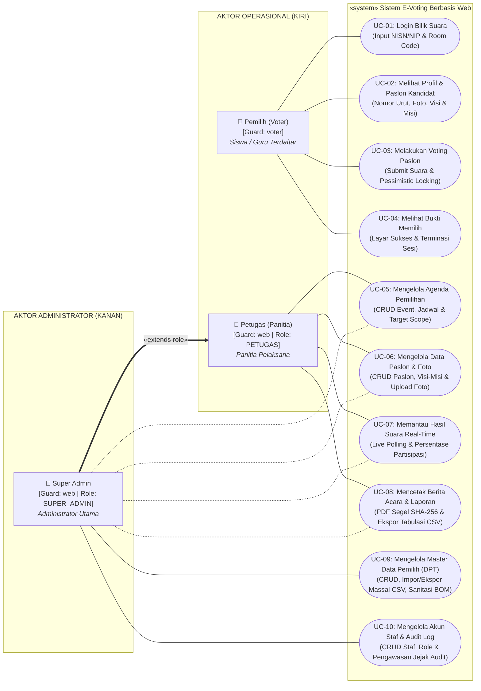

---

### 3.2.3 Tabel Spesifikasi 10 Use Case Inti Sistem

Setiap use case yang tercantum pada diagram di atas dipetakan secara terperinci ke dalam tabel spesifikasi teknis berikut, mencakup identitas use case, aktor terkait, hak akses, deskripsi operasional faktual, rute/kontroler implementasi, serta tabel basis data yang dipengaruhi:

| ID Use Case | Nama Use Case | Aktor Terkait | Hak Akses (*Guard / Role*) | Deskripsi Faktual & Operasional | Rute & Pengontrol (*Controller / Action*) | Tabel Basis Data Terkait |
| :--- | :--- | :--- | :--- | :--- | :--- | :--- |
| **UC-01** | Login Bilik Suara | Pemilih | `voter` | Mengautentikasi identitas pemilih (NISN/NIP) serta mencocokkan kode bilik pemilihan (*Room Code*) yang sedang aktif. | `POST /login`<br/>`POST /bilik/join`<br/>`VotingController::joinRoom` | `voters`, `events` |
| **UC-02** | Melihat Profil & Paslon Kandidat | Pemilih | `voter` | Menampilkan lembar suara digital berisi nomor urut, foto resmi kandidat, nama lengkap, serta visi dan misi pasangan calon. | `GET /bilik-suara/{roomCode}`<br/>`VotingController::room` | `candidates`, `events` |
| **UC-03** | Melakukan Voting Paslon | Pemilih | `voter` | Mengirimkan surat suara digital ke basis data secara atomik menggunakan penguncian baris (*pessimistic locking*) untuk mencegah pemilihan ganda. | `POST /bilik-suara/{roomCode}/vote`<br/>`App\Actions\CastVoteAction` | `votes`, `voters`, `events` |
| **UC-04** | Melihat Bukti Memilih | Pemilih | `voter` | Menampilkan halaman konfirmasi sukses pencoblosan dan secara otomatis mematikan sesi pemilih (*logout*). | `GET /bilik-suara/{roomCode}/sukses`<br/>`VotingController::success` | `voters` (`has_voted=1`) |
| **UC-05** | Mengelola Agenda Pemilihan | Petugas, Super Admin | `web` (`PETUGAS`, `SUPER_ADMIN`) | Mengelola siklus hidup agenda pemilihan (*Event*), meliputi pembuatan agenda, pengaturan jadwal mulai/selesai, penetapan target pemilih (siswa/guru), dan perubahan status (DRAFT/PUBLISHED/CLOSED). | `Resource: /events`<br/>`EventController` | `events` |
| **UC-06** | Mengelola Data Paslon & Foto | Petugas, Super Admin | `web` (`PETUGAS`, `SUPER_ADMIN`) | Menambah, mengubah, dan menghapus kandidat paslon, nomor urut, serta mengunggah berkas foto resmi ke penyimpanan sistem. | `Resource: /events/{event}/candidates`<br/>`CandidateController` | `candidates` |
| **UC-07** | Memantau Hasil Suara Real-Time | Petugas, Super Admin | `web` (`PETUGAS`, `SUPER_ADMIN`) | Memantau perolehan suara langsung (*live polling*) dan memonitor persentase tingkat partisipasi pemilih (*voter turnout*). | `GET /events/{event}/monitoring`<br/>`MonitoringController` | `votes`, `voters` |
| **UC-08** | Mencetak Berita Acara & Laporan | Petugas, Super Admin | `web` (`PETUGAS`, `SUPER_ADMIN`) | Mengunduh dokumen Berita Acara resmi format PDF ber-Segel Integritas Digital SHA-256 dan mengekspor tabulasi data suara ke berkas CSV. | `GET /events/{event}/report/pdf`<br/>`GET /events/{event}/report/csv`<br/>`ReportController` | `events`, `candidates`, `votes` |
| **UC-09** | Mengelola Master Data Pemilih (DPT) | Super Admin | `web` (`SUPER_ADMIN` eksklusif) | Mengelola data induk pemilih tetap (DPT), aktivasi/deaktivasi status hak suara, serta impor massal CSV dengan sanitasi otomatis karakter byte tak terlihat (*UTF-8 BOM*). | `Resource: /admin/voters`<br/>`POST /admin/voters/import`<br/>`App\Services\VoterImportService` | `voters` |
| **UC-10** | Mengelola Akun Staf & Audit Log | Super Admin | `web` (`SUPER_ADMIN` eksklusif) | Mengelola akun panitia/petugas internal, pembagian peran akses sistem, pengawasan jejak audit (*audit trail*), dan pembersihan log sistem (*pruning*). | `Resource: /admin/users`<br/>`GET /admin/logs`<br/>`POST /admin/logs/prune`<br/>`AuditLogController` | `users`, `audit_logs` |

---

### 3.2.4 Karakteristik Interaksi & Keamanan Sistem

Berdasarkan perancangan use case di atas, implementasi perangkat lunak menerapkan empat prinsip integritas sistem:

1. **Pencegahan Suara Ganda (*Pessimistic Locking* pada UC-03):**
   Eksekusi use case UC-03 dibungkus dalam blok `DB::transaction()` dengan instruksi `lockForUpdate()` pada entitas pemilih. Validasi memastikan bahwa kolom `has_voted` bernilai `0` sebelum pencatatan dilakukan. Begitu suara tersimpan, status langsung diperbarui menjadi `1`, sehingga pengiriman permintaan coblos berulang secara bersamaan (*concurrent race conditions*) otomatis digagalkan.
2. **Anonimitas Penuh Pemilih (*Zero-Knowledge Voter Privacy*):**
   Pada basis data, tabel `votes` mencatat id kandidat, id agenda pemilihan, dan waktu pencoblosan, namun sama sekali tidak memiliki relasi (*foreign key*) ke tabel `voters`. Hal ini menjamin bahwa kerahasiaan pilihan suara pemilih tetap terlindungi dan tidak dapat dilacak kembali oleh petugas maupun administrator.
3. **Integritas Dokumen Laporan (Segel Kriptografi SHA-256 pada UC-08):**
   Saat Berita Acara pemilihan diterbitkan pada UC-08, sistem menghitung ringkasan tanda tangan digital (*hash*) SHA-256 dari seluruh payload perolehan suara yang dibekukan. Segel ini dicetak di lembar fisik PDF untuk membuktikan bahwa dokumen hasil rekapitulasi belum mengalami manipulasi pasca-pemilihan.
4. **Sanitasi Impor Data Massal (Pembersihan UTF-8 BOM pada UC-09):**
   Pada UC-09, pengunggahan berkas CSV yang diekspor dari aplikasi spreadsheet (seperti Microsoft Excel) disaring melalui `VoterImportService` untuk memotong 3-byte metadata tak terlihat (*Byte Order Mark: EF BB BF*). Hal ini menjamin parsing baris data pertama tidak korup dan proses impor ribuan pemilih berjalan lancar tanpa galat.

---

## 3.3 Perancangan Activity Diagram Sistem

Sub-bab ini menyajikan pemodelan alur kerja sistem secara dinamis (*dynamic workflow modeling*) menggunakan *Activity Diagram* standar UML 2.5. Berbeda dengan diagram aktivitas konseptual konvensional yang bersifat satu kolom datar, perancangan aktivitas pada aplikasi *E-Voting* ini mengadopsi arsitektur *Swimlane* 3 Partisi Vertikal (*Three-Column Swimlane Partition*) yang secara tegas membagi batas wewenang dan alur eksekusi antara:
1. **Aktor / Pengguna Fisik (Kolom Kiri):** Merepresentasikan tindakan nyata yang dilakukan oleh subjek manusia, seperti menginput teks identitas, memilih kartu paslon, menekan tombol aksi pada layar, dan memberikan konfirmasi akhir pada modal dialog.
2. **Antarmuka Web / Frontend (Kolom Tengah):** Merepresentasikan perilaku peramban klien (*web browser*), meliputi proses rendering berkas Blade Template, penangkapan event DOM/Alpine.js, validasi format sisi klien, injeksi token proteksi `@csrf`, penampilan jendela modal konfirmasi, serta pengiriman permintaan HTTP asinkron (*AJAX polling*).
3. **Server & Basis Data / Backend (Kolom Kanan):** Merepresentasikan logika pemrosesan oleh kernel Laravel 11, rantai *middleware* (`auth`, `role`, `voter.auth`), *FormRequest validation*, eksekusi *Eloquent ORM*, manajemen transaksi atomik `DB::transaction()`, penguncian pesimistik baris basis data `lockForUpdate()`, komputasi kriptografis SHA-256, hingga persistensi permanen ke tabel MySQL.

Seluruh diagram aktivitas dirancang sinkron 100% dengan 10 *Use Case* inti pada Sub-bab 3.2. Seluruh berkas grafis vektor Draw.io interaktif berbasis multi-tab (*Tab 1 s.d. Tab 10*) untuk keperluan ekspor diagram ke lembar kerja penguji/asesor tersimpan pada berkas [DIAGRAM_DRAWIO_SUB_BAB_3_3.md](c:/Users/USER/evoting/design-system/DIAGRAM_DRAWIO_SUB_BAB_3_3.md).

---

### 3.3.1 Matriks Pemetaan Use Case terhadap Activity Diagram

Tabel berikut menyajikan keterhubungan formal antara fungsionalitas sistem pada Use Case Diagram dengan alur kerja dinamis pada Activity Diagram:

| ID Aktivitas | Nama Alur Kerja Aktivitas | Use Case Rujukan | Aktor Utama | Fitur Kunci & Standar Keamanan Faktual |
| :--- | :--- | :--- | :--- | :--- |
| **AD-01** | Autentikasi Pemilih Bilik Suara | **UC-01** | Pemilih | Validasi ganda *NISN/NIP* + *Room Code*, pemeriksaan hak pilih DPT, inisialisasi sesi `voter` guard. |
| **AD-02** | Eksplorasi Profil & Paslon Kandidat | **UC-02** | Pemilih | Rendering lembar suara digital, pop-up visi & misi interaktif menggunakan Alpine.js tanpa refresh layar. |
| **AD-03** | Pencoblosan Surat Suara & Transaksi Atomik | **UC-03** | Pemilih | Modal dialog konfirmasi, transaksi atomik `DB::transaction()`, penguncian baris pesimistik `lockForUpdate()`, pencegahan *race condition*, dan isolasi kotak suara *Zero-Knowledge*. |
| **AD-04** | Penerbitan Bukti Memilih & Logout Guard Voter | **UC-04** | Pemilih | Tampilan status sukses coblos, pembersihan sesi aktif (*session invalidation*), dan regenerasi token CSRF otomatis. |
| **AD-05** | Pengelolaan Agenda Pemilihan (*Event*) | **UC-05** | Petugas, Super Admin | Validasi batas waktu, generasi otomatis 6-karakter acak unik *Room Code*, siklus status DRAFT/PUBLISHED/CLOSED, dan audit logging. |
| **AD-06** | Pengelolaan Data Paslon & Upload Foto | **UC-06** | Petugas, Super Admin | Validasi gambar (MIME jpg/jpeg/png, maks 2048 KB), penyimpanan terisolasi ke *public disk*, auto-increment nomor urut, auto-switch status agenda ke SIAP saat paslon $\ge 2$. |
| **AD-07** | Pemantauan Perolehan Suara Real-Time | **UC-07** | Petugas, Super Admin | Polling periodik interval 3-5 detik via AJAX `/live-stats`, pembaruan dinamis dataset Chart.js, kalkulasi persentase partisipasi DPT (*turnout*). |
| **AD-08** | Penerbitan Berita Acara & Rekapitulasi | **UC-08** | Petugas, Super Admin | Agregasi suara terkunci, kalkulasi segel digital SHA-256 (32 karakter), *streaming output* lembar PDF resmi via DomPDF, dan ekspor tabulasi CSV. |
| **AD-09** | Pengelolaan DPT & Impor CSV Terfilter BOM | **UC-09** | Super Admin | Deteksi dan eliminasi otomatis 3-byte metadata tak terlihat *UTF-8 BOM* (`\xEF\xBB\xBF`), validasi integritas baris, dan penyisipan massal (*bulk insert*) ke tabel `voters`. |
| **AD-10** | Manajemen Akun Staf & Pengawasan Audit Log | **UC-10** | Super Admin | Hashing kredensial *Bcrypt* 12 rounds, pengaturan hak akses RBAC, perekaman seluruh mutasi sistem, dan fitur pembersihan berkala (*pruning* log). |

---

### 3.3.2 Spesifikasi Teknis 10 Activity Diagram (AD-01 s.d. AD-10)

Berikut merupakan rincian naskah perancangan teknis untuk ke-10 alur aktivitas sistem, dilengkapi dengan matriks 3 partisi dan visualisasi diagram alir:

#### 1. AD-01: Autentikasi Pemilih Bilik Suara (UC-01)
Aktivitas ini mengelola proses verifikasi identitas pemilih yang mengakses bilik suara digital. Sistem menjamin hanya pemilih yang terdaftar di DPT, memiliki hak suara (`has_voted = 0`), dan memasukkan kode ruangan agenda (*Room Code*) yang valid dan berstatus aktif (`PUBLISHED`) yang diizinkan masuk ke bilik suara.

| Partisi | Entitas / Layer | Rincian Langkah Operasional |
| :--- | :--- | :--- |
| **Aktor** | Pemilih | Membuka laman login bilik suara, memasukkan nomor identitas (NISN/NIP) dan 6 digit Room Code, lalu menekan tombol "Masuk Bilik". |
| **Frontend** | Antarmuka Web | Menerima masukan form, menyisipkan token `@csrf`, dan mengirimkan permintaan HTTP `POST /bilik/join` ke server. |
| **Backend** | Server & Basis Data | Memvalidasi input masukan; mencari record pada tabel `events` berdasarkan `room_code` dan status `PUBLISHED`; memverifikasi record pada tabel `voters` berdasarkan identifier; memeriksa kolom `has_voted == 0`. Jika tidak valid, melempar pesan kesalahan; jika valid, menerbitkan sesi guard `voter` dan mengarahkan ke lembar suara. |

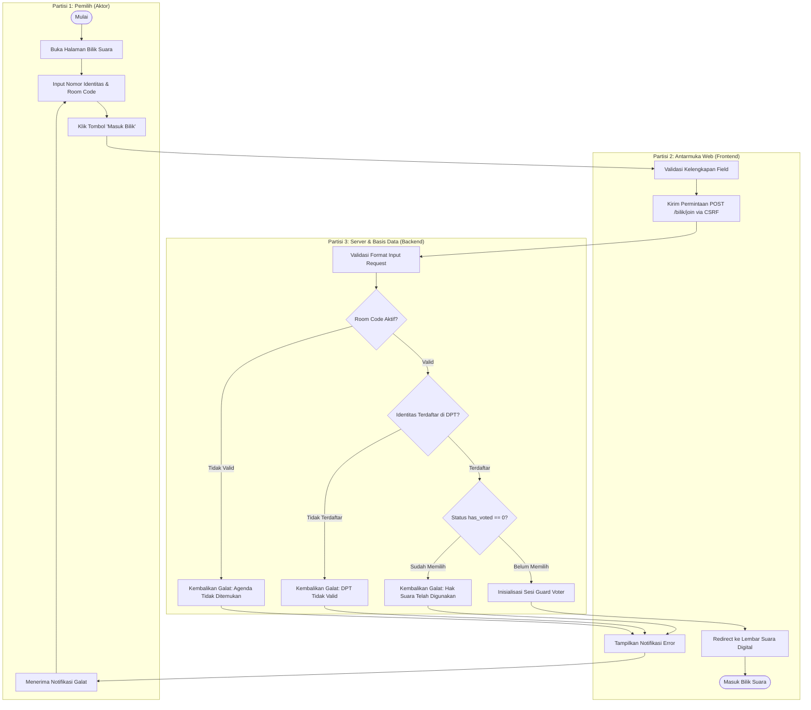

---

#### 2. AD-02: Eksplorasi Profil & Paslon Kandidat (UC-02)
Aktivitas ini menyajikan daftar pasangan calon kandidat yang berpartisipasi dalam agenda pemilihan. Sistem menampilkan foto resmi, nomor urut, serta menyediakan dialog modal interaktif tanpa refresh halaman untuk membaca visi, misi, dan program kerja kandidat.

| Partisi | Entitas / Layer | Rincian Langkah Operasional |
| :--- | :--- | :--- |
| **Aktor** | Pemilih | Berada di bilik suara, mencermati kartu kandidat, menekan tombol "Lihat Visi & Misi" pada kartu paslon tertentu, lalu menutup modal. |
| **Frontend** | Antarmuka Web | Mengirimkan permintaan HTTP `GET /bilik-suara/{roomCode}`; merender komponen kartu suara; mengeksekusi state Alpine.js (`x-data="{ showModal: true }"`) saat tombol visi-misi ditekan. |
| **Backend** | Server & Basis Data | Memeriksa validitas sesi aktif pemilih via *voter middleware*; menarik koleksi kandidat aktif dari tabel `candidates` yang diurutkan berdasarkan `order_number ASC`; menyajikan data ke view Blade. |

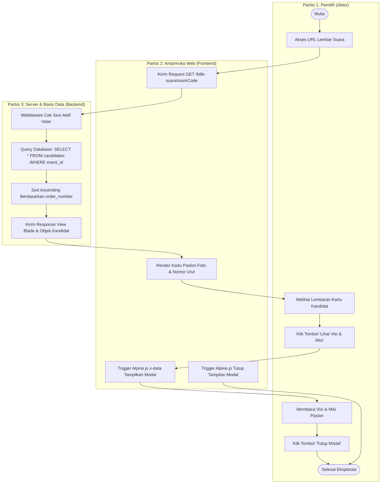

---

#### 3. AD-03: Pencoblosan Surat Suara & Transaksi Atomik (UC-03)
Aktivitas ini merupakan inti fungsionalitas pemungutan suara (*core voting transaction*). Untuk mencegah kecurangan pemilihan ganda yang dipicu oleh penekanan tombol berulang secara simultan (*concurrency race condition*), sistem membungkus eksekusi ke dalam blok transaksi atomik basis data (`DB::transaction`) disertai penguncian pesimistik pada baris pemilih (`lockForUpdate`). Pilihan kandidat disimpan ke tabel `votes` tanpa menyimpan foreign key pemilih guna mewujudkan prinsip *Zero-Knowledge Ballot*.

| Partisi | Entitas / Layer | Rincian Langkah Operasional |
| :--- | :--- | :--- |
| **Aktor** | Pemilih | Menekan tombol "Coblos" pada kartu paslon pilihan; membaca detail pada modal konfirmasi; menekan tombol "Ya, Coblos Sekarang". |
| **Frontend** | Antarmuka Web | Menampilkan dialog modal konfirmasi; menangani klik konfirmasi dengan menonaktifkan (*disable*) tombol coblos untuk mencegah double click; mengirim `POST /bilik-suara/{roomCode}/vote` dengan token `@csrf` dan `candidate_id`. |
| **Backend** | Server & Basis Data | Mengeksekusi `CastVoteAction` di dalam `DB::transaction()`; mengunci baris pemilih dengan `Voter::where('id', $voterId)->lockForUpdate()->first()`; memverifikasi `has_voted == 0`; membuat baris baru di tabel `votes` (anonim); mengupdate `has_voted = 1` dan mencatat `voted_at`; men-commit transaksi. |

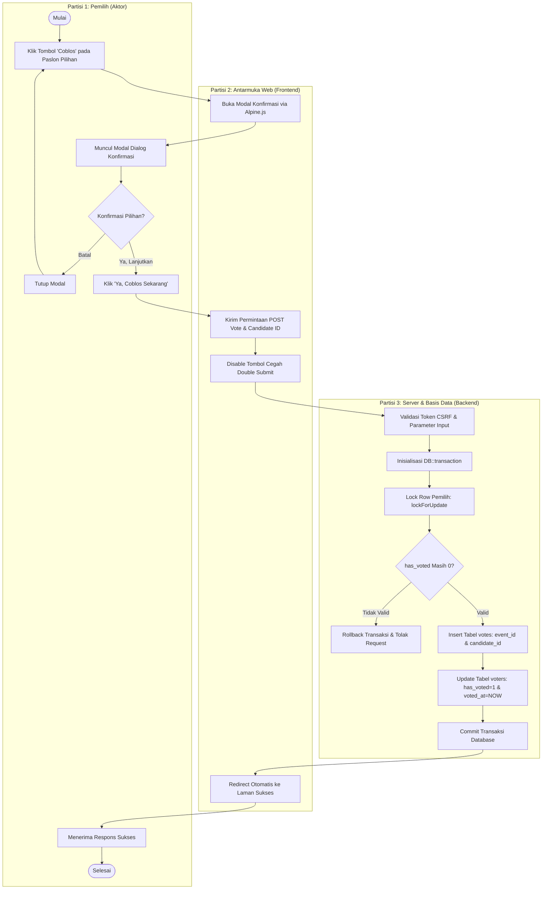

---

#### 4. AD-04: Penerbitan Bukti Memilih & Logout Guard Voter (UC-04)
Aktivitas ini memastikan bahwa setelah surat suara tersimpan secara sah, pemilih disajikan bukti visual bahwa hak pilihnya telah sukses terekam, diikuti dengan pemutusan sesi (*session logout*) secara otomatis demi mencegah penyalahgunaan akun di bilik suara publik.

| Partisi | Entitas / Layer | Rincian Langkah Operasional |
| :--- | :--- | :--- |
| **Aktor** | Pemilih | Melihat layar status "Suara Anda Berhasil Disimpan", memeriksa cap waktu pemilihan, lalu menekan tombol "Keluar Bilik Suara". |
| **Frontend** | Antarmuka Web | Mengirimkan permintaan HTTP `GET /bilik-suara/{roomCode}/sukses`; merender kartu bukti pemilihan; saat tombol keluar diklik, memicu pengiriman `POST /logout-voter`. |
| **Backend** | Server & Basis Data | Memverifikasi bahwa pemilih bersangkutan benar-benar telah memiliki status `has_voted = 1`; saat logout dipanggil, mengeksekusi `Auth::guard('voter')->logout()`, melakukan `session()->invalidate()`, dan me-regenerasi token CSRF baru. |

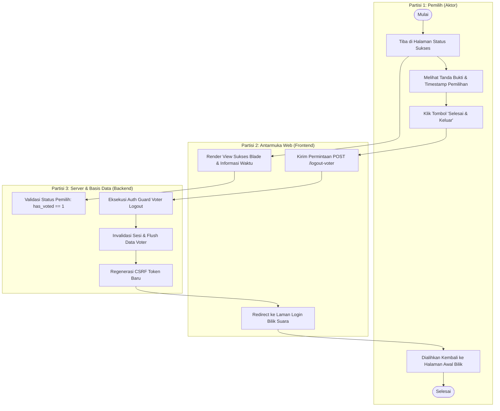

---

#### 5. AD-05: Pengelolaan Agenda Pemilihan (UC-05)
Aktivitas ini mencakup tata kelola agenda pemilihan (*events*) oleh panitia pelaksana atau super admin, mulai dari pembuatan agenda baru, pengaturan rentang waktu mulai dan selesai, pemilihan target pemilih (siswa/guru), pembuatan kode bilik (*Room Code*) acak berkarakter unik, hingga penutupan agenda.

| Partisi | Entitas / Layer | Rincian Langkah Operasional |
| :--- | :--- | :--- |
| **Aktor** | Petugas / Admin | Mengakses dashboard, membuka modul Event, mengisi formulir data agenda (judul, deskripsi, waktu pelaksanaan, tipe pemilih), lalu menekan tombol "Simpan Agenda". |
| **Frontend** | Antarmuka Web | Melakukan validasi format tanggal dan kelengkapan field form; menginjeksi token CSRF; mengirimkan permintaan HTTP `POST /events`. |
| **Backend** | Server & Basis Data | Memvalidasi hak akses petugas melalui *role middleware*; mengeksekusi *EventFormRequest*; men-generate 6 karakter alfanumerik unik untuk `room_code`; menyimpan record ke tabel `events` dengan status awal `DRAFT`; memicu `AuditLog::log()` untuk mencatat jejak mutasi agenda. |

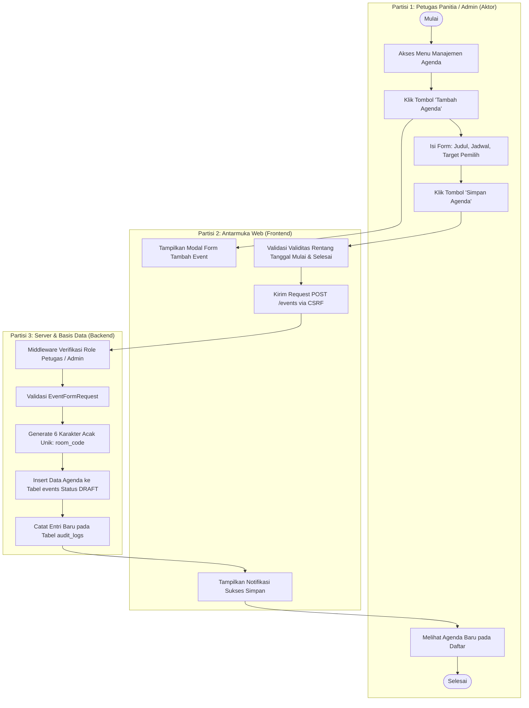

---

#### 6. AD-06: Pengelolaan Data Paslon & Upload Foto (UC-06)
Aktivitas ini mengelola data pasangan calon kandidat pada agenda yang aktif. Sistem memvalidasi kelayakan berkas gambar resmi, menyimpannya ke direktori publik yang aman, mengelola nomor urut, serta secara otomatis memperbarui status agenda menjadi `SIAP` apabila jumlah kandidat telah memenuhi ambang batas minimal ($\ge 2$ paslon).

| Partisi | Entitas / Layer | Rincian Langkah Operasional |
| :--- | :--- | :--- |
| **Aktor** | Petugas / Admin | Membuka detail agenda, memilih menu Paslon, memasukkan nama ketua & wakil, nomor urut, visi-misi, memilih berkas foto paslon, lalu menekan "Simpan Kandidat". |
| **Frontend** | Antarmuka Web | Memeriksa tipe berkas foto pada sisi browser; menyertakan enkripsi multipart form data (`enctype="multipart/form-data"`); mengirimkan HTTP `POST /events/{id}/candidates`. |
| **Backend** | Server & Basis Data | Memvalidasi file upload (format: JPG/JPEG/PNG, ukuran maksimal: 2048 KB); mengunggah berkas ke direktori `storage/app/public/candidates/`; menyimpan metadata ke tabel `candidates`; mengecek total kandidat pada agenda (jika $\ge 2$, memperbarui flag status agenda menjadi `SIAP`). |

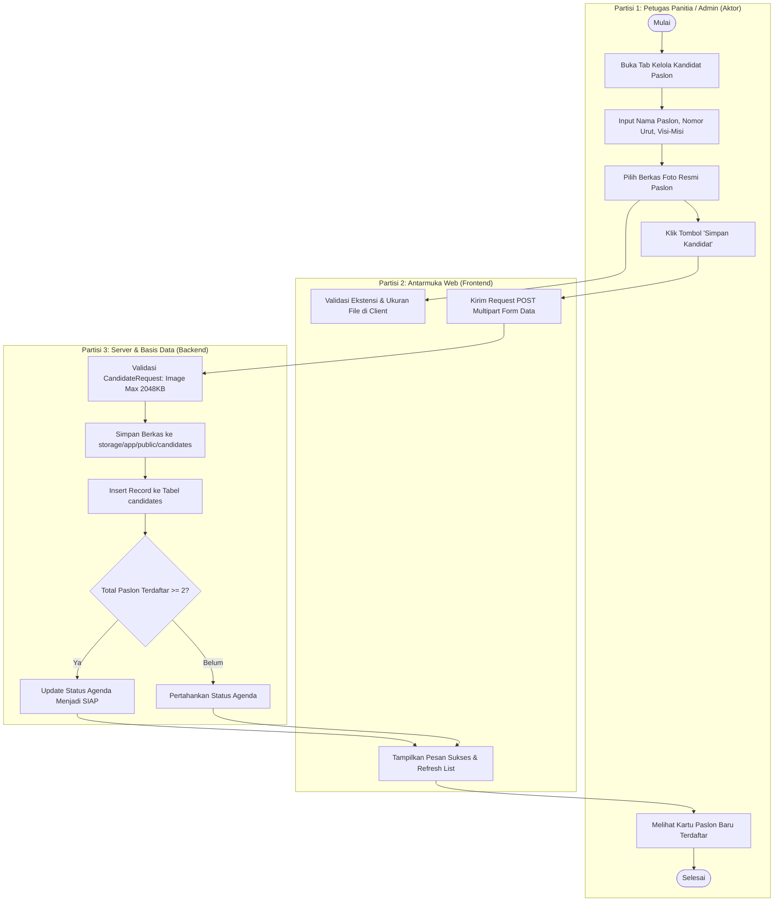

---

#### 7. AD-07: Pemantauan Perolehan Suara Real-Time (UC-07)
Aktivitas ini menyediakan fasilitas transparansi rekapitulasi suara secara *live* bagi panitia pelaksana. Sistem menggunakan mekanisme *asynchronous polling* berbasis AJAX pada interval waktu berkala (3-5 detik) untuk memperbarui grafik perolehan suara tanpa perlu memuat ulang seluruh halaman peramban (*no full-page reload*).

| Partisi | Entitas / Layer | Rincian Langkah Operasional |
| :--- | :--- | :--- |
| **Aktor** | Petugas / Admin | Mengakses halaman *Live Monitoring* agenda yang sedang berlangsung; memantau grafik perolehan suara paslon dan diagram partisipasi pemilih. |
| **Frontend** | Antarmuka Web | Menginisialisasi komponen Chart.js pada saat pemuatan awal; menjalankan *interval timer* JavaScript untuk mengirimkan AJAX `GET /events/{id}/live-stats` setiap 3-5 detik; memperbarui objek dataset grafik dan counter DOM secara mulus. |
| **Backend** | Server & Basis Data | Menerima kueri asinkron; mengeksekusi kueri agregasi `SELECT candidate_id, COUNT(*) FROM votes GROUP BY candidate_id`; menghitung jumlah pemilih yang telah mencoblos dari tabel `voters` untuk mendapatkan rasio partisipasi (*turnout percentage*); mengembalikan payload berformat JSON ringan. |

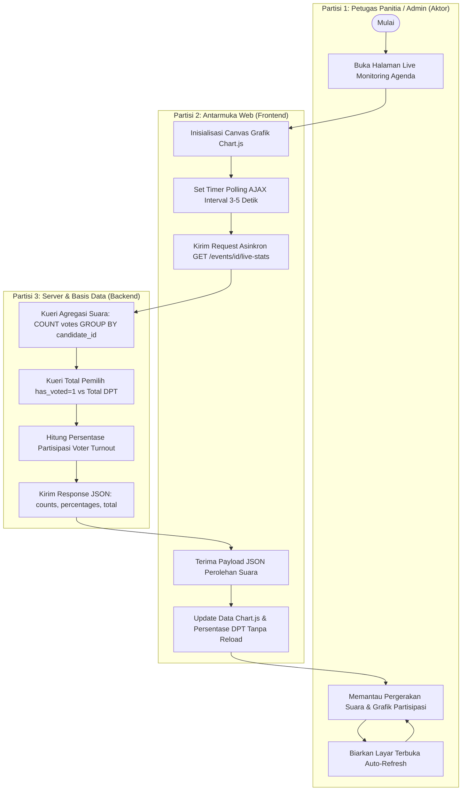

---

#### 8. AD-08: Penerbitan Berita Acara & Rekapitulasi (UC-08)
Aktivitas ini mengelola proses akhir dari pemilu digital, yaitu pembekuan hasil pemungutan suara, pembuatan dokumen resmi Berita Acara berformat PDF, pembubuhan segel integritas kriptografi SHA-256, serta penyediaan fasilitas ekspor tabulasi suara ke format CSV untuk arsip fisik panitia.

| Partisi | Entitas / Layer | Rincian Langkah Operasional |
| :--- | :--- | :--- |
| **Aktor** | Petugas / Admin | Menutup agenda pemilihan yang telah usai jadwalnya, menekan tombol "Cetak Berita Acara (PDF)" atau "Ekspor Tabulasi (CSV)". |
| **Frontend** | Antarmuka Web | Menangkap klik cetak laporan; mengirimkan permintaan HTTP `GET /events/{id}/report/pdf` atau `GET /events/{id}/report/csv`. |
| **Backend** | Server & Basis Data | Memastikan agenda telah ditutup (`CLOSED`); menarik rekapitulasi final dari tabel `votes` dan metadata panitia; mengompilasi string data suara dan menghitung nilai hash SHA-256 sebagai Segel Integritas Digital; me-render template PDF melalui pustaka DomPDF dengan stempel hash; me-stream berkas biner langsung ke browser pengguna. |

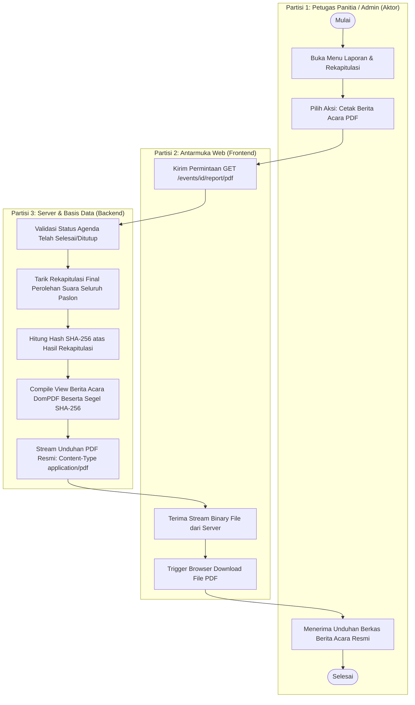

---

#### 9. AD-09: Pengelolaan DPT & Impor CSV Terfilter BOM (UC-09)
Aktivitas ini dijalankan secara eksklusif oleh Super Admin untuk mengelola Daftar Pemilih Tetap (DPT). Untuk mengatasi kendala umum impor data dari Microsoft Excel yang sering menyertakan karakter *Byte Order Mark* (BOM), modul `VoterImportService` secara otomatis mendeteksi dan memotong 3-byte metadata tak terlihat `\xEF\xBB\xBF` sebelum memproses data baris demi baris ke basis data.

| Partisi | Entitas / Layer | Rincian Langkah Operasional |
| :--- | :--- | :--- |
| **Aktor** | Super Admin | Mengakses modul Master DPT, memilih berkas spreadsheet `.csv` daftar pemilih dari komputer lokal, lalu menekan tombol "Unggah & Impor DPT". |
| **Frontend** | Antarmuka Web | Memvalidasi ekstensi file pada browser (`.csv`); menyertakan token `@csrf`; mengirimkan form data multipart ke `POST /admin/voters/import`. |
| **Backend** | Server & Basis Data | Memeriksa otorisasi *Super Admin middleware*; memanggil `VoterImportService`; membaca stream berkas; mendeteksi dan memotong 3-byte awalan *UTF-8 BOM* (`\xEF\xBB\xBF`); mem-parsing baris data; memvalidasi keunikan nomor identitas; melakukan penyisipan massal (*bulk insert*) ke tabel `voters`; mencatat hasil impor ke `audit_logs`. |

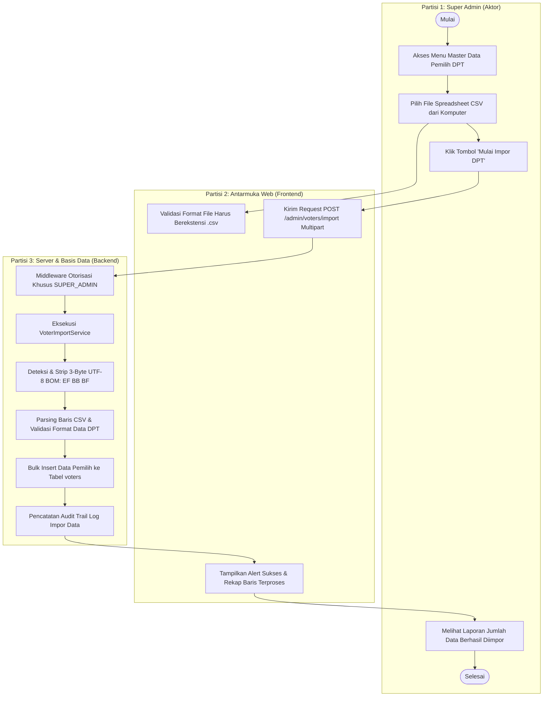

---

#### 10. AD-10: Manajemen Akun Staf & Pengawasan Audit Log (UC-10)
Aktivitas ini mengelola akun pengguna internal sistem (*users*) serta pengawasan catatan jejak audit (*audit trails*). Super Admin memiliki wewenang eksklusif untuk membuat akun panitia baru dengan proteksi kata sandi *Bcrypt*, menetapkan *role*, menginspeksi aktivitas sistem, serta mengeksekusi pembersihan log usang (*pruning*).

| Partisi | Entitas / Layer | Rincian Langkah Operasional |
| :--- | :--- | :--- |
| **Aktor** | Super Admin | Mengakses modul Pengguna / Log Audit, memasukkan data staf baru atau memilih rentang waktu pembersihan log, lalu menekan tombol konfirmasi aksi. |
| **Frontend** | Antarmuka Web | Memvalidasi kecocokan konfirmasi password; mengirimkan permintaan HTTP `POST /admin/users` atau `POST /admin/logs/prune` beserta token `@csrf`. |
| **Backend** | Server & Basis Data | Memverifikasi wewenang *Super Admin*; mengenkripsi password dengan algoritma *Bcrypt* (faktor kerja 12 rounds); menyimpan akun ke tabel `users` dengan peran (`PANITIA` / `SUPER_ADMIN`); untuk modul log, mengeksekusi penghapusan log lawas berdasarkan parameter tanggal pada tabel `audit_logs`; memicu pencatatan audit log atas tindakan admin tersebut. |

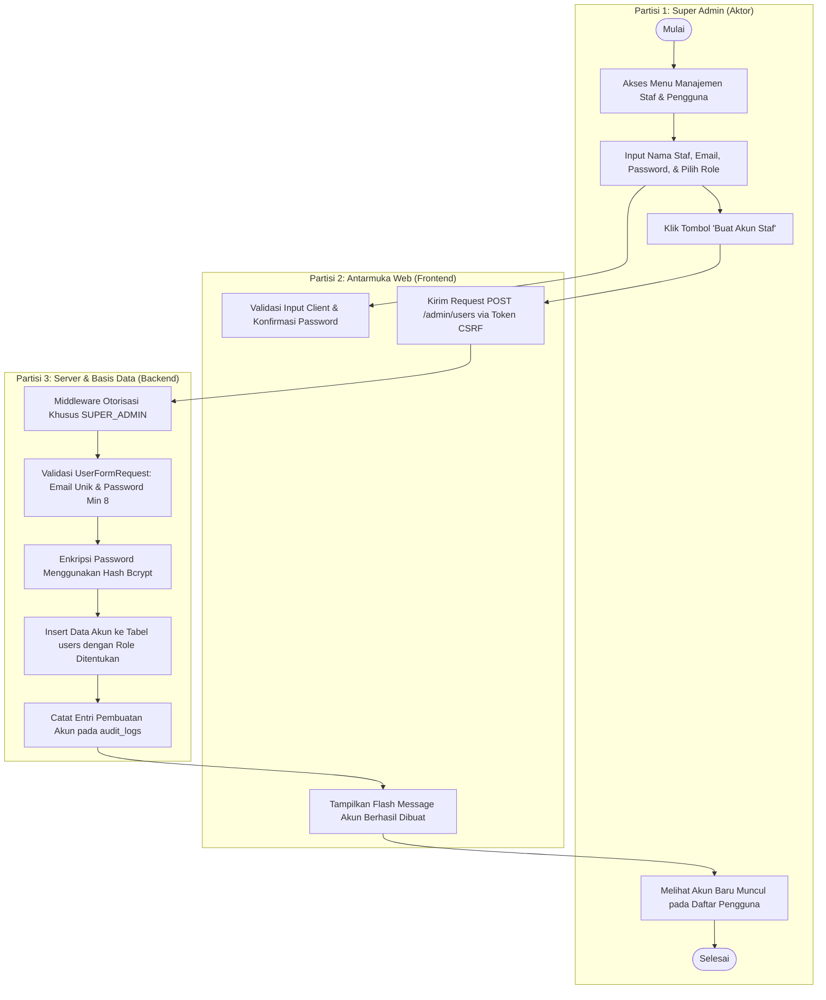

---

### 3.3.3 Kesimpulan Desain Alur Kerja & Jaminan Integritas

Melalui perancangan 10 diagram aktivitas berbasis *Swimlane* 3 Partisi Vertikal di atas, aplikasi *E-Voting* memiliki standarisasi alur kerja yang teratur dan teruji:
1. **Pemisahan Peran yang Jelas (*Separation of Duties*):** Tanggung jawab antara antarmuka klien dan server terisolasi dengan baik. Validasi tidak hanya mengandalkan sisi klien (*frontend*), melainkan ditegakkan secara mutlak oleh lapisan validasi dan middleware di sisi server (*backend*).
2. **Keandalan Transaksi Tingkat Tinggi (*High-Integrity Concurrency*):** Pada aktivitas pencoblosan (AD-03), integrasi mekanisme penguncian pesimistik (*pessimistic row locking*) menjamin konsistensi ACID, sehingga sistem bebas dari celah eksploitasi suara ganda meskipun ratusan pemilih mencoblos secara bersamaan.
3. **Akuntabilitas & Ketahanan Data (*Accountability & Robustness*):** Setiap mutasi data penting pada agenda dan akun staf senantiasa dicatat pada tabel audit log secara otomatis, sementara proses pertukaran data massal dilengkapi mekanisme mitigasi seperti pembersihan *UTF-8 BOM* pada berkas CSV untuk mencegah kegagalan pembacaan data.

---

## 3.4 Perancangan Basis Data (*Database Design*)

Perancangan basis data merupakan tahapan perancangan model konseptual, logis, dan fisik data yang menjamin keutuhan data (*data integrity*), ketiadaan anomali peremajaan data (*zero update anomalies*), serta pemenuhan standar regulasi pemilihan umum mengenai kerahasiaan pilihan suara (*Zero-Knowledge Secret Ballot Architecture*). 

Sistem aplikasi *E-Voting* mengadopsi standar **Notasi Chen Klasik (Peter Chen, 1976)** untuk pemodelan konseptual tingkat tinggi (*Entity Relationship Diagram* / ERD). Notasi ini dipilih secara baku karena memberikan representasi visual murni yang membedakan secara tegas antara **Entitas** (kata benda/objek), **Relasi Asosiasi** (kata kerja/belah ketupat), serta **Atribut** (karakteristik/elips), termasuk kemampuan menampung atribut pada relasi many-to-many (*associative relationship attributes*).

---

### 3.4.1 Entity Relationship Diagram (ERD) - Notasi Chen Klasik

#### 1. Simbologi Standar Notasi Chen yang Digunakan

Perancangan ERD pada sistem *E-Voting* mematuhi aturan baku Notasi Peter Chen sebagai berikut:
1. **Entitas (*Entity*):** Direpresentasikan dengan bentuk **Persegi Panjang Membulat (*Rounded Rectangle*)**, melambangkan tabel master atau himpunan objek independen di dalam sistem (`USER`, `VOTER`, `EVENT`, `CANDIDATE`, `VOTE`, `AUDIT_LOG`).
2. **Relasi (*Relationship*):** Direpresentasikan dengan bentuk **Belah Ketupat (*Rhombus / Diamond*)**, melambangkan interaksi atau hubungan kerja antarentitas (`Membuat`, `Menugaskan`, `Memiliki`, `Menampung`, `Berpartisipasi`).
3. **Atribut (*Attribute*):** Direpresentasikan dengan bentuk **Elips / Oval**, terhubung ke entitas yang bersangkutan.
4. **Atribut Kunci Utama (*Primary Key Attribute*):** Direpresentasikan dengan bentuk elips dengan teks yang **digarisbawahi (*underlined*)** (misal: `<u>id</u>`, `<u>identifier</u>`).
5. **Atribut Relasi (*Relationship Attribute*):** Direpresentasikan dengan elips yang terhubung langsung ke belah ketupat relasi untuk entitas relasional *Many-to-Many* (misal: atribut `has_voted` dan `voted_at` pada relasi `Berpartisipasi`).
6. **Kardinalitas (*Cardinality Ratio*):** Dicantumkan secara eksplisit pada garis penghubung relasi:
   - **$1 : M$ (*One-to-Many*):** Satu entitas berhubungan dengan banyak entitas lainnya.
   - **$M : N$ (*Many-to-Many*):** Banyak entitas berhubungan dengan banyak entitas lainnya melalui relasi ber-atribut (*associative table*).

---

#### 2. Arsitektur Krusial Kerahasiaan Suara (*Zero-Knowledge Secret Ballot Architecture*)

Salah satu keunggulan perancangan basis data pada sistem aplikasi *E-Voting* ini adalah penegakan hukum asas pemilu **LUBER-JURDIL (Langsung, Umum, Bebas, Rahasia, Jujur, dan Adil)** yang direfleksikan secara murni pada skema data fisik:

> **Pemisahan Hak Suara dan Surat Suara:**
> 1. Entitas `VOTER` (Pemilih) berelasi dengan `EVENT` melalui relasi `Berpartisipasi` (`event_participations`). Di sini dicatat apakah pemilih sudah menggunakan hak suaranya melalui flag `has_voted = TRUE` dan waktu `voted_at`.
> 2. Entitas `VOTE` (Kertas Suara Digital) **HANYA** berelasi dengan `EVENT` dan `CANDIDATE`.
> 3. **Tabel `votes` SAMA SEKALI TIDAK MEMILIKI kolom `voter_id`**.
>
> Hal ini membuktikan secara ilmiah dan audit hukum bahwa sistem **tidak dapat melacak kembali pilihan kandidat yang dicoblos oleh pemilih tertentu**, bahkan oleh Administrator Basis Data (*Database Administrator*) sekalipun. Kerahasiaan pemilih terjamin secara matematis dan struktural.

---

#### 3. Kamus Entitas, Atribut, dan Kardinalitas Relasi Faktual

Berdasarkan 8 berkas migrasi database riil pada *framework* Laravel 11 (`database/migrations/`), berikut adalah pemetaan lengkap seluruh entitas dan relasinya:

| No | Nama Entitas | Deskripsi Entitas | Kunci Utama (*PK*) | Kunci Tamu (*FK*) & Atribut Utama Lainnya |
|:---:|:---|:---|:---|:---|
| 1 | **USER** | Akun staf pengelola sistem (*Super Admin*, *Admin Event*, *Saksi/Operator*). | `<u>id</u>` | `nama`, `email` (*unique*), `password`, `role` (`SUPER_ADMIN`, `ADMIN_EVENT`, `SAKSI`), `created_at` |
| 2 | **VOTER** | Data master pemilih terdaftar (DPT Siswa / Guru). | `<u>id</u>` | `<u>identifier</u>` (*unique* NIS/NIP/Token), `nama`, `kelas`, `type` (`SISWA`, `GURU`), `is_active` |
| 3 | **EVENT** | Agenda / bilik pemilihan umum yang diselenggarakan. | `<u>id</u>` | `created_by_user_id` (FK $\rightarrow$ `users.id`), `title`, `category`, `target_scope`, `target_class`, `room_code`, `invite_token`, `status`, `start_time`, `end_time` |
| 4 | **CANDIDATE** | Profil pasangan kandidat / calon ketua dalam suatu agenda. | `<u>id</u>` | `event_id` (FK $\rightarrow$ `events.id`), `candidate_number`, `name`, `photo_url`, `vision`, `mission` |
| 5 | **VOTE** | Surat suara digital anonim hasil pencoblosan sah. | `<u>id</u>` | `event_id` (FK $\rightarrow$ `events.id`), `candidate_id` (FK $\rightarrow$ `candidates.id`), `voted_at` *(Zero-Knowledge, Tanpa voter_id)* |
| 6 | **AUDIT_LOG** | Rekam jejak aktivitas forensik dan keamanan sistem. | `<u>id</u>` | `user_type`, `user_id`, `user_name`, `action`, `ip_address`, `payload`, `created_at` |

Matriks Kardinalitas Relasi:
- **`USER` (1) --- [Membuat] --- (M) `EVENT`:** Satu User (Super Admin/Admin Event) dapat membuat banyak agenda pemilihan, setiap agenda dibuat oleh tepat satu user pembuat.
- **`USER` (M) --- [Ditugaskan] --- (N) `EVENT` (`event_officers`):** Relasi penugasan panitia. Banyak User dapat ditugaskan ke banyak Event, membawa atribut relasi `<u>id</u>` dan `created_at`.
- **`EVENT` (1) --- [Memiliki] --- (M) `CANDIDATE`:** Satu Event menaungi banyak kandidat (minimal 2 paslon), setiap kandidat terdaftar pada tepat satu event.
- **`EVENT` (1) --- [Menampung] --- (M) `VOTE`:** Satu Event menampung kumpulan akumulasi kertas suara digital yang masuk.
- **`CANDIDATE` (1) --- [Menerima] --- (M) `VOTE`:** Satu Kandidat menerima banyak coblosan suara dari para pemilih.
- **`VOTER` (M) --- [Berpartisipasi] --- (N) `EVENT` (`event_participations`):** Relasi partisipasi DPT. Pemilih terdaftar pada event, membawa atribut relasi `<u>id</u>`, `has_voted` (boolean status coblos), dan `voted_at` (waktu pencoblosan).

---

#### 4. Diagram Konseptual ERD Notasi Chen

Berikut adalah visualisasi alur konseptual *Entity Relationship Diagram* menggunakan Notasi Peter Chen:

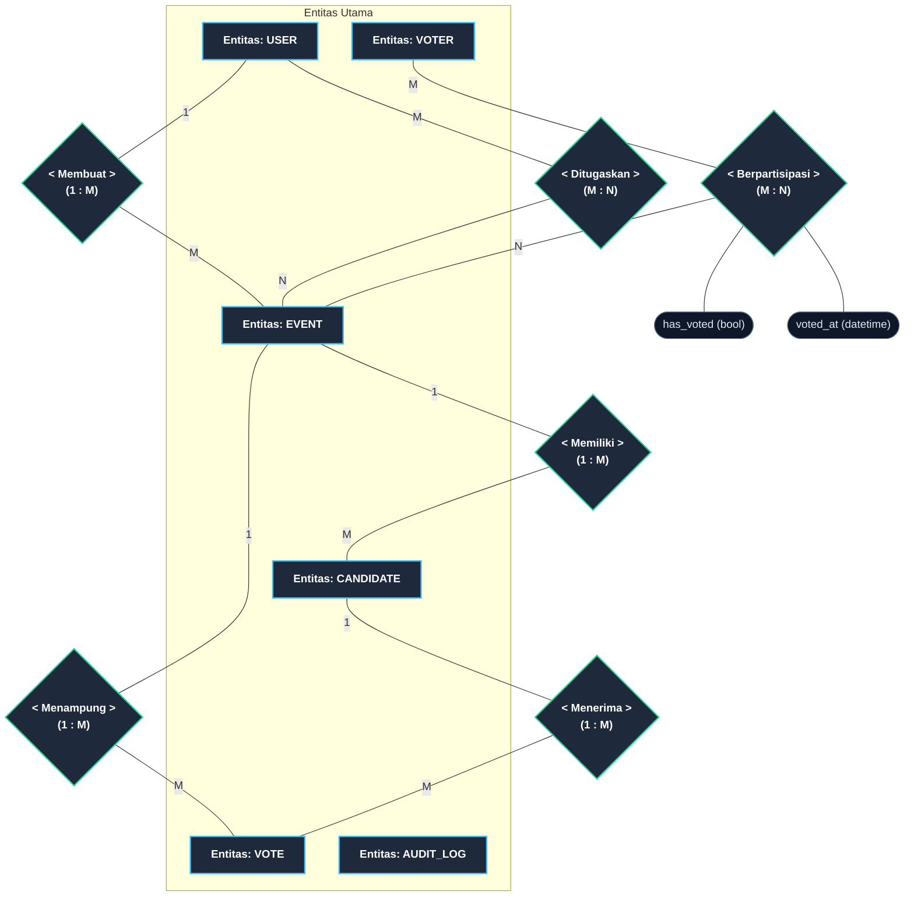

---

#### 5. Kode Berkas Draw.io XML Mandiri

Seluruh rancangan visual resmi *Entity Relationship Diagram (ERD)* Notasi Chen Klasik dalam resolusi tinggi, berstandar palet *Dark / Navy High-Contrast*, dan siap impor ke aplikasi diagrams.net / Draw.io telah didokumentasikan secara lengkap pada berkas terpisah:

- **Lokasi Berkas XML:** [DIAGRAM_DRAWIO_SUB_BAB_3_4_ERD.md](c:/Users/USER/evoting/design-system/DIAGRAM_DRAWIO_SUB_BAB_3_4_ERD.md)
- **Metode Impor:** Buka Draw.io $\rightarrow$ Menu **Arrange / Extras** $\rightarrow$ **Edit Diagram** $\rightarrow$ Tempelkan (*paste*) kode XML yang tersedia pada berkas tersebut. Diagram akan langsung terbentuk sempurna dengan penataan simetris, bebas tumpang tindih, dan memenuhi standar pengujian LSP P3 Pemrogram Junior.

---

### 3.4.2 Physical Data Model (PDM) - Notasi Crow's Foot Relasional

#### 1. Definisi dan Filosofi PDM

Jika *Entity Relationship Diagram* (ERD) pada Sub-bab 3.4.1 memodelkan domain data secara konseptual-logis menggunakan notasi Peter Chen (tanpa terikat spesifikasi mesin basis data tertentu), maka *Physical Data Model* (PDM) merupakan cetak biru perancangan fisik tingkat rendah (*low-level physical schema*) yang diimplementasikan secara konkret pada sistem manajemen basis data relasional (*Relational Database Management System* / RDBMS).

Pemodelan PDM pada sistem *E-Voting* ini mengadopsi standar **Notasi Kaki Gagak (*Crow's Foot Notation*)** dan mencerminkan 100% skema fisik riil yang dieksekusi melalui 8 berkas migrasi basis data *framework* Laravel 11 (`database/migrations/`). Seluruh tipe data primitif, panjang alokasi memori (*storage allocation*), batasan keunikan (*unique constraint*), indeks gabungan (*composite index*), hingga perilaku integritas referensial (*foreign key cascading action*) dirancang secara presisi untuk menjamin integritas data (ACID) dan keamanan pemilu digital.

| Parameter Pembeda | Entity Relationship Diagram (ERD) - 3.4.1 | Physical Data Model (PDM) - 3.4.2 |
| :--- | :--- | :--- |
| **Tingkat Abstraksi** | Tingkat Konseptual & Logis Tinggi (*High-level Conceptual*). | Tingkat Fisik & Implementasi RDBMS (*Physical / Storage Level*). |
| **Notasi Grafis** | Peter Chen Klasik (Persegi, Belah Ketupat, Elips). | Crow's Foot Relational (Tabel Fisik dengan Simbol Kaki Gagak). |
| **Spesifikasi Tipe Data** | Konseptual / Umum (`string`, `integer`, `boolean`). | Spesifik Mesin MySQL (`BIGINT UNSIGNED`, `VARCHAR(255)`, `ENUM`, `JSON`). |
| **Entitas Asosiatif ($M:N$)** | Dimodelkan sebagai relasi belah ketupat ber-atribut. | Diwujudkan menjadi tabel pivot fisik konkret (`event_officers`, `event_participations`). |
| **Integritas Referensial** | Hanya menyatakan adanya relasi semantik antarentitas. | Memetakan *Foreign Key*, aturan `ON DELETE CASCADE`, serta `RESTRICT`. |
| **Optimasi Performa** | Tidak memuat konsep indeks performa fisik. | Memuat *B-Tree Primary Key*, *Composite Unique Key*, dan *Covering Indexes*. |

---

#### 2. Spesifikasi Target RDBMS & Karakteristik Fisik

Implementasi basis data fisik sistem *E-Voting* dikonfigurasi berdasarkan spesifikasi server produksi berikut:
- **RDBMS Engine:** MySQL 8.0+ / MariaDB 10.4+ dengan *Storage Engine* **InnoDB**.
- **Karakteristik Transaksi:** Mendukung penuh prinsip **ACID** (*Atomicity, Consistency, Isolation, Durability*) dengan kemampuan *Row-Level Locking* (`SELECT ... FOR UPDATE`) untuk mencegah kondisi balapan (*race condition*) pencoblosan ganda konkuren pada bilik suara.
- **Karakter Set & Collation:** `utf8mb4` dengan collation `utf8mb4_unicode_ci` guna mendukung penyimpanan nama, kelas, visi, misi, dan payload log dalam cakupan karakter internasional secara aman tanpa risiko pemotongan string (*string truncation*).
- **Format Kunci Utama (*Primary Key*):** Seluruh tabel menggunakan `id BIGINT UNSIGNED AUTO_INCREMENT` (64-bit integer, jangkauan 0 s.d. $18.446.744.073.709.551.615$) untuk menjamin ketersediaan alokasi baris data jangka panjang serta konsistensi tipe data relasi *foreign key*.

---

#### 3. Arsitektur Kerahasiaan Suara (*Zero-Knowledge Secret Ballot Architecture*)

Perancangan PDM sistem *E-Voting* ini secara fundamental menyelesaikan permasalahan klasik dalam rekayasa perangkat lunak pemilu elektronik: **bagaimana membuktikan hak pilih seseorang telah digunakan tanpa pernah bisa mengungkap kandidat mana yang ia pilih**.

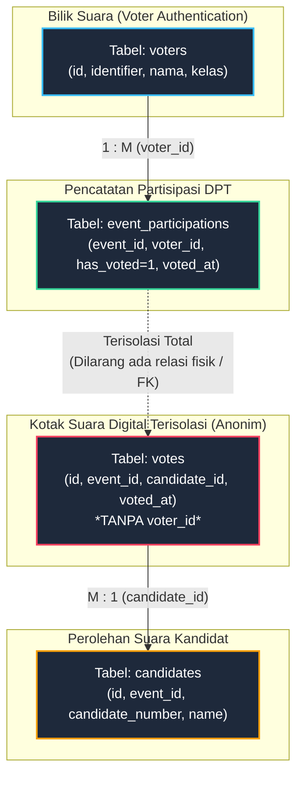

**Pembuktian Teknis Jaminan Asas LUBER:**
1. **Pemisahan Jalur Relasional (*Decoupled Relational Path*):**
   - Hak pilih diverifikasi dan dikunci melalui pembaruan kolom `has_voted = 1` serta pengisian `voted_at` pada tabel pivot `event_participations`.
   - Di sisi lain, surat suara yang dicoblos dimasukkan ke dalam tabel `votes` yang **HANYA** memiliki dua *Foreign Key*, yaitu `event_id` dan `candidate_id`.
   - **Tabel `votes` sama sekali tidak memiliki kolom `voter_id`**.
2. **Ketiadaan Jalur Pelacakan Kueri (*Impossible Relational Join*):**
   - Secara matematis dan struktural, tidak ada satupun perintah kueri SQL (`INNER JOIN`, `LEFT JOIN`, `CROSS JOIN`, maupun `SUBQUERY`) yang dapat menghubungkan suatu baris di tabel `voters` dengan baris di tabel `votes`.
   - Bahkan jika *Database Administrator* (DBA) atau penyerang memiliki hak akses `root` ke server basis data, mereka tetap tidak dapat merekonstruksi identitas pemilih di balik suatu kertas suara digital.
3. **Pemberantasan Coblos Ganda (*Double-Voting Prevention*):**
   - Integritas hak pilih dilindungi oleh *Composite Unique Constraint* pada tabel `event_participations` yaitu `UNIQUE(event_id, voter_id)`.
   - Pada saat pemilih menekan tombol "Kirim Suara", sistem mengeksekusi transaksi ACID yang mengunci baris partisipasi pemilih (`SELECT ... FOR UPDATE`). Jika `has_voted` bernilai `1`, transaksi dibatalkan (*rollback*) seketika, mencegah manipulasi *multi-tab* atau serangan injeksi konkurensi.

---

#### 4. Kamus Data Teknis 8 Tabel Fisik Basis Data

Berikut adalah rincian kamus data fisik (*physical data dictionary*) untuk seluruh 8 tabel sistem berdasarkan berkas migrasi Laravel 11:

##### 1. Tabel: `users`
Menyimpan kredensial dan hak akses pengguna internal manajemen (*Super Admin*, *Admin Event*, dan *Saksi/Operator*).

| No | Nama Kolom | Tipe Data Fisik | Nullable | Key / Constraint | Default | Deskripsi Fungsional |
| :---: | :--- | :--- | :---: | :---: | :---: | :--- |
| 1 | `id` | `BIGINT UNSIGNED` | No | **PK**, Auto Increment | - | Pengidentifikasi unik akun staf pengelola. |
| 2 | `nama` | `VARCHAR(255)` | No | - | - | Nama lengkap staf pengelola sistem. |
| 3 | `email` | `VARCHAR(255)` | No | **UK** (*Unique*) | - | Alamat surel unik untuk autentikasi login Web. |
| 4 | `email_verified_at` | `TIMESTAMP` | Yes | - | `NULL` | Waktu verifikasi email akun pengguna. |
| 5 | `password` | `VARCHAR(255)` | No | - | - | Hash sandi akun terenkripsi algoritma Bcrypt (60 char). |
| 6 | `role` | `ENUM` | No | - | `'PETUGAS'` | Hak akses peran: `'SUPER_ADMIN'`, `'ADMIN_EVENT'`, `'PETUGAS'`. |
| 7 | `remember_token` | `VARCHAR(100)` | Yes | - | `NULL` | Token persisten sesi autentikasi *Remember Me*. |
| 8 | `created_at` | `TIMESTAMP` | Yes | - | `NULL` | Waktu pembuatan baris akun pengguna. |
| 9 | `updated_at` | `TIMESTAMP` | Yes | - | `NULL` | Waktu pembaruan terakhir data akun pengguna. |

##### 2. Tabel: `voters`
Menyimpan data master pemilih (Daftar Pemilih Tetap / DPT dari unsur siswa dan guru/staf).

| No | Nama Kolom | Tipe Data Fisik | Nullable | Key / Constraint | Default | Deskripsi Fungsional |
| :---: | :--- | :--- | :---: | :---: | :---: | :--- |
| 1 | `id` | `BIGINT UNSIGNED` | No | **PK**, Auto Increment | - | Pengidentifikasi unik data pemilih. |
| 2 | `identifier` | `VARCHAR(255)` | No | **UK** (*Unique*) | - | Nomor identitas resmi unik (NISN untuk siswa / NIP untuk guru). |
| 3 | `nama` | `VARCHAR(255)` | No | - | - | Nama lengkap pemilih sesuai buku induk sekolah. |
| 4 | `kelas` | `VARCHAR(100)` | Yes | - | `NULL` | Rombongan belajar/tingkat kelas (misal: 'XII RPL 1') atau unit kerja. |
| 5 | `type` | `ENUM` | No | - | `'SISWA'` | Jenis keanggotaan pemilih: `'SISWA'` atau `'GURU'`. |
| 6 | `is_active` | `BOOLEAN` | No | - | `1` (*true*) | Status keaktifan akun pemilih untuk masuk bilik suara (0/1). |
| 7 | `remember_token` | `VARCHAR(100)` | Yes | - | `NULL` | Token sesi bilik suara pemilih. |
| 8 | `created_at` | `TIMESTAMP` | Yes | - | `NULL` | Waktu import/pendaftaran data pemilih. |
| 9 | `updated_at` | `TIMESTAMP` | Yes | - | `NULL` | Waktu pembaruan data pemilih. |

##### 3. Tabel: `events`
Menyimpan konfigurasi agenda pemilihan umum elektronik (bilik suara digital).

| No | Nama Kolom | Tipe Data Fisik | Nullable | Key / Constraint | Default | Deskripsi Fungsional |
| :---: | :--- | :--- | :---: | :---: | :---: | :--- |
| 1 | `id` | `BIGINT UNSIGNED` | No | **PK**, Auto Increment | - | Pengidentifikasi unik agenda pemilihan. |
| 2 | `created_by_user_id` | `BIGINT UNSIGNED` | No | **FK** $\rightarrow$ `users(id)` | - | Referensi ID user pengelola yang membuat event (*Cascade*). |
| 3 | `title` | `VARCHAR(255)` | No | - | - | Nama agenda resmi (misal: 'Pemilihan Ketua OSIS 2025/2026'). |
| 4 | `category` | `VARCHAR(100)` | No | - | `'KETUA_OSIS'` | Kategori pemilihan: `'KETUA_OSIS'`, `'KETUA_MPK'`, dll. |
| 5 | `target_scope` | `VARCHAR(20)` | No | - | `'ALL'` | Cakupan partisipan: `'ALL'` (Semua) atau `'CLASS'` (Spesifik). |
| 6 | `target_class` | `VARCHAR(100)` | Yes | - | `NULL` | Filter kelas tertentu jika target scope dibatasi tingkat rombel. |
| 7 | `description` | `TEXT` | Yes | - | `NULL` | Uraian petunjuk tata tertib dan deskripsi pemilihan. |
| 8 | `room_code` | `VARCHAR(255)` | No | **UK** (*Unique*) | - | Kode unik bilik suara untuk diakses pemilih di portal depan. |
| 9 | `invite_token` | `VARCHAR(64)` | Yes | **UK** (*Unique*) | `NULL` | Token acak URL tautan langsung bilik suara digital. |
| 10 | `status` | `ENUM` | No | - | `'DRAFT'` | Status agenda: `'DRAFT'`, `'ACTIVE'`, `'COMPLETED'`, `'ARCHIVED'`. |
| 11 | `start_time` | `TIMESTAMP` | Yes | - | `NULL` | Waktu pembukaan pemungutan suara resmi. |
| 12 | `end_time` | `TIMESTAMP` | Yes | - | `NULL` | Waktu penutupan pemungutan suara resmi. |
| 13 | `created_at` | `TIMESTAMP` | Yes | - | `NULL` | Waktu pembuatan agenda pemilihan. |
| 14 | `updated_at` | `TIMESTAMP` | Yes | - | `NULL` | Waktu pembaruan status/agenda pemilihan. |

##### 4. Tabel: `candidates`
Menyimpan profil pasangan kandidat / calon ketua yang berkompetisi pada suatu agenda pemilihan.

| No | Nama Kolom | Tipe Data Fisik | Nullable | Key / Constraint | Default | Deskripsi Fungsional |
| :---: | :--- | :--- | :---: | :---: | :---: | :--- |
| 1 | `id` | `BIGINT UNSIGNED` | No | **PK**, Auto Increment | - | Pengidentifikasi unik data kandidat. |
| 2 | `event_id` | `BIGINT UNSIGNED` | No | **FK** $\rightarrow$ `events(id)` | - | Referensi agenda pemilihan tempat kandidat berkontestasi (*Cascade*). |
| 3 | `candidate_number` | `INT` | No | - | - | Nomor urut resmi kandidat pada surat suara (misal: 1, 2, 3). |
| 4 | `name` | `VARCHAR(255)` | No | - | - | Nama lengkap kandidat atau nama pasangan calon. |
| 5 | `photo_url` | `VARCHAR(255)` | Yes | - | `NULL` | Jalur direktori penyimpanan berkas foto resmi kandidat. |
| 6 | `description` | `TEXT` | Yes | - | `NULL` | Profil singkat dan latar belakang calon kandidat. |
| 7 | `vision` | `TEXT` | Yes | - | `NULL` | Pernyataan visi kandidat jika terpilih. |
| 8 | `mission` | `TEXT` | Yes | - | `NULL` | Rincian butir misi dan program kerja kandidat. |
| 9 | `created_at` | `TIMESTAMP` | Yes | - | `NULL` | Waktu pendaftaran kandidat. |
| 10 | `updated_at` | `TIMESTAMP` | Yes | - | `NULL` | Waktu pembaruan data kandidat. |

##### 5. Tabel: `votes`
Menyimpan lembar suara digital anonim yang masuk ke dalam kotak suara terenkripsi.

| No | Nama Kolom | Tipe Data Fisik | Nullable | Key / Constraint | Default | Deskripsi Fungsional |
| :---: | :--- | :--- | :---: | :---: | :---: | :--- |
| 1 | `id` | `BIGINT UNSIGNED` | No | **PK**, Auto Increment | - | Pengidentifikasi unik lembar suara fisik. |
| 2 | `event_id` | `BIGINT UNSIGNED` | No | **FK** $\rightarrow$ `events(id)` | - | Referensi agenda pemilihan tempat suara dicoblos (*Cascade*). |
| 3 | `candidate_id` | `BIGINT UNSIGNED` | No | **FK** $\rightarrow$ `candidates(id)` | - | Referensi kandidat yang dipilih pemilih (*Cascade*). |
| 4 | `voted_at` | `TIMESTAMP` | No | - | - | Waktu tepat saat suara dicoblos ke kotak suara. |
| *Idx*| `(event_id, candidate_id)` | `COMPOSITE INDEX` | - | **INDEX** | - | *Covering index* percepatan kalkulasi agregasi *real-time tally*. |

##### 6. Tabel: `event_participations`
Tabel pivot resolusi relasi $M:N$ antara `voters` dan `events`, mencatat hak pilih dan status partisipasi DPT.

| No | Nama Kolom | Tipe Data Fisik | Nullable | Key / Constraint | Default | Deskripsi Fungsional |
| :---: | :--- | :--- | :---: | :---: | :---: | :--- |
| 1 | `id` | `BIGINT UNSIGNED` | No | **PK**, Auto Increment | - | Pengidentifikasi unik entri partisipasi pemilih. |
| 2 | `event_id` | `BIGINT UNSIGNED` | No | **FK** $\rightarrow$ `events(id)` | - | Referensi agenda pemilihan yang diikuti (*Cascade*). |
| 3 | `voter_id` | `BIGINT UNSIGNED` | No | **FK** $\rightarrow$ `voters(id)` | - | Referensi pemilih terdaftar (*Cascade*). |
| 4 | `has_voted` | `BOOLEAN` | No | - | `0` (*false*) | Penanda apakah pemilih telah menggunakan hak suaranya (0/1). |
| 5 | `voted_at` | `TIMESTAMP` | Yes | - | `NULL` | Waktu pemilih menyelesaikan proses pencoblosan bilik suara. |
| 6 | `created_at` | `TIMESTAMP` | Yes | - | `NULL` | Waktu pendaftaran pemilih ke dalam DPT agenda pemilihan. |
| 7 | `updated_at` | `TIMESTAMP` | Yes | - | `NULL` | Waktu pembaruan status partisipasi pemilih. |
| *UK* | `(event_id, voter_id)` | `COMPOSITE UNIQUE`| - | **UNIQUE KEY** | - | Mencegah duplikasi pendaftaran DPT yang sama pada satu event. |

##### 7. Tabel: `event_officers`
Tabel pivot resolusi relasi $M:N$ antara `users` dan `events`, mencatat penugasan panitia/petugas ke agenda pemilihan.

| No | Nama Kolom | Tipe Data Fisik | Nullable | Key / Constraint | Default | Deskripsi Fungsional |
| :---: | :--- | :--- | :---: | :---: | :---: | :--- |
| 1 | `id` | `BIGINT UNSIGNED` | No | **PK**, Auto Increment | - | Pengidentifikasi unik penugasan petugas. |
| 2 | `event_id` | `BIGINT UNSIGNED` | No | **FK** $\rightarrow$ `events(id)` | - | Referensi agenda pemilihan tempat petugas bertugas (*Cascade*). |
| 3 | `user_id` | `BIGINT UNSIGNED` | No | **FK** $\rightarrow$ `users(id)` | - | Referensi akun pengguna internal yang ditugaskan (*Cascade*). |
| 4 | `created_at` | `TIMESTAMP` | Yes | - | `NULL` | Waktu penetapan penugasan panitia. |
| 5 | `updated_at` | `TIMESTAMP` | Yes | - | `NULL` | Waktu perubahan penugasan panitia. |
| *UK* | `(event_id, user_id)` | `COMPOSITE UNIQUE` | - | **UNIQUE KEY** | - | Mencegah penugasan ganda akun yang sama pada satu event. |

##### 8. Tabel: `audit_logs`
Menyimpan riwayat jejak forensik seluruh mutasi data kritis sistem untuk keperluan audit transparansi pemilu.

| No | Nama Kolom | Tipe Data Fisik | Nullable | Key / Constraint | Default | Deskripsi Fungsional |
| :---: | :--- | :--- | :---: | :---: | :---: | :--- |
| 1 | `id` | `BIGINT UNSIGNED` | No | **PK**, Auto Increment | - | Pengidentifikasi unik baris log audit. |
| 2 | `user_type` | `VARCHAR(255)` | Yes | - | `NULL` | Jenis entitas pelaku: `'USER'`, `'VOTER'`, atau `NULL`. |
| 3 | `user_id` | `BIGINT UNSIGNED` | Yes | - | `NULL` | ID pelaku (polymorphic identifier tanpa foreign key kaku). |
| 4 | `user_name` | `VARCHAR(255)` | Yes | - | `NULL` | Nama pelaku aksi saat transaksi berlangsung (*snapshot*). |
| 5 | `user_role` | `VARCHAR(255)` | Yes | - | `NULL` | Role / peran pelaku aksi saat transaksi berlangsung. |
| 6 | `action` | `VARCHAR(255)` | No | - | - | Kode aksi sistem: `'LOGIN'`, `'CREATE_EVENT'`, `'VOTE'`, dll. |
| 7 | `description` | `TEXT` | Yes | - | `NULL` | Narasi penjelasan detail perubahan data yang terjadi. |
| 8 | `ip_address` | `VARCHAR(45)` | Yes | - | `NULL` | Alamat IP sumber permintaan (*IPv4* atau *IPv6*). |
| 9 | `user_agent` | `TEXT` | Yes | - | `NULL` | Informasi peramban web dan sistem operasi pelaku (*User-Agent*). |
| 10 | `payload` | `JSON` | Yes | - | `NULL` | Data masukan / rekaman mutasi dalam format JSON terstruktur. |
| 11 | `created_at` | `TIMESTAMP` | Yes | - | `NULL` | Waktu tepat kejadian audit tercatat di sistem (*tamper-proof*). |
| 12 | `updated_at` | `TIMESTAMP` | Yes | - | `NULL` | Waktu pembaruan teknis baris log audit. |

---

#### 5. Matriks Integritas Referensial & Aturan Cascading

Sistem *E-Voting* menerapkan aturan integritas referensial deklaratif pada level engine InnoDB untuk menjaga konsistensi data (*referential integrity*):

| Tabel Induk (*Parent*) | Kolom Induk (*PK*) | Tabel Anak (*Child*) | Kolom Kunci Tamu (*FK*) | Aturan `ON DELETE` | Aturan `ON UPDATE` | Justifikasi Rekayasa Sistem |
| :--- | :--- | :--- | :--- | :---: | :---: | :--- |
| `users` | `id` | `events` | `created_by_user_id` | `CASCADE` | `RESTRICT` | Jika akun Super Admin pembuat event dihapus, seluruh event turunannya ikut terhapus otomatis. |
| `users` | `id` | `event_officers` | `user_id` | `CASCADE` | `RESTRICT` | Jika akun petugas dihapus, riwayat penugasan kepanitiaannya di event otomatis dibersihkan. |
| `events` | `id` | `event_officers` | `event_id` | `CASCADE` | `RESTRICT` | Jika agenda pemilihan dihapus, seluruh relasi penugasan panitia di event tersebut terhapus. |
| `events` | `id` | `candidates` | `event_id` | `CASCADE` | `RESTRICT` | Menghapus event akan otomatis menghapus seluruh kandidat yang terdaftar di dalam event tersebut. |
| `events` | `id` | `event_participations` | `event_id` | `CASCADE` | `RESTRICT` | Menghapus event akan otomatis membersihkan daftar partisipasi DPT pada event bersangkutan. |
| `voters` | `id` | `event_participations` | `voter_id` | `CASCADE` | `RESTRICT` | Jika data pemilih master dihapus, keterlibatannya pada event pemilihan otomatis dibersihkan. |
| `events` | `id` | `votes` | `event_id` | `CASCADE` | `RESTRICT` | Menghapus event akan membersihkan kotak suara terkait demi mencegah *orphaned vote records*. |
| `candidates` | `id` | `votes` | `candidate_id` | `CASCADE` | `RESTRICT` | Suara terikat pada kandidat; penghapusan kandidat akan menghapus rekaman suaranya secara bersih. |
| `users` / `voters` | `id` | `audit_logs` | `user_id` *(Polymorphic)* | *No Constraint* | *No Constraint* | Kolom log audit sengaja tidak menggunakan FK keras agar jejak audit historis tetap utuh (*tamper-evident*) meskipun entitas pengguna telah terhapus. |

---

#### 6. Strategi Indexing & Optimasi Kueri Performa Tinggi

Tabel fisik pada sistem *E-Voting* dilengkapi indeks khusus untuk mengoptimalkan kueri dengan beban transaksi tinggi (*high-concurrency read/write*):
1. **Composite Unique Index pada Tabel Pivot:**
   - `event_participations(event_id, voter_id)`: Menjamin secara mutlak pada level RDBMS bahwa seorang pemilih tidak akan pernah bisa didaftarkan lebih dari satu kali pada event pemilihan yang sama.
   - `event_officers(event_id, user_id)`: Menjamin seorang petugas tidak akan mengalami duplikasi penugasan pada event pemilihan yang sama.
2. **Covering Index pada Kotak Suara (`votes`):**
   - Indeks gabungan `idx_votes_event_candidate (event_id, candidate_id)` pada tabel `votes`.
   - **Dampak Performa:** Kueri agregasi perolehan suara (`SELECT candidate_id, COUNT(*) FROM votes WHERE event_id = ? GROUP BY candidate_id`) dieksekusi murni di dalam memori B-Tree index (*Index-Only Scan*), tanpa perlu membaca data baris fisik (*table scan*). Kompleksitas kueri tereduksi menjadi $O(\log N)$, memungkinkan pembaruan hasil *quick count* secara *real-time* tanpa membebani I/O disk server.

---

#### 7. Diagram Relasional PDM Notasi Crow's Foot

Berikut adalah visualisasi hubungan antartabel fisik pada tingkat RDBMS menggunakan notasi *Crow's Foot*:

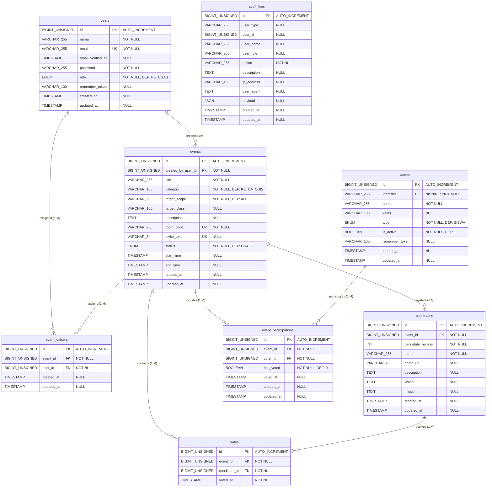

---

#### 8. Kode Berkas Draw.io XML Mandiri

Seluruh rancangan diagram teknis *Physical Data Model (PDM)* Notasi Crow's Foot dalam format tabel HTML relasional modern (lengkap dengan koordinat ortogonal rapi, palet warna gelap *Modern Navy*, indikator `[PK]`, `[FK]`, `[UK]`, `[NN]`, serta callout privasi suara) telah disediakan pada berkas terpisah:

- **Lokasi Berkas XML:** [DIAGRAM_DRAWIO_SUB_BAB_3_4_PDM.md](c:/Users/USER/evoting/design-system/DIAGRAM_DRAWIO_SUB_BAB_3_4_PDM.md)
- **Metode Impor:** Buka Draw.io $\rightarrow$ Menu **Extras** $\rightarrow$ **Edit Diagram...** $\rightarrow$ Hapus isi lama dan tempelkan (*paste*) seluruh kode XML dari berkas tersebut $\rightarrow$ Klik **OK**. Diagram akan tampil dalam tata letak 3 kolom simetris beresolusi tinggi, siap diekspor menjadi format PNG/PDF untuk lampiran resmi laporan UKOM.

