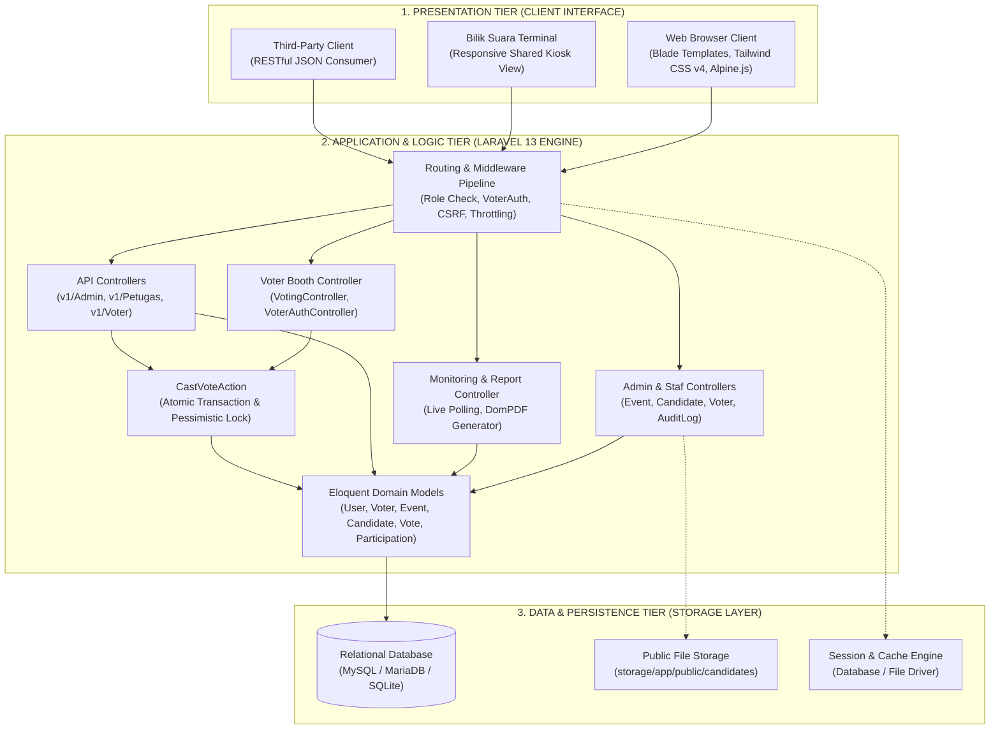
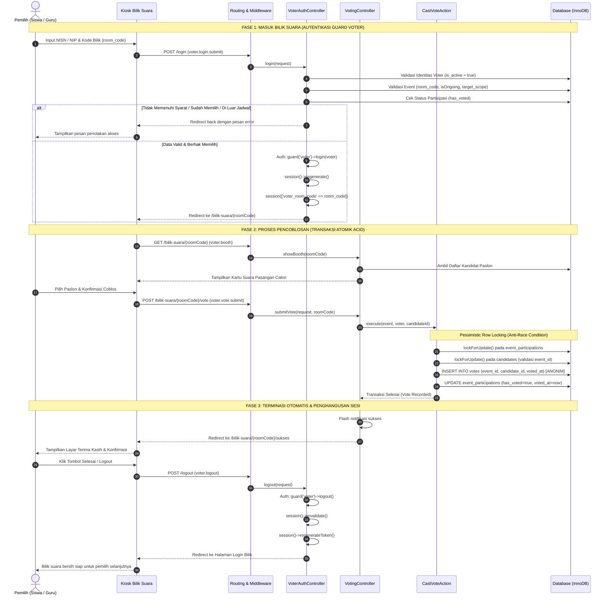
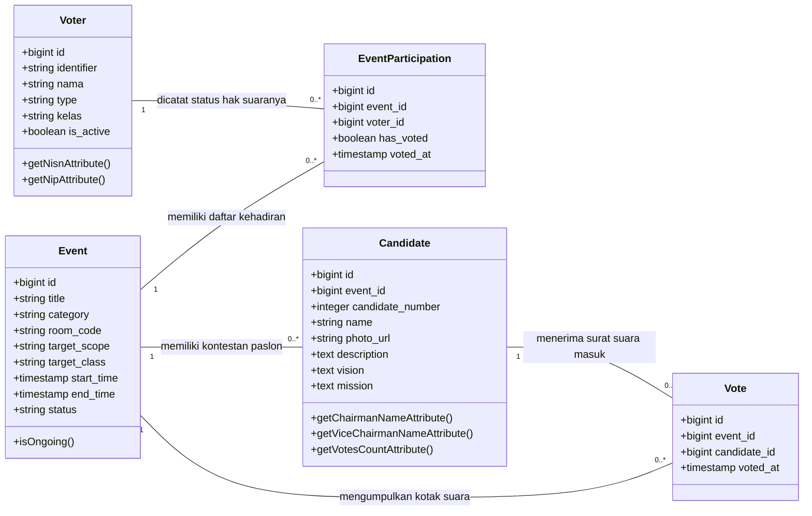

# PANDUAN DAN KODE KONVERSI DIAGRAM DRAW.IO (SUB-BAB 3.1)
## Laporan UKOM LSP P3 - Sistem E-Voting Berbasis Web

Dokumen ini memuat kode diagram siap pakai untuk **Draw.io (diagrams.net)** yang dirancang khusus untuk memvisualisasikan **Sub-bab 3.1 (Perancangan Arsitektur Sistem dan Keamanan)**.

---

### CARA MEMASUKKAN KODE KE DRAW.IO (Langkah 10 Detik)

1. Buka peramban dan akses **[https://app.diagrams.net](https://app.diagrams.net)** (atau buka aplikasi desktop Draw.io).
2. Buat dokumen baru (*Create New Diagram*) pilih **Blank Diagram**.
3. Pada menu bar atas Draw.io:
   - Klik ikon **`+`** (pada toolbar) **ATAU** klik menu **Arrange** -> **Insert** -> **Advanced** -> **Mermaid**.
4. Hapus teks bawaan pada kotak dialog yang muncul, lalu **Copy-Paste** salah satu blok kode diagram di bawah ini.
5. Klik tombol **Insert**.
6. Diagram akan langsung terbentuk menjadi komponen kotak dan panah Draw.io asli. Anda dapat mengatur tata letak, mengubah warna tema, mengganti jenis huruf (*font*), dan mengekspornya ke format **PNG (300 DPI)** atau **PDF** untuk dilampirkan ke dokumen laporan Word.

---

## DIAGRAM 1: ARSITEKTUR MULTI-TIER & POLA SISTEM (THREE-TIER ARCHITECTURE)

Diagram ini memvisualisasikan pemisahan tiga lapisan (*Presentation*, *Application*, dan *Data Persistence Tier*) serta interaksi antar-komponen Controller, Action (`CastVoteAction`), dan Model Eloquent.

### Kode Draw.io (Mermaid):


---

## DIAGRAM 2: SEQUENCE DIAGRAM OTENTIKASI MULTI-GUARD & SESI BILIK SUARA

Diagram urutan ini menggambarkan interaksi dinamis antara Pemilih, Kiosk Bilik Suara, Middleware, Controller, Action Transaksi, dan Basis Data pada tiga fase: Masuk Bilik, Pencoblosan Suara, dan Keluar Otomatis.

### Kode Draw.io (Mermaid):


---

## DIAGRAM 3: CLASS DIAGRAM KOTAK SUARA ANONIM (ZERO-KNOWLEDGE BALLOT ARCHITECTURE)

Diagram kelas ini memperlihatkan pemisahan fisik antara data kehadiran pemilih (`event_participations`) dengan kotak suara digital (`votes`), membuktikan bahwa sistem menjamin kerahasiaan pilihan pemilih (asas Rahasia) secara struktural.

### Kode Draw.io (Mermaid):


---

## DIAGRAM 4: ALUR PEMBUATAN SEGEL INTEGRITAS DIGITAL SHA-256 BERITA ACARA PDF

Diagram alir (*flowchart*) ini memvisualisasikan bagaimana kode segel integritas digital 32 karakter pada lembar Berita Acara PDF dihitung untuk mencegah pemalsuan dokumen fisik hasil pemungutan suara.

### Kode Draw.io (Mermaid):
```mermaid
flowchart TD
    Start([Mulai: Staf Mengunduh Berita Acara PDF]) --> InputData[/Ambil Data Hasil Pemilihan/]
    
    InputData --> Extract[Ekstrak Variabel Kunci: <br/>- Event ID <br/>- Total Suara Sah <br/>- ID Kandidat Terpilih <br/>- Kunci Rahasia Sistem APP_KEY]
    
    Extract --> Concat[Penggabungan String: <br/>rawVerification = EventID | TotalVotes | LeaderID | AppKey]
    
    Concat --> Hash[Kalkulasi Kriptografis: <br/>integrityHash = hash 'sha256', rawVerification]
    
    Hash --> Substr[Ekstraksi 32 Karakter Pertama & Kapitalisasi: <br/>digitalSeal = strtoupper substr integrityHash, 0, 32]
    
    Substr --> GenNo[Format Nomor Berita Acara: <br/>BA-EVT / Tahun / EventID]
    
    GenNo --> RenderPDF[Render Template DomPDF: <br/>Cetak Tabel Hasil, Nama Saksi, dan Kode Segel Integritas]
    
    RenderPDF --> OutputPDF[/File Berita Acara Resmi PDF Siap Diunduh & Dicetak/]
    OutputPDF --> End([Selesai])
```

---

### PANDUAN PEMBERIAN GAYA (STYLING) DI DRAW.IO UNTUK LAPORAN UKOM

Agar diagram terlihat rapi dan elegan saat diuji oleh Asesor LSP:
1. **Warna Kotak (Color Palette):**
   - **Presentation Layer / UI:** Gunakan warna biru muda (*Soft Blue*: `#dae8fc`, border `#6c8ebf`).
   - **Application Logic / Controller / Action:** Gunakan warna slate/abu-abu netral (*Light Gray/Slate*: `#f5f5f5`, border `#666666`).
   - **Data / Database Tier:** Gunakan warna hijau lembut (*Soft Green*: `#d5e8d4`, border `#82b366`).
   - **Blok Kritis / Keamanan (Zero-Knowledge & Lock):** Gunakan aksen oranye atau kuning lembut (*Warm Yellow*: `#fff2cc`, border `#d6b656`).
2. **Font & Tipografi:**
   - Gunakan jenis huruf sans-serif formal seperti **Arial**, **Helvetica**, atau **Inter**.
   - Ukuran judul kontainer: 12-14 pt (Tebal / *Bold*).
   - Ukuran teks komponen: 10-11 pt.
3. **Ekspor Gambar:**
   - Pilih menu **File** -> **Export as** -> **PNG**.
   - Centang **Transparent Background** (opsional) atau biarkan putih.
   - Atur **DPI** ke **300** agar saat disisipkan ke naskah skripsi/laporan Word hasilnya tajam dan tidak pecah saat dicetak.
