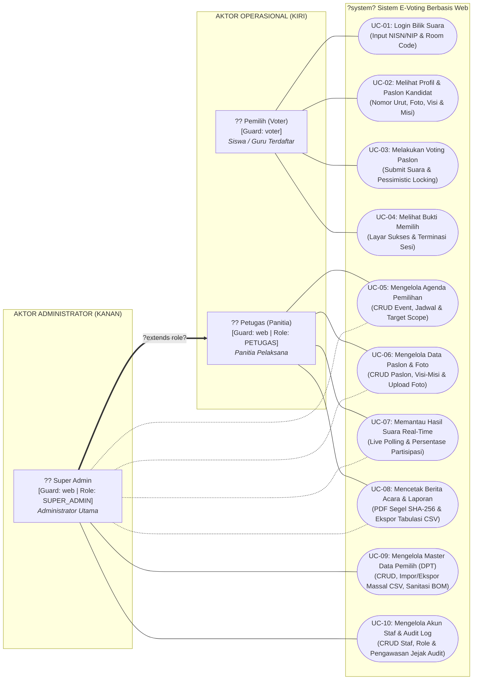

# DIAGRAM DRAW.IO INTI TUNGGAL (SUB-BAB 3.2)
## Laporan UKOM LSP P3 - Pemodelan UML Use Case Diagram Sistem E-Voting

Dokumen ini memuat perancangan **1 Diagram Inti Tunggal (*Single Core Use Case Diagram*)** untuk **Sub-bab 3.2 (Pemodelan UML Sistem)** aplikasi E-Voting berbasis Laravel 11 dan MySQL. 

Perancangan ini mengadopsi arsitektur tata letak visual terpusat (*Centralized System Boundary*) sesuai standar acuan rekayasa perangkat lunak:
- **1 Batas Sistem di Tengah (*System Boundary*):** `?system? Sistem E-Voting Berbasis Web`.
- **Aktor Sisi Kiri:** `Pemilih (Voter)` pada kuadran atas dan `Petugas (Panitia Pemilihan)` pada kuadran bawah.
- **Aktor Sisi Kanan:** `Super Admin (Administrator Utama)` pada kuadran kanan tengah.
- **Kolom Tengah Vertikal:** 10 Use Case inti tersusun rapi dari atas ke bawah tanpa adanya garis yang saling memotong (*zero line crossing*).

---

### CARA IMPOR KODE KE DRAW.IO (DIAGRAMS.NET)

Anda dapat memasukkan diagram ini ke Draw.io menggunakan salah satu dari dua metode di bawah ini:

#### Metode A: Impor Native XML Draw.io (Sangat Direkomendasikan - Hasil 100% Presisi)
1. Buka peramban dan akses **[https://app.diagrams.net](https://app.diagrams.net)** (atau jalankan aplikasi desktop Draw.io).
2. Buat dokumen baru (*Create New Diagram*) lalu pilih **Blank Diagram**.
3. Pada bilah menu atas Draw.io, klik menu **Extras** -> **Edit Diagram...**
4. Hapus seluruh teks XML bawaan yang ada di dalam kotak dialog tersebut.
5. Salin (*copy*) seluruh teks kode pada blok **KODE NATIVE DRAW.IO XML** di bawah, lalu tempel (*paste*) ke dalam kotak dialog tersebut.
6. Klik tombol **OK**.
7. Diagram langsung tersusun sempurna dengan tata letak geometris, warna aksen, ikon aktor, dan rute garis konektor yang rapi tanpa perlu ditata ulang secara manual.
8. Ekspor diagram ke format gambar: Klik **File** -> **Export as** -> **PNG** (pilih *DPI: 300* agar gambar tajam saat dicetak pada dokumen Word laporan).

#### Metode B: Impor melalui Advanced Mermaid
1. Pada Draw.io, klik menu **Arrange** -> **Insert** -> **Advanced** -> **Mermaid**.
2. Salin dan tempel kode pada blok **KODE MERMAID (LIVE PREVIEW)** di bawah.
3. Klik tombol **Insert**.

---

### KODE NATIVE DRAW.IO XML (SIAP IMPOR VIA EXTRAS -> EDIT DIAGRAM)

Salin seluruh blok XML di bawah ini:

```xml
<mxfile host="app.diagrams.net" modified="2025-02-17T00:00:00.000Z" agent="Mozilla/5.0" version="24.0.0" type="device">
  <diagram id="evoting-core-usecase" name="Diagram Inti Use Case Sistem E-Voting">
    <mxGraphModel dx="1200" dy="800" grid="1" gridSize="10" guides="1" tooltips="1" connect="1" arrows="1" fold="1" page="1" pageScale="1" pageWidth="1169" pageHeight="827" background="#FFFFFF" math="0" shadow="0">
      <root>
        <mxCell id="0" />
        <mxCell id="1" parent="0" />

        <!-- 1. SYSTEM BOUNDARY (SISTEM E-VOTING) -->
        <mxCell id="sys_boundary" value="&lt;b style=&quot;font-size: 15px;&quot;&gt;&amp;laquo;system&amp;raquo; Sistem E-Voting Berbasis Web&lt;/b&gt;" style="shape=rect;rounded=1;arcSize=4;whiteSpace=wrap;html=1;verticalAlign=top;align=left;spacingTop=12;spacingLeft=16;strokeColor=#475569;strokeWidth=2.5;dashed=1;dashPattern=6 4;fillColor=#F8FAFC;" vertex="1" parent="1">
          <mxGeometry x="340" y="40" width="480" height="730" as="geometry" />
        </mxCell>

        <!-- 2. ACTORS -->
        <!-- Aktor Sisi Kiri Atas: Pemilih -->
        <mxCell id="actor_pemilih" value="&lt;b style=&quot;font-size: 13px;&quot;&gt;Pemilih&lt;/b&gt;&lt;br&gt;&lt;i style=&quot;font-size: 11px; color: #4B5563;&quot;&gt;(Siswa / Guru)&lt;/i&gt;&lt;br&gt;&lt;span style=&quot;font-size: 10px; color: #1E40AF;&quot;&gt;[Guard: voter]&lt;/span&gt;" style="shape=umlActor;verticalLabelPosition=bottom;verticalAlign=top;html=1;outlineConnect=0;strokeColor=#1E3A8A;strokeWidth=2;fillColor=#DBEAFE;" vertex="1" parent="1">
          <mxGeometry x="120" y="135" width="60" height="110" as="geometry" />
        </mxCell>

        <!-- Aktor Sisi Kiri Bawah: Petugas -->
        <mxCell id="actor_petugas" value="&lt;b style=&quot;font-size: 13px;&quot;&gt;Petugas&lt;/b&gt;&lt;br&gt;&lt;i style=&quot;font-size: 11px; color: #4B5563;&quot;&gt;(Panitia Pemilihan)&lt;/i&gt;&lt;br&gt;&lt;span style=&quot;font-size: 10px; color: #065F46;&quot;&gt;[Role: PETUGAS]&lt;/span&gt;" style="shape=umlActor;verticalLabelPosition=bottom;verticalAlign=top;html=1;outlineConnect=0;strokeColor=#065F46;strokeWidth=2;fillColor=#D1FAE5;" vertex="1" parent="1">
          <mxGeometry x="120" y="460" width="60" height="110" as="geometry" />
        </mxCell>

        <!-- Aktor Sisi Kanan: Super Admin -->
        <mxCell id="actor_admin" value="&lt;b style=&quot;font-size: 13px;&quot;&gt;Super Admin&lt;/b&gt;&lt;br&gt;&lt;i style=&quot;font-size: 11px; color: #4B5563;&quot;&gt;(Administrator Utama)&lt;/i&gt;&lt;br&gt;&lt;span style=&quot;font-size: 10px; color: #6B21A8;&quot;&gt;[Role: SUPER_ADMIN]&lt;/span&gt;" style="shape=umlActor;verticalLabelPosition=bottom;verticalAlign=top;html=1;outlineConnect=0;strokeColor=#5B21B6;strokeWidth=2;fillColor=#EDE9FE;" vertex="1" parent="1">
          <mxGeometry x="980" y="490" width="60" height="110" as="geometry" />
        </mxCell>

        <!-- 3. USE CASES (KOLOM TENGAH VERTICAL) -->
        <!-- Sektor Bilik Suara (UC-01 s.d. UC-04) -->
        <mxCell id="uc_01" value="&lt;b&gt;Login Bilik Suara&lt;/b&gt;&lt;br&gt;&lt;span style=&quot;font-size: 10px; color: #1E3A8A;&quot;&gt;(Input NISN/NIP &amp;amp; Room Code)&lt;/span&gt;" style="ellipse;whiteSpace=wrap;html=1;strokeColor=#2563EB;strokeWidth=1.8;fillColor=#EFF6FF;fontSize=12;fontFamily=Helvetica;" vertex="1" parent="1">
          <mxGeometry x="420" y="90" width="320" height="46" as="geometry" />
        </mxCell>

        <mxCell id="uc_02" value="&lt;b&gt;Melihat Profil &amp;amp; Paslon Kandidat&lt;/b&gt;&lt;br&gt;&lt;span style=&quot;font-size: 10px; color: #1E3A8A;&quot;&gt;(Daftar Nomor, Foto, Visi-Misi)&lt;/span&gt;" style="ellipse;whiteSpace=wrap;html=1;strokeColor=#2563EB;strokeWidth=1.8;fillColor=#EFF6FF;fontSize=12;fontFamily=Helvetica;" vertex="1" parent="1">
          <mxGeometry x="420" y="154" width="320" height="46" as="geometry" />
        </mxCell>

        <mxCell id="uc_03" value="&lt;b&gt;Melakukan Voting Paslon&lt;/b&gt;&lt;br&gt;&lt;span style=&quot;font-size: 10px; color: #B91C1C;&quot;&gt;(Submit Suara &amp;amp; Pessimistic Locking)&lt;/span&gt;" style="ellipse;whiteSpace=wrap;html=1;strokeColor=#DC2626;strokeWidth=2;fillColor=#FEF2F2;fontSize=12;fontFamily=Helvetica;" vertex="1" parent="1">
          <mxGeometry x="420" y="218" width="320" height="46" as="geometry" />
        </mxCell>

        <mxCell id="uc_04" value="&lt;b&gt;Melihat Bukti Memilih&lt;/b&gt;&lt;br&gt;&lt;span style=&quot;font-size: 10px; color: #1E3A8A;&quot;&gt;(Layar Sukses &amp;amp; Terminasi Sesi)&lt;/span&gt;" style="ellipse;whiteSpace=wrap;html=1;strokeColor=#2563EB;strokeWidth=1.8;fillColor=#EFF6FF;fontSize=12;fontFamily=Helvetica;" vertex="1" parent="1">
          <mxGeometry x="420" y="282" width="320" height="46" as="geometry" />
        </mxCell>

        <!-- Sektor Operasional Kepanitiaan (UC-05 s.d. UC-08) -->
        <mxCell id="uc_05" value="&lt;b&gt;Mengelola Agenda Pemilihan&lt;/b&gt;&lt;br&gt;&lt;span style=&quot;font-size: 10px; color: #065F46;&quot;&gt;(CRUD Event, Jadwal &amp;amp; Target Scope)&lt;/span&gt;" style="ellipse;whiteSpace=wrap;html=1;strokeColor=#059669;strokeWidth=1.8;fillColor=#ECFDF5;fontSize=12;fontFamily=Helvetica;" vertex="1" parent="1">
          <mxGeometry x="420" y="356" width="320" height="46" as="geometry" />
        </mxCell>

        <mxCell id="uc_06" value="&lt;b&gt;Mengelola Data Paslon &amp;amp; Foto&lt;/b&gt;&lt;br&gt;&lt;span style=&quot;font-size: 10px; color: #065F46;&quot;&gt;(CRUD Kandidat, Visi-Misi &amp;amp; Upload)&lt;/span&gt;" style="ellipse;whiteSpace=wrap;html=1;strokeColor=#059669;strokeWidth=1.8;fillColor=#ECFDF5;fontSize=12;fontFamily=Helvetica;" vertex="1" parent="1">
          <mxGeometry x="420" y="420" width="320" height="46" as="geometry" />
        </mxCell>

        <mxCell id="uc_07" value="&lt;b&gt;Memantau Hasil Suara Real-Time&lt;/b&gt;&lt;br&gt;&lt;span style=&quot;font-size: 10px; color: #065F46;&quot;&gt;(Live Polling &amp;amp; Partisipasi Pemilih)&lt;/span&gt;" style="ellipse;whiteSpace=wrap;html=1;strokeColor=#059669;strokeWidth=1.8;fillColor=#ECFDF5;fontSize=12;fontFamily=Helvetica;" vertex="1" parent="1">
          <mxGeometry x="420" y="484" width="320" height="46" as="geometry" />
        </mxCell>

        <mxCell id="uc_08" value="&lt;b&gt;Mencetak Berita Acara &amp;amp; Laporan&lt;/b&gt;&lt;br&gt;&lt;span style=&quot;font-size: 10px; color: #065F46;&quot;&gt;(PDF Segel SHA-256 &amp;amp; Ekspor CSV)&lt;/span&gt;" style="ellipse;whiteSpace=wrap;html=1;strokeColor=#059669;strokeWidth=1.8;fillColor=#ECFDF5;fontSize=12;fontFamily=Helvetica;" vertex="1" parent="1">
          <mxGeometry x="420" y="548" width="320" height="46" as="geometry" />
        </mxCell>

        <!-- Sektor Tata Kelola Master & Audit (UC-09 s.d. UC-10) -->
        <mxCell id="uc_09" value="&lt;b&gt;Mengelola Master Data Pemilih (DPT)&lt;/b&gt;&lt;br&gt;&lt;span style=&quot;font-size: 10px; color: #5B21B6;&quot;&gt;(CRUD, Impor/Ekspor CSV &amp;amp; Sanitasi BOM)&lt;/span&gt;" style="ellipse;whiteSpace=wrap;html=1;strokeColor=#7C3AED;strokeWidth=2;fillColor=#F5F3FF;fontSize=12;fontFamily=Helvetica;" vertex="1" parent="1">
          <mxGeometry x="420" y="622" width="320" height="46" as="geometry" />
        </mxCell>

        <mxCell id="uc_10" value="&lt;b&gt;Mengelola Akun Staf &amp;amp; Audit Log&lt;/b&gt;&lt;br&gt;&lt;span style=&quot;font-size: 10px; color: #5B21B6;&quot;&gt;(CRUD Staf, Role &amp;amp; Audit Trail Log)&lt;/span&gt;" style="ellipse;whiteSpace=wrap;html=1;strokeColor=#7C3AED;strokeWidth=2;fillColor=#F5F3FF;fontSize=12;fontFamily=Helvetica;" vertex="1" parent="1">
          <mxGeometry x="420" y="686" width="320" height="46" as="geometry" />
        </mxCell>

        <!-- 4. EDGES & ASSOCIATIONS -->
        <!-- Asosiasi Pemilih ke UC-01 s.d. UC-04 -->
        <mxCell id="edge_pemilih_01" style="edgeStyle=orthogonalEdgeStyle;rounded=1;orthogonalLoop=1;jettySize=auto;html=1;entryX=0;entryY=0.5;strokeColor=#2563EB;strokeWidth=1.8;endArrow=none;" edge="1" parent="1" source="actor_pemilih" target="uc_01">
          <mxGeometry relative="1" as="geometry" />
        </mxCell>

        <mxCell id="edge_pemilih_02" style="edgeStyle=orthogonalEdgeStyle;rounded=1;orthogonalLoop=1;jettySize=auto;html=1;entryX=0;entryY=0.5;strokeColor=#2563EB;strokeWidth=1.8;endArrow=none;" edge="1" parent="1" source="actor_pemilih" target="uc_02">
          <mxGeometry relative="1" as="geometry" />
        </mxCell>

        <mxCell id="edge_pemilih_03" style="edgeStyle=orthogonalEdgeStyle;rounded=1;orthogonalLoop=1;jettySize=auto;html=1;entryX=0;entryY=0.5;strokeColor=#DC2626;strokeWidth=2;endArrow=none;" edge="1" parent="1" source="actor_pemilih" target="uc_03">
          <mxGeometry relative="1" as="geometry" />
        </mxCell>

        <mxCell id="edge_pemilih_04" style="edgeStyle=orthogonalEdgeStyle;rounded=1;orthogonalLoop=1;jettySize=auto;html=1;entryX=0;entryY=0.5;strokeColor=#2563EB;strokeWidth=1.8;endArrow=none;" edge="1" parent="1" source="actor_pemilih" target="uc_04">
          <mxGeometry relative="1" as="geometry" />
        </mxCell>

        <!-- Asosiasi Petugas ke UC-05 s.d. UC-08 -->
        <mxCell id="edge_petugas_05" style="edgeStyle=orthogonalEdgeStyle;rounded=1;orthogonalLoop=1;jettySize=auto;html=1;entryX=0;entryY=0.5;strokeColor=#059669;strokeWidth=1.8;endArrow=none;" edge="1" parent="1" source="actor_petugas" target="uc_05">
          <mxGeometry relative="1" as="geometry" />
        </mxCell>

        <mxCell id="edge_petugas_06" style="edgeStyle=orthogonalEdgeStyle;rounded=1;orthogonalLoop=1;jettySize=auto;html=1;entryX=0;entryY=0.5;strokeColor=#059669;strokeWidth=1.8;endArrow=none;" edge="1" parent="1" source="actor_petugas" target="uc_06">
          <mxGeometry relative="1" as="geometry" />
        </mxCell>

        <mxCell id="edge_petugas_07" style="edgeStyle=orthogonalEdgeStyle;rounded=1;orthogonalLoop=1;jettySize=auto;html=1;entryX=0;entryY=0.5;strokeColor=#059669;strokeWidth=1.8;endArrow=none;" edge="1" parent="1" source="actor_petugas" target="uc_07">
          <mxGeometry relative="1" as="geometry" />
        </mxCell>

        <mxCell id="edge_petugas_08" style="edgeStyle=orthogonalEdgeStyle;rounded=1;orthogonalLoop=1;jettySize=auto;html=1;entryX=0;entryY=0.5;strokeColor=#059669;strokeWidth=1.8;endArrow=none;" edge="1" parent="1" source="actor_petugas" target="uc_08">
          <mxGeometry relative="1" as="geometry" />
        </mxCell>

        <!-- Asosiasi Super Admin (Warisan Hak Akses ke UC-05 s.d. UC-08) -->
        <mxCell id="edge_admin_05" style="edgeStyle=orthogonalEdgeStyle;rounded=1;orthogonalLoop=1;jettySize=auto;html=1;entryX=1;entryY=0.5;strokeColor=#A855F7;strokeWidth=1.4;dashed=1;dashPattern=4 3;endArrow=none;" edge="1" parent="1" source="actor_admin" target="uc_05">
          <mxGeometry relative="1" as="geometry" />
        </mxCell>

        <mxCell id="edge_admin_06" style="edgeStyle=orthogonalEdgeStyle;rounded=1;orthogonalLoop=1;jettySize=auto;html=1;entryX=1;entryY=0.5;strokeColor=#A855F7;strokeWidth=1.4;dashed=1;dashPattern=4 3;endArrow=none;" edge="1" parent="1" source="actor_admin" target="uc_06">
          <mxGeometry relative="1" as="geometry" />
        </mxCell>

        <mxCell id="edge_admin_07" style="edgeStyle=orthogonalEdgeStyle;rounded=1;orthogonalLoop=1;jettySize=auto;html=1;entryX=1;entryY=0.5;strokeColor=#A855F7;strokeWidth=1.4;dashed=1;dashPattern=4 3;endArrow=none;" edge="1" parent="1" source="actor_admin" target="uc_07">
          <mxGeometry relative="1" as="geometry" />
        </mxCell>

        <mxCell id="edge_admin_08" style="edgeStyle=orthogonalEdgeStyle;rounded=1;orthogonalLoop=1;jettySize=auto;html=1;entryX=1;entryY=0.5;strokeColor=#A855F7;strokeWidth=1.4;dashed=1;dashPattern=4 3;endArrow=none;" edge="1" parent="1" source="actor_admin" target="uc_08">
          <mxGeometry relative="1" as="geometry" />
        </mxCell>

        <!-- Asosiasi Eksklusif Super Admin ke UC-09 & UC-10 -->
        <mxCell id="edge_admin_09" style="edgeStyle=orthogonalEdgeStyle;rounded=1;orthogonalLoop=1;jettySize=auto;html=1;entryX=1;entryY=0.5;strokeColor=#7C3AED;strokeWidth=2;endArrow=none;" edge="1" parent="1" source="actor_admin" target="uc_09">
          <mxGeometry relative="1" as="geometry" />
        </mxCell>

        <mxCell id="edge_admin_10" style="edgeStyle=orthogonalEdgeStyle;rounded=1;orthogonalLoop=1;jettySize=auto;html=1;entryX=1;entryY=0.5;strokeColor=#7C3AED;strokeWidth=2;endArrow=none;" edge="1" parent="1" source="actor_admin" target="uc_10">
          <mxGeometry relative="1" as="geometry" />
        </mxCell>

        <!-- Generalisasi Pewarisan Peran Super Admin ke Petugas (Bawah Boundary) -->
        <mxCell id="edge_generalization" value="&amp;laquo;extends role&amp;raquo;" style="edgeStyle=orthogonalEdgeStyle;rounded=1;orthogonalLoop=1;jettySize=auto;html=1;entryX=0.5;entryY=1;strokeColor=#4B5563;strokeWidth=1.8;dashed=1;endArrow=block;endFill=0;endSize=8;fontSize=10;fontColor=#4B5563;" edge="1" parent="1" source="actor_admin" target="actor_petugas">
          <mxGeometry relative="1" as="geometry">
            <Array as="points">
              <mxPoint x="1010" y="755" />
              <mxPoint x="150" y="755" />
            </Array>
          </mxGeometry>
        </mxCell>

      </root>
    </mxGraphModel>
  </diagram>
</mxfile>
```

---

### KODE MERMAID (LIVE PREVIEW DALAM MARKDOWN)

Kode Mermaid di bawah ini dapat ditampilkan langsung pada pembaca Markdown atau dimasukkan melalui menu **Insert** -> **Advanced** -> **Mermaid** di Draw.io:



---

### TABEL SPESIFIKASI 10 USE CASE INTI SISTEM

Tabel di bawah ini merinci kesepuluh use case inti yang dimodelkan pada diagram tunggal di atas, lengkap dengan pemetaan teknis ke dalam berkas kode sumber Laravel 11:

| ID Use Case | Nama Use Case | Aktor Terkait | Hak Akses (*Guard / Role*) | Deskripsi Faktual & Operasional | Rute & Pengontrol (*Controller / Action*) | Tabel Basis Data Terkait |
| :--- | :--- | :--- | :--- | :--- | :--- | :--- |
| **UC-01** | Login Bilik Suara | Pemilih | `voter` | Mengautentikasi identitas pemilih (NISN/NIP) serta mencocokkan kode bilik pemilihan (*Room Code*) yang sedang aktif. | `POST /login`<br/>`POST /bilik/join`<br/>`VotingController::joinRoom` | `voters`, `events` |
| **UC-02** | Melihat Profil & Paslon Kandidat | Pemilih | `voter` | Menampilkan surat suara digital berisi nomor urut, foto resmi kandidat, nama lengkap, serta visi dan misi pasangan calon. | `GET /bilik-suara/{roomCode}`<br/>`VotingController::room` | `candidates`, `events` |
| **UC-03** | Melakukan Voting Paslon | Pemilih | `voter` | Mengirimkan surat suara digital ke basis data secara atomik menggunakan penguncian baris (*pessimistic locking*) untuk mencegah pemilihan ganda. | `POST /bilik-suara/{roomCode}/vote`<br/>`App\Actions\CastVoteAction` | `votes`, `voters`, `events` |
| **UC-04** | Melihat Bukti Memilih | Pemilih | `voter` | Menampilkan halaman konfirmasi sukses pencoblosan dan secara otomatis mematikan sesi pemilih (*logout*). | `GET /bilik-suara/{roomCode}/sukses`<br/>`VotingController::success` | `voters` (`has_voted=1`) |
| **UC-05** | Mengelola Agenda Pemilihan | Petugas, Super Admin | `web` (`PETUGAS`, `SUPER_ADMIN`) | Mengelola siklus hidup agenda pemilihan (*Event*), meliputi pembuatan agenda, pengaturan jadwal mulai/selesai, penetapan target pemilih (siswa/guru), dan perubahan status (DRAFT/PUBLISHED/CLOSED). | `Resource: /events`<br/>`EventController` | `events` |
| **UC-06** | Mengelola Data Paslon & Foto | Petugas, Super Admin | `web` (`PETUGAS`, `SUPER_ADMIN`) | Menambah, mengubah, dan menghapus kandidat paslon, nomor urut, serta mengunggah berkas foto resmi ke penyimpanan lokal/publik. | `Resource: /events/{event}/candidates`<br/>`CandidateController` | `candidates` |
| **UC-07** | Memantau Hasil Suara Real-Time | Petugas, Super Admin | `web` (`PETUGAS`, `SUPER_ADMIN`) | Memantau perolehan suara langsung (*live polling*) dan memonitor persentase tingkat partisipasi pemilih (*voter turnout*). | `GET /events/{event}/monitoring`<br/>`MonitoringController` | `votes`, `voters` |
| **UC-08** | Mencetak Berita Acara & Laporan | Petugas, Super Admin | `web` (`PETUGAS`, `SUPER_ADMIN`) | Mengunduh dokumen Berita Acara resmi format PDF ber-Segel Integritas Digital SHA-256 dan mengekspor tabulasi data suara ke berkas CSV. | `GET /events/{event}/report/pdf`<br/>`GET /events/{event}/report/csv`<br/>`ReportController` | `events`, `candidates`, `votes` |
| **UC-09** | Mengelola Master Data Pemilih (DPT) | Super Admin | `web` (`SUPER_ADMIN` eksklusif) | Mengelola data induk pemilih tetap (DPT), aktivasi/deaktivasi status hak suara, serta impor massal CSV dengan sanitasi otomatis karakter byte tak terlihat (*UTF-8 BOM*). | `Resource: /admin/voters`<br/>`POST /admin/voters/import`<br/>`App\Services\VoterImportService` | `voters` |
| **UC-10** | Mengelola Akun Staf & Audit Log | Super Admin | `web` (`SUPER_ADMIN` eksklusif) | Mengelola akun panitia/petugas internal, pembagian peran akses sistem, pengawasan jejak audit (*audit trail*), dan pembersihan log sistem (*pruning*). | `Resource: /admin/users`<br/>`GET /admin/logs`<br/>`POST /admin/logs/prune`<br/>`AuditLogController` | `users`, `audit_logs` |

---

### PANDUAN MENJAWAB PERTANYAAN ASESOR LSP P3

Saat dilakukan pengujian lisan (*oral assessment*) oleh asesor terkait Use Case Diagram ini, gunakan panduan argumen teknis berikut:

#### 1. Mengapa memodelkan seluruh sistem ke dalam 1 Diagram Inti Tunggal (*Single System Boundary*)?
> **Jawaban:** 
> "Sesuai standar pemodelan UML rekayasa perangkat lunak, 1 Diagram Inti Tunggal (*High-Level Core Use Case Diagram*) memberikan sudut pandang menyeluruh (*single pane of glass*) atas batasan sistem (*system boundary*). Diagram ini memisahkan secara tegas zona hak akses: pemilih di bilik suara (kiri atas), petugas operasional pemilihan (kiri bawah), dan administrator utama (kanan). Dengan susunan vertikal terpusat, alur sistem menjadi sangat mudah dibaca tanpa ada persilangan garis (*zero line crossing*)."

#### 2. Apa arti relasi panah `?extends role?` dari Super Admin ke Petugas?
> **Jawaban:** 
> "Relasi tersebut adalah **Generalisasi Aktor (*Actor Generalization*)**. Dalam konsep *Role-Based Access Control* (RBAC) aplikasi E-Voting ini, Super Admin memiliki seluruh wewenang fungsional yang dimiliki oleh Petugas (seperti mengelola agenda pemilihan dan memantau perolehan suara). Daripada menghubungkan aktor Super Admin ke setiap use case petugas dengan garis yang rumit, UML menyediakan notasi generalisasi aktor untuk menyatakan pewarisan kewenangan (*inherited privileges*)."

#### 3. Bagaimana use case UC-03 menjamin integritas suara pemilih dan mencegah kecurangan?
> **Jawaban:** 
> "Di balik use case UC-03 (*Melakukan Voting Paslon*), sistem menjalankan kelas `CastVoteAction` yang dibungkus dalam transaksi basis data `DB::transaction()` dengan teknik penguncian baris *pessimistic locking* (`lockForUpdate`). Sistem memvalidasi apakah kolom `has_voted` masih bernilai `0`. Jika valid, status diubah menjadi `1`, dan rekaman suara dimasukkan ke tabel `votes` tanpa menyimpan data relasi pemilih (*Zero-Knowledge Voter Privacy*). Ini mencegah serangan balapan data (*race condition*) apabila pemilih menekan tombol coblos berkali-kali secara simultan."

#### 4. Mengapa operasi impor DPT pada UC-09 memerlukan sanitasi UTF-8 BOM khusus?
> **Jawaban:** 
> "Saat pengguna mengekspor berkas dari aplikasi lembar kerja seperti Microsoft Excel, sering kali ditambahkan penanda tak terlihat berupa *Byte Order Mark* (EF BB BF). Jika tidak disanitasi, baris pertama CSV (header `nisn_nip`) akan terbaca korup dan gagal diproses oleh validasi Laravel. Kelas `VoterImportService` pada UC-09 secara otomatis membersihkan byte BOM tersebut sebelum parsing data dimulai sehingga impor DPT dijamin bebas galat."
