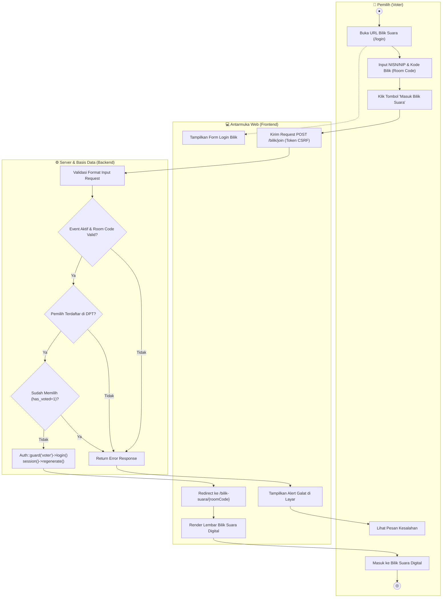
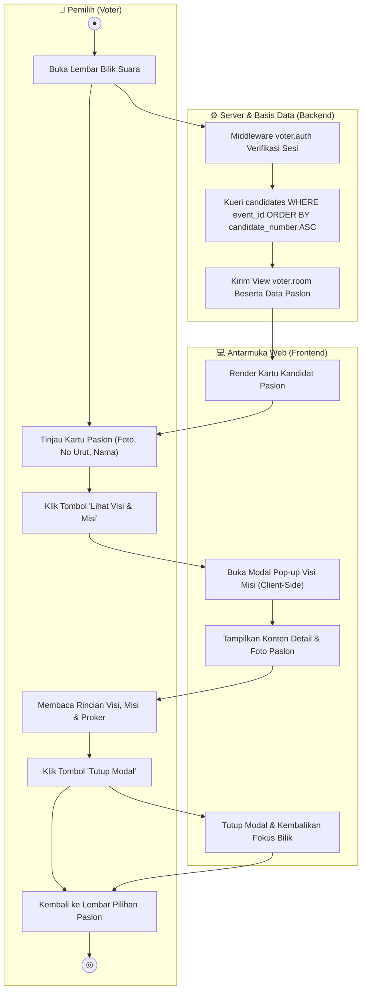
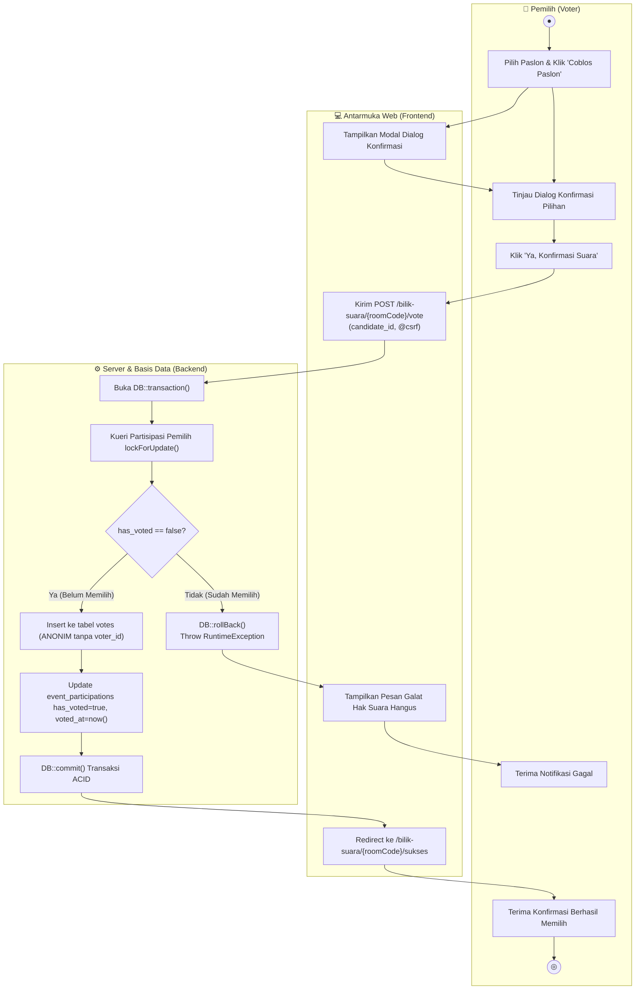
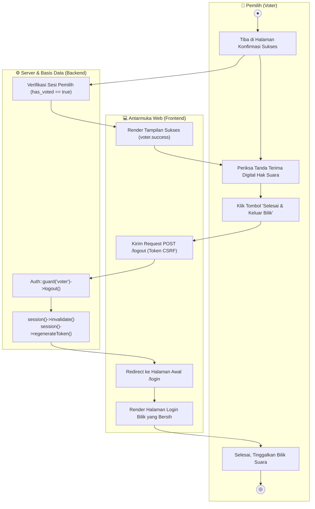
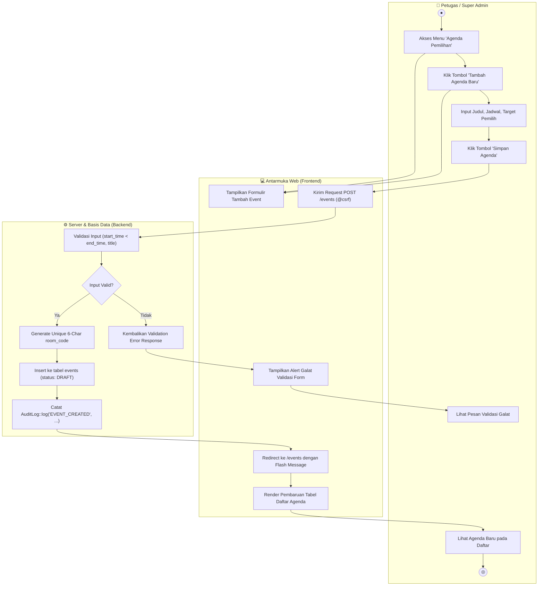
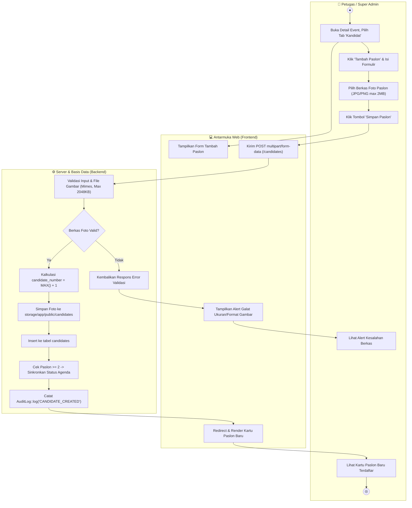
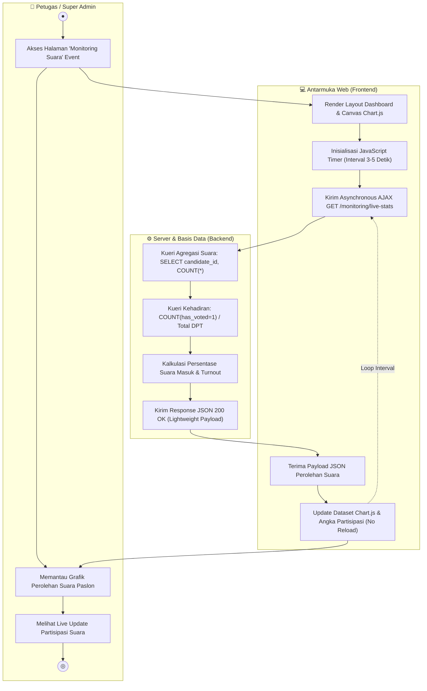
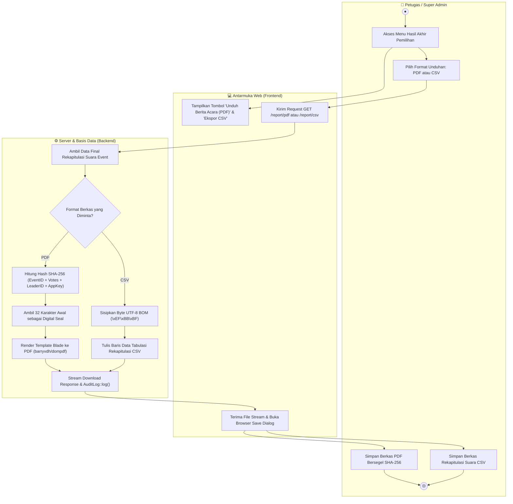
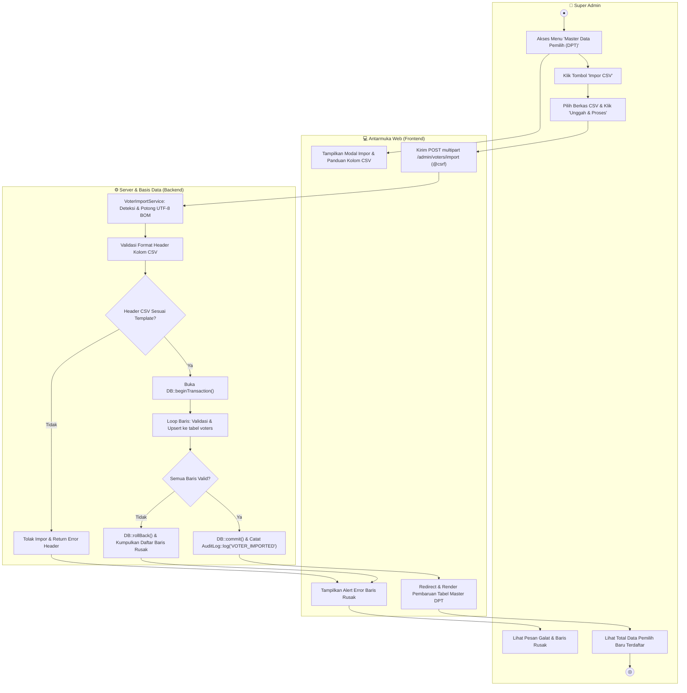
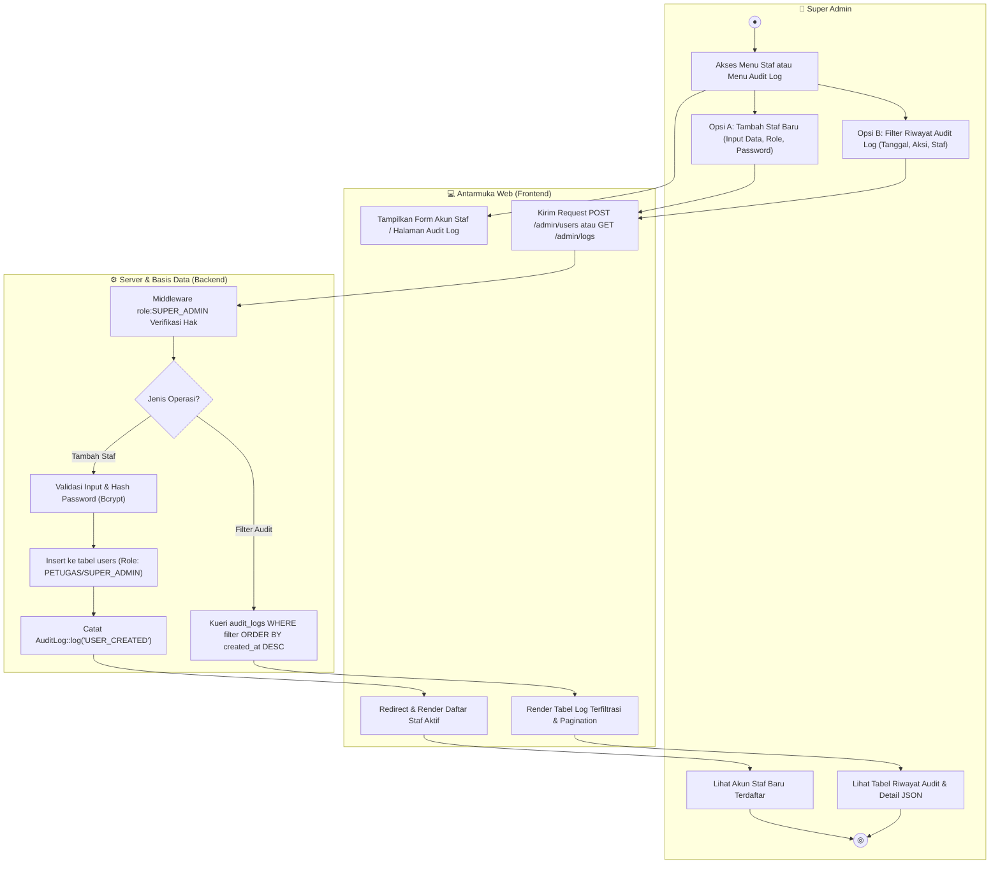

# DIAGRAM DRAW.IO ACTIVITY DIAGRAM (SUB-BAB 3.3)
## Laporan UKOM LSP P3 - Pemodelan UML Activity Diagram Sistem E-Voting

Dokumen ini memuat spesifikasi lengkap dan rancangan visual **10 Activity Diagram (AD-01 s.d. AD-10)** untuk **Sub-bab 3.3 (Pemodelan UML Sistem)** aplikasi E-Voting berbasis Laravel 11 dan MySQL.

Seluruh perancangan diagram mengadopsi format visual standar industri berupa **Partisi 3 Kolom Swimlane Vertikal (*Three-Lane Vertical Swimlane*)**:
1. **Kolom 1 (Kiri): Aktor Pengguna (*User / Actor*)** — Merepresentasikan inisiasi aksi oleh pengguna akhir (Pemilih, Petugas Panitia, atau Super Admin).
2. **Kolom 2 (Tengah): Antarmuka Web (*Web Interface / Frontend*)** — Merepresentasikan komponen tampilan Blade, formulir interaktif, dialog modal, skrip AJAX/JavaScript, dan umpan balik antarmuka (*UI alert/feedback*).
3. **Kolom 3 (Kanan): Server & Basis Data (*Backend Server & Database*)** — Merepresentasikan logika perutean (*routing*), lapisan *middleware*, pengendali (*controller*), aksi layanan (*action service*), kueri *Eloquent ORM / Query Builder*, penguncian baris pesimistik (*pessimistic locking*), transaksi atomik ACID, dan penyimpanan fisik basis data MySQL.

---

### CARA IMPOR KODE KE DRAW.IO (DIAGRAMS.NET)

Terdapat 2 (dua) metode untuk memasukkan diagram ke Draw.io:

#### Metode A: Impor Native XML Draw.io Multi-Halaman (Sangat Direkomendasikan - 1 File Memuat 10 Tab)
1. Buka peramban dan akses **[https://app.diagrams.net](https://app.diagrams.net)** (atau buka aplikasi desktop Draw.io).
2. Buat berkas baru (*Create New Diagram*) lalu pilih **Blank Diagram**.
3. Pada bilah menu atas Draw.io, klik menu **Extras** -> **Edit Diagram...**
4. Hapus seluruh kode XML bawaan yang ada di dalam kotak dialog tersebut.
5. Salin (*copy*) seluruh teks kode pada blok **KODE NATIVE DRAW.IO XML LENGKAP (10 TAB DIAGRAM)** di bawah, lalu tempel (*paste*) ke dalam kotak dialog tersebut.
6. Klik tombol **OK**.
7. Draw.io akan secara otomatis membuat **10 Tab Halaman Terpisah** di bilah bawah peramban:
   - `AD-01: Login Bilik`
   - `AD-02: Eksplorasi Paslon`
   - `AD-03: Pemberian Suara`
   - `AD-04: Bukti Memilih`
   - `AD-05: Kelola Agenda`
   - `AD-06: Kelola Paslon`
   - `AD-07: Monitoring Suara`
   - `AD-08: Cetak Laporan`
   - `AD-09: Master DPT`
   - `AD-10: Staf & Audit`
8. Ekspor diagram ke format gambar untuk laporan: Klik **File** -> **Export as** -> **PNG** (pilih *DPI: 300* agar gambar tajam saat dicetak pada dokumen Microsoft Word laporan UKOM).

#### Metode B: Impor melalui Advanced Mermaid
1. Pada Draw.io, klik menu **Arrange** -> **Insert** -> **Advanced** -> **Mermaid**.
2. Salin dan tempel kode Mermaid dari salah satu diagram yang diinginkan pada bagian **DAFTAR KODE MERMAID PER FITUR** di bawah.
3. Klik tombol **Insert**.

---

### DAFTAR KODE MERMAID PER FITUR (AD-01 S.D. AD-10)

Berikut adalah kode Mermaid untuk setiap activity diagram yang dapat langsung ditinjau secara visual pada editor Markdown:

#### 1. AD-01: Autentikasi Pemilih & Akses Bilik Suara (UC-01)


---

#### 2. AD-02: Eksplorasi Profil Paslon & Visi-Misi (UC-02)


---

#### 3. AD-03: Pemberian Suara Transaksional / Voting (UC-03)


---

#### 4. AD-04: Penerbitan Bukti Memilih & Selesai (UC-04)


---

#### 5. AD-05: Pengelolaan Agenda Pemilihan / Event (UC-05)


---

#### 6. AD-06: Pengelolaan Data Paslon & Upload Foto (UC-06)


---

#### 7. AD-07: Pemantauan Hasil Suara Real-Time (UC-07)


---

#### 8. AD-08: Penerbitan Berita Acara PDF & Ekspor CSV (UC-08)


---

#### 9. AD-09: Pengelolaan Master DPT & Impor Massal CSV (UC-09)


---

#### 10. AD-10: Pengelolaan Akun Staf & Penelusuran Audit Log (UC-10)


---

### KODE NATIVE DRAW.IO XML LENGKAP (10 TAB DIAGRAM)

Salin seluruh blok XML di bawah ini. Ketika ditempel ke Draw.io melalui menu **Extras -> Edit Diagram...**, Draw.io akan memuat **10 Tab Halaman Mandiri** yang tersusun presisi dalam 3 kolom swimlane:

```xml
<mxfile host="app.diagrams.net" modified="2025-02-17T00:00:00.000Z" agent="Mozilla/5.0" version="24.0.0" type="device">
  
  <!-- ========================================== -->
  <!-- TAB 1: AD-01 AUTENTIKASI PEMILIH           -->
  <!-- ========================================== -->
  <diagram id="ad-01-auth" name="AD-01: Login Bilik Suara">
    <mxGraphModel dx="1200" dy="800" grid="1" gridSize="10" guides="1" tooltips="1" connect="1" arrows="1" fold="1" page="1" pageScale="1" pageWidth="1000" pageHeight="850" background="#FFFFFF">
      <root>
        <mxCell id="0" />
        <mxCell id="1" parent="0" />

        <!-- HEADER & SWIMLANES -->
        <!-- Lane 1: Pemilih -->
        <mxCell id="l1_head" value="&lt;b style=&quot;font-size: 13px;&quot;&gt;👤 PEMILIH (VOTER)&lt;/b&gt;" style="swimlane;startSize=36;fontStyle=1;align=center;verticalAlign=middle;fillColor=#DBEAFE;strokeColor=#1E40AF;strokeWidth=2;fontSize=12;fontColor=#1E3A8A;" vertex="1" parent="1">
          <mxGeometry x="40" y="40" width="280" height="760" as="geometry" />
        </mxCell>
        <!-- Lane 2: Antarmuka Web -->
        <mxCell id="l2_head" value="&lt;b style=&quot;font-size: 13px;&quot;&gt;💻 ANTARMUKA WEB (FRONTEND)&lt;/b&gt;" style="swimlane;startSize=36;fontStyle=1;align=center;verticalAlign=middle;fillColor=#D1FAE5;strokeColor=#065F46;strokeWidth=2;fontSize=12;fontColor=#064E3B;" vertex="1" parent="1">
          <mxGeometry x="320" y="40" width="310" height="760" as="geometry" />
        </mxCell>
        <!-- Lane 3: Server & Basis Data -->
        <mxCell id="l3_head" value="&lt;b style=&quot;font-size: 13px;&quot;&gt;⚙️ SERVER &amp;amp; BASIS DATA (BACKEND)&lt;/b&gt;" style="swimlane;startSize=36;fontStyle=1;align=center;verticalAlign=middle;fillColor=#EDE9FE;strokeColor=#5B21B6;strokeWidth=2;fontSize=12;fontColor=#4C1D95;" vertex="1" parent="1">
          <mxGeometry x="630" y="40" width="330" height="760" as="geometry" />
        </mxCell>

        <!-- NODES AD-01 -->
        <!-- Start Node -->
        <mxCell id="ad1_start" value="" style="ellipse;fillColor=#1E293B;strokeColor=none;" vertex="1" parent="l1_head">
          <mxGeometry x="125" y="55" width="30" height="30" as="geometry" />
        </mxCell>
        <!-- A1 -->
        <mxCell id="ad1_a1" value="Akses Halaman Bilik Suara&lt;br&gt;&lt;i style=&quot;font-size: 10px; color: #475569;&quot;&gt;(GET /login atau /bilik/join)&lt;/i&gt;" style="rounded=1;arcSize=20;whiteSpace=wrap;html=1;fillColor=#EFF6FF;strokeColor=#2563EB;strokeWidth=1.5;fontSize=11;fontColor=#1E293B;" vertex="1" parent="l1_head">
          <mxGeometry x="45" y="110" width="190" height="50" as="geometry" />
        </mxCell>
        <!-- B1 -->
        <mxCell id="ad1_b1" value="Tampilkan Formulir Login Bilik&lt;br&gt;&lt;i style=&quot;font-size: 10px; color: #047857;&quot;&gt;(Input NISN/NIP &amp;amp; Room Code)&lt;/i&gt;" style="rounded=1;arcSize=20;whiteSpace=wrap;html=1;fillColor=#ECFDF5;strokeColor=#059669;strokeWidth=1.5;fontSize=11;fontColor=#064E3B;" vertex="1" parent="l2_head">
          <mxGeometry x="55" y="110" width="200" height="50" as="geometry" />
        </mxCell>
        <!-- A2 -->
        <mxCell id="ad1_a2" value="Input NISN / NIP &amp;amp;&lt;br&gt;Kode Bilik (Room Code)" style="rounded=1;arcSize=20;whiteSpace=wrap;html=1;fillColor=#EFF6FF;strokeColor=#2563EB;strokeWidth=1.5;fontSize=11;fontColor=#1E293B;" vertex="1" parent="l1_head">
          <mxGeometry x="45" y="190" width="190" height="50" as="geometry" />
        </mxCell>
        <!-- A3 -->
        <mxCell id="ad1_a3" value="Klik Tombol &quot;Masuk Bilik&quot;" style="rounded=1;arcSize=20;whiteSpace=wrap;html=1;fillColor=#EFF6FF;strokeColor=#2563EB;strokeWidth=1.5;fontSize=11;fontColor=#1E293B;" vertex="1" parent="l1_head">
          <mxGeometry x="45" y="270" width="190" height="45" as="geometry" />
        </mxCell>
        <!-- B2 -->
        <mxCell id="ad1_b2" value="Kirim Request POST /bilik/join&lt;br&gt;&lt;i style=&quot;font-size: 10px; color: #047857;&quot;&gt;(Sertakan Token Kripto @csrf)&lt;/i&gt;" style="rounded=1;arcSize=20;whiteSpace=wrap;html=1;fillColor=#ECFDF5;strokeColor=#059669;strokeWidth=1.5;fontSize=11;fontColor=#064E3B;" vertex="1" parent="l2_head">
          <mxGeometry x="55" y="268" width="200" height="50" as="geometry" />
        </mxCell>
        <!-- C1 -->
        <mxCell id="ad1_c1" value="Validasi Format Input &amp;amp;&lt;br&gt;Cari Event berdasarkan room_code" style="rounded=1;arcSize=20;whiteSpace=wrap;html=1;fillColor=#F5F3FF;strokeColor=#7C3AED;strokeWidth=1.5;fontSize=11;fontColor=#4C1D95;" vertex="1" parent="l3_head">
          <mxGeometry x="60" y="268" width="210" height="50" as="geometry" />
        </mxCell>
        <!-- D1: Decision 1 -->
        <mxCell id="ad1_d1" value="Event Aktif &amp;amp;&lt;br&gt;Jadwal Sesuai?" style="rhombus;whiteSpace=wrap;html=1;fillColor=#FEF3C7;strokeColor=#D97706;strokeWidth=1.5;fontSize=10;fontColor=#78350F;" vertex="1" parent="l3_head">
          <mxGeometry x="105" y="345" width="120" height="60" as="geometry" />
        </mxCell>
        <!-- D2: Decision 2 -->
        <mxCell id="ad1_d2" value="Pemilih Terdaftar&lt;br&gt;di DPT?" style="rhombus;whiteSpace=wrap;html=1;fillColor=#FEF3C7;strokeColor=#D97706;strokeWidth=1.5;fontSize=10;fontColor=#78350F;" vertex="1" parent="l3_head">
          <mxGeometry x="105" y="435" width="120" height="60" as="geometry" />
        </mxCell>
        <!-- D3: Decision 3 -->
        <mxCell id="ad1_d3" value="Belum Memilih&lt;br&gt;(has_voted=0)?" style="rhombus;whiteSpace=wrap;html=1;fillColor=#FEF3C7;strokeColor=#D97706;strokeWidth=1.5;fontSize=10;fontColor=#78350F;" vertex="1" parent="l3_head">
          <mxGeometry x="105" y="525" width="120" height="60" as="geometry" />
        </mxCell>
        <!-- C_ERR -->
        <mxCell id="ad1_cerr" value="Kembalikan Flash Error&lt;br&gt;&lt;i style=&quot;font-size: 10px;&quot;&gt;(Alasan: Kode Salah / Sudah Memilih)&lt;/i&gt;" style="rounded=1;arcSize=20;whiteSpace=wrap;html=1;fillColor=#FEE2E2;strokeColor=#DC2626;strokeWidth=1.5;fontSize=10;fontColor=#991B1B;" vertex="1" parent="l3_head">
          <mxGeometry x="60" y="615" width="210" height="40" as="geometry" />
        </mxCell>
        <!-- B_ERR -->
        <mxCell id="ad1_berr" value="Tampilkan Alert Galat pada Layar" style="rounded=1;arcSize=20;whiteSpace=wrap;html=1;fillColor=#FEE2E2;strokeColor=#DC2626;strokeWidth=1.5;fontSize=11;fontColor=#991B1B;" vertex="1" parent="l2_head">
          <mxGeometry x="55" y="615" width="200" height="40" as="geometry" />
        </mxCell>
        <!-- C_OK -->
        <mxCell id="ad1_cok" value="Auth::guard(&#39;voter&#39;)-&gt;login() &amp;amp;&lt;br&gt;session()-&gt;regenerate()" style="rounded=1;arcSize=20;whiteSpace=wrap;html=1;fillColor=#F5F3FF;strokeColor=#7C3AED;strokeWidth=1.5;fontSize=11;fontColor=#4C1D95;" vertex="1" parent="l3_head">
          <mxGeometry x="60" y="680" width="210" height="50" as="geometry" />
        </mxCell>
        <!-- B_OK -->
        <mxCell id="ad1_bok" value="Redirect ke /bilik-suara/{roomCode}&lt;br&gt;&amp;amp; Render Lembar Bilik Suara" style="rounded=1;arcSize=20;whiteSpace=wrap;html=1;fillColor=#ECFDF5;strokeColor=#059669;strokeWidth=1.5;fontSize=11;fontColor=#064E3B;" vertex="1" parent="l2_head">
          <mxGeometry x="55" y="680" width="200" height="50" as="geometry" />
        </mxCell>
        <!-- A_OK -->
        <mxCell id="ad1_aok" value="Masuk ke Bilik Suara Digital" style="rounded=1;arcSize=20;whiteSpace=wrap;html=1;fillColor=#EFF6FF;strokeColor=#2563EB;strokeWidth=1.5;fontSize=11;fontColor=#1E293B;" vertex="1" parent="l1_head">
          <mxGeometry x="45" y="685" width="190" height="40" as="geometry" />
        </mxCell>
        <!-- End Node -->
        <mxCell id="ad1_end" value="" style="ellipse;html=1;shape=doubleEllipse;fillColor=#1E293B;strokeColor=#1E293B;strokeWidth=2;" vertex="1" parent="l1_head">
          <mxGeometry x="125" y="745" width="30" height="30" as="geometry" />
        </mxCell>

        <!-- EDGES AD-01 -->
        <mxCell id="e1" style="edgeStyle=orthogonalEdgeStyle;rounded=0;html=1;strokeColor=#334155;strokeWidth=1.5;" edge="1" parent="1" source="ad1_start" target="ad1_a1" />
        <mxCell id="e2" style="edgeStyle=orthogonalEdgeStyle;rounded=0;html=1;strokeColor=#334155;strokeWidth=1.5;" edge="1" parent="1" source="ad1_a1" target="ad1_b1" />
        <mxCell id="e3" style="edgeStyle=orthogonalEdgeStyle;rounded=0;html=1;strokeColor=#334155;strokeWidth=1.5;" edge="1" parent="1" source="ad1_b1" target="ad1_a2" />
        <mxCell id="e4" style="edgeStyle=orthogonalEdgeStyle;rounded=0;html=1;strokeColor=#334155;strokeWidth=1.5;" edge="1" parent="1" source="ad1_a2" target="ad1_a3" />
        <mxCell id="e5" style="edgeStyle=orthogonalEdgeStyle;rounded=0;html=1;strokeColor=#334155;strokeWidth=1.5;" edge="1" parent="1" source="ad1_a3" target="ad1_b2" />
        <mxCell id="e6" style="edgeStyle=orthogonalEdgeStyle;rounded=0;html=1;strokeColor=#334155;strokeWidth=1.5;" edge="1" parent="1" source="ad1_b2" target="ad1_c1" />
        <mxCell id="e7" style="edgeStyle=orthogonalEdgeStyle;rounded=0;html=1;strokeColor=#334155;strokeWidth=1.5;" edge="1" parent="1" source="ad1_c1" target="ad1_d1" />
        <mxCell id="e8" value="[Tidak]" style="edgeStyle=orthogonalEdgeStyle;rounded=0;html=1;strokeColor=#DC2626;strokeWidth=1.5;fontColor=#DC2626;fontSize=10;" edge="1" parent="1" source="ad1_d1" target="ad1_cerr">
          <Array as="points">
            <mxPoint x="920" y="415" />
            <mxPoint x="920" y="675" />
          </Array>
        </mxCell>
        <mxCell id="e9" value="[Ya]" style="edgeStyle=orthogonalEdgeStyle;rounded=0;html=1;strokeColor=#059669;strokeWidth=1.5;fontColor=#059669;fontSize=10;" edge="1" parent="1" source="ad1_d1" target="ad1_d2" />
        <mxCell id="e10" value="[Tidak]" style="edgeStyle=orthogonalEdgeStyle;rounded=0;html=1;strokeColor=#DC2626;strokeWidth=1.5;fontColor=#DC2626;fontSize=10;" edge="1" parent="1" source="ad1_d2" target="ad1_cerr">
          <Array as="points">
            <mxPoint x="900" y="505" />
            <mxPoint x="900" y="675" />
          </Array>
        </mxCell>
        <mxCell id="e11" value="[Ya]" style="edgeStyle=orthogonalEdgeStyle;rounded=0;html=1;strokeColor=#059669;strokeWidth=1.5;fontColor=#059669;fontSize=10;" edge="1" parent="1" source="ad1_d2" target="ad1_d3" />
        <mxCell id="e12" value="[Tidak (Sudah Memilih)]" style="edgeStyle=orthogonalEdgeStyle;rounded=0;html=1;strokeColor=#DC2626;strokeWidth=1.5;fontColor=#DC2626;fontSize=10;" edge="1" parent="1" source="ad1_d3" target="ad1_cerr" />
        <mxCell id="e13" value="[Ya (Belum)]" style="edgeStyle=orthogonalEdgeStyle;rounded=0;html=1;strokeColor=#059669;strokeWidth=1.5;fontColor=#059669;fontSize=10;" edge="1" parent="1" source="ad1_d3" target="ad1_cok">
          <Array as="points">
            <mxPoint x="740" y="635" />
            <mxPoint x="740" y="745" />
          </Array>
        </mxCell>
        <mxCell id="e14" style="edgeStyle=orthogonalEdgeStyle;rounded=0;html=1;strokeColor=#DC2626;strokeWidth=1.5;" edge="1" parent="1" source="ad1_cerr" target="ad1_berr" />
        <mxCell id="e15" style="edgeStyle=orthogonalEdgeStyle;rounded=0;html=1;strokeColor=#059669;strokeWidth=1.5;" edge="1" parent="1" source="ad1_cok" target="ad1_bok" />
        <mxCell id="e16" style="edgeStyle=orthogonalEdgeStyle;rounded=0;html=1;strokeColor=#059669;strokeWidth=1.5;" edge="1" parent="1" source="ad1_bok" target="ad1_aok" />
        <mxCell id="e17" style="edgeStyle=orthogonalEdgeStyle;rounded=0;html=1;strokeColor=#334155;strokeWidth=1.5;" edge="1" parent="1" source="ad1_aok" target="ad1_end" />
      </root>
    </mxGraphModel>
  </diagram>

  <!-- ========================================== -->
  <!-- TAB 2: AD-02 EKSPLORASI PROFIL PASLON      -->
  <!-- ========================================== -->
  <diagram id="ad-02-explore" name="AD-02: Eksplorasi Paslon">
    <mxGraphModel dx="1200" dy="800" grid="1" gridSize="10" guides="1" tooltips="1" connect="1" arrows="1" fold="1" page="1" pageScale="1" pageWidth="1000" pageHeight="700" background="#FFFFFF">
      <root>
        <mxCell id="0" />
        <mxCell id="1" parent="0" />

        <mxCell id="l1_ad2" value="&lt;b style=&quot;font-size: 13px;&quot;&gt;👤 PEMILIH (VOTER)&lt;/b&gt;" style="swimlane;startSize=36;fontStyle=1;align=center;verticalAlign=middle;fillColor=#DBEAFE;strokeColor=#1E40AF;strokeWidth=2;fontSize=12;fontColor=#1E3A8A;" vertex="1" parent="1">
          <mxGeometry x="40" y="40" width="280" height="600" as="geometry" />
        </mxCell>
        <mxCell id="l2_ad2" value="&lt;b style=&quot;font-size: 13px;&quot;&gt;💻 ANTARMUKA WEB (FRONTEND)&lt;/b&gt;" style="swimlane;startSize=36;fontStyle=1;align=center;verticalAlign=middle;fillColor=#D1FAE5;strokeColor=#065F46;strokeWidth=2;fontSize=12;fontColor=#064E3B;" vertex="1" parent="1">
          <mxGeometry x="320" y="40" width="310" height="600" as="geometry" />
        </mxCell>
        <mxCell id="l3_ad2" value="&lt;b style=&quot;font-size: 13px;&quot;&gt;⚙️ SERVER &amp;amp; BASIS DATA (BACKEND)&lt;/b&gt;" style="swimlane;startSize=36;fontStyle=1;align=center;verticalAlign=middle;fillColor=#EDE9FE;strokeColor=#5B21B6;strokeWidth=2;fontSize=12;fontColor=#4C1D95;" vertex="1" parent="1">
          <mxGeometry x="630" y="40" width="330" height="600" as="geometry" />
        </mxCell>

        <!-- Start Node -->
        <mxCell id="ad2_start" value="" style="ellipse;fillColor=#1E293B;strokeColor=none;" vertex="1" parent="l1_ad2">
          <mxGeometry x="125" y="55" width="30" height="30" as="geometry" />
        </mxCell>
        <mxCell id="ad2_a1" value="Akses Lembar Bilik Suara" style="rounded=1;arcSize=20;whiteSpace=wrap;html=1;fillColor=#EFF6FF;strokeColor=#2563EB;strokeWidth=1.5;fontSize=11;fontColor=#1E293B;" vertex="1" parent="l1_ad2">
          <mxGeometry x="45" y="110" width="190" height="40" as="geometry" />
        </mxCell>
        <mxCell id="ad2_c1" value="Middleware voter.auth Cek Sesi &amp;amp;&lt;br&gt;Kueri candidates WHERE event_id&lt;br&gt;ORDER BY candidate_number ASC" style="rounded=1;arcSize=20;whiteSpace=wrap;html=1;fillColor=#F5F3FF;strokeColor=#7C3AED;strokeWidth=1.5;fontSize=11;fontColor=#4C1D95;" vertex="1" parent="l3_ad2">
          <mxGeometry x="60" y="105" width="210" height="50" as="geometry" />
        </mxCell>
        <mxCell id="ad2_b1" value="Render Kartu Paslon&lt;br&gt;&lt;i style=&quot;font-size: 10px; color: #047857;&quot;&gt;(Foto, No Urut, Nama Ketua &amp;amp; Wakil)&lt;/i&gt;" style="rounded=1;arcSize=20;whiteSpace=wrap;html=1;fillColor=#ECFDF5;strokeColor=#059669;strokeWidth=1.5;fontSize=11;fontColor=#064E3B;" vertex="1" parent="l2_ad2">
          <mxGeometry x="55" y="180" width="200" height="45" as="geometry" />
        </mxCell>
        <mxCell id="ad2_a2" value="Tinjau Kartu &amp;amp; Klik Tombol&lt;br&gt;&quot;Lihat Visi &amp;amp; Misi&quot;" style="rounded=1;arcSize=20;whiteSpace=wrap;html=1;fillColor=#EFF6FF;strokeColor=#2563EB;strokeWidth=1.5;fontSize=11;fontColor=#1E293B;" vertex="1" parent="l1_ad2">
          <mxGeometry x="45" y="250" width="190" height="45" as="geometry" />
        </mxCell>
        <mxCell id="ad2_b2" value="Buka Modal Pop-up Visi Misi&lt;br&gt;&lt;i style=&quot;font-size: 10px; color: #047857;&quot;&gt;(Client-side Dynamic Modal)&lt;/i&gt;" style="rounded=1;arcSize=20;whiteSpace=wrap;html=1;fillColor=#ECFDF5;strokeColor=#059669;strokeWidth=1.5;fontSize=11;fontColor=#064E3B;" vertex="1" parent="l2_ad2">
          <mxGeometry x="55" y="250" width="200" height="45" as="geometry" />
        </mxCell>
        <mxCell id="ad2_a3" value="Membaca Uraian Visi, Misi,&lt;br&gt;serta Program Kerja Paslon" style="rounded=1;arcSize=20;whiteSpace=wrap;html=1;fillColor=#EFF6FF;strokeColor=#2563EB;strokeWidth=1.5;fontSize=11;fontColor=#1E293B;" vertex="1" parent="l1_ad2">
          <mxGeometry x="45" y="330" width="190" height="45" as="geometry" />
        </mxCell>
        <mxCell id="ad2_a4" value="Klik Tombol &quot;Tutup Modal&quot;" style="rounded=1;arcSize=20;whiteSpace=wrap;html=1;fillColor=#EFF6FF;strokeColor=#2563EB;strokeWidth=1.5;fontSize=11;fontColor=#1E293B;" vertex="1" parent="l1_ad2">
          <mxGeometry x="45" y="410" width="190" height="40" as="geometry" />
        </mxCell>
        <mxCell id="ad2_b3" value="Tutup Modal &amp;amp; Kembalikan&lt;br&gt;Fokus ke Pilihan Paslon" style="rounded=1;arcSize=20;whiteSpace=wrap;html=1;fillColor=#ECFDF5;strokeColor=#059669;strokeWidth=1.5;fontSize=11;fontColor=#064E3B;" vertex="1" parent="l2_ad2">
          <mxGeometry x="55" y="410" width="200" height="40" as="geometry" />
        </mxCell>
        <mxCell id="ad2_a5" value="Kembali ke Lembar Bilik Suara&lt;br&gt;(Siap Melakukan Pencoblosan)" style="rounded=1;arcSize=20;whiteSpace=wrap;html=1;fillColor=#EFF6FF;strokeColor=#2563EB;strokeWidth=1.5;fontSize=11;fontColor=#1E293B;" vertex="1" parent="l1_ad2">
          <mxGeometry x="45" y="480" width="190" height="45" as="geometry" />
        </mxCell>
        <!-- End Node -->
        <mxCell id="ad2_end" value="" style="ellipse;html=1;shape=doubleEllipse;fillColor=#1E293B;strokeColor=#1E293B;strokeWidth=2;" vertex="1" parent="l1_ad2">
          <mxGeometry x="125" y="550" width="30" height="30" as="geometry" />
        </mxCell>

        <!-- Edges AD-02 -->
        <mxCell id="ad2_e1" style="edgeStyle=orthogonalEdgeStyle;rounded=0;html=1;strokeColor=#334155;strokeWidth=1.5;" edge="1" parent="1" source="ad2_start" target="ad2_a1" />
        <mxCell id="ad2_e2" style="edgeStyle=orthogonalEdgeStyle;rounded=0;html=1;strokeColor=#334155;strokeWidth=1.5;" edge="1" parent="1" source="ad2_a1" target="ad2_c1" />
        <mxCell id="ad2_e3" style="edgeStyle=orthogonalEdgeStyle;rounded=0;html=1;strokeColor=#334155;strokeWidth=1.5;" edge="1" parent="1" source="ad2_c1" target="ad2_b1" />
        <mxCell id="ad2_e4" style="edgeStyle=orthogonalEdgeStyle;rounded=0;html=1;strokeColor=#334155;strokeWidth=1.5;" edge="1" parent="1" source="ad2_b1" target="ad2_a2" />
        <mxCell id="ad2_e5" style="edgeStyle=orthogonalEdgeStyle;rounded=0;html=1;strokeColor=#334155;strokeWidth=1.5;" edge="1" parent="1" source="ad2_a2" target="ad2_b2" />
        <mxCell id="ad2_e6" style="edgeStyle=orthogonalEdgeStyle;rounded=0;html=1;strokeColor=#334155;strokeWidth=1.5;" edge="1" parent="1" source="ad2_b2" target="ad2_a3" />
        <mxCell id="ad2_e7" style="edgeStyle=orthogonalEdgeStyle;rounded=0;html=1;strokeColor=#334155;strokeWidth=1.5;" edge="1" parent="1" source="ad2_a3" target="ad2_a4" />
        <mxCell id="ad2_e8" style="edgeStyle=orthogonalEdgeStyle;rounded=0;html=1;strokeColor=#334155;strokeWidth=1.5;" edge="1" parent="1" source="ad2_a4" target="ad2_b3" />
        <mxCell id="ad2_e9" style="edgeStyle=orthogonalEdgeStyle;rounded=0;html=1;strokeColor=#334155;strokeWidth=1.5;" edge="1" parent="1" source="ad2_b3" target="ad2_a5" />
        <mxCell id="ad2_e10" style="edgeStyle=orthogonalEdgeStyle;rounded=0;html=1;strokeColor=#334155;strokeWidth=1.5;" edge="1" parent="1" source="ad2_a5" target="ad2_end" />
      </root>
    </mxGraphModel>
  </diagram>

  <!-- ========================================== -->
  <!-- TAB 3: AD-03 PEMBERIAN SUARA TRANSAKSIONAL -->
  <!-- ========================================== -->
  <diagram id="ad-03-vote" name="AD-03: Pemberian Suara">
    <mxGraphModel dx="1200" dy="800" grid="1" gridSize="10" guides="1" tooltips="1" connect="1" arrows="1" fold="1" page="1" pageScale="1" pageWidth="1000" pageHeight="760" background="#FFFFFF">
      <root>
        <mxCell id="0" />
        <mxCell id="1" parent="0" />

        <mxCell id="l1_ad3" value="&lt;b style=&quot;font-size: 13px;&quot;&gt;👤 PEMILIH (VOTER)&lt;/b&gt;" style="swimlane;startSize=36;fontStyle=1;align=center;verticalAlign=middle;fillColor=#DBEAFE;strokeColor=#1E40AF;strokeWidth=2;fontSize=12;fontColor=#1E3A8A;" vertex="1" parent="1">
          <mxGeometry x="40" y="40" width="280" height="680" as="geometry" />
        </mxCell>
        <mxCell id="l2_ad3" value="&lt;b style=&quot;font-size: 13px;&quot;&gt;💻 ANTARMUKA WEB (FRONTEND)&lt;/b&gt;" style="swimlane;startSize=36;fontStyle=1;align=center;verticalAlign=middle;fillColor=#D1FAE5;strokeColor=#065F46;strokeWidth=2;fontSize=12;fontColor=#064E3B;" vertex="1" parent="1">
          <mxGeometry x="320" y="40" width="310" height="680" as="geometry" />
        </mxCell>
        <mxCell id="l3_ad3" value="&lt;b style=&quot;font-size: 13px;&quot;&gt;⚙️ SERVER &amp;amp; BASIS DATA (BACKEND)&lt;/b&gt;" style="swimlane;startSize=36;fontStyle=1;align=center;verticalAlign=middle;fillColor=#EDE9FE;strokeColor=#5B21B6;strokeWidth=2;fontSize=12;fontColor=#4C1D95;" vertex="1" parent="1">
          <mxGeometry x="630" y="40" width="330" height="680" as="geometry" />
        </mxCell>

        <!-- Start Node -->
        <mxCell id="ad3_start" value="" style="ellipse;fillColor=#1E293B;strokeColor=none;" vertex="1" parent="l1_ad3">
          <mxGeometry x="125" y="55" width="30" height="30" as="geometry" />
        </mxCell>
        <mxCell id="ad3_a1" value="Pilih Paslon &amp;amp; Klik &quot;Coblos&quot;" style="rounded=1;arcSize=20;whiteSpace=wrap;html=1;fillColor=#EFF6FF;strokeColor=#2563EB;strokeWidth=1.5;fontSize=11;fontColor=#1E293B;" vertex="1" parent="l1_ad3">
          <mxGeometry x="45" y="110" width="190" height="40" as="geometry" />
        </mxCell>
        <mxCell id="ad3_b1" value="Tampilkan Modal Konfirmasi Suara&lt;br&gt;&lt;i style=&quot;font-size: 10px; color: #047857;&quot;&gt;(Yakin memilih Paslon No. X?)&lt;/i&gt;" style="rounded=1;arcSize=20;whiteSpace=wrap;html=1;fillColor=#ECFDF5;strokeColor=#059669;strokeWidth=1.5;fontSize=11;fontColor=#064E3B;" vertex="1" parent="l2_ad3">
          <mxGeometry x="55" y="108" width="200" height="45" as="geometry" />
        </mxCell>
        <mxCell id="ad3_a2" value="Klik &quot;Ya, Konfirmasi Pilihan&quot;" style="rounded=1;arcSize=20;whiteSpace=wrap;html=1;fillColor=#EFF6FF;strokeColor=#2563EB;strokeWidth=1.5;fontSize=11;fontColor=#1E293B;" vertex="1" parent="l1_ad3">
          <mxGeometry x="45" y="180" width="190" height="40" as="geometry" />
        </mxCell>
        <mxCell id="ad3_b2" value="Kirim POST /bilik-suara/{roomCode}/vote&lt;br&gt;&lt;i style=&quot;font-size: 10px; color: #047857;&quot;&gt;(Payload: candidate_id, Token @csrf)&lt;/i&gt;" style="rounded=1;arcSize=20;whiteSpace=wrap;html=1;fillColor=#ECFDF5;strokeColor=#059669;strokeWidth=1.5;fontSize=11;fontColor=#064E3B;" vertex="1" parent="l2_ad3">
          <mxGeometry x="55" y="178" width="200" height="45" as="geometry" />
        </mxCell>
        <mxCell id="ad3_c1" value="Eksekusi CastVoteAction&lt;br&gt;Buka DB::transaction()" style="rounded=1;arcSize=20;whiteSpace=wrap;html=1;fillColor=#F5F3FF;strokeColor=#7C3AED;strokeWidth=1.5;fontSize=11;fontColor=#4C1D95;" vertex="1" parent="l3_ad3">
          <mxGeometry x="60" y="178" width="210" height="45" as="geometry" />
        </mxCell>
        <mxCell id="ad3_c2" value="Kueri Partisipasi Pemilih dengan&lt;br&gt;Penguncian Baris: lockForUpdate()" style="rounded=1;arcSize=20;whiteSpace=wrap;html=1;fillColor=#F5F3FF;strokeColor=#7C3AED;strokeWidth=1.5;fontSize=11;fontColor=#4C1D95;" vertex="1" parent="l3_ad3">
          <mxGeometry x="60" y="250" width="210" height="50" as="geometry" />
        </mxCell>
        <mxCell id="ad3_d1" value="has_voted == false&lt;br&gt;(Belum Memilih)?" style="rhombus;whiteSpace=wrap;html=1;fillColor=#FEF3C7;strokeColor=#D97706;strokeWidth=1.5;fontSize=10;fontColor=#78350F;" vertex="1" parent="l3_ad3">
          <mxGeometry x="95" y="330" width="140" height="60" as="geometry" />
        </mxCell>
        <mxCell id="ad3_c_fail" value="DB::rollBack() &amp;amp;&lt;br&gt;Throw RuntimeException" style="rounded=1;arcSize=20;whiteSpace=wrap;html=1;fillColor=#FEE2E2;strokeColor=#DC2626;strokeWidth=1.5;fontSize=10;fontColor=#991B1B;" vertex="1" parent="l3_head">
          <mxGeometry x="60" y="420" width="210" height="40" as="geometry" />
        </mxCell>
        <mxCell id="ad3_b_fail" value="Tampilkan Pesan Peringatan:&lt;br&gt;&quot;Hak suara sudah digunakan&quot;" style="rounded=1;arcSize=20;whiteSpace=wrap;html=1;fillColor=#FEE2E2;strokeColor=#DC2626;strokeWidth=1.5;fontSize=10;fontColor=#991B1B;" vertex="1" parent="l2_head">
          <mxGeometry x="55" y="420" width="200" height="40" as="geometry" />
        </mxCell>
        <mxCell id="ad3_c3" value="1. Insert Surat Suara ke tabel votes&lt;br&gt;&lt;i style=&quot;font-size: 10px; color: #6D28D9;&quot;&gt;(ANONIM: Tanpa foreign key voter_id)&lt;/i&gt;&lt;br&gt;2. Update event_participations&lt;br&gt;has_voted=true, voted_at=now()" style="rounded=1;arcSize=20;whiteSpace=wrap;html=1;fillColor=#F5F3FF;strokeColor=#7C3AED;strokeWidth=1.5;fontSize=10;fontColor=#4C1D95;" vertex="1" parent="l3_ad3">
          <mxGeometry x="50" y="485" width="230" height="65" as="geometry" />
        </mxCell>
        <mxCell id="ad3_c4" value="DB::commit() Transaksi ACID" style="rounded=1;arcSize=20;whiteSpace=wrap;html=1;fillColor=#F5F3FF;strokeColor=#7C3AED;strokeWidth=1.5;fontSize=11;fontColor=#4C1D95;" vertex="1" parent="l3_ad3">
          <mxGeometry x="60" y="575" width="210" height="40" as="geometry" />
        </mxCell>
        <mxCell id="ad3_b3" value="Redirect ke /bilik-suara/{roomCode}/sukses" style="rounded=1;arcSize=20;whiteSpace=wrap;html=1;fillColor=#ECFDF5;strokeColor=#059669;strokeWidth=1.5;fontSize=11;fontColor=#064E3B;" vertex="1" parent="l2_ad3">
          <mxGeometry x="55" y="575" width="200" height="40" as="geometry" />
        </mxCell>
        <mxCell id="ad3_a3" value="Menerima Konfirmasi Sukses Memilih" style="rounded=1;arcSize=20;whiteSpace=wrap;html=1;fillColor=#EFF6FF;strokeColor=#2563EB;strokeWidth=1.5;fontSize=11;fontColor=#1E293B;" vertex="1" parent="l1_ad3">
          <mxGeometry x="45" y="575" width="190" height="40" as="geometry" />
        </mxCell>
        <!-- End Node -->
        <mxCell id="ad3_end" value="" style="ellipse;html=1;shape=doubleEllipse;fillColor=#1E293B;strokeColor=#1E293B;strokeWidth=2;" vertex="1" parent="l1_ad3">
          <mxGeometry x="125" y="635" width="30" height="30" as="geometry" />
        </mxCell>

        <!-- Edges AD-03 -->
        <mxCell id="ad3_e1" style="edgeStyle=orthogonalEdgeStyle;rounded=0;html=1;strokeColor=#334155;strokeWidth=1.5;" edge="1" parent="1" source="ad3_start" target="ad3_a1" />
        <mxCell id="ad3_e2" style="edgeStyle=orthogonalEdgeStyle;rounded=0;html=1;strokeColor=#334155;strokeWidth=1.5;" edge="1" parent="1" source="ad3_a1" target="ad3_b1" />
        <mxCell id="ad3_e3" style="edgeStyle=orthogonalEdgeStyle;rounded=0;html=1;strokeColor=#334155;strokeWidth=1.5;" edge="1" parent="1" source="ad3_b1" target="ad3_a2" />
        <mxCell id="ad3_e4" style="edgeStyle=orthogonalEdgeStyle;rounded=0;html=1;strokeColor=#334155;strokeWidth=1.5;" edge="1" parent="1" source="ad3_a2" target="ad3_b2" />
        <mxCell id="ad3_e5" style="edgeStyle=orthogonalEdgeStyle;rounded=0;html=1;strokeColor=#334155;strokeWidth=1.5;" edge="1" parent="1" source="ad3_b2" target="ad3_c1" />
        <mxCell id="ad3_e6" style="edgeStyle=orthogonalEdgeStyle;rounded=0;html=1;strokeColor=#334155;strokeWidth=1.5;" edge="1" parent="1" source="ad3_c1" target="ad3_c2" />
        <mxCell id="ad3_e7" style="edgeStyle=orthogonalEdgeStyle;rounded=0;html=1;strokeColor=#334155;strokeWidth=1.5;" edge="1" parent="1" source="ad3_c2" target="ad3_d1" />
        <mxCell id="ad3_e8" value="[Tidak]" style="edgeStyle=orthogonalEdgeStyle;rounded=0;html=1;strokeColor=#DC2626;strokeWidth=1.5;fontColor=#DC2626;fontSize=10;" edge="1" parent="1" source="ad3_d1" target="ad3_c_fail" />
        <mxCell id="ad3_e9" style="edgeStyle=orthogonalEdgeStyle;rounded=0;html=1;strokeColor=#DC2626;strokeWidth=1.5;" edge="1" parent="1" source="ad3_c_fail" target="ad3_b_fail" />
        <mxCell id="ad3_e10" value="[Ya (Lolos)]" style="edgeStyle=orthogonalEdgeStyle;rounded=0;html=1;strokeColor=#059669;strokeWidth=1.5;fontColor=#059669;fontSize=10;" edge="1" parent="1" source="ad3_d1" target="ad3_c3">
          <Array as="points">
            <mxPoint x="920" y="400" />
            <mxPoint x="920" y="555" />
          </Array>
        </mxCell>
        <mxCell id="ad3_e11" style="edgeStyle=orthogonalEdgeStyle;rounded=0;html=1;strokeColor=#334155;strokeWidth=1.5;" edge="1" parent="1" source="ad3_c3" target="ad3_c4" />
        <mxCell id="ad3_e12" style="edgeStyle=orthogonalEdgeStyle;rounded=0;html=1;strokeColor=#059669;strokeWidth=1.5;" edge="1" parent="1" source="ad3_c4" target="ad3_b3" />
        <mxCell id="ad3_e13" style="edgeStyle=orthogonalEdgeStyle;rounded=0;html=1;strokeColor=#059669;strokeWidth=1.5;" edge="1" parent="1" source="ad3_b3" target="ad3_a3" />
        <mxCell id="ad3_e14" style="edgeStyle=orthogonalEdgeStyle;rounded=0;html=1;strokeColor=#334155;strokeWidth=1.5;" edge="1" parent="1" source="ad3_a3" target="ad3_end" />
      </root>
    </mxGraphModel>
  </diagram>

  <!-- ========================================== -->
  <!-- TAB 4: AD-04 BUKTI MEMILIH & TERMINASI SESI -->
  <!-- ========================================== -->
  <diagram id="ad-04-receipt" name="AD-04: Bukti Memilih">
    <mxGraphModel dx="1200" dy="800" grid="1" gridSize="10" guides="1" tooltips="1" connect="1" arrows="1" fold="1" page="1" pageScale="1" pageWidth="1000" pageHeight="650" background="#FFFFFF">
      <root>
        <mxCell id="0" />
        <mxCell id="1" parent="0" />

        <mxCell id="l1_ad4" value="&lt;b style=&quot;font-size: 13px;&quot;&gt;👤 PEMILIH (VOTER)&lt;/b&gt;" style="swimlane;startSize=36;fontStyle=1;align=center;verticalAlign=middle;fillColor=#DBEAFE;strokeColor=#1E40AF;strokeWidth=2;fontSize=12;fontColor=#1E3A8A;" vertex="1" parent="1">
          <mxGeometry x="40" y="40" width="280" height="550" as="geometry" />
        </mxCell>
        <mxCell id="l2_ad4" value="&lt;b style=&quot;font-size: 13px;&quot;&gt;💻 ANTARMUKA WEB (FRONTEND)&lt;/b&gt;" style="swimlane;startSize=36;fontStyle=1;align=center;verticalAlign=middle;fillColor=#D1FAE5;strokeColor=#065F46;strokeWidth=2;fontSize=12;fontColor=#064E3B;" vertex="1" parent="1">
          <mxGeometry x="320" y="40" width="310" height="550" as="geometry" />
        </mxCell>
        <mxCell id="l3_ad4" value="&lt;b style=&quot;font-size: 13px;&quot;&gt;⚙️ SERVER &amp;amp; BASIS DATA (BACKEND)&lt;/b&gt;" style="swimlane;startSize=36;fontStyle=1;align=center;verticalAlign=middle;fillColor=#EDE9FE;strokeColor=#5B21B6;strokeWidth=2;fontSize=12;fontColor=#4C1D95;" vertex="1" parent="1">
          <mxGeometry x="630" y="40" width="330" height="550" as="geometry" />
        </mxCell>

        <mxCell id="ad4_start" value="" style="ellipse;fillColor=#1E293B;strokeColor=none;" vertex="1" parent="l1_ad4">
          <mxGeometry x="125" y="55" width="30" height="30" as="geometry" />
        </mxCell>
        <mxCell id="ad4_a1" value="Melihat Layar Sukses Memilih" style="rounded=1;arcSize=20;whiteSpace=wrap;html=1;fillColor=#EFF6FF;strokeColor=#2563EB;strokeWidth=1.5;fontSize=11;fontColor=#1E293B;" vertex="1" parent="l1_ad4">
          <mxGeometry x="45" y="110" width="190" height="40" as="geometry" />
        </mxCell>
        <mxCell id="ad4_b1" value="Render Tanda Terima Digital&lt;br&gt;&lt;i style=&quot;font-size: 10px; color: #047857;&quot;&gt;(Ikon Centang Hijau &amp;amp; Waktu Memilih)&lt;/i&gt;" style="rounded=1;arcSize=20;whiteSpace=wrap;html=1;fillColor=#ECFDF5;strokeColor=#059669;strokeWidth=1.5;fontSize=11;fontColor=#064E3B;" vertex="1" parent="l2_ad4">
          <mxGeometry x="55" y="108" width="200" height="45" as="geometry" />
        </mxCell>
        <mxCell id="ad4_a2" value="Meninjau Bukti &amp;amp; Klik Tombol&lt;br&gt;&quot;Selesai &amp;amp; Keluar Bilik&quot;" style="rounded=1;arcSize=20;whiteSpace=wrap;html=1;fillColor=#EFF6FF;strokeColor=#2563EB;strokeWidth=1.5;fontSize=11;fontColor=#1E293B;" vertex="1" parent="l1_ad4">
          <mxGeometry x="45" y="190" width="190" height="45" as="geometry" />
        </mxCell>
        <mxCell id="ad4_b2" value="Kirim Request POST /logout&lt;br&gt;&lt;i style=&quot;font-size: 10px; color: #047857;&quot;&gt;(Logout Sesi Guard Voter)&lt;/i&gt;" style="rounded=1;arcSize=20;whiteSpace=wrap;html=1;fillColor=#ECFDF5;strokeColor=#059669;strokeWidth=1.5;fontSize=11;fontColor=#064E3B;" vertex="1" parent="l2_ad4">
          <mxGeometry x="55" y="190" width="200" height="45" as="geometry" />
        </mxCell>
        <mxCell id="ad4_c1" value="Auth::guard(&#39;voter&#39;)-&gt;logout()" style="rounded=1;arcSize=20;whiteSpace=wrap;html=1;fillColor=#F5F3FF;strokeColor=#7C3AED;strokeWidth=1.5;fontSize=11;fontColor=#4C1D95;" vertex="1" parent="l3_ad4">
          <mxGeometry x="60" y="190" width="210" height="45" as="geometry" />
        </mxCell>
        <mxCell id="ad4_c2" value="Pemusnahan Sesi:&lt;br&gt;session()-&gt;invalidate() &amp;amp;&lt;br&gt;session()-&gt;regenerateToken()" style="rounded=1;arcSize=20;whiteSpace=wrap;html=1;fillColor=#F5F3FF;strokeColor=#7C3AED;strokeWidth=1.5;fontSize=11;fontColor=#4C1D95;" vertex="1" parent="l3_ad4">
          <mxGeometry x="60" y="270" width="210" height="55" as="geometry" />
        </mxCell>
        <mxCell id="ad4_b3" value="Redirect ke Halaman Awal /login&lt;br&gt;&amp;amp; Bersihkan State Peramban" style="rounded=1;arcSize=20;whiteSpace=wrap;html=1;fillColor=#ECFDF5;strokeColor=#059669;strokeWidth=1.5;fontSize=11;fontColor=#064E3B;" vertex="1" parent="l2_ad4">
          <mxGeometry x="55" y="360" width="200" height="45" as="geometry" />
        </mxCell>
        <mxCell id="ad4_a3" value="Meninggalkan Bilik Suara&lt;br&gt;&lt;i style=&quot;font-size: 10px; color: #475569;&quot;&gt;(Bilik Bersih untuk Pemilih Berikutnya)&lt;/i&gt;" style="rounded=1;arcSize=20;whiteSpace=wrap;html=1;fillColor=#EFF6FF;strokeColor=#2563EB;strokeWidth=1.5;fontSize=11;fontColor=#1E293B;" vertex="1" parent="l1_ad4">
          <mxGeometry x="45" y="360" width="190" height="45" as="geometry" />
        </mxCell>
        <mxCell id="ad4_end" value="" style="ellipse;html=1;shape=doubleEllipse;fillColor=#1E293B;strokeColor=#1E293B;strokeWidth=2;" vertex="1" parent="l1_ad4">
          <mxGeometry x="125" y="440" width="30" height="30" as="geometry" />
        </mxCell>

        <!-- Edges AD-04 -->
        <mxCell id="ad4_e1" style="edgeStyle=orthogonalEdgeStyle;rounded=0;html=1;strokeColor=#334155;strokeWidth=1.5;" edge="1" parent="1" source="ad4_start" target="ad4_a1" />
        <mxCell id="ad4_e2" style="edgeStyle=orthogonalEdgeStyle;rounded=0;html=1;strokeColor=#334155;strokeWidth=1.5;" edge="1" parent="1" source="ad4_a1" target="ad4_b1" />
        <mxCell id="ad4_e3" style="edgeStyle=orthogonalEdgeStyle;rounded=0;html=1;strokeColor=#334155;strokeWidth=1.5;" edge="1" parent="1" source="ad4_b1" target="ad4_a2" />
        <mxCell id="ad4_e4" style="edgeStyle=orthogonalEdgeStyle;rounded=0;html=1;strokeColor=#334155;strokeWidth=1.5;" edge="1" parent="1" source="ad4_a2" target="ad4_b2" />
        <mxCell id="ad4_e5" style="edgeStyle=orthogonalEdgeStyle;rounded=0;html=1;strokeColor=#334155;strokeWidth=1.5;" edge="1" parent="1" source="ad4_b2" target="ad4_c1" />
        <mxCell id="ad4_e6" style="edgeStyle=orthogonalEdgeStyle;rounded=0;html=1;strokeColor=#334155;strokeWidth=1.5;" edge="1" parent="1" source="ad4_c1" target="ad4_c2" />
        <mxCell id="ad4_e7" style="edgeStyle=orthogonalEdgeStyle;rounded=0;html=1;strokeColor=#059669;strokeWidth=1.5;" edge="1" parent="1" source="ad4_c2" target="ad4_b3" />
        <mxCell id="ad4_e8" style="edgeStyle=orthogonalEdgeStyle;rounded=0;html=1;strokeColor=#059669;strokeWidth=1.5;" edge="1" parent="1" source="ad4_b3" target="ad4_a3" />
        <mxCell id="ad4_e9" style="edgeStyle=orthogonalEdgeStyle;rounded=0;html=1;strokeColor=#334155;strokeWidth=1.5;" edge="1" parent="1" source="ad4_a3" target="ad4_end" />
      </root>
    </mxGraphModel>
  </diagram>

  <!-- ========================================== -->
  <!-- TAB 5: AD-05 PENGELOLAAN AGENDA PEMILIHAN  -->
  <!-- ========================================== -->
  <diagram id="ad-05-event" name="AD-05: Kelola Agenda">
    <mxGraphModel dx="1200" dy="800" grid="1" gridSize="10" guides="1" tooltips="1" connect="1" arrows="1" fold="1" page="1" pageScale="1" pageWidth="1000" pageHeight="720" background="#FFFFFF">
      <root>
        <mxCell id="0" />
        <mxCell id="1" parent="0" />

        <mxCell id="l1_ad5" value="&lt;b style=&quot;font-size: 13px;&quot;&gt;👤 PETUGAS / SUPER ADMIN&lt;/b&gt;" style="swimlane;startSize=36;fontStyle=1;align=center;verticalAlign=middle;fillColor=#DBEAFE;strokeColor=#1E40AF;strokeWidth=2;fontSize=12;fontColor=#1E3A8A;" vertex="1" parent="1">
          <mxGeometry x="40" y="40" width="280" height="640" as="geometry" />
        </mxCell>
        <mxCell id="l2_ad5" value="&lt;b style=&quot;font-size: 13px;&quot;&gt;💻 ANTARMUKA WEB (FRONTEND)&lt;/b&gt;" style="swimlane;startSize=36;fontStyle=1;align=center;verticalAlign=middle;fillColor=#D1FAE5;strokeColor=#065F46;strokeWidth=2;fontSize=12;fontColor=#064E3B;" vertex="1" parent="1">
          <mxGeometry x="320" y="40" width="310" height="640" as="geometry" />
        </mxCell>
        <mxCell id="l3_ad5" value="&lt;b style=&quot;font-size: 13px;&quot;&gt;⚙️ SERVER &amp;amp; BASIS DATA (BACKEND)&lt;/b&gt;" style="swimlane;startSize=36;fontStyle=1;align=center;verticalAlign=middle;fillColor=#EDE9FE;strokeColor=#5B21B6;strokeWidth=2;fontSize=12;fontColor=#4C1D95;" vertex="1" parent="1">
          <mxGeometry x="630" y="40" width="330" height="640" as="geometry" />
        </mxCell>

        <mxCell id="ad5_start" value="" style="ellipse;fillColor=#1E293B;strokeColor=none;" vertex="1" parent="l1_ad5">
          <mxGeometry x="125" y="55" width="30" height="30" as="geometry" />
        </mxCell>
        <mxCell id="ad5_a1" value="Akses Menu &quot;Agenda Pemilihan&quot;&lt;br&gt;&amp;amp; Klik &quot;Tambah Agenda&quot;" style="rounded=1;arcSize=20;whiteSpace=wrap;html=1;fillColor=#EFF6FF;strokeColor=#2563EB;strokeWidth=1.5;fontSize=11;fontColor=#1E293B;" vertex="1" parent="l1_ad5">
          <mxGeometry x="45" y="105" width="190" height="45" as="geometry" />
        </mxCell>
        <mxCell id="ad5_b1" value="Tampilkan Formulir Tambah Event&lt;br&gt;&lt;i style=&quot;font-size: 10px; color: #047857;&quot;&gt;(Judul, Deskripsi, Jadwal, Target DPT)&lt;/i&gt;" style="rounded=1;arcSize=20;whiteSpace=wrap;html=1;fillColor=#ECFDF5;strokeColor=#059669;strokeWidth=1.5;fontSize=11;fontColor=#064E3B;" vertex="1" parent="l2_ad5">
          <mxGeometry x="55" y="105" width="200" height="45" as="geometry" />
        </mxCell>
        <mxCell id="ad5_a2" value="Input Data Agenda &amp;amp;&lt;br&gt;Klik &quot;Simpan Agenda&quot;" style="rounded=1;arcSize=20;whiteSpace=wrap;html=1;fillColor=#EFF6FF;strokeColor=#2563EB;strokeWidth=1.5;fontSize=11;fontColor=#1E293B;" vertex="1" parent="l1_ad5">
          <mxGeometry x="45" y="180" width="190" height="45" as="geometry" />
        </mxCell>
        <mxCell id="ad5_b2" value="Kirim Request POST /events&lt;br&gt;&lt;i style=&quot;font-size: 10px; color: #047857;&quot;&gt;(Sertakan Token @csrf)&lt;/i&gt;" style="rounded=1;arcSize=20;whiteSpace=wrap;html=1;fillColor=#ECFDF5;strokeColor=#059669;strokeWidth=1.5;fontSize=11;fontColor=#064E3B;" vertex="1" parent="l2_ad5">
          <mxGeometry x="55" y="180" width="200" height="45" as="geometry" />
        </mxCell>
        <mxCell id="ad5_c1" value="Validasi Input Request&lt;br&gt;&lt;i style=&quot;font-size: 10px; color: #6D28D9;&quot;&gt;(title required, start_time &amp;lt; end_time)&lt;/i&gt;" style="rounded=1;arcSize=20;whiteSpace=wrap;html=1;fillColor=#F5F3FF;strokeColor=#7C3AED;strokeWidth=1.5;fontSize=11;fontColor=#4C1D95;" vertex="1" parent="l3_ad5">
          <mxGeometry x="60" y="178" width="210" height="45" as="geometry" />
        </mxCell>
        <mxCell id="ad5_d1" value="Input Valid?" style="rhombus;whiteSpace=wrap;html=1;fillColor=#FEF3C7;strokeColor=#D97706;strokeWidth=1.5;fontSize=10;fontColor=#78350F;" vertex="1" parent="l3_ad5">
          <mxGeometry x="115" y="255" width="100" height="50" as="geometry" />
        </mxCell>
        <mxCell id="ad5_c_fail" value="Kembalikan Pesan Galat Validasi" style="rounded=1;arcSize=20;whiteSpace=wrap;html=1;fillColor=#FEE2E2;strokeColor=#DC2626;strokeWidth=1.5;fontSize=10;fontColor=#991B1B;" vertex="1" parent="l3_ad5">
          <mxGeometry x="60" y="335" width="210" height="35" as="geometry" />
        </mxCell>
        <mxCell id="ad5_b_fail" value="Tampilkan Alert Galat pada Form" style="rounded=1;arcSize=20;whiteSpace=wrap;html=1;fillColor=#FEE2E2;strokeColor=#DC2626;strokeWidth=1.5;fontSize=10;fontColor=#991B1B;" vertex="1" parent="l2_ad5">
          <mxGeometry x="55" y="335" width="200" height="35" as="geometry" />
        </mxCell>
        <mxCell id="ad5_c2" value="1. Generate Unique room_code (6 Karakter)&lt;br&gt;2. Insert ke tabel events (status: DRAFT)&lt;br&gt;3. Rekam AuditLog: EVENT_CREATED" style="rounded=1;arcSize=20;whiteSpace=wrap;html=1;fillColor=#F5F3FF;strokeColor=#7C3AED;strokeWidth=1.5;fontSize=10;fontColor=#4C1D95;" vertex="1" parent="l3_ad5">
          <mxGeometry x="50" y="395" width="230" height="55" as="geometry" />
        </mxCell>
        <mxCell id="ad5_b3" value="Redirect ke /events &amp;amp;&lt;br&gt;Tampilkan Flash Message Sukses" style="rounded=1;arcSize=20;whiteSpace=wrap;html=1;fillColor=#ECFDF5;strokeColor=#059669;strokeWidth=1.5;fontSize=11;fontColor=#064E3B;" vertex="1" parent="l2_ad5">
          <mxGeometry x="55" y="480" width="200" height="45" as="geometry" />
        </mxCell>
        <mxCell id="ad5_a3" value="Melihat Agenda Baru Terdaftar&lt;br&gt;pada Tabel Manajemen Event" style="rounded=1;arcSize=20;whiteSpace=wrap;html=1;fillColor=#EFF6FF;strokeColor=#2563EB;strokeWidth=1.5;fontSize=11;fontColor=#1E293B;" vertex="1" parent="l1_ad5">
          <mxGeometry x="45" y="480" width="190" height="45" as="geometry" />
        </mxCell>
        <mxCell id="ad5_end" value="" style="ellipse;html=1;shape=doubleEllipse;fillColor=#1E293B;strokeColor=#1E293B;strokeWidth=2;" vertex="1" parent="l1_ad5">
          <mxGeometry x="125" y="560" width="30" height="30" as="geometry" />
        </mxCell>

        <!-- Edges AD-05 -->
        <mxCell id="ad5_e1" style="edgeStyle=orthogonalEdgeStyle;rounded=0;html=1;strokeColor=#334155;strokeWidth=1.5;" edge="1" parent="1" source="ad5_start" target="ad5_a1" />
        <mxCell id="ad5_e2" style="edgeStyle=orthogonalEdgeStyle;rounded=0;html=1;strokeColor=#334155;strokeWidth=1.5;" edge="1" parent="1" source="ad5_a1" target="ad5_b1" />
        <mxCell id="ad5_e3" style="edgeStyle=orthogonalEdgeStyle;rounded=0;html=1;strokeColor=#334155;strokeWidth=1.5;" edge="1" parent="1" source="ad5_b1" target="ad5_a2" />
        <mxCell id="ad5_e4" style="edgeStyle=orthogonalEdgeStyle;rounded=0;html=1;strokeColor=#334155;strokeWidth=1.5;" edge="1" parent="1" source="ad5_a2" target="ad5_b2" />
        <mxCell id="ad5_e5" style="edgeStyle=orthogonalEdgeStyle;rounded=0;html=1;strokeColor=#334155;strokeWidth=1.5;" edge="1" parent="1" source="ad5_b2" target="ad5_c1" />
        <mxCell id="ad5_e6" style="edgeStyle=orthogonalEdgeStyle;rounded=0;html=1;strokeColor=#334155;strokeWidth=1.5;" edge="1" parent="1" source="ad5_c1" target="ad5_d1" />
        <mxCell id="ad5_e7" value="[Tidak]" style="edgeStyle=orthogonalEdgeStyle;rounded=0;html=1;strokeColor=#DC2626;strokeWidth=1.5;fontColor=#DC2626;fontSize=10;" edge="1" parent="1" source="ad5_d1" target="ad5_c_fail" />
        <mxCell id="ad5_e8" style="edgeStyle=orthogonalEdgeStyle;rounded=0;html=1;strokeColor=#DC2626;strokeWidth=1.5;" edge="1" parent="1" source="ad5_c_fail" target="ad5_b_fail" />
        <mxCell id="ad5_e9" value="[Ya]" style="edgeStyle=orthogonalEdgeStyle;rounded=0;html=1;strokeColor=#059669;strokeWidth=1.5;fontColor=#059669;fontSize=10;" edge="1" parent="1" source="ad5_d1" target="ad5_c2">
          <Array as="points">
            <mxPoint x="880" y="320" />
            <mxPoint x="880" y="440" />
          </Array>
        </mxCell>
        <mxCell id="ad5_e10" style="edgeStyle=orthogonalEdgeStyle;rounded=0;html=1;strokeColor=#059669;strokeWidth=1.5;" edge="1" parent="1" source="ad5_c2" target="ad5_b3" />
        <mxCell id="ad5_e11" style="edgeStyle=orthogonalEdgeStyle;rounded=0;html=1;strokeColor=#059669;strokeWidth=1.5;" edge="1" parent="1" source="ad5_b3" target="ad5_a3" />
        <mxCell id="ad5_e12" style="edgeStyle=orthogonalEdgeStyle;rounded=0;html=1;strokeColor=#334155;strokeWidth=1.5;" edge="1" parent="1" source="ad5_a3" target="ad5_end" />
      </root>
    </mxGraphModel>
  </diagram>

  <!-- ========================================== -->
  <!-- TAB 6: AD-06 PENGELOLAAN PASLON & FOTO     -->
  <!-- ========================================== -->
  <diagram id="ad-06-candidate" name="AD-06: Kelola Paslon">
    <mxGraphModel dx="1200" dy="800" grid="1" gridSize="10" guides="1" tooltips="1" connect="1" arrows="1" fold="1" page="1" pageScale="1" pageWidth="1000" pageHeight="720" background="#FFFFFF">
      <root>
        <mxCell id="0" />
        <mxCell id="1" parent="0" />

        <mxCell id="l1_ad6" value="&lt;b style=&quot;font-size: 13px;&quot;&gt;👤 PETUGAS / SUPER ADMIN&lt;/b&gt;" style="swimlane;startSize=36;fontStyle=1;align=center;verticalAlign=middle;fillColor=#DBEAFE;strokeColor=#1E40AF;strokeWidth=2;fontSize=12;fontColor=#1E3A8A;" vertex="1" parent="1">
          <mxGeometry x="40" y="40" width="280" height="640" as="geometry" />
        </mxCell>
        <mxCell id="l2_ad6" value="&lt;b style=&quot;font-size: 13px;&quot;&gt;💻 ANTARMUKA WEB (FRONTEND)&lt;/b&gt;" style="swimlane;startSize=36;fontStyle=1;align=center;verticalAlign=middle;fillColor=#D1FAE5;strokeColor=#065F46;strokeWidth=2;fontSize=12;fontColor=#064E3B;" vertex="1" parent="1">
          <mxGeometry x="320" y="40" width="310" height="640" as="geometry" />
        </mxCell>
        <mxCell id="l3_ad6" value="&lt;b style=&quot;font-size: 13px;&quot;&gt;⚙️ SERVER &amp;amp; BASIS DATA (BACKEND)&lt;/b&gt;" style="swimlane;startSize=36;fontStyle=1;align=center;verticalAlign=middle;fillColor=#EDE9FE;strokeColor=#5B21B6;strokeWidth=2;fontSize=12;fontColor=#4C1D95;" vertex="1" parent="1">
          <mxGeometry x="630" y="40" width="330" height="640" as="geometry" />
        </mxCell>

        <mxCell id="ad6_start" value="" style="ellipse;fillColor=#1E293B;strokeColor=none;" vertex="1" parent="l1_ad6">
          <mxGeometry x="125" y="55" width="30" height="30" as="geometry" />
        </mxCell>
        <mxCell id="ad6_a1" value="Buka Tab &quot;Kandidat Paslon&quot;&lt;br&gt;&amp;amp; Klik &quot;Tambah Paslon&quot;" style="rounded=1;arcSize=20;whiteSpace=wrap;html=1;fillColor=#EFF6FF;strokeColor=#2563EB;strokeWidth=1.5;fontSize=11;fontColor=#1E293B;" vertex="1" parent="l1_ad6">
          <mxGeometry x="45" y="105" width="190" height="45" as="geometry" />
        </mxCell>
        <mxCell id="ad6_b1" value="Tampilkan Form Paslon &amp;amp; Upload Foto&lt;br&gt;&lt;i style=&quot;font-size: 10px; color: #047857;&quot;&gt;(Nama Ketua, Wakil, Visi, Misi, Foto)&lt;/i&gt;" style="rounded=1;arcSize=20;whiteSpace=wrap;html=1;fillColor=#ECFDF5;strokeColor=#059669;strokeWidth=1.5;fontSize=11;fontColor=#064E3B;" vertex="1" parent="l2_ad6">
          <mxGeometry x="55" y="105" width="200" height="45" as="geometry" />
        </mxCell>
        <mxCell id="ad6_a2" value="Input Data &amp;amp; Unggah Foto&lt;br&gt;Klik &quot;Simpan Paslon&quot;" style="rounded=1;arcSize=20;whiteSpace=wrap;html=1;fillColor=#EFF6FF;strokeColor=#2563EB;strokeWidth=1.5;fontSize=11;fontColor=#1E293B;" vertex="1" parent="l1_ad6">
          <mxGeometry x="45" y="180" width="190" height="45" as="geometry" />
        </mxCell>
        <mxCell id="ad6_b2" value="Kirim POST multipart/form-data&lt;br&gt;ke /events/{event}/candidates" style="rounded=1;arcSize=20;whiteSpace=wrap;html=1;fillColor=#ECFDF5;strokeColor=#059669;strokeWidth=1.5;fontSize=11;fontColor=#064E3B;" vertex="1" parent="l2_ad6">
          <mxGeometry x="55" y="180" width="200" height="45" as="geometry" />
        </mxCell>
        <mxCell id="ad6_c1" value="Validasi Input &amp;amp; Berkas Gambar&lt;br&gt;&lt;i style=&quot;font-size: 10px; color: #6D28D9;&quot;&gt;(Mimes: jpg,png,webp | Max: 2048 KB)&lt;/i&gt;" style="rounded=1;arcSize=20;whiteSpace=wrap;html=1;fillColor=#F5F3FF;strokeColor=#7C3AED;strokeWidth=1.5;fontSize=11;fontColor=#4C1D95;" vertex="1" parent="l3_ad6">
          <mxGeometry x="60" y="178" width="210" height="45" as="geometry" />
        </mxCell>
        <mxCell id="ad6_d1" value="File &amp;amp; Input Valid?" style="rhombus;whiteSpace=wrap;html=1;fillColor=#FEF3C7;strokeColor=#D97706;strokeWidth=1.5;fontSize=10;fontColor=#78350F;" vertex="1" parent="l3_ad6">
          <mxGeometry x="100" y="255" width="130" height="50" as="geometry" />
        </mxCell>
        <mxCell id="ad6_c_fail" value="Kembalikan Pesan Galat Validasi/File" style="rounded=1;arcSize=20;whiteSpace=wrap;html=1;fillColor=#FEE2E2;strokeColor=#DC2626;strokeWidth=1.5;fontSize=10;fontColor=#991B1B;" vertex="1" parent="l3_ad6">
          <mxGeometry x="60" y="335" width="210" height="35" as="geometry" />
        </mxCell>
        <mxCell id="ad6_b_fail" value="Tampilkan Alert Galat pada Form" style="rounded=1;arcSize=20;whiteSpace=wrap;html=1;fillColor=#FEE2E2;strokeColor=#DC2626;strokeWidth=1.5;fontSize=10;fontColor=#991B1B;" vertex="1" parent="l2_ad6">
          <mxGeometry x="55" y="335" width="200" height="35" as="geometry" />
        </mxCell>
        <mxCell id="ad6_c2" value="1. Hitung candidate_number = MAX() + 1&lt;br&gt;2. Simpan Foto ke disk public/candidates&lt;br&gt;3. Insert ke tabel candidates&lt;br&gt;4. Cek Paslon &amp;gt;= 2 -&amp;gt; Update Status Siap&lt;br&gt;5. Rekam AuditLog: CANDIDATE_CREATED" style="rounded=1;arcSize=20;whiteSpace=wrap;html=1;fillColor=#F5F3FF;strokeColor=#7C3AED;strokeWidth=1.5;fontSize=10;fontColor=#4C1D95;" vertex="1" parent="l3_ad6">
          <mxGeometry x="45" y="395" width="240" height="70" as="geometry" />
        </mxCell>
        <mxCell id="ad6_b3" value="Redirect &amp;amp; Render Kartu Paslon Baru" style="rounded=1;arcSize=20;whiteSpace=wrap;html=1;fillColor=#ECFDF5;strokeColor=#059669;strokeWidth=1.5;fontSize=11;fontColor=#064E3B;" vertex="1" parent="l2_ad6">
          <mxGeometry x="55" y="495" width="200" height="40" as="geometry" />
        </mxCell>
        <mxCell id="ad6_a3" value="Melihat Kartu Paslon Baru Terdaftar" style="rounded=1;arcSize=20;whiteSpace=wrap;html=1;fillColor=#EFF6FF;strokeColor=#2563EB;strokeWidth=1.5;fontSize=11;fontColor=#1E293B;" vertex="1" parent="l1_ad6">
          <mxGeometry x="45" y="495" width="190" height="40" as="geometry" />
        </mxCell>
        <mxCell id="ad6_end" value="" style="ellipse;html=1;shape=doubleEllipse;fillColor=#1E293B;strokeColor=#1E293B;strokeWidth=2;" vertex="1" parent="l1_ad6">
          <mxGeometry x="125" y="565" width="30" height="30" as="geometry" />
        </mxCell>

        <!-- Edges AD-06 -->
        <mxCell id="ad6_e1" style="edgeStyle=orthogonalEdgeStyle;rounded=0;html=1;strokeColor=#334155;strokeWidth=1.5;" edge="1" parent="1" source="ad6_start" target="ad6_a1" />
        <mxCell id="ad6_e2" style="edgeStyle=orthogonalEdgeStyle;rounded=0;html=1;strokeColor=#334155;strokeWidth=1.5;" edge="1" parent="1" source="ad6_a1" target="ad6_b1" />
        <mxCell id="ad6_e3" style="edgeStyle=orthogonalEdgeStyle;rounded=0;html=1;strokeColor=#334155;strokeWidth=1.5;" edge="1" parent="1" source="ad6_b1" target="ad6_a2" />
        <mxCell id="ad6_e4" style="edgeStyle=orthogonalEdgeStyle;rounded=0;html=1;strokeColor=#334155;strokeWidth=1.5;" edge="1" parent="1" source="ad6_a2" target="ad6_b2" />
        <mxCell id="ad6_e5" style="edgeStyle=orthogonalEdgeStyle;rounded=0;html=1;strokeColor=#334155;strokeWidth=1.5;" edge="1" parent="1" source="ad6_b2" target="ad6_c1" />
        <mxCell id="ad6_e6" style="edgeStyle=orthogonalEdgeStyle;rounded=0;html=1;strokeColor=#334155;strokeWidth=1.5;" edge="1" parent="1" source="ad6_c1" target="ad6_d1" />
        <mxCell id="ad6_e7" value="[Tidak]" style="edgeStyle=orthogonalEdgeStyle;rounded=0;html=1;strokeColor=#DC2626;strokeWidth=1.5;fontColor=#DC2626;fontSize=10;" edge="1" parent="1" source="ad6_d1" target="ad6_c_fail" />
        <mxCell id="ad6_e8" style="edgeStyle=orthogonalEdgeStyle;rounded=0;html=1;strokeColor=#DC2626;strokeWidth=1.5;" edge="1" parent="1" source="ad6_c_fail" target="ad6_b_fail" />
        <mxCell id="ad6_e9" value="[Ya]" style="edgeStyle=orthogonalEdgeStyle;rounded=0;html=1;strokeColor=#059669;strokeWidth=1.5;fontColor=#059669;fontSize=10;" edge="1" parent="1" source="ad6_d1" target="ad6_c2">
          <Array as="points">
            <mxPoint x="880" y="320" />
            <mxPoint x="880" y="440" />
          </Array>
        </mxCell>
        <mxCell id="ad6_e10" style="edgeStyle=orthogonalEdgeStyle;rounded=0;html=1;strokeColor=#059669;strokeWidth=1.5;" edge="1" parent="1" source="ad6_c2" target="ad6_b3" />
        <mxCell id="ad6_e11" style="edgeStyle=orthogonalEdgeStyle;rounded=0;html=1;strokeColor=#059669;strokeWidth=1.5;" edge="1" parent="1" source="ad6_b3" target="ad6_a3" />
        <mxCell id="ad6_e12" style="edgeStyle=orthogonalEdgeStyle;rounded=0;html=1;strokeColor=#334155;strokeWidth=1.5;" edge="1" parent="1" source="ad6_a3" target="ad6_end" />
      </root>
    </mxGraphModel>
  </diagram>

  <!-- ========================================== -->
  <!-- TAB 7: AD-07 PEMANTAUAN HASIL SUARA        -->
  <!-- ========================================== -->
  <diagram id="ad-07-monitoring" name="AD-07: Monitoring Suara">
    <mxGraphModel dx="1200" dy="800" grid="1" gridSize="10" guides="1" tooltips="1" connect="1" arrows="1" fold="1" page="1" pageScale="1" pageWidth="1000" pageHeight="680" background="#FFFFFF">
      <root>
        <mxCell id="0" />
        <mxCell id="1" parent="0" />

        <mxCell id="l1_ad7" value="&lt;b style=&quot;font-size: 13px;&quot;&gt;👤 PETUGAS / SUPER ADMIN&lt;/b&gt;" style="swimlane;startSize=36;fontStyle=1;align=center;verticalAlign=middle;fillColor=#DBEAFE;strokeColor=#1E40AF;strokeWidth=2;fontSize=12;fontColor=#1E3A8A;" vertex="1" parent="1">
          <mxGeometry x="40" y="40" width="280" height="580" as="geometry" />
        </mxCell>
        <mxCell id="l2_ad7" value="&lt;b style=&quot;font-size: 13px;&quot;&gt;💻 ANTARMUKA WEB (FRONTEND)&lt;/b&gt;" style="swimlane;startSize=36;fontStyle=1;align=center;verticalAlign=middle;fillColor=#D1FAE5;strokeColor=#065F46;strokeWidth=2;fontSize=12;fontColor=#064E3B;" vertex="1" parent="1">
          <mxGeometry x="320" y="40" width="310" height="580" as="geometry" />
        </mxCell>
        <mxCell id="l3_ad7" value="&lt;b style=&quot;font-size: 13px;&quot;&gt;⚙️ SERVER &amp;amp; BASIS DATA (BACKEND)&lt;/b&gt;" style="swimlane;startSize=36;fontStyle=1;align=center;verticalAlign=middle;fillColor=#EDE9FE;strokeColor=#5B21B6;strokeWidth=2;fontSize=12;fontColor=#4C1D95;" vertex="1" parent="1">
          <mxGeometry x="630" y="40" width="330" height="580" as="geometry" />
        </mxCell>

        <mxCell id="ad7_start" value="" style="ellipse;fillColor=#1E293B;strokeColor=none;" vertex="1" parent="l1_ad7">
          <mxGeometry x="125" y="55" width="30" height="30" as="geometry" />
        </mxCell>
        <mxCell id="ad7_a1" value="Akses Halaman &quot;Monitoring Suara&quot;&lt;br&gt;&lt;i style=&quot;font-size: 10px; color: #475569;&quot;&gt;(GET /events/{event}/monitoring)&lt;/i&gt;" style="rounded=1;arcSize=20;whiteSpace=wrap;html=1;fillColor=#EFF6FF;strokeColor=#2563EB;strokeWidth=1.5;fontSize=11;fontColor=#1E293B;" vertex="1" parent="l1_ad7">
          <mxGeometry x="45" y="105" width="190" height="45" as="geometry" />
        </mxCell>
        <mxCell id="ad7_b1" value="Render Dashboard Monitoring &amp;amp;&lt;br&gt;Canvas Grafik Batang Chart.js" style="rounded=1;arcSize=20;whiteSpace=wrap;html=1;fillColor=#ECFDF5;strokeColor=#059669;strokeWidth=1.5;fontSize=11;fontColor=#064E3B;" vertex="1" parent="l2_ad7">
          <mxGeometry x="55" y="105" width="200" height="45" as="geometry" />
        </mxCell>
        <mxCell id="ad7_b2" value="Inisialisasi Timer JavaScript&lt;br&gt;&lt;i style=&quot;font-size: 10px; color: #047857;&quot;&gt;(setInterval tiap 3-5 Detik)&lt;/i&gt;" style="rounded=1;arcSize=20;whiteSpace=wrap;html=1;fillColor=#ECFDF5;strokeColor=#059669;strokeWidth=1.5;fontSize=11;fontColor=#064E3B;" vertex="1" parent="l2_ad7">
          <mxGeometry x="55" y="180" width="200" height="45" as="geometry" />
        </mxCell>
        <mxCell id="ad7_b3" value="Kirim Asynchronous AJAX Request&lt;br&gt;GET /events/{event}/monitoring/live-stats" style="rounded=1;arcSize=20;whiteSpace=wrap;html=1;fillColor=#ECFDF5;strokeColor=#059669;strokeWidth=1.5;fontSize=10;fontColor=#064E3B;" vertex="1" parent="l2_ad7">
          <mxGeometry x="50" y="255" width="210" height="45" as="geometry" />
        </mxCell>
        <mxCell id="ad7_c1" value="Kueri Agregasi Suara &amp;amp; Partisipasi:&lt;br&gt;1. COUNT(*) FROM votes per candidate&lt;br&gt;2. COUNT(has_voted=1) / Total DPT" style="rounded=1;arcSize=20;whiteSpace=wrap;html=1;fillColor=#F5F3FF;strokeColor=#7C3AED;strokeWidth=1.5;fontSize=10;fontColor=#4C1D95;" vertex="1" parent="l3_ad7">
          <mxGeometry x="50" y="250" width="230" height="55" as="geometry" />
        </mxCell>
        <mxCell id="ad7_c2" value="Kembalikan JSON Response 200 OK&lt;br&gt;&lt;i style=&quot;font-size: 10px; color: #6D28D9;&quot;&gt;(Ringan tanpa render ulang view Blade)&lt;/i&gt;" style="rounded=1;arcSize=20;whiteSpace=wrap;html=1;fillColor=#F5F3FF;strokeColor=#7C3AED;strokeWidth=1.5;fontSize=10;fontColor=#4C1D95;" vertex="1" parent="l3_ad7">
          <mxGeometry x="50" y="340" width="230" height="45" as="geometry" />
        </mxCell>
        <mxCell id="ad7_b4" value="Update Dataset Chart.js &amp;amp;&lt;br&gt;Angka Partisipasi secara Mulus (No Reload)" style="rounded=1;arcSize=20;whiteSpace=wrap;html=1;fillColor=#ECFDF5;strokeColor=#059669;strokeWidth=1.5;fontSize=10;fontColor=#064E3B;" vertex="1" parent="l2_ad7">
          <mxGeometry x="50" y="340" width="210" height="45" as="geometry" />
        </mxCell>
        <mxCell id="ad7_a2" value="Memantau Grafik Suara Terkini &amp;amp;&lt;br&gt;Persentase Pemilih Masuk" style="rounded=1;arcSize=20;whiteSpace=wrap;html=1;fillColor=#EFF6FF;strokeColor=#2563EB;strokeWidth=1.5;fontSize=11;fontColor=#1E293B;" vertex="1" parent="l1_ad7">
          <mxGeometry x="45" y="340" width="190" height="45" as="geometry" />
        </mxCell>
        <mxCell id="ad7_end" value="" style="ellipse;html=1;shape=doubleEllipse;fillColor=#1E293B;strokeColor=#1E293B;strokeWidth=2;" vertex="1" parent="l1_ad7">
          <mxGeometry x="125" y="440" width="30" height="30" as="geometry" />
        </mxCell>

        <!-- Edges AD-07 -->
        <mxCell id="ad7_e1" style="edgeStyle=orthogonalEdgeStyle;rounded=0;html=1;strokeColor=#334155;strokeWidth=1.5;" edge="1" parent="1" source="ad7_start" target="ad7_a1" />
        <mxCell id="ad7_e2" style="edgeStyle=orthogonalEdgeStyle;rounded=0;html=1;strokeColor=#334155;strokeWidth=1.5;" edge="1" parent="1" source="ad7_a1" target="ad7_b1" />
        <mxCell id="ad7_e3" style="edgeStyle=orthogonalEdgeStyle;rounded=0;html=1;strokeColor=#334155;strokeWidth=1.5;" edge="1" parent="1" source="ad7_b1" target="ad7_b2" />
        <mxCell id="ad7_e4" style="edgeStyle=orthogonalEdgeStyle;rounded=0;html=1;strokeColor=#334155;strokeWidth=1.5;" edge="1" parent="1" source="ad7_b2" target="ad7_b3" />
        <mxCell id="ad7_e5" style="edgeStyle=orthogonalEdgeStyle;rounded=0;html=1;strokeColor=#334155;strokeWidth=1.5;" edge="1" parent="1" source="ad7_b3" target="ad7_c1" />
        <mxCell id="ad7_e6" style="edgeStyle=orthogonalEdgeStyle;rounded=0;html=1;strokeColor=#334155;strokeWidth=1.5;" edge="1" parent="1" source="ad7_c1" target="ad7_c2" />
        <mxCell id="ad7_e7" style="edgeStyle=orthogonalEdgeStyle;rounded=0;html=1;strokeColor=#059669;strokeWidth=1.5;" edge="1" parent="1" source="ad7_c2" target="ad7_b4" />
        <mxCell id="ad7_e8" style="edgeStyle=orthogonalEdgeStyle;rounded=0;html=1;strokeColor=#059669;strokeWidth=1.5;" edge="1" parent="1" source="ad7_b4" target="ad7_a2" />
        <mxCell id="ad7_e9" value="[Interval Loop]" style="edgeStyle=orthogonalEdgeStyle;rounded=0;html=1;strokeColor=#0284C7;strokeWidth=1.5;fontColor=#0284C7;fontSize=10;dashed=1;" edge="1" parent="1" source="ad7_b4" target="ad7_b3">
          <Array as="points">
            <mxPoint x="420" y="410" />
            <mxPoint x="360" y="410" />
            <mxPoint x="360" y="320" />
            <mxPoint x="425" y="320" />
          </Array>
        </mxCell>
        <mxCell id="ad7_e10" style="edgeStyle=orthogonalEdgeStyle;rounded=0;html=1;strokeColor=#334155;strokeWidth=1.5;" edge="1" parent="1" source="ad7_a2" target="ad7_end" />
      </root>
    </mxGraphModel>
  </diagram>

  <!-- ========================================== -->
  <!-- TAB 8: AD-08 BERITA ACARA PDF & EKSPOR CSV -->
  <!-- ========================================== -->
  <diagram id="ad-08-report" name="AD-08: Cetak Laporan">
    <mxGraphModel dx="1200" dy="800" grid="1" gridSize="10" guides="1" tooltips="1" connect="1" arrows="1" fold="1" page="1" pageScale="1" pageWidth="1000" pageHeight="720" background="#FFFFFF">
      <root>
        <mxCell id="0" />
        <mxCell id="1" parent="0" />

        <mxCell id="l1_ad8" value="&lt;b style=&quot;font-size: 13px;&quot;&gt;👤 PETUGAS / SUPER ADMIN&lt;/b&gt;" style="swimlane;startSize=36;fontStyle=1;align=center;verticalAlign=middle;fillColor=#DBEAFE;strokeColor=#1E40AF;strokeWidth=2;fontSize=12;fontColor=#1E3A8A;" vertex="1" parent="1">
          <mxGeometry x="40" y="40" width="280" height="640" as="geometry" />
        </mxCell>
        <mxCell id="l2_ad8" value="&lt;b style=&quot;font-size: 13px;&quot;&gt;💻 ANTARMUKA WEB (FRONTEND)&lt;/b&gt;" style="swimlane;startSize=36;fontStyle=1;align=center;verticalAlign=middle;fillColor=#D1FAE5;strokeColor=#065F46;strokeWidth=2;fontSize=12;fontColor=#064E3B;" vertex="1" parent="1">
          <mxGeometry x="320" y="40" width="310" height="640" as="geometry" />
        </mxCell>
        <mxCell id="l3_ad8" value="&lt;b style=&quot;font-size: 13px;&quot;&gt;⚙️ SERVER &amp;amp; BASIS DATA (BACKEND)&lt;/b&gt;" style="swimlane;startSize=36;fontStyle=1;align=center;verticalAlign=middle;fillColor=#EDE9FE;strokeColor=#5B21B6;strokeWidth=2;fontSize=12;fontColor=#4C1D95;" vertex="1" parent="1">
          <mxGeometry x="630" y="40" width="330" height="640" as="geometry" />
        </mxCell>

        <mxCell id="ad8_start" value="" style="ellipse;fillColor=#1E293B;strokeColor=none;" vertex="1" parent="l1_ad8">
          <mxGeometry x="125" y="55" width="30" height="30" as="geometry" />
        </mxCell>
        <mxCell id="ad8_a1" value="Akses Laporan Pemilihan &amp;amp;&lt;br&gt;Pilih &quot;Cetak PDF&quot; atau &quot;Ekspor CSV&quot;" style="rounded=1;arcSize=20;whiteSpace=wrap;html=1;fillColor=#EFF6FF;strokeColor=#2563EB;strokeWidth=1.5;fontSize=11;fontColor=#1E293B;" vertex="1" parent="l1_ad8">
          <mxGeometry x="45" y="105" width="190" height="45" as="geometry" />
        </mxCell>
        <mxCell id="ad8_b1" value="Kirim Request Download&lt;br&gt;GET /report/pdf atau /report/csv" style="rounded=1;arcSize=20;whiteSpace=wrap;html=1;fillColor=#ECFDF5;strokeColor=#059669;strokeWidth=1.5;fontSize=11;fontColor=#064E3B;" vertex="1" parent="l2_ad8">
          <mxGeometry x="55" y="105" width="200" height="45" as="geometry" />
        </mxCell>
        <mxCell id="ad8_c1" value="Ambil Rekapitulasi Data Final Event" style="rounded=1;arcSize=20;whiteSpace=wrap;html=1;fillColor=#F5F3FF;strokeColor=#7C3AED;strokeWidth=1.5;fontSize=11;fontColor=#4C1D95;" vertex="1" parent="l3_ad8">
          <mxGeometry x="60" y="105" width="210" height="45" as="geometry" />
        </mxCell>
        <mxCell id="ad8_d1" value="Format Dokumen?" style="rhombus;whiteSpace=wrap;html=1;fillColor=#FEF3C7;strokeColor=#D97706;strokeWidth=1.5;fontSize=10;fontColor=#78350F;" vertex="1" parent="l3_ad8">
          <mxGeometry x="105" y="180" width="120" height="50" as="geometry" />
        </mxCell>
        <!-- Jalur PDF -->
        <mxCell id="ad8_c_pdf" value="1. Hitung Hash SHA-256 Integritas&lt;br&gt;2. Ambil 32 Karakter Segel Digital&lt;br&gt;3. Render PDF (barryvdh/dompdf)" style="rounded=1;arcSize=20;whiteSpace=wrap;html=1;fillColor=#F5F3FF;strokeColor=#7C3AED;strokeWidth=1.5;fontSize=10;fontColor=#4C1D95;" vertex="1" parent="l3_ad8">
          <mxGeometry x="50" y="260" width="230" height="55" as="geometry" />
        </mxCell>
        <!-- Jalur CSV -->
        <mxCell id="ad8_c_csv" value="1. Sisipkan Byte UTF-8 BOM (\xEF\xBB\xBF)&lt;br&gt;2. Tulis Baris Tabulasi Rekapitulasi CSV" style="rounded=1;arcSize=20;whiteSpace=wrap;html=1;fillColor=#F5F3FF;strokeColor=#7C3AED;strokeWidth=1.5;fontSize=10;fontColor=#4C1D95;" vertex="1" parent="l3_ad8">
          <mxGeometry x="50" y="345" width="230" height="45" as="geometry" />
        </mxCell>
        <mxCell id="ad8_c2" value="Stream Response Berkas &amp;amp;&lt;br&gt;Catat AuditLog: REPORT_DOWNLOADED" style="rounded=1;arcSize=20;whiteSpace=wrap;html=1;fillColor=#F5F3FF;strokeColor=#7C3AED;strokeWidth=1.5;fontSize=10;fontColor=#4C1D95;" vertex="1" parent="l3_ad8">
          <mxGeometry x="50" y="420" width="230" height="45" as="geometry" />
        </mxCell>
        <mxCell id="ad8_b2" value="Buka Browser Download Dialog" style="rounded=1;arcSize=20;whiteSpace=wrap;html=1;fillColor=#ECFDF5;strokeColor=#059669;strokeWidth=1.5;fontSize=11;fontColor=#064E3B;" vertex="1" parent="l2_ad8">
          <mxGeometry x="55" y="420" width="200" height="45" as="geometry" />
        </mxCell>
        <mxCell id="ad8_a2" value="Menyimpan Berkas PDF / CSV&lt;br&gt;ke Penyimpanan Komputer Lokal" style="rounded=1;arcSize=20;whiteSpace=wrap;html=1;fillColor=#EFF6FF;strokeColor=#2563EB;strokeWidth=1.5;fontSize=11;fontColor=#1E293B;" vertex="1" parent="l1_ad8">
          <mxGeometry x="45" y="420" width="190" height="45" as="geometry" />
        </mxCell>
        <mxCell id="ad8_end" value="" style="ellipse;html=1;shape=doubleEllipse;fillColor=#1E293B;strokeColor=#1E293B;strokeWidth=2;" vertex="1" parent="l1_ad8">
          <mxGeometry x="125" y="510" width="30" height="30" as="geometry" />
        </mxCell>

        <!-- Edges AD-08 -->
        <mxCell id="ad8_e1" style="edgeStyle=orthogonalEdgeStyle;rounded=0;html=1;strokeColor=#334155;strokeWidth=1.5;" edge="1" parent="1" source="ad8_start" target="ad8_a1" />
        <mxCell id="ad8_e2" style="edgeStyle=orthogonalEdgeStyle;rounded=0;html=1;strokeColor=#334155;strokeWidth=1.5;" edge="1" parent="1" source="ad8_a1" target="ad8_b1" />
        <mxCell id="ad8_e3" style="edgeStyle=orthogonalEdgeStyle;rounded=0;html=1;strokeColor=#334155;strokeWidth=1.5;" edge="1" parent="1" source="ad8_b1" target="ad8_c1" />
        <mxCell id="ad8_e4" style="edgeStyle=orthogonalEdgeStyle;rounded=0;html=1;strokeColor=#334155;strokeWidth=1.5;" edge="1" parent="1" source="ad8_c1" target="ad8_d1" />
        <mxCell id="ad8_e5" value="[PDF]" style="edgeStyle=orthogonalEdgeStyle;rounded=0;html=1;strokeColor=#2563EB;strokeWidth=1.5;fontColor=#2563EB;fontSize=10;" edge="1" parent="1" source="ad8_d1" target="ad8_c_pdf" />
        <mxCell id="ad8_e6" value="[CSV]" style="edgeStyle=orthogonalEdgeStyle;rounded=0;html=1;strokeColor=#059669;strokeWidth=1.5;fontColor=#059669;fontSize=10;" edge="1" parent="1" source="ad8_d1" target="ad8_c_csv">
          <Array as="points">
            <mxPoint x="900" y="245" />
            <mxPoint x="900" y="390" />
          </Array>
        </mxCell>
        <mxCell id="ad8_e7" style="edgeStyle=orthogonalEdgeStyle;rounded=0;html=1;strokeColor=#334155;strokeWidth=1.5;" edge="1" parent="1" source="ad8_c_pdf" target="ad8_c2" />
        <mxCell id="ad8_e8" style="edgeStyle=orthogonalEdgeStyle;rounded=0;html=1;strokeColor=#334155;strokeWidth=1.5;" edge="1" parent="1" source="ad8_c_csv" target="ad8_c2" />
        <mxCell id="ad8_e9" style="edgeStyle=orthogonalEdgeStyle;rounded=0;html=1;strokeColor=#059669;strokeWidth=1.5;" edge="1" parent="1" source="ad8_c2" target="ad8_b2" />
        <mxCell id="ad8_e10" style="edgeStyle=orthogonalEdgeStyle;rounded=0;html=1;strokeColor=#059669;strokeWidth=1.5;" edge="1" parent="1" source="ad8_b2" target="ad8_a2" />
        <mxCell id="ad8_e11" style="edgeStyle=orthogonalEdgeStyle;rounded=0;html=1;strokeColor=#334155;strokeWidth=1.5;" edge="1" parent="1" source="ad8_a2" target="ad8_end" />
      </root>
    </mxGraphModel>
  </diagram>

  <!-- ========================================== -->
  <!-- TAB 9: AD-09 MASTER DPT & IMPOR CSV       -->
  <!-- ========================================== -->
  <diagram id="ad-09-dpt" name="AD-09: Master DPT">
    <mxGraphModel dx="1200" dy="800" grid="1" gridSize="10" guides="1" tooltips="1" connect="1" arrows="1" fold="1" page="1" pageScale="1" pageWidth="1000" pageHeight="720" background="#FFFFFF">
      <root>
        <mxCell id="0" />
        <mxCell id="1" parent="0" />

        <mxCell id="l1_ad9" value="&lt;b style=&quot;font-size: 13px;&quot;&gt;👤 SUPER ADMIN&lt;/b&gt;" style="swimlane;startSize=36;fontStyle=1;align=center;verticalAlign=middle;fillColor=#DBEAFE;strokeColor=#1E40AF;strokeWidth=2;fontSize=12;fontColor=#1E3A8A;" vertex="1" parent="1">
          <mxGeometry x="40" y="40" width="280" height="640" as="geometry" />
        </mxCell>
        <mxCell id="l2_ad9" value="&lt;b style=&quot;font-size: 13px;&quot;&gt;💻 ANTARMUKA WEB (FRONTEND)&lt;/b&gt;" style="swimlane;startSize=36;fontStyle=1;align=center;verticalAlign=middle;fillColor=#D1FAE5;strokeColor=#065F46;strokeWidth=2;fontSize=12;fontColor=#064E3B;" vertex="1" parent="1">
          <mxGeometry x="320" y="40" width="310" height="640" as="geometry" />
        </mxCell>
        <mxCell id="l3_ad9" value="&lt;b style=&quot;font-size: 13px;&quot;&gt;⚙️ SERVER &amp;amp; BASIS DATA (BACKEND)&lt;/b&gt;" style="swimlane;startSize=36;fontStyle=1;align=center;verticalAlign=middle;fillColor=#EDE9FE;strokeColor=#5B21B6;strokeWidth=2;fontSize=12;fontColor=#4C1D95;" vertex="1" parent="1">
          <mxGeometry x="630" y="40" width="330" height="640" as="geometry" />
        </mxCell>

        <mxCell id="ad9_start" value="" style="ellipse;fillColor=#1E293B;strokeColor=none;" vertex="1" parent="l1_ad9">
          <mxGeometry x="125" y="55" width="30" height="30" as="geometry" />
        </mxCell>
        <mxCell id="ad9_a1" value="Akses Menu &quot;Master DPT&quot;&lt;br&gt;&amp;amp; Klik &quot;Impor CSV&quot;" style="rounded=1;arcSize=20;whiteSpace=wrap;html=1;fillColor=#EFF6FF;strokeColor=#2563EB;strokeWidth=1.5;fontSize=11;fontColor=#1E293B;" vertex="1" parent="l1_ad9">
          <mxGeometry x="45" y="105" width="190" height="45" as="geometry" />
        </mxCell>
        <mxCell id="ad9_b1" value="Tampilkan Modal Unggah CSV &amp;amp;&lt;br&gt;Panduan Struktur Kolom DPT" style="rounded=1;arcSize=20;whiteSpace=wrap;html=1;fillColor=#ECFDF5;strokeColor=#059669;strokeWidth=1.5;fontSize=11;fontColor=#064E3B;" vertex="1" parent="l2_ad9">
          <mxGeometry x="55" y="105" width="200" height="45" as="geometry" />
        </mxCell>
        <mxCell id="ad9_a2" value="Pilih Berkas CSV &amp;amp;&lt;br&gt;Klik &quot;Unggah &amp;amp; Proses&quot;" style="rounded=1;arcSize=20;whiteSpace=wrap;html=1;fillColor=#EFF6FF;strokeColor=#2563EB;strokeWidth=1.5;fontSize=11;fontColor=#1E293B;" vertex="1" parent="l1_ad9">
          <mxGeometry x="45" y="180" width="190" height="45" as="geometry" />
        </mxCell>
        <mxCell id="ad9_b2" value="Kirim POST multipart/form-data&lt;br&gt;ke /admin/voters/import" style="rounded=1;arcSize=20;whiteSpace=wrap;html=1;fillColor=#ECFDF5;strokeColor=#059669;strokeWidth=1.5;fontSize=11;fontColor=#064E3B;" vertex="1" parent="l2_ad9">
          <mxGeometry x="55" y="180" width="200" height="45" as="geometry" />
        </mxCell>
        <mxCell id="ad9_c1" value="VoterImportService:&lt;br&gt;Potong Karakter UTF-8 BOM (\xEF\xBB\xBF) &amp;amp;&lt;br&gt;Validasi Header Baris CSV" style="rounded=1;arcSize=20;whiteSpace=wrap;html=1;fillColor=#F5F3FF;strokeColor=#7C3AED;strokeWidth=1.5;fontSize=10;fontColor=#4C1D95;" vertex="1" parent="l3_ad9">
          <mxGeometry x="50" y="175" width="230" height="55" as="geometry" />
        </mxCell>
        <mxCell id="ad9_d1" value="Header Sesuai&lt;br&gt;Template?" style="rhombus;whiteSpace=wrap;html=1;fillColor=#FEF3C7;strokeColor=#D97706;strokeWidth=1.5;fontSize=10;fontColor=#78350F;" vertex="1" parent="l3_ad9">
          <mxGeometry x="105" y="255" width="120" height="50" as="geometry" />
        </mxCell>
        <mxCell id="ad9_c_fail" value="Tolak Impor &amp;amp; Kirim Flash Error" style="rounded=1;arcSize=20;whiteSpace=wrap;html=1;fillColor=#FEE2E2;strokeColor=#DC2626;strokeWidth=1.5;fontSize=10;fontColor=#991B1B;" vertex="1" parent="l3_ad9">
          <mxGeometry x="60" y="335" width="210" height="35" as="geometry" />
        </mxCell>
        <mxCell id="ad9_b_fail" value="Tampilkan Alert Galat Format CSV" style="rounded=1;arcSize=20;whiteSpace=wrap;html=1;fillColor=#FEE2E2;strokeColor=#DC2626;strokeWidth=1.5;fontSize=10;fontColor=#991B1B;" vertex="1" parent="l2_ad9">
          <mxGeometry x="55" y="335" width="200" height="35" as="geometry" />
        </mxCell>
        <mxCell id="ad9_c2" value="1. Buka DB::beginTransaction()&lt;br&gt;2. Loop Baris &amp;amp; Upsert ke tabel voters&lt;br&gt;3. DB::commit() Transaksi&lt;br&gt;4. Rekam AuditLog: VOTER_IMPORTED" style="rounded=1;arcSize=20;whiteSpace=wrap;html=1;fillColor=#F5F3FF;strokeColor=#7C3AED;strokeWidth=1.5;fontSize=10;fontColor=#4C1D95;" vertex="1" parent="l3_ad9">
          <mxGeometry x="45" y="395" width="240" height="65" as="geometry" />
        </mxCell>
        <mxCell id="ad9_b3" value="Redirect &amp;amp; Render Tabel DPT Baru" style="rounded=1;arcSize=20;whiteSpace=wrap;html=1;fillColor=#ECFDF5;strokeColor=#059669;strokeWidth=1.5;fontSize=11;fontColor=#064E3B;" vertex="1" parent="l2_ad9">
          <mxGeometry x="55" y="495" width="200" height="40" as="geometry" />
        </mxCell>
        <mxCell id="ad9_a3" value="Melihat Total Pemilih Baru Terdaftar" style="rounded=1;arcSize=20;whiteSpace=wrap;html=1;fillColor=#EFF6FF;strokeColor=#2563EB;strokeWidth=1.5;fontSize=11;fontColor=#1E293B;" vertex="1" parent="l1_ad9">
          <mxGeometry x="45" y="495" width="190" height="40" as="geometry" />
        </mxCell>
        <mxCell id="ad9_end" value="" style="ellipse;html=1;shape=doubleEllipse;fillColor=#1E293B;strokeColor=#1E293B;strokeWidth=2;" vertex="1" parent="l1_ad9">
          <mxGeometry x="125" y="565" width="30" height="30" as="geometry" />
        </mxCell>

        <!-- Edges AD-09 -->
        <mxCell id="ad9_e1" style="edgeStyle=orthogonalEdgeStyle;rounded=0;html=1;strokeColor=#334155;strokeWidth=1.5;" edge="1" parent="1" source="ad9_start" target="ad9_a1" />
        <mxCell id="ad9_e2" style="edgeStyle=orthogonalEdgeStyle;rounded=0;html=1;strokeColor=#334155;strokeWidth=1.5;" edge="1" parent="1" source="ad9_a1" target="ad9_b1" />
        <mxCell id="ad9_e3" style="edgeStyle=orthogonalEdgeStyle;rounded=0;html=1;strokeColor=#334155;strokeWidth=1.5;" edge="1" parent="1" source="ad9_b1" target="ad9_a2" />
        <mxCell id="ad9_e4" style="edgeStyle=orthogonalEdgeStyle;rounded=0;html=1;strokeColor=#334155;strokeWidth=1.5;" edge="1" parent="1" source="ad9_a2" target="ad9_b2" />
        <mxCell id="ad9_e5" style="edgeStyle=orthogonalEdgeStyle;rounded=0;html=1;strokeColor=#334155;strokeWidth=1.5;" edge="1" parent="1" source="ad9_b2" target="ad9_c1" />
        <mxCell id="ad9_e6" style="edgeStyle=orthogonalEdgeStyle;rounded=0;html=1;strokeColor=#334155;strokeWidth=1.5;" edge="1" parent="1" source="ad9_c1" target="ad9_d1" />
        <mxCell id="ad9_e7" value="[Tidak]" style="edgeStyle=orthogonalEdgeStyle;rounded=0;html=1;strokeColor=#DC2626;strokeWidth=1.5;fontColor=#DC2626;fontSize=10;" edge="1" parent="1" source="ad9_d1" target="ad9_c_fail" />
        <mxCell id="ad9_e8" style="edgeStyle=orthogonalEdgeStyle;rounded=0;html=1;strokeColor=#DC2626;strokeWidth=1.5;" edge="1" parent="1" source="ad9_c_fail" target="ad9_b_fail" />
        <mxCell id="ad9_e9" value="[Ya]" style="edgeStyle=orthogonalEdgeStyle;rounded=0;html=1;strokeColor=#059669;strokeWidth=1.5;fontColor=#059669;fontSize=10;" edge="1" parent="1" source="ad9_d1" target="ad9_c2">
          <Array as="points">
            <mxPoint x="880" y="320" />
            <mxPoint x="880" y="440" />
          </Array>
        </mxCell>
        <mxCell id="ad9_e10" style="edgeStyle=orthogonalEdgeStyle;rounded=0;html=1;strokeColor=#059669;strokeWidth=1.5;" edge="1" parent="1" source="ad9_c2" target="ad9_b3" />
        <mxCell id="ad9_e11" style="edgeStyle=orthogonalEdgeStyle;rounded=0;html=1;strokeColor=#059669;strokeWidth=1.5;" edge="1" parent="1" source="ad9_b3" target="ad9_a3" />
        <mxCell id="ad9_e12" style="edgeStyle=orthogonalEdgeStyle;rounded=0;html=1;strokeColor=#334155;strokeWidth=1.5;" edge="1" parent="1" source="ad9_a3" target="ad9_end" />
      </root>
    </mxGraphModel>
  </diagram>

  <!-- ========================================== -->
  <!-- TAB 10: AD-10 PENGELOLAAN STAF & AUDIT LOG -->
  <!-- ========================================== -->
  <diagram id="ad-10-admin" name="AD-10: Staf &amp; Audit">
    <mxGraphModel dx="1200" dy="800" grid="1" gridSize="10" guides="1" tooltips="1" connect="1" arrows="1" fold="1" page="1" pageScale="1" pageWidth="1000" pageHeight="720" background="#FFFFFF">
      <root>
        <mxCell id="0" />
        <mxCell id="1" parent="0" />

        <mxCell id="l1_ad10" value="&lt;b style=&quot;font-size: 13px;&quot;&gt;👤 SUPER ADMIN&lt;/b&gt;" style="swimlane;startSize=36;fontStyle=1;align=center;verticalAlign=middle;fillColor=#DBEAFE;strokeColor=#1E40AF;strokeWidth=2;fontSize=12;fontColor=#1E3A8A;" vertex="1" parent="1">
          <mxGeometry x="40" y="40" width="280" height="640" as="geometry" />
        </mxCell>
        <mxCell id="l2_ad10" value="&lt;b style=&quot;font-size: 13px;&quot;&gt;💻 ANTARMUKA WEB (FRONTEND)&lt;/b&gt;" style="swimlane;startSize=36;fontStyle=1;align=center;verticalAlign=middle;fillColor=#D1FAE5;strokeColor=#065F46;strokeWidth=2;fontSize=12;fontColor=#064E3B;" vertex="1" parent="1">
          <mxGeometry x="320" y="40" width="310" height="640" as="geometry" />
        </mxCell>
        <mxCell id="l3_ad10" value="&lt;b style=&quot;font-size: 13px;&quot;&gt;⚙️ SERVER &amp;amp; BASIS DATA (BACKEND)&lt;/b&gt;" style="swimlane;startSize=36;fontStyle=1;align=center;verticalAlign=middle;fillColor=#EDE9FE;strokeColor=#5B21B6;strokeWidth=2;fontSize=12;fontColor=#4C1D95;" vertex="1" parent="1">
          <mxGeometry x="630" y="40" width="330" height="640" as="geometry" />
        </mxCell>

        <mxCell id="ad10_start" value="" style="ellipse;fillColor=#1E293B;strokeColor=none;" vertex="1" parent="l1_ad10">
          <mxGeometry x="125" y="55" width="30" height="30" as="geometry" />
        </mxCell>
        <mxCell id="ad10_a1" value="Akses Menu Staf atau Jejak Audit" style="rounded=1;arcSize=20;whiteSpace=wrap;html=1;fillColor=#EFF6FF;strokeColor=#2563EB;strokeWidth=1.5;fontSize=11;fontColor=#1E293B;" vertex="1" parent="l1_ad10">
          <mxGeometry x="45" y="105" width="190" height="40" as="geometry" />
        </mxCell>
        <mxCell id="ad10_b1" value="Tampilkan Form Staf / Tabel Audit Log" style="rounded=1;arcSize=20;whiteSpace=wrap;html=1;fillColor=#ECFDF5;strokeColor=#059669;strokeWidth=1.5;fontSize=11;fontColor=#064E3B;" vertex="1" parent="l2_ad10">
          <mxGeometry x="55" y="105" width="200" height="40" as="geometry" />
        </mxCell>
        <mxCell id="ad10_a2" value="Kirim Aksi Form Tambah Staf /&lt;br&gt;Terapkan Filter Histori Log" style="rounded=1;arcSize=20;whiteSpace=wrap;html=1;fillColor=#EFF6FF;strokeColor=#2563EB;strokeWidth=1.5;fontSize=11;fontColor=#1E293B;" vertex="1" parent="l1_ad10">
          <mxGeometry x="45" y="175" width="190" height="45" as="geometry" />
        </mxCell>
        <mxCell id="ad10_b2" value="Kirim Request ke Server&lt;br&gt;&lt;i style=&quot;font-size: 10px; color: #047857;&quot;&gt;(POST /admin/users atau GET /admin/logs)&lt;/i&gt;" style="rounded=1;arcSize=20;whiteSpace=wrap;html=1;fillColor=#ECFDF5;strokeColor=#059669;strokeWidth=1.5;fontSize=10;fontColor=#064E3B;" vertex="1" parent="l2_ad10">
          <mxGeometry x="55" y="175" width="200" height="45" as="geometry" />
        </mxCell>
        <mxCell id="ad10_c1" value="Middleware role:SUPER_ADMIN&lt;br&gt;Verifikasi Izin Akses Eksklusif" style="rounded=1;arcSize=20;whiteSpace=wrap;html=1;fillColor=#F5F3FF;strokeColor=#7C3AED;strokeWidth=1.5;fontSize=11;fontColor=#4C1D95;" vertex="1" parent="l3_ad10">
          <mxGeometry x="60" y="175" width="210" height="45" as="geometry" />
        </mxCell>
        <mxCell id="ad10_d1" value="Jenis Aksi?" style="rhombus;whiteSpace=wrap;html=1;fillColor=#FEF3C7;strokeColor=#D97706;strokeWidth=1.5;fontSize=10;fontColor=#78350F;" vertex="1" parent="l3_ad10">
          <mxGeometry x="110" y="250" width="110" height="50" as="geometry" />
        </mxCell>
        <!-- Cabang Tambah Staf -->
        <mxCell id="ad10_c_staf" value="1. Validasi Email &amp;amp; Bcrypt Password&lt;br&gt;2. Insert ke tabel users (Role Panitia)&lt;br&gt;3. Rekam AuditLog: USER_CREATED" style="rounded=1;arcSize=20;whiteSpace=wrap;html=1;fillColor=#F5F3FF;strokeColor=#7C3AED;strokeWidth=1.5;fontSize=10;fontColor=#4C1D95;" vertex="1" parent="l3_ad10">
          <mxGeometry x="45" y="330" width="240" height="55" as="geometry" />
        </mxCell>
        <!-- Cabang Audit Log -->
        <mxCell id="ad10_c_audit" value="Kueri audit_logs WHERE filter&lt;br&gt;ORDER BY created_at DESC (Limit 25)" style="rounded=1;arcSize=20;whiteSpace=wrap;html=1;fillColor=#F5F3FF;strokeColor=#7C3AED;strokeWidth=1.5;fontSize=10;fontColor=#4C1D95;" vertex="1" parent="l3_ad10">
          <mxGeometry x="45" y="415" width="240" height="45" as="geometry" />
        </mxCell>
        <mxCell id="ad10_b3" value="Render Pembaruan Data Staf /&lt;br&gt;Tabel Audit Log dengan Pagination" style="rounded=1;arcSize=20;whiteSpace=wrap;html=1;fillColor=#ECFDF5;strokeColor=#059669;strokeWidth=1.5;fontSize=10;fontColor=#064E3B;" vertex="1" parent="l2_ad10">
          <mxGeometry x="50" y="485" width="210" height="45" as="geometry" />
        </mxCell>
        <mxCell id="ad10_a3" value="Melihat Staf Baru Terdaftar atau&lt;br&gt;Menelusuri Riwayat Aktivitas Sistem" style="rounded=1;arcSize=20;whiteSpace=wrap;html=1;fillColor=#EFF6FF;strokeColor=#2563EB;strokeWidth=1.5;fontSize=10;fontColor=#1E293B;" vertex="1" parent="l1_ad10">
          <mxGeometry x="45" y="485" width="190" height="45" as="geometry" />
        </mxCell>
        <mxCell id="ad10_end" value="" style="ellipse;html=1;shape=doubleEllipse;fillColor=#1E293B;strokeColor=#1E293B;strokeWidth=2;" vertex="1" parent="l1_ad10">
          <mxGeometry x="125" y="560" width="30" height="30" as="geometry" />
        </mxCell>

        <!-- Edges AD-10 -->
        <mxCell id="ad10_e1" style="edgeStyle=orthogonalEdgeStyle;rounded=0;html=1;strokeColor=#334155;strokeWidth=1.5;" edge="1" parent="1" source="ad10_start" target="ad10_a1" />
        <mxCell id="ad10_e2" style="edgeStyle=orthogonalEdgeStyle;rounded=0;html=1;strokeColor=#334155;strokeWidth=1.5;" edge="1" parent="1" source="ad10_a1" target="ad10_b1" />
        <mxCell id="ad10_e3" style="edgeStyle=orthogonalEdgeStyle;rounded=0;html=1;strokeColor=#334155;strokeWidth=1.5;" edge="1" parent="1" source="ad10_b1" target="ad10_a2" />
        <mxCell id="ad10_e4" style="edgeStyle=orthogonalEdgeStyle;rounded=0;html=1;strokeColor=#334155;strokeWidth=1.5;" edge="1" parent="1" source="ad10_a2" target="ad10_b2" />
        <mxCell id="ad10_e5" style="edgeStyle=orthogonalEdgeStyle;rounded=0;html=1;strokeColor=#334155;strokeWidth=1.5;" edge="1" parent="1" source="ad10_b2" target="ad10_c1" />
        <mxCell id="ad10_e6" style="edgeStyle=orthogonalEdgeStyle;rounded=0;html=1;strokeColor=#334155;strokeWidth=1.5;" edge="1" parent="1" source="ad10_c1" target="ad10_d1" />
        <mxCell id="ad10_e7" value="[Tambah Staf]" style="edgeStyle=orthogonalEdgeStyle;rounded=0;html=1;strokeColor=#2563EB;strokeWidth=1.5;fontColor=#2563EB;fontSize=10;" edge="1" parent="1" source="ad10_d1" target="ad10_c_staf" />
        <mxCell id="ad10_e8" value="[Filter Audit]" style="edgeStyle=orthogonalEdgeStyle;rounded=0;html=1;strokeColor=#059669;strokeWidth=1.5;fontColor=#059669;fontSize=10;" edge="1" parent="1" source="ad10_d1" target="ad10_c_audit">
          <Array as="points">
            <mxPoint x="900" y="315" />
            <mxPoint x="900" y="460" />
          </Array>
        </mxCell>
        <mxCell id="ad10_e9" style="edgeStyle=orthogonalEdgeStyle;rounded=0;html=1;strokeColor=#334155;strokeWidth=1.5;" edge="1" parent="1" source="ad10_c_staf" target="ad10_b3" />
        <mxCell id="ad10_e10" style="edgeStyle=orthogonalEdgeStyle;rounded=0;html=1;strokeColor=#334155;strokeWidth=1.5;" edge="1" parent="1" source="ad10_c_audit" target="ad10_b3" />
        <mxCell id="ad10_e11" style="edgeStyle=orthogonalEdgeStyle;rounded=0;html=1;strokeColor=#059669;strokeWidth=1.5;" edge="1" parent="1" source="ad10_b3" target="ad10_a3" />
        <mxCell id="ad10_e12" style="edgeStyle=orthogonalEdgeStyle;rounded=0;html=1;strokeColor=#334155;strokeWidth=1.5;" edge="1" parent="1" source="ad10_a3" target="ad10_end" />
      </root>
    </mxGraphModel>
  </diagram>

</mxfile>
```
