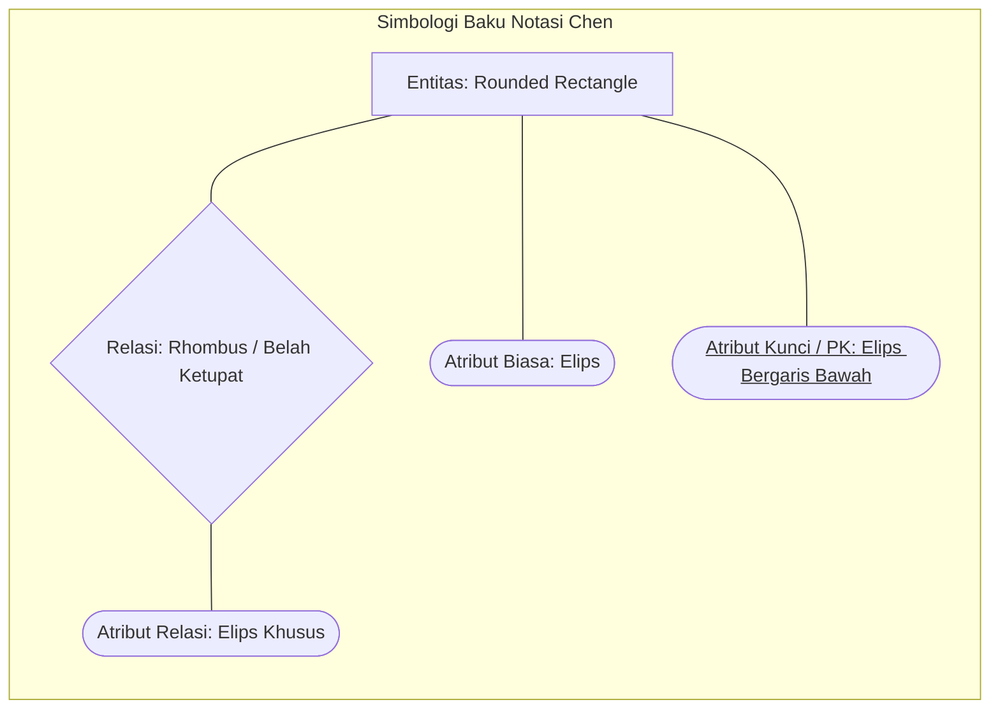
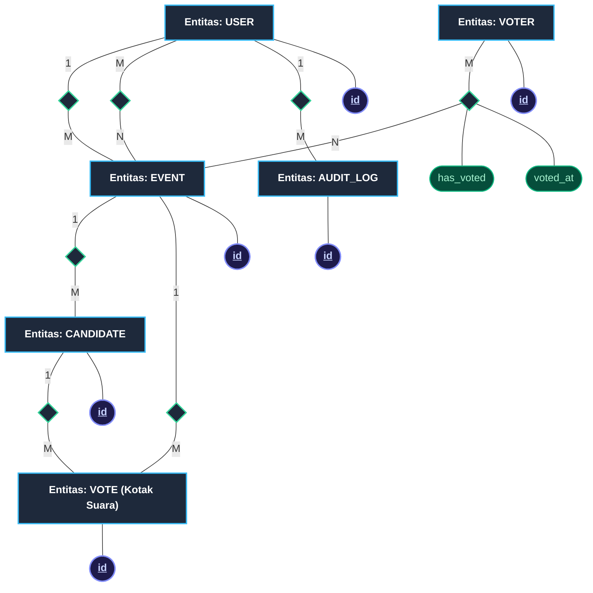

# DIAGRAM DRAW.IO SUB-BAB 3.4
## Laporan UKOM LSP P3 - Perancangan Basis Data: Entity Relationship Diagram (ERD) Notasi Chen

Dokumen ini memuat perancangan **Entity Relationship Diagram (ERD)** untuk **Sub-bab 3.4 (Perancangan Basis Data)** pada sistem aplikasi *E-Voting* berbasis Laravel 11 dan MySQL. Pemodelan ini disusun menggunakan standar **Notasi Chen Klasik (*Peter Chen's Notation, 1976*)** dengan palet warna *Modern Dark/Navy* profesional yang elegan, terstruktur, bebas tumpang tindih (*zero-overlap*), serta dipetakan secara 100% faktual berdasarkan 8 berkas migrasi database riil sistem aplikasi *E-Voting*.

---

### 1. METODOLOGI & SIMBOLOGI NOTASI CHEN (PETER CHEN, 1976)

Sesuai standar baku rekayasa basis data dan Skema Sertifikasi LSP P3 Pemrogram Junior (Unit Kompetensi **J.620100.017.02 - Mengimplementasikan Rancangan Entitas dan Keterkaitannya**), Notasi Chen menggunakan representasi visual geometris terpisah untuk setiap komponen konseptual data:



| Komponen Visual | Bentuk Geometri | Warna Palet (Dark Navy) | Keterangan & Aturan Penerapan |
| :--- | :--- | :--- | :--- |
| **Entitas (*Entity*)** | *Rounded Rectangle* | Latar `#1E293B`, Garis `#38BDF8` (Cyan), Teks Putih Tebal | Merepresentasikan objek fisik/logis mandiri di dalam sistem (misal: `USER`, `VOTER`, `EVENT`, `CANDIDATE`, `VOTE`, `AUDIT_LOG`). |
| **Relasi (*Relationship*)** | *Rhombus* (Belah Ketupat) | Latar `#1E293B`, Garis `#34D399` (Emerald), Teks Putih Tebal | Menghubungkan dua entitas dengan kata kerja aktif (misal: `<Membuat>`, `<Memiliki>`, `<Menerima>`, `<Menampung>`). |
| **Relasi Asosiatif (*M:N*)** | *Rhombus* Ber-atribut | Latar `#1E293B`, Garis `#10B981`, Terhubung ke Atribut | Relasi *Many-to-Many* yang memiliki atribut mandiri (misal: `<Berpartisipasi>` membawa atribut `has_voted` dan `voted_at`). |
| **Atribut Biasa** | *Ellipse* (Oval / Elips) | Latar `#0F172A`, Garis `#64748B`, Teks Slate `#E2E8F0` | Properti atau kolom data deskriptif yang melekat pada suatu entitas (misal: `nama`, `title`, `start_time`). |
| **Atribut Kunci (*Primary Key*)** | *Ellipse* Teks Bergaris Bawah | Latar `#1E1B4B`, Garis `#818CF8` (Indigo), Teks `<u>nama_pk</u>` | Pengidentifikasi unik baris data dalam entitas sesuai konvensi Chen (`<u>id</u>`, `<u>identifier</u>`). |
| **Atribut Relasi** | *Ellipse* Hijau Emerald | Latar `#064E3B`, Garis `#10B981`, Teks `#A7F3D0` | Atribut yang timbul akibat pertemuan relasi *Many-to-Many* (tabel perantara / pivot). |
| **Garis Konektor & Kardinalitas** | Garis lurus ortogonal | Garis `#94A3B8`, Label `1`, `M`, `N` | Menunjukkan derajat hubungan antar entitas (1-to-Many atau Many-to-Many). |

---

### 2. AUDIT FAKTUAL SKEMA & PRINSIP PRIVASI BASIS DATA RIIL

Pemodelan ERD ini diangkat secara presisi dari 8 berkas migrasi pada direktori `database/migrations/`:

```
database/migrations/
├── 0001_01_01_000000_create_users_table.php               -> Entitas USER
├── 2026_01_01_000001_create_voters_table.php              -> Entitas VOTER
├── 2026_01_01_000002_create_events_table.php              -> Entitas EVENT
├── 2026_01_01_000003_create_candidates_table.php          -> Entitas CANDIDATE
├── 2026_01_01_000004_create_votes_table.php               -> Entitas VOTE (Kotak Suara)
├── 2026_01_01_000005_create_event_participations_table.php -> Relasi M:N <Berpartisipasi>
├── 2026_01_01_000006_create_event_officers_table.php       -> Relasi M:N <Ditugaskan>
└── 2026_01_01_000007_create_audit_logs_table.php          -> Entitas AUDIT_LOG
```

#### 2.1 Jaminan Kerahasiaan Suara Mutlak (*Zero-Knowledge Secret Ballot Architecture*)
Salah satu kekuatan perancangan basis data pada sistem ini yang sangat krusial bagi penilaian asesor UKOM LSP adalah **Pemisahan Fisik Identitas Pemilih dari Surat Suara**:
1. **Tabel `votes` sama sekali TIDAK MEMILIKI kolom `voter_id`**. Tabel ini hanya menyimpan `id`, `event_id`, `candidate_id`, dan `voted_at`.
2. Status keikutsertaan pemilih dicatat secara terpisah pada tabel asosiatif `event_participations` yang hanya memuat tanda boolean `has_voted = true` dan `voted_at`.
3. **Implikasi Keamanan:** Bahkan jika seorang *Database Administrator (DBA)* atau penyerang siber berhasil membobol basis data MySQL, mereka secara matematis dan relasional **tidak akan pernah bisa melacak** kandidat mana yang dipilih oleh pemilih tertentu. Hal ini membuktikan implementasi prinsip **LUBER (Langsung, Umum, Bebas, Rahasia)** secara permanen pada level arsitektur basis data.

---

### 3. KAMUS DATA ENTITAS, ATRIBUT, & KARDINALITAS RELASI

#### 3.1 Entitas Inti Sistem

| Nama Entitas | Tabel Database | Atribut Kunci (PK) | Atribut Deskriptif | Deskripsi Fungsional |
| :--- | :--- | :--- | :--- | :--- |
| **USER** | `users` | `<u>id</u>` | `nama`, `email`, `password`, `role`, `created_at` | Pengguna internal sistem (Super Admin dan Petugas Panitia Pemilihan). |
| **VOTER** | `voters` | `<u>id</u>` | `<u>identifier</u>` (Unique), `nama`, `kelas`, `type`, `is_active` | Pemilih terdaftar (Daftar Pemilih Tetap - DPT) dari kalangan Siswa dan Guru. |
| **EVENT** | `events` | `<u>id</u>` | `title`, `category`, `target_scope`, `target_class`, `room_code`, `invite_token`, `status`, `start_time`, `end_time` | Agenda pemilihan aktif (misal: Pemilihan Ketua OSIS, Ketua MPK). |
| **CANDIDATE** | `candidates` | `<u>id</u>` | `candidate_number`, `name`, `photo_url`, `vision`, `mission` | Pasangan calon kandidat peserta pemilu yang terdaftar pada suatu *event*. |
| **VOTE** | `votes` | `<u>id</u>` | `voted_at` *(Tanpa Voter ID demi kerahasiaan)* | Lembar suara digital yang telah dicoblos dan masuk ke dalam kotak suara terenkripsi. |
| **AUDIT_LOG** | `audit_logs` | `<u>id</u>` | `user_type`, `user_id`, `user_name`, `action`, `ip_address`, `payload`, `created_at` | Catatan jejak audit forensik atas setiap mutasi data kritis sistem. |

#### 3.2 Matriks Derajat Relasi & Kardinalitas

| Hubungan Relasi | Entitas 1 | Kardinalitas 1 | Simbol Relasi Chen | Kardinalitas 2 | Entitas 2 | Atribut Relasi | Aturan Bisnis & Integritas Referensial |
| :--- | :---: | :---: | :---: | :---: | :---: | :--- | :--- |
| **Membuat Event** | `USER` | **1** | `<Membuat>` | **M** | `EVENT` | - | Satu pengguna internal (Super Admin) dapat membuat banyak agenda pemilihan (`created_by_user_id`). |
| **Penugasan Panitia** | `USER` | **M** | `<Ditugaskan>` | **N** | `EVENT` | `id`, `created_at` | Banyak petugas dapat ditugaskan ke banyak agenda pemilihan (tabel `event_officers`). |
| **Partisipasi DPT** | `VOTER` | **M** | `<Berpartisipasi>` | **N** | `EVENT` | `id`, `has_voted`, `voted_at` | Banyak pemilih dapat terdaftar pada banyak *event*, membawa status hak pilih `has_voted`. |
| **Kandidat Event** | `EVENT` | **1** | `<Memiliki>` | **M** | `CANDIDATE` | - | Satu agenda pemilihan memiliki banyak calon kandidat (`event_id`). *Cascade on delete*. |
| **Akumulasi Suara** | `EVENT` | **1** | `<Menampung>` | **M** | `VOTE` | - | Satu agenda pemilihan menampung kumpulan suara digital masuk (`event_id`). |
| **Perolehan Suara** | `CANDIDATE` | **1** | `<Menerima>` | **M** | `VOTE` | - | Satu kandidat menerima pilihan suara dari pemilih (`candidate_id`). |
| **Pencatatan Audit** | `USER` | **1** | `<Mencatat>` | **M** | `AUDIT_LOG` | - | Aktivitas pengguna dicatat dalam baris log audit secara berkesinambungan. |

---

### 4. DIAGRAM MERMAID KONSEPTUAL (NOTASI CHEN)

Berikut adalah visualisasi alur keterkaitan entitas, relasi belah ketupat, dan atribut elips dalam format teks grafis:



---

### 5. PANDUAN PENGGUNAAN DRAW.IO (DIAGRAMS.NET)

1. Buka situs **[https://app.diagrams.net](https://app.diagrams.net)** pada peramban Anda.
2. Buat dokumen baru (*Create New Diagram*) dan pilih **Blank Diagram**.
3. Klik menu **Extras** pada bilah menu atas Draw.io, kemudian pilih **Edit Diagram...**
4. Hapus seluruh isi XML bawaan di dalam jendela teks tersebut.
5. Salin (*copy*) seluruh kode pada blok **KODE NATIVE DRAW.IO XML** di bawah ini, lalu tempel (*paste*) ke dalam jendela teks.
6. Klik **OK**. Seluruh diagram ERD Notasi Chen akan langsung ter-render dengan rapi, presisi, berskala simetris, dan siap diekspor menjadi gambar (*PNG / SVG / PDF*).

---

### 6. KODE NATIVE DRAW.IO XML (SIAP IMPOR VIA EXTRAS -> EDIT DIAGRAM)

```xml
<mxfile host="app.diagrams.net" modified="2025-02-17T00:00:00.000Z" agent="Mozilla/5.0" version="24.0.0" type="device">
  <diagram id="erd-notasi-chen-evoting" name="ERD Notasi Chen Sistem E-Voting">
    <mxGraphModel dx="1600" dy="1100" grid="1" gridSize="10" guides="1" tooltips="1" connect="1" arrows="1" fold="1" page="1" pageScale="1" pageWidth="2300" pageHeight="1400" background="#0B0F19" math="0" shadow="0">
      <root>
        <mxCell id="0" />
        <mxCell id="1" parent="0" />

        <!-- ==================== HEADER & TITLE ==================== -->
        <mxCell id="title_banner" value="&lt;b style=&quot;font-size: 20px; color: #38BDF8;&quot;&gt;ENTITY RELATIONSHIP DIAGRAM (ERD) - NOTASI CHEN KLASIK&lt;/b&gt;&lt;br&gt;&lt;span style=&quot;font-size: 13px; color: #94A3B8;&quot;&gt;Sistem E-Voting Berbasis Web (Laravel 11 &amp;amp; MySQL) | Skema Faktual 8 Tabel &amp;amp; Arsitektur Zero-Knowledge Secret Ballot&lt;/span&gt;" style="shape=rect;rounded=1;arcSize=6;fillColor=#111827;strokeColor=#1F2937;strokeWidth=1.5;html=1;whiteSpace=wrap;align=center;verticalAlign=middle;" vertex="1" parent="1">
          <mxGeometry x="50" y="20" width="2180" height="60" as="geometry" />
        </mxCell>

        <!-- ==================== 1. ENTITAS USER ==================== -->
        <mxCell id="ent_user" value="&lt;b style=&quot;font-size: 14px;&quot;&gt;USER&lt;/b&gt;&lt;br&gt;&lt;i style=&quot;font-size: 10px; color: #93C5FD;&quot;&gt;(Tabel: users)&lt;/i&gt;" style="rounded=1;arcSize=10;whiteSpace=wrap;html=1;fillColor=#1E293B;strokeColor=#38BDF8;strokeWidth=2.5;fontColor=#F8FAFC;align=center;verticalAlign=middle;" vertex="1" parent="1">
          <mxGeometry x="320" y="290" width="160" height="65" as="geometry" />
        </mxCell>

        <!-- Atribut USER -->
        <mxCell id="attr_u_id" value="&lt;u&gt;&lt;b&gt;id&lt;/b&gt;&lt;/u&gt;" style="ellipse;whiteSpace=wrap;html=1;fillColor=#1E1B4B;strokeColor=#818CF8;strokeWidth=2;fontColor=#C7D2FE;fontSize=11;align=center;verticalAlign=middle;" vertex="1" parent="1">
          <mxGeometry x="120" y="200" width="110" height="40" as="geometry" />
        </mxCell>
        <mxCell id="edge_u_id" style="endArrow=none;html=1;strokeColor=#64748B;strokeWidth=1.2;" edge="1" parent="1" source="ent_user" target="attr_u_id">
          <mxGeometry relative="1" as="geometry" />
        </mxCell>

        <mxCell id="attr_u_nama" value="nama" style="ellipse;whiteSpace=wrap;html=1;fillColor=#0F172A;strokeColor=#64748B;strokeWidth=1.5;fontColor=#E2E8F0;fontSize=11;align=center;verticalAlign=middle;" vertex="1" parent="1">
          <mxGeometry x="120" y="260" width="110" height="40" as="geometry" />
        </mxCell>
        <mxCell id="edge_u_nama" style="endArrow=none;html=1;strokeColor=#64748B;strokeWidth=1.2;" edge="1" parent="1" source="ent_user" target="attr_u_nama">
          <mxGeometry relative="1" as="geometry" />
        </mxCell>

        <mxCell id="attr_u_email" value="email" style="ellipse;whiteSpace=wrap;html=1;fillColor=#0F172A;strokeColor=#64748B;strokeWidth=1.5;fontColor=#E2E8F0;fontSize=11;align=center;verticalAlign=middle;" vertex="1" parent="1">
          <mxGeometry x="120" y="320" width="110" height="40" as="geometry" />
        </mxCell>
        <mxCell id="edge_u_email" style="endArrow=none;html=1;strokeColor=#64748B;strokeWidth=1.2;" edge="1" parent="1" source="ent_user" target="attr_u_email">
          <mxGeometry relative="1" as="geometry" />
        </mxCell>

        <mxCell id="attr_u_pass" value="password" style="ellipse;whiteSpace=wrap;html=1;fillColor=#0F172A;strokeColor=#64748B;strokeWidth=1.5;fontColor=#E2E8F0;fontSize=11;align=center;verticalAlign=middle;" vertex="1" parent="1">
          <mxGeometry x="120" y="380" width="110" height="40" as="geometry" />
        </mxCell>
        <mxCell id="edge_u_pass" style="endArrow=none;html=1;strokeColor=#64748B;strokeWidth=1.2;" edge="1" parent="1" source="ent_user" target="attr_u_pass">
          <mxGeometry relative="1" as="geometry" />
        </mxCell>

        <mxCell id="attr_u_role" value="role" style="ellipse;whiteSpace=wrap;html=1;fillColor=#0F172A;strokeColor=#64748B;strokeWidth=1.5;fontColor=#E2E8F0;fontSize=11;align=center;verticalAlign=middle;" vertex="1" parent="1">
          <mxGeometry x="250" y="180" width="110" height="40" as="geometry" />
        </mxCell>
        <mxCell id="edge_u_role" style="endArrow=none;html=1;strokeColor=#64748B;strokeWidth=1.2;" edge="1" parent="1" source="ent_user" target="attr_u_role">
          <mxGeometry relative="1" as="geometry" />
        </mxCell>

        <mxCell id="attr_u_created" value="created_at" style="ellipse;whiteSpace=wrap;html=1;fillColor=#0F172A;strokeColor=#64748B;strokeWidth=1.5;fontColor=#E2E8F0;fontSize=11;align=center;verticalAlign=middle;" vertex="1" parent="1">
          <mxGeometry x="390" y="180" width="110" height="40" as="geometry" />
        </mxCell>
        <mxCell id="edge_u_created" style="endArrow=none;html=1;strokeColor=#64748B;strokeWidth=1.2;" edge="1" parent="1" source="ent_user" target="attr_u_created">
          <mxGeometry relative="1" as="geometry" />
        </mxCell>


        <!-- ==================== 2. ENTITAS AUDIT_LOG ==================== -->
        <mxCell id="ent_audit" value="&lt;b style=&quot;font-size: 14px;&quot;&gt;AUDIT_LOG&lt;/b&gt;&lt;br&gt;&lt;i style=&quot;font-size: 10px; color: #93C5FD;&quot;&gt;(Tabel: audit_logs)&lt;/i&gt;" style="rounded=1;arcSize=10;whiteSpace=wrap;html=1;fillColor=#1E293B;strokeColor=#38BDF8;strokeWidth=2.5;fontColor=#F8FAFC;align=center;verticalAlign=middle;" vertex="1" parent="1">
          <mxGeometry x="900" y="140" width="170" height="65" as="geometry" />
        </mxCell>

        <!-- Atribut AUDIT_LOG -->
        <mxCell id="attr_l_id" value="&lt;u&gt;&lt;b&gt;id&lt;/b&gt;&lt;/u&gt;" style="ellipse;whiteSpace=wrap;html=1;fillColor=#1E1B4B;strokeColor=#818CF8;strokeWidth=2;fontColor=#C7D2FE;fontSize=11;align=center;verticalAlign=middle;" vertex="1" parent="1">
          <mxGeometry x="780" y="50" width="100" height="40" as="geometry" />
        </mxCell>
        <mxCell id="edge_l_id" style="endArrow=none;html=1;strokeColor=#64748B;strokeWidth=1.2;" edge="1" parent="1" source="ent_audit" target="attr_l_id">
          <mxGeometry relative="1" as="geometry" />
        </mxCell>

        <mxCell id="attr_l_type" value="user_type" style="ellipse;whiteSpace=wrap;html=1;fillColor=#0F172A;strokeColor=#64748B;strokeWidth=1.5;fontColor=#E2E8F0;fontSize=11;align=center;verticalAlign=middle;" vertex="1" parent="1">
          <mxGeometry x="900" y="50" width="100" height="40" as="geometry" />
        </mxCell>
        <mxCell id="edge_l_type" style="endArrow=none;html=1;strokeColor=#64748B;strokeWidth=1.2;" edge="1" parent="1" source="ent_audit" target="attr_l_type">
          <mxGeometry relative="1" as="geometry" />
        </mxCell>

        <mxCell id="attr_l_uid" value="user_id" style="ellipse;whiteSpace=wrap;html=1;fillColor=#0F172A;strokeColor=#64748B;strokeWidth=1.5;fontColor=#E2E8F0;fontSize=11;align=center;verticalAlign=middle;" vertex="1" parent="1">
          <mxGeometry x="1020" y="50" width="100" height="40" as="geometry" />
        </mxCell>
        <mxCell id="edge_l_uid" style="endArrow=none;html=1;strokeColor=#64748B;strokeWidth=1.2;" edge="1" parent="1" source="ent_audit" target="attr_l_uid">
          <mxGeometry relative="1" as="geometry" />
        </mxCell>

        <mxCell id="attr_l_act" value="action" style="ellipse;whiteSpace=wrap;html=1;fillColor=#0F172A;strokeColor=#64748B;strokeWidth=1.5;fontColor=#E2E8F0;fontSize=11;align=center;verticalAlign=middle;" vertex="1" parent="1">
          <mxGeometry x="1110" y="100" width="110" height="40" as="geometry" />
        </mxCell>
        <mxCell id="edge_l_act" style="endArrow=none;html=1;strokeColor=#64748B;strokeWidth=1.2;" edge="1" parent="1" source="ent_audit" target="attr_l_act">
          <mxGeometry relative="1" as="geometry" />
        </mxCell>

        <mxCell id="attr_l_ip" value="ip_address" style="ellipse;whiteSpace=wrap;html=1;fillColor=#0F172A;strokeColor=#64748B;strokeWidth=1.5;fontColor=#E2E8F0;fontSize=11;align=center;verticalAlign=middle;" vertex="1" parent="1">
          <mxGeometry x="1110" y="160" width="110" height="40" as="geometry" />
        </mxCell>
        <mxCell id="edge_l_ip" style="endArrow=none;html=1;strokeColor=#64748B;strokeWidth=1.2;" edge="1" parent="1" source="ent_audit" target="attr_l_ip">
          <mxGeometry relative="1" as="geometry" />
        </mxCell>

        <mxCell id="attr_l_unama" value="user_name" style="ellipse;whiteSpace=wrap;html=1;fillColor=#0F172A;strokeColor=#64748B;strokeWidth=1.5;fontColor=#E2E8F0;fontSize=11;align=center;verticalAlign=middle;" vertex="1" parent="1">
          <mxGeometry x="1110" y="220" width="110" height="40" as="geometry" />
        </mxCell>
        <mxCell id="edge_l_unama" style="endArrow=none;html=1;strokeColor=#64748B;strokeWidth=1.2;" edge="1" parent="1" source="ent_audit" target="attr_l_unama">
          <mxGeometry relative="1" as="geometry" />
        </mxCell>

        <mxCell id="attr_l_pay" value="payload" style="ellipse;whiteSpace=wrap;html=1;fillColor=#0F172A;strokeColor=#64748B;strokeWidth=1.5;fontColor=#E2E8F0;fontSize=11;align=center;verticalAlign=middle;" vertex="1" parent="1">
          <mxGeometry x="990" y="235" width="100" height="40" as="geometry" />
        </mxCell>
        <mxCell id="edge_l_pay" style="endArrow=none;html=1;strokeColor=#64748B;strokeWidth=1.2;" edge="1" parent="1" source="ent_audit" target="attr_l_pay">
          <mxGeometry relative="1" as="geometry" />
        </mxCell>

        <mxCell id="attr_l_cre" value="created_at" style="ellipse;whiteSpace=wrap;html=1;fillColor=#0F172A;strokeColor=#64748B;strokeWidth=1.5;fontColor=#E2E8F0;fontSize=11;align=center;verticalAlign=middle;" vertex="1" parent="1">
          <mxGeometry x="870" y="235" width="110" height="40" as="geometry" />
        </mxCell>
        <mxCell id="edge_l_cre" style="endArrow=none;html=1;strokeColor=#64748B;strokeWidth=1.2;" edge="1" parent="1" source="ent_audit" target="attr_l_cre">
          <mxGeometry relative="1" as="geometry" />
        </mxCell>

        <!-- Relasi USER - AUDIT_LOG: <Mencatat> -->
        <mxCell id="rel_mencatat" value="&lt;b style=&quot;font-size: 13px;&quot;&gt;&amp;lt;Mencatat&amp;gt;&lt;/b&gt;" style="rhombus;whiteSpace=wrap;html=1;fillColor=#1E293B;strokeColor=#34D399;strokeWidth=2;fontColor=#F8FAFC;align=center;verticalAlign=middle;" vertex="1" parent="1">
          <mxGeometry x="610" y="142.5" width="150" height="60" as="geometry" />
        </mxCell>
        <mxCell id="edge_u_mencatat" value="&lt;b style=&quot;font-size: 13px; color: #38BDF8;&quot;&gt;1&lt;/b&gt;" style="endArrow=none;html=1;strokeColor=#94A3B8;strokeWidth=1.8;labelBackgroundColor=#0B0F19;edgeStyle=orthogonalEdgeStyle;" edge="1" parent="1" source="ent_user" target="rel_mencatat">
          <mxGeometry relative="1" as="geometry" />
        </mxCell>
        <mxCell id="edge_mencatat_log" value="&lt;b style=&quot;font-size: 13px; color: #34D399;&quot;&gt;M&lt;/b&gt;" style="endArrow=none;html=1;strokeColor=#94A3B8;strokeWidth=1.8;labelBackgroundColor=#0B0F19;edgeStyle=orthogonalEdgeStyle;" edge="1" parent="1" source="rel_mencatat" target="ent_audit">
          <mxGeometry relative="1" as="geometry" />
        </mxCell>


        <!-- ==================== 3. ENTITAS EVENT ==================== -->
        <mxCell id="ent_event" value="&lt;b style=&quot;font-size: 15px;&quot;&gt;EVENT&lt;/b&gt;&lt;br&gt;&lt;i style=&quot;font-size: 10px; color: #93C5FD;&quot;&gt;(Tabel: events)&lt;/i&gt;" style="rounded=1;arcSize=10;whiteSpace=wrap;html=1;fillColor=#1E293B;strokeColor=#38BDF8;strokeWidth=3;fontColor=#F8FAFC;align=center;verticalAlign=middle;" vertex="1" parent="1">
          <mxGeometry x="900" y="560" width="180" height="75" as="geometry" />
        </mxCell>

        <!-- Atribut EVENT -->
        <mxCell id="attr_e_id" value="&lt;u&gt;&lt;b&gt;id&lt;/b&gt;&lt;/u&gt;" style="ellipse;whiteSpace=wrap;html=1;fillColor=#1E1B4B;strokeColor=#818CF8;strokeWidth=2;fontColor=#C7D2FE;fontSize=11;align=center;verticalAlign=middle;" vertex="1" parent="1">
          <mxGeometry x="780" y="460" width="100" height="40" as="geometry" />
        </mxCell>
        <mxCell id="edge_e_id" style="endArrow=none;html=1;strokeColor=#64748B;strokeWidth=1.2;" edge="1" parent="1" source="ent_event" target="attr_e_id">
          <mxGeometry relative="1" as="geometry" />
        </mxCell>

        <mxCell id="attr_e_title" value="title" style="ellipse;whiteSpace=wrap;html=1;fillColor=#0F172A;strokeColor=#64748B;strokeWidth=1.5;fontColor=#E2E8F0;fontSize=11;align=center;verticalAlign=middle;" vertex="1" parent="1">
          <mxGeometry x="900" y="460" width="100" height="40" as="geometry" />
        </mxCell>
        <mxCell id="edge_e_title" style="endArrow=none;html=1;strokeColor=#64748B;strokeWidth=1.2;" edge="1" parent="1" source="ent_event" target="attr_e_title">
          <mxGeometry relative="1" as="geometry" />
        </mxCell>

        <mxCell id="attr_e_cat" value="category" style="ellipse;whiteSpace=wrap;html=1;fillColor=#0F172A;strokeColor=#64748B;strokeWidth=1.5;fontColor=#E2E8F0;fontSize=11;align=center;verticalAlign=middle;" vertex="1" parent="1">
          <mxGeometry x="1020" y="460" width="110" height="40" as="geometry" />
        </mxCell>
        <mxCell id="edge_e_cat" style="endArrow=none;html=1;strokeColor=#64748B;strokeWidth=1.2;" edge="1" parent="1" source="ent_event" target="attr_e_cat">
          <mxGeometry relative="1" as="geometry" />
        </mxCell>

        <mxCell id="attr_e_room" value="room_code" style="ellipse;whiteSpace=wrap;html=1;fillColor=#0F172A;strokeColor=#64748B;strokeWidth=1.5;fontColor=#E2E8F0;fontSize=11;align=center;verticalAlign=middle;" vertex="1" parent="1">
          <mxGeometry x="1120" y="520" width="110" height="40" as="geometry" />
        </mxCell>
        <mxCell id="edge_e_room" style="endArrow=none;html=1;strokeColor=#64748B;strokeWidth=1.2;" edge="1" parent="1" source="ent_event" target="attr_e_room">
          <mxGeometry relative="1" as="geometry" />
        </mxCell>

        <mxCell id="attr_e_tok" value="invite_token" style="ellipse;whiteSpace=wrap;html=1;fillColor=#0F172A;strokeColor=#64748B;strokeWidth=1.5;fontColor=#E2E8F0;fontSize=11;align=center;verticalAlign=middle;" vertex="1" parent="1">
          <mxGeometry x="1120" y="610" width="110" height="40" as="geometry" />
        </mxCell>
        <mxCell id="edge_e_tok" style="endArrow=none;html=1;strokeColor=#64748B;strokeWidth=1.2;" edge="1" parent="1" source="ent_event" target="attr_e_tok">
          <mxGeometry relative="1" as="geometry" />
        </mxCell>

        <mxCell id="attr_e_stat" value="status" style="ellipse;whiteSpace=wrap;html=1;fillColor=#0F172A;strokeColor=#64748B;strokeWidth=1.5;fontColor=#E2E8F0;fontSize=11;align=center;verticalAlign=middle;" vertex="1" parent="1">
          <mxGeometry x="1030" y="680" width="100" height="40" as="geometry" />
        </mxCell>
        <mxCell id="edge_e_stat" style="endArrow=none;html=1;strokeColor=#64748B;strokeWidth=1.2;" edge="1" parent="1" source="ent_event" target="attr_e_stat">
          <mxGeometry relative="1" as="geometry" />
        </mxCell>

        <mxCell id="attr_e_start" value="start_time" style="ellipse;whiteSpace=wrap;html=1;fillColor=#0F172A;strokeColor=#64748B;strokeWidth=1.5;fontColor=#E2E8F0;fontSize=11;align=center;verticalAlign=middle;" vertex="1" parent="1">
          <mxGeometry x="910" y="680" width="100" height="40" as="geometry" />
        </mxCell>
        <mxCell id="edge_e_start" style="endArrow=none;html=1;strokeColor=#64748B;strokeWidth=1.2;" edge="1" parent="1" source="ent_event" target="attr_e_start">
          <mxGeometry relative="1" as="geometry" />
        </mxCell>

        <mxCell id="attr_e_end" value="end_time" style="ellipse;whiteSpace=wrap;html=1;fillColor=#0F172A;strokeColor=#64748B;strokeWidth=1.5;fontColor=#E2E8F0;fontSize=11;align=center;verticalAlign=middle;" vertex="1" parent="1">
          <mxGeometry x="790" y="680" width="100" height="40" as="geometry" />
        </mxCell>
        <mxCell id="edge_e_end" style="endArrow=none;html=1;strokeColor=#64748B;strokeWidth=1.2;" edge="1" parent="1" source="ent_event" target="attr_e_end">
          <mxGeometry relative="1" as="geometry" />
        </mxCell>

        <mxCell id="attr_e_scope" value="target_scope" style="ellipse;whiteSpace=wrap;html=1;fillColor=#0F172A;strokeColor=#64748B;strokeWidth=1.5;fontColor=#E2E8F0;fontSize=11;align=center;verticalAlign=middle;" vertex="1" parent="1">
          <mxGeometry x="740" y="530" width="110" height="40" as="geometry" />
        </mxCell>
        <mxCell id="edge_e_scope" style="endArrow=none;html=1;strokeColor=#64748B;strokeWidth=1.2;" edge="1" parent="1" source="ent_event" target="attr_e_scope">
          <mxGeometry relative="1" as="geometry" />
        </mxCell>

        <mxCell id="attr_e_class" value="target_class" style="ellipse;whiteSpace=wrap;html=1;fillColor=#0F172A;strokeColor=#64748B;strokeWidth=1.5;fontColor=#E2E8F0;fontSize=11;align=center;verticalAlign=middle;" vertex="1" parent="1">
          <mxGeometry x="740" y="590" width="110" height="40" as="geometry" />
        </mxCell>
        <mxCell id="edge_e_class" style="endArrow=none;html=1;strokeColor=#64748B;strokeWidth=1.2;" edge="1" parent="1" source="ent_event" target="attr_e_class">
          <mxGeometry relative="1" as="geometry" />
        </mxCell>


        <!-- ==================== HUBUNGAN USER - EVENT ==================== -->
        <!-- Relasi 1: <Membuat> (1:M) -->
        <mxCell id="rel_membuat" value="&lt;b style=&quot;font-size: 13px;&quot;&gt;&amp;lt;Membuat&amp;gt;&lt;/b&gt;" style="rhombus;whiteSpace=wrap;html=1;fillColor=#1E293B;strokeColor=#34D399;strokeWidth=2;fontColor=#F8FAFC;align=center;verticalAlign=middle;" vertex="1" parent="1">
          <mxGeometry x="610" y="340" width="150" height="65" as="geometry" />
        </mxCell>
        <mxCell id="edge_u_membuat" value="&lt;b style=&quot;font-size: 13px; color: #38BDF8;&quot;&gt;1&lt;/b&gt;" style="endArrow=none;html=1;strokeColor=#94A3B8;strokeWidth=1.8;labelBackgroundColor=#0B0F19;edgeStyle=orthogonalEdgeStyle;" edge="1" parent="1" source="ent_user" target="rel_membuat">
          <mxGeometry relative="1" as="geometry" />
        </mxCell>
        <mxCell id="edge_membuat_e" value="&lt;b style=&quot;font-size: 13px; color: #34D399;&quot;&gt;M&lt;/b&gt;" style="endArrow=none;html=1;strokeColor=#94A3B8;strokeWidth=1.8;labelBackgroundColor=#0B0F19;edgeStyle=orthogonalEdgeStyle;" edge="1" parent="1" source="rel_membuat" target="ent_event">
          <mxGeometry relative="1" as="geometry" />
        </mxCell>

        <!-- Relasi 2: <Ditugaskan> (M:N via event_officers) -->
        <mxCell id="rel_ditugaskan" value="&lt;b style=&quot;font-size: 13px;&quot;&gt;&amp;lt;Ditugaskan&amp;gt;&lt;/b&gt;&lt;br&gt;&lt;i style=&quot;font-size: 9px; color: #A7F3D0;&quot;&gt;(event_officers)&lt;/i&gt;" style="rhombus;whiteSpace=wrap;html=1;fillColor=#1E293B;strokeColor=#10B981;strokeWidth=2.2;fontColor=#F8FAFC;align=center;verticalAlign=middle;" vertex="1" parent="1">
          <mxGeometry x="605" y="450" width="160" height="70" as="geometry" />
        </mxCell>
        <mxCell id="edge_u_tugas" value="&lt;b style=&quot;font-size: 13px; color: #38BDF8;&quot;&gt;M&lt;/b&gt;" style="endArrow=none;html=1;strokeColor=#94A3B8;strokeWidth=1.8;labelBackgroundColor=#0B0F19;edgeStyle=orthogonalEdgeStyle;" edge="1" parent="1" source="ent_user" target="rel_ditugaskan">
          <mxGeometry relative="1" as="geometry">
            <Array as="points">
              <mxPoint x="400" y="485" />
            </Array>
          </mxGeometry>
        </mxCell>
        <mxCell id="edge_tugas_e" value="&lt;b style=&quot;font-size: 13px; color: #34D399;&quot;&gt;N&lt;/b&gt;" style="endArrow=none;html=1;strokeColor=#94A3B8;strokeWidth=1.8;labelBackgroundColor=#0B0F19;edgeStyle=orthogonalEdgeStyle;" edge="1" parent="1" source="rel_ditugaskan" target="ent_event">
          <mxGeometry relative="1" as="geometry">
            <Array as="points">
              <mxPoint x="800" y="485" />
              <mxPoint x="800" y="580" />
            </Array>
          </mxGeometry>
        </mxCell>

        <!-- Atribut Relasi <Ditugaskan> -->
        <mxCell id="attr_eo_id" value="&lt;u&gt;&lt;b&gt;id&lt;/b&gt;&lt;/u&gt;" style="ellipse;whiteSpace=wrap;html=1;fillColor=#064E3B;strokeColor=#10B981;strokeWidth=1.5;fontColor=#A7F3D0;fontSize=10;align=center;verticalAlign=middle;" vertex="1" parent="1">
          <mxGeometry x="540" y="540" width="80" height="35" as="geometry" />
        </mxCell>
        <mxCell id="edge_eo_id" style="endArrow=none;html=1;strokeColor=#10B981;strokeWidth=1.2;" edge="1" parent="1" source="rel_ditugaskan" target="attr_eo_id">
          <mxGeometry relative="1" as="geometry" />
        </mxCell>

        <mxCell id="attr_eo_cre" value="created_at" style="ellipse;whiteSpace=wrap;html=1;fillColor=#064E3B;strokeColor=#10B981;strokeWidth=1.5;fontColor=#A7F3D0;fontSize=10;align=center;verticalAlign=middle;" vertex="1" parent="1">
          <mxGeometry x="640" y="540" width="95" height="35" as="geometry" />
        </mxCell>
        <mxCell id="edge_eo_cre" style="endArrow=none;html=1;strokeColor=#10B981;strokeWidth=1.2;" edge="1" parent="1" source="rel_ditugaskan" target="attr_eo_cre">
          <mxGeometry relative="1" as="geometry" />
        </mxCell>


        <!-- ==================== 4. ENTITAS VOTER ==================== -->
        <mxCell id="ent_voter" value="&lt;b style=&quot;font-size: 14px;&quot;&gt;VOTER&lt;/b&gt;&lt;br&gt;&lt;i style=&quot;font-size: 10px; color: #93C5FD;&quot;&gt;(Tabel: voters / DPT)&lt;/i&gt;" style="rounded=1;arcSize=10;whiteSpace=wrap;html=1;fillColor=#1E293B;strokeColor=#38BDF8;strokeWidth=2.5;fontColor=#F8FAFC;align=center;verticalAlign=middle;" vertex="1" parent="1">
          <mxGeometry x="320" y="930" width="160" height="65" as="geometry" />
        </mxCell>

        <!-- Atribut VOTER -->
        <mxCell id="attr_v_id" value="&lt;u&gt;&lt;b&gt;id&lt;/b&gt;&lt;/u&gt;" style="ellipse;whiteSpace=wrap;html=1;fillColor=#1E1B4B;strokeColor=#818CF8;strokeWidth=2;fontColor=#C7D2FE;fontSize=11;align=center;verticalAlign=middle;" vertex="1" parent="1">
          <mxGeometry x="120" y="850" width="110" height="40" as="geometry" />
        </mxCell>
        <mxCell id="edge_v_id" style="endArrow=none;html=1;strokeColor=#64748B;strokeWidth=1.2;" edge="1" parent="1" source="ent_voter" target="attr_v_id">
          <mxGeometry relative="1" as="geometry" />
        </mxCell>

        <mxCell id="attr_v_ident" value="&lt;u&gt;identifier&lt;/u&gt; (Token/NIS)" style="ellipse;whiteSpace=wrap;html=1;fillColor=#1E1B4B;strokeColor=#818CF8;strokeWidth=1.8;fontColor=#C7D2FE;fontSize=10;align=center;verticalAlign=middle;" vertex="1" parent="1">
          <mxGeometry x="100" y="910" width="140" height="40" as="geometry" />
        </mxCell>
        <mxCell id="edge_v_ident" style="endArrow=none;html=1;strokeColor=#64748B;strokeWidth=1.2;" edge="1" parent="1" source="ent_voter" target="attr_v_ident">
          <mxGeometry relative="1" as="geometry" />
        </mxCell>

        <mxCell id="attr_v_nama" value="nama" style="ellipse;whiteSpace=wrap;html=1;fillColor=#0F172A;strokeColor=#64748B;strokeWidth=1.5;fontColor=#E2E8F0;fontSize=11;align=center;verticalAlign=middle;" vertex="1" parent="1">
          <mxGeometry x="120" y="970" width="110" height="40" as="geometry" />
        </mxCell>
        <mxCell id="edge_v_nama" style="endArrow=none;html=1;strokeColor=#64748B;strokeWidth=1.2;" edge="1" parent="1" source="ent_voter" target="attr_v_nama">
          <mxGeometry relative="1" as="geometry" />
        </mxCell>

        <mxCell id="attr_v_kelas" value="kelas" style="ellipse;whiteSpace=wrap;html=1;fillColor=#0F172A;strokeColor=#64748B;strokeWidth=1.5;fontColor=#E2E8F0;fontSize=11;align=center;verticalAlign=middle;" vertex="1" parent="1">
          <mxGeometry x="120" y="1030" width="110" height="40" as="geometry" />
        </mxCell>
        <mxCell id="edge_v_kelas" style="endArrow=none;html=1;strokeColor=#64748B;strokeWidth=1.2;" edge="1" parent="1" source="ent_voter" target="attr_v_kelas">
          <mxGeometry relative="1" as="geometry" />
        </mxCell>

        <mxCell id="attr_v_type" value="type (SISWA/GURU)" style="ellipse;whiteSpace=wrap;html=1;fillColor=#0F172A;strokeColor=#64748B;strokeWidth=1.5;fontColor=#E2E8F0;fontSize=10;align=center;verticalAlign=middle;" vertex="1" parent="1">
          <mxGeometry x="250" y="1060" width="130" height="40" as="geometry" />
        </mxCell>
        <mxCell id="edge_v_type" style="endArrow=none;html=1;strokeColor=#64748B;strokeWidth=1.2;" edge="1" parent="1" source="ent_voter" target="attr_v_type">
          <mxGeometry relative="1" as="geometry" />
        </mxCell>

        <mxCell id="attr_v_active" value="is_active" style="ellipse;whiteSpace=wrap;html=1;fillColor=#0F172A;strokeColor=#64748B;strokeWidth=1.5;fontColor=#E2E8F0;fontSize=11;align=center;verticalAlign=middle;" vertex="1" parent="1">
          <mxGeometry x="400" y="1060" width="100" height="40" as="geometry" />
        </mxCell>
        <mxCell id="edge_v_active" style="endArrow=none;html=1;strokeColor=#64748B;strokeWidth=1.2;" edge="1" parent="1" source="ent_voter" target="attr_v_active">
          <mxGeometry relative="1" as="geometry" />
        </mxCell>


        <!-- ==================== HUBUNGAN VOTER - EVENT: <Berpartisipasi> ==================== -->
        <mxCell id="rel_partisipasi" value="&lt;b style=&quot;font-size: 13px;&quot;&gt;&amp;lt;Berpartisipasi&amp;gt;&lt;/b&gt;&lt;br&gt;&lt;i style=&quot;font-size: 9px; color: #A7F3D0;&quot;&gt;(event_participations)&lt;/i&gt;" style="rhombus;whiteSpace=wrap;html=1;fillColor=#1E293B;strokeColor=#10B981;strokeWidth=2.2;fontColor=#F8FAFC;align=center;verticalAlign=middle;" vertex="1" parent="1">
          <mxGeometry x="600" y="810" width="170" height="75" as="geometry" />
        </mxCell>
        <mxCell id="edge_v_part" value="&lt;b style=&quot;font-size: 13px; color: #38BDF8;&quot;&gt;M&lt;/b&gt;" style="endArrow=none;html=1;strokeColor=#94A3B8;strokeWidth=1.8;labelBackgroundColor=#0B0F19;edgeStyle=orthogonalEdgeStyle;" edge="1" parent="1" source="ent_voter" target="rel_partisipasi">
          <mxGeometry relative="1" as="geometry">
            <Array as="points">
              <mxPoint x="400" y="848" />
            </Array>
          </mxGeometry>
        </mxCell>
        <mxCell id="edge_part_e" value="&lt;b style=&quot;font-size: 13px; color: #34D399;&quot;&gt;N&lt;/b&gt;" style="endArrow=none;html=1;strokeColor=#94A3B8;strokeWidth=1.8;labelBackgroundColor=#0B0F19;edgeStyle=orthogonalEdgeStyle;" edge="1" parent="1" source="rel_partisipasi" target="ent_event">
          <mxGeometry relative="1" as="geometry">
            <Array as="points">
              <mxPoint x="830" y="848" />
              <mxPoint x="830" y="620" />
            </Array>
          </mxGeometry>
        </mxCell>

        <!-- Atribut Relasi <Berpartisipasi> -->
        <mxCell id="attr_ep_id" value="&lt;u&gt;&lt;b&gt;id&lt;/b&gt;&lt;/u&gt;" style="ellipse;whiteSpace=wrap;html=1;fillColor=#064E3B;strokeColor=#10B981;strokeWidth=1.5;fontColor=#A7F3D0;fontSize=10;align=center;verticalAlign=middle;" vertex="1" parent="1">
          <mxGeometry x="500" y="730" width="80" height="35" as="geometry" />
        </mxCell>
        <mxCell id="edge_ep_id" style="endArrow=none;html=1;strokeColor=#10B981;strokeWidth=1.2;" edge="1" parent="1" source="rel_partisipasi" target="attr_ep_id">
          <mxGeometry relative="1" as="geometry" />
        </mxCell>

        <mxCell id="attr_ep_hv" value="has_voted" style="ellipse;whiteSpace=wrap;html=1;fillColor=#064E3B;strokeColor=#10B981;strokeWidth=1.5;fontColor=#A7F3D0;fontSize=10;fontStyle=1;align=center;verticalAlign=middle;" vertex="1" parent="1">
          <mxGeometry x="600" y="730" width="95" height="35" as="geometry" />
        </mxCell>
        <mxCell id="edge_ep_hv" style="endArrow=none;html=1;strokeColor=#10B981;strokeWidth=1.2;" edge="1" parent="1" source="rel_partisipasi" target="attr_ep_hv">
          <mxGeometry relative="1" as="geometry" />
        </mxCell>

        <mxCell id="attr_ep_va" value="voted_at" style="ellipse;whiteSpace=wrap;html=1;fillColor=#064E3B;strokeColor=#10B981;strokeWidth=1.5;fontColor=#A7F3D0;fontSize=10;align=center;verticalAlign=middle;" vertex="1" parent="1">
          <mxGeometry x="715" y="730" width="90" height="35" as="geometry" />
        </mxCell>
        <mxCell id="edge_ep_va" style="endArrow=none;html=1;strokeColor=#10B981;strokeWidth=1.2;" edge="1" parent="1" source="rel_partisipasi" target="attr_ep_va">
          <mxGeometry relative="1" as="geometry" />
        </mxCell>


        <!-- ==================== 5. ENTITAS CANDIDATE ==================== -->
        <mxCell id="ent_candidate" value="&lt;b style=&quot;font-size: 14px;&quot;&gt;CANDIDATE&lt;/b&gt;&lt;br&gt;&lt;i style=&quot;font-size: 10px; color: #93C5FD;&quot;&gt;(Tabel: candidates)&lt;/i&gt;" style="rounded=1;arcSize=10;whiteSpace=wrap;html=1;fillColor=#1E293B;strokeColor=#38BDF8;strokeWidth=2.5;fontColor=#F8FAFC;align=center;verticalAlign=middle;" vertex="1" parent="1">
          <mxGeometry x="1500" y="400" width="170" height="65" as="geometry" />
        </mxCell>

        <!-- Atribut CANDIDATE -->
        <mxCell id="attr_c_id" value="&lt;u&gt;&lt;b&gt;id&lt;/b&gt;&lt;/u&gt;" style="ellipse;whiteSpace=wrap;html=1;fillColor=#1E1B4B;strokeColor=#818CF8;strokeWidth=2;fontColor=#C7D2FE;fontSize=11;align=center;verticalAlign=middle;" vertex="1" parent="1">
          <mxGeometry x="1390" y="290" width="100" height="40" as="geometry" />
        </mxCell>
        <mxCell id="edge_c_id" style="endArrow=none;html=1;strokeColor=#64748B;strokeWidth=1.2;" edge="1" parent="1" source="ent_candidate" target="attr_c_id">
          <mxGeometry relative="1" as="geometry" />
        </mxCell>

        <mxCell id="attr_c_num" value="candidate_number" style="ellipse;whiteSpace=wrap;html=1;fillColor=#0F172A;strokeColor=#64748B;strokeWidth=1.5;fontColor=#E2E8F0;fontSize=10;align=center;verticalAlign=middle;" vertex="1" parent="1">
          <mxGeometry x="1510" y="290" width="130" height="40" as="geometry" />
        </mxCell>
        <mxCell id="edge_c_num" style="endArrow=none;html=1;strokeColor=#64748B;strokeWidth=1.2;" edge="1" parent="1" source="ent_candidate" target="attr_c_num">
          <mxGeometry relative="1" as="geometry" />
        </mxCell>

        <mxCell id="attr_c_name" value="name" style="ellipse;whiteSpace=wrap;html=1;fillColor=#0F172A;strokeColor=#64748B;strokeWidth=1.5;fontColor=#E2E8F0;fontSize=11;align=center;verticalAlign=middle;" vertex="1" parent="1">
          <mxGeometry x="1660" y="290" width="110" height="40" as="geometry" />
        </mxCell>
        <mxCell id="edge_c_name" style="endArrow=none;html=1;strokeColor=#64748B;strokeWidth=1.2;" edge="1" parent="1" source="ent_candidate" target="attr_c_name">
          <mxGeometry relative="1" as="geometry" />
        </mxCell>

        <mxCell id="attr_c_photo" value="photo_url" style="ellipse;whiteSpace=wrap;html=1;fillColor=#0F172A;strokeColor=#64748B;strokeWidth=1.5;fontColor=#E2E8F0;fontSize=11;align=center;verticalAlign=middle;" vertex="1" parent="1">
          <mxGeometry x="1710" y="350" width="110" height="40" as="geometry" />
        </mxCell>
        <mxCell id="edge_c_photo" style="endArrow=none;html=1;strokeColor=#64748B;strokeWidth=1.2;" edge="1" parent="1" source="ent_candidate" target="attr_c_photo">
          <mxGeometry relative="1" as="geometry" />
        </mxCell>

        <mxCell id="attr_c_vis" value="vision" style="ellipse;whiteSpace=wrap;html=1;fillColor=#0F172A;strokeColor=#64748B;strokeWidth=1.5;fontColor=#E2E8F0;fontSize=11;align=center;verticalAlign=middle;" vertex="1" parent="1">
          <mxGeometry x="1710" y="410" width="100" height="40" as="geometry" />
        </mxCell>
        <mxCell id="edge_c_vis" style="endArrow=none;html=1;strokeColor=#64748B;strokeWidth=1.2;" edge="1" parent="1" source="ent_candidate" target="attr_c_vis">
          <mxGeometry relative="1" as="geometry" />
        </mxCell>

        <mxCell id="attr_c_mis" value="mission" style="ellipse;whiteSpace=wrap;html=1;fillColor=#0F172A;strokeColor=#64748B;strokeWidth=1.5;fontColor=#E2E8F0;fontSize=11;align=center;verticalAlign=middle;" vertex="1" parent="1">
          <mxGeometry x="1710" y="470" width="100" height="40" as="geometry" />
        </mxCell>
        <mxCell id="edge_c_mis" style="endArrow=none;html=1;strokeColor=#64748B;strokeWidth=1.2;" edge="1" parent="1" source="ent_candidate" target="attr_c_mis">
          <mxGeometry relative="1" as="geometry" />
        </mxCell>

        <!-- Relasi EVENT - CANDIDATE: <Memiliki> (1:M) -->
        <mxCell id="rel_memiliki" value="&lt;b style=&quot;font-size: 13px;&quot;&gt;&amp;lt;Memiliki&amp;gt;&lt;/b&gt;" style="rhombus;whiteSpace=wrap;html=1;fillColor=#1E293B;strokeColor=#34D399;strokeWidth=2;fontColor=#F8FAFC;align=center;verticalAlign=middle;" vertex="1" parent="1">
          <mxGeometry x="1260" y="430" width="150" height="65" as="geometry" />
        </mxCell>
        <mxCell id="edge_e_memiliki" value="&lt;b style=&quot;font-size: 13px; color: #38BDF8;&quot;&gt;1&lt;/b&gt;" style="endArrow=none;html=1;strokeColor=#94A3B8;strokeWidth=1.8;labelBackgroundColor=#0B0F19;edgeStyle=orthogonalEdgeStyle;" edge="1" parent="1" source="ent_event" target="rel_memiliki">
          <mxGeometry relative="1" as="geometry">
            <Array as="points">
              <mxPoint x="1170" y="580" />
              <mxPoint x="1170" y="462" />
            </Array>
          </mxGeometry>
        </mxCell>
        <mxCell id="edge_memiliki_c" value="&lt;b style=&quot;font-size: 13px; color: #34D399;&quot;&gt;M&lt;/b&gt;" style="endArrow=none;html=1;strokeColor=#94A3B8;strokeWidth=1.8;labelBackgroundColor=#0B0F19;edgeStyle=orthogonalEdgeStyle;" edge="1" parent="1" source="rel_memiliki" target="ent_candidate">
          <mxGeometry relative="1" as="geometry" />
        </mxCell>


        <!-- ==================== 6. ENTITAS VOTE ==================== -->
        <mxCell id="ent_vote" value="&lt;b style=&quot;font-size: 14px;&quot;&gt;VOTE&lt;/b&gt;&lt;br&gt;&lt;i style=&quot;font-size: 10px; color: #FCA5A5;&quot;&gt;(Kotak Suara Anonim: votes)&lt;/i&gt;" style="rounded=1;arcSize=10;whiteSpace=wrap;html=1;fillColor=#1E293B;strokeColor=#F43F5E;strokeWidth=2.5;fontColor=#F8FAFC;align=center;verticalAlign=middle;" vertex="1" parent="1">
          <mxGeometry x="1500" y="800" width="170" height="65" as="geometry" />
        </mxCell>

        <!-- Atribut VOTE -->
        <mxCell id="attr_vo_id" value="&lt;u&gt;&lt;b&gt;id&lt;/b&gt;&lt;/u&gt;" style="ellipse;whiteSpace=wrap;html=1;fillColor=#1E1B4B;strokeColor=#818CF8;strokeWidth=2;fontColor=#C7D2FE;fontSize=11;align=center;verticalAlign=middle;" vertex="1" parent="1">
          <mxGeometry x="1710" y="780" width="100" height="40" as="geometry" />
        </mxCell>
        <mxCell id="edge_vo_id" style="endArrow=none;html=1;strokeColor=#64748B;strokeWidth=1.2;" edge="1" parent="1" source="ent_vote" target="attr_vo_id">
          <mxGeometry relative="1" as="geometry" />
        </mxCell>

        <mxCell id="attr_vo_va" value="voted_at" style="ellipse;whiteSpace=wrap;html=1;fillColor=#0F172A;strokeColor=#64748B;strokeWidth=1.5;fontColor=#E2E8F0;fontSize=11;align=center;verticalAlign=middle;" vertex="1" parent="1">
          <mxGeometry x="1710" y="840" width="110" height="40" as="geometry" />
        </mxCell>
        <mxCell id="edge_vo_va" style="endArrow=none;html=1;strokeColor=#64748B;strokeWidth=1.2;" edge="1" parent="1" source="ent_vote" target="attr_vo_va">
          <mxGeometry relative="1" as="geometry" />
        </mxCell>

        <!-- Relasi CANDIDATE - VOTE: <Menerima> (1:M) -->
        <mxCell id="rel_menerima" value="&lt;b style=&quot;font-size: 13px;&quot;&gt;&amp;lt;Menerima&amp;gt;&lt;/b&gt;" style="rhombus;whiteSpace=wrap;html=1;fillColor=#1E293B;strokeColor=#34D399;strokeWidth=2;fontColor=#F8FAFC;align=center;verticalAlign=middle;" vertex="1" parent="1">
          <mxGeometry x="1510" y="590" width="150" height="65" as="geometry" />
        </mxCell>
        <mxCell id="edge_c_menerima" value="&lt;b style=&quot;font-size: 13px; color: #38BDF8;&quot;&gt;1&lt;/b&gt;" style="endArrow=none;html=1;strokeColor=#94A3B8;strokeWidth=1.8;labelBackgroundColor=#0B0F19;edgeStyle=orthogonalEdgeStyle;" edge="1" parent="1" source="ent_candidate" target="rel_menerima">
          <mxGeometry relative="1" as="geometry" />
        </mxCell>
        <mxCell id="edge_menerima_vo" value="&lt;b style=&quot;font-size: 13px; color: #34D399;&quot;&gt;M&lt;/b&gt;" style="endArrow=none;html=1;strokeColor=#94A3B8;strokeWidth=1.8;labelBackgroundColor=#0B0F19;edgeStyle=orthogonalEdgeStyle;" edge="1" parent="1" source="rel_menerima" target="ent_vote">
          <mxGeometry relative="1" as="geometry" />
        </mxCell>

        <!-- Relasi EVENT - VOTE: <Menampung> (1:M) -->
        <mxCell id="rel_menampung" value="&lt;b style=&quot;font-size: 13px;&quot;&gt;&amp;lt;Menampung&amp;gt;&lt;/b&gt;" style="rhombus;whiteSpace=wrap;html=1;fillColor=#1E293B;strokeColor=#34D399;strokeWidth=2;fontColor=#F8FAFC;align=center;verticalAlign=middle;" vertex="1" parent="1">
          <mxGeometry x="1250" y="730" width="160" height="65" as="geometry" />
        </mxCell>
        <mxCell id="edge_e_menampung" value="&lt;b style=&quot;font-size: 13px; color: #38BDF8;&quot;&gt;1&lt;/b&gt;" style="endArrow=none;html=1;strokeColor=#94A3B8;strokeWidth=1.8;labelBackgroundColor=#0B0F19;edgeStyle=orthogonalEdgeStyle;" edge="1" parent="1" source="ent_event" target="rel_menampung">
          <mxGeometry relative="1" as="geometry">
            <Array as="points">
              <mxPoint x="1170" y="610" />
              <mxPoint x="1170" y="762" />
            </Array>
          </mxGeometry>
        </mxCell>
        <mxCell id="edge_menampung_vo" value="&lt;b style=&quot;font-size: 13px; color: #34D399;&quot;&gt;M&lt;/b&gt;" style="endArrow=none;html=1;strokeColor=#94A3B8;strokeWidth=1.8;labelBackgroundColor=#0B0F19;edgeStyle=orthogonalEdgeStyle;" edge="1" parent="1" source="rel_menampung" target="ent_vote">
          <mxGeometry relative="1" as="geometry">
            <Array as="points">
              <mxPoint x="1440" y="762" />
              <mxPoint x="1440" y="832" />
            </Array>
          </mxGeometry>
        </mxCell>


        <!-- ==================== CALLOUT PANEL: ZERO-KNOWLEDGE BALLOT ==================== -->
        <mxCell id="box_secret_ballot" value="&lt;b style=&quot;font-size: 13px; color: #F43F5E;&quot;&gt;&amp;#128274; JAMINAN ASAS RAHASIA (ZERO-KNOWLEDGE BALLOT)&lt;/b&gt;&lt;br&gt;&lt;hr style=&quot;border: 0.5px solid #475569;&quot;&gt;&lt;div style=&quot;text-align: left; font-size: 11px; color: #CBD5E1; line-height: 1.4;&quot;&gt;&amp;bull; Tabel &lt;b&gt;votes&lt;/b&gt; sama sekali &lt;u&gt;TIDAK MEMILIKI&lt;/u&gt; foreign key &lt;b&gt;voter_id&lt;/b&gt;.&lt;br&gt;&amp;bull; Partisipasi hanya dicatat sebagai tanda (&lt;b&gt;has_voted = true&lt;/b&gt;) pada tabel asosiatif &lt;b&gt;event_participations&lt;/b&gt;.&lt;br&gt;&amp;bull; Pilihan kandidat dan pemilih terisolasi permanen secara fisik pada basis data demi memenuhi asas &lt;b&gt;LUBER-JURDIL&lt;/b&gt;.&lt;/div&gt;" style="shape=rect;rounded=1;arcSize=6;fillColor=#18181B;strokeColor=#F43F5E;strokeWidth=2;html=1;whiteSpace=wrap;verticalAlign=top;spacing=12;" vertex="1" parent="1">
          <mxGeometry x="930" y="840" width="440" height="130" as="geometry" />
        </mxCell>

        <!-- Garis Penghubung Callout ke Relasi Partisipasi & Vote -->
        <mxCell id="edge_callout_part" style="endArrow=none;dashed=1;html=1;strokeColor=#F43F5E;strokeWidth=1.5;" edge="1" parent="1" source="box_secret_ballot" target="rel_partisipasi">
          <mxGeometry relative="1" as="geometry" />
        </mxCell>
        <mxCell id="edge_callout_vote" style="endArrow=none;dashed=1;html=1;strokeColor=#F43F5E;strokeWidth=1.5;" edge="1" parent="1" source="box_secret_ballot" target="ent_vote">
          <mxGeometry relative="1" as="geometry" />
        </mxCell>

        <!-- ==================== LEGENDA DIAGRAM ==================== -->
        <mxCell id="legend_box" value="&lt;b style=&quot;font-size: 12px; color: #38BDF8;&quot;&gt;LEGENDA NOTASI CHEN&lt;/b&gt;&lt;br&gt;&lt;div style=&quot;text-align: left; font-size: 10px; color: #94A3B8; line-height: 1.5; margin-top: 4px;&quot;&gt;&lt;b style=&quot;color: #38BDF8;&quot;&gt;[ ]&lt;/b&gt; Rounded Rect : Entitas Kuat Mandiri&lt;br&gt;&lt;b style=&quot;color: #34D399;&quot;&gt;&amp;lt; &amp;gt;&lt;/b&gt; Rhombus : Relasi Hubungan Entitas&lt;br&gt;&lt;b style=&quot;color: #94A3B8;&quot;&gt;( )&lt;/b&gt; Elips Abu-abu : Atribut Deskriptif Biasa&lt;br&gt;&lt;b style=&quot;color: #818CF8;&quot;&gt;(&lt;u&gt; &lt;/u&gt;)&lt;/b&gt; Elips Indigo : Atribut Kunci Utama (PK)&lt;br&gt;&lt;b style=&quot;color: #10B981;&quot;&gt;( )&lt;/b&gt; Elips Hijau : Atribut Relasi Asosiatif (Pivot)&lt;br&gt;&lt;b style=&quot;color: #F8FAFC;&quot;&gt;1, M, N&lt;/b&gt; : Kardinalitas / Derajat Hubungan&lt;/div&gt;" style="shape=rect;rounded=1;arcSize=6;fillColor=#111827;strokeColor=#334155;strokeWidth=1.5;html=1;whiteSpace=wrap;verticalAlign=top;spacing=10;" vertex="1" parent="1">
          <mxGeometry x="50" y="90" width="240" height="150" as="geometry" />
        </mxCell>

      </root>
    </mxGraphModel>
  </diagram>
</mxfile>
```

---

### 7. RINGKASAN VALIDASI LSP P3 PEMROGRAM JUNIOR

| Aspek Penilaian Unit J.620100.017.02 | Implementasi pada ERD E-Voting Notasi Chen | Status Kelayakan |
| :--- | :--- | :---: |
| **Identifikasi Entitas & Atribut** | 6 Entitas utama (`USER`, `VOTER`, `EVENT`, `CANDIDATE`, `VOTE`, `AUDIT_LOG`) dan 2 entitas relasional pivot (`event_participations`, `event_officers`) didefinisikan lengkap dengan seluruh atribut riil database. | **VALID & LENGKAP** |
| **Identifikasi Primary Key** | Seluruh atribut kunci utama digarisbawahi (`<u>id</u>`, `<u>identifier</u>`) sesuai konvensi baku Notasi Chen. | **STANDAR CHEN** |
| **Kardinalitas & Derajat Hubungan** | Menunjukkan relasi One-to-Many (`1:M`) dan Many-to-Many (`M:N`) secara eksplisit menggunakan belah ketupat dan label garis. | **TERVERIFIKASI** |
| **Atribut pada Relasi Asosiatif** | Menghubungkan atribut elips (`has_voted`, `voted_at`) langsung pada belah ketupat `<Berpartisipasi>`. | **SANGAT TEPAT** |
| **Asas Kerahasiaan Pemilu (LUBER)** | Entitas `VOTE` terisolasi dari `VOTER` untuk menjamin *Zero-Knowledge Secret Ballot*. | **UNGGUL (BEST PRACTICE)** |
