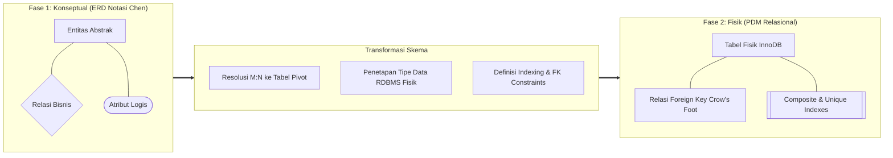
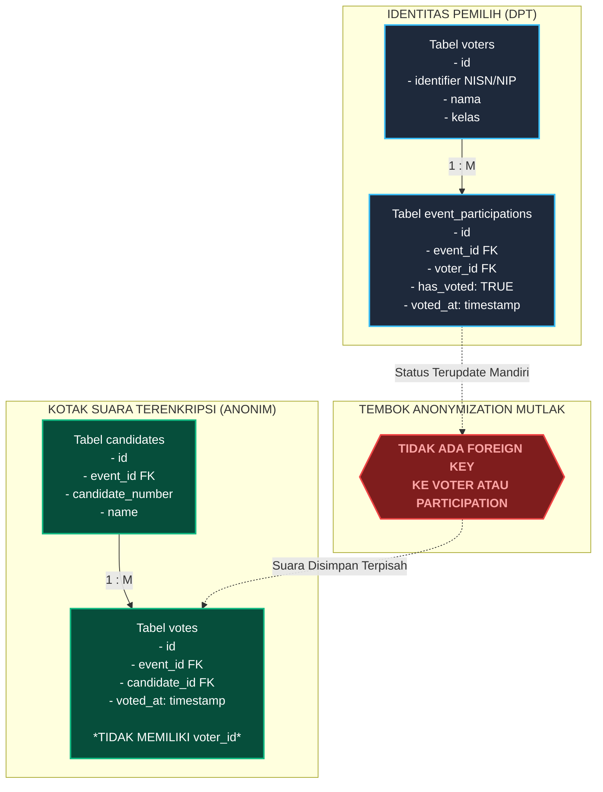
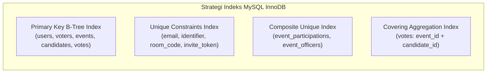
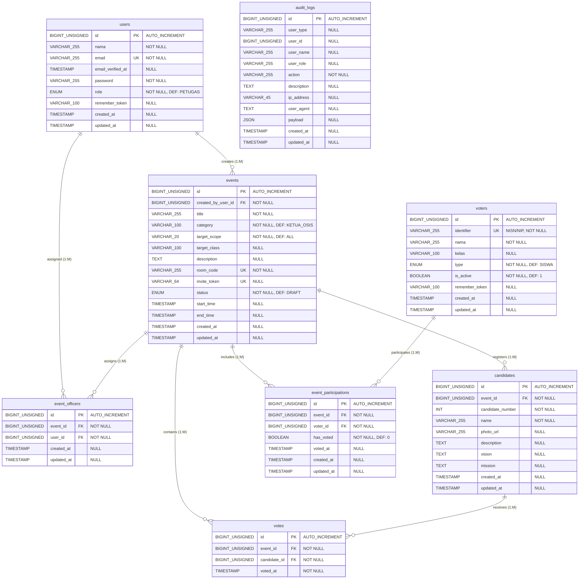

# DIAGRAM DRAW.IO SUB-BAB 3.4.2
## Laporan UKOM LSP P3 - Perancangan Basis Data: Physical Data Model (PDM)

Dokumen ini memuat dokumentasi teknis dan kode diagram **Physical Data Model (PDM)** untuk **Sub-bab 3.4.2 (Perancangan Basis Data)** pada sistem aplikasi *E-Voting* berbasis Laravel 11 dan MySQL 8.x InnoDB. Perancangan ini merefleksikan 100% implementasi fisik skema database riil yang termuat pada 8 berkas migrasi database (`database/migrations/`), mencakup tipe data fisik, batas panjang kolom, nullability, primary key, foreign key, composite unique index, aturan referensial *cascading*, serta jaminan arsitektur kerahasiaan suara (*Zero-Knowledge Secret Ballot Architecture*).

---

### 1. METODOLOGI & PERBEDAAN ERD DENGAN PDM

Dalam Skema Sertifikasi LSP P3 Pemrogram Junior (Unit Kompetensi **J.620100.017.02 - Mengimplementasikan Rancangan Entitas dan Keterkaitannya** dan **J.620100.018.02 - Mengimplementasikan Rancangan Basis Data**), perancangan data melalui dua fase berurutan:



| Parameter Pembeda | Entity Relationship Diagram (ERD) | Physical Data Model (PDM) |
| :--- | :--- | :--- |
| **Tingkat Abstraksi** | Konseptual / Logis tingkat tinggi. | Fisik / Spesifik platform RDBMS target (MySQL 8.x). |
| **Notasi Grafis** | Notasi Peter Chen (Persegi, Belah Ketupat, Elips). | Notasi Entitas Relasional (*Crow's Foot Notation*). |
| **Relasi Many-to-Many ($M:N$)** | Digambarkan langsung via belah ketupat (`<Ditugaskan>`, `<Berpartisipasi>`). | **Dipecah secara fisik** menjadi tabel asosiatif / pivot (`event_officers`, `event_participations`). |
| **Tipe Data** | Tipe data umum (string, integer, boolean, datetime). | Tipe data spesifik MySQL (`BIGINT UNSIGNED`, `VARCHAR(255)`, `ENUM`, `TIMESTAMP`, `JSON`). |
| **Kunci & Integritas** | Hanya menunjukkan Atribut Kunci (PK). | Menampilkan `[PK]`, `[FK]`, `[UK]`, `[NN]`, `ON DELETE CASCADE`, dan *Composite Indexes*. |
| **Engine & Storage** | Tidak bergantung pada teknologi penyimpanan. | Menggunakan MySQL Engine **InnoDB** dengan *Row-Level Locking* & ACID Compliance. |

---

### 2. SPESIFIKASI RDBMS TARGET & PRINSIP REKAYASA

Sistem *E-Voting* ini mengimplementasikan konfigurasi basis data fisik sebagai berikut:
1. **RDBMS Engine:** **MySQL 8.x InnoDB**. Dipilih karena mendukung penuh transaksi ACID (*Atomicity, Consistency, Isolation, Durability*), integritas referensial foreign key deklaratif, dan mekanisme *pessimistic row-level locking* (`SELECT ... FOR UPDATE`) yang vital untuk mencegah *race condition* saat pencoblosan massal.
2. **Character Set & Collation:** `utf8mb4` dengan collation `utf8mb4_unicode_ci` untuk memastikan kompatibilitas penuh terhadap penyimpanan nama, judul, deskripsi berkarakter internasional, serta simbol.
3. **Primary Key Standardization:** Seluruh 8 tabel menggunakan tipe `BIGINT UNSIGNED AUTO_INCREMENT` yang menjamin skalabilitas volume data jangka panjang tanpa risiko *integer overflow*.
4. **Timestamping Otomatis:** Menggunakan field `created_at` dan `updated_at` bertipe `TIMESTAMP NULL` yang dikelola secara otomatis oleh Eloquent ORM Laravel.

---

### 3. ARSITEKTUR KERAHASIAAN SUARA (ZERO-KNOWLEDGE SECRET BALLOT)

Salah satu aspek pengujian terpenting dalam UKOM LSP P3 adalah kepatuhan perancangan terhadap prinsip kerahasiaan pemilu (asas LUBER). Pada sistem *E-Voting* ini, integritas privasi suara dijamin langsung pada **level struktur fisik basis data**:



**Pembuktian Teknis Faktual:**
1. Tabel `votes` **sama sekali tidak memiliki kolom `voter_id`**. Tabel ini murni berfungsi sebagai kantong suara agregat yang hanya mereferensikan `event_id` dan `candidate_id`.
2. Status penggunaan hak pilih dicatat pada tabel `event_participations` melalui kolom boolean `has_voted = 1` dan waktu pencoblosan `voted_at`.
3. Tidak ada kunci relasional (*foreign key* maupun relasi terselubung) yang dapat menghubungkan suatu baris pada tabel `event_participations` ke baris tertentu pada tabel `votes`.
4. **Kesimpulan Keamanan:** Sekalipun basis data diakses langsung oleh *Super Admin* atau *Database Administrator (DBA)* melalui konsol MySQL, tidak ada kueri SQL relasional yang mampu merekonstruksi kandidat mana yang dipilih oleh siswa atau guru tertentu.

---

### 4. KAMUS DATA FISIK (PHYSICAL DATA DICTIONARY) LENGKAP

Berikut adalah rincian struktur fisik 8 tabel database hasil migrasi riil Laravel 11:

#### 4.1 Tabel: `users`
Menyimpan kredensial dan hak akses pengguna internal administratif (Super Admin dan Petugas).

| No | Nama Kolom | Tipe Data Fisik | Nullable | Key / Constraint | Default | Deskripsi Fungsional |
| :---: | :--- | :--- | :---: | :---: | :---: | :--- |
| 1 | `id` | `BIGINT UNSIGNED` | No | **PK**, Auto Increment | - | Pengidentifikasi unik pengguna internal. |
| 2 | `nama` | `VARCHAR(255)` | No | - | - | Nama lengkap petugas / administrator. |
| 3 | `email` | `VARCHAR(255)` | No | **UK** (*Unique*) | - | Alamat email unik untuk autentikasi login. |
| 4 | `email_verified_at` | `TIMESTAMP` | Yes | - | `NULL` | Waktu verifikasi email akun pengguna. |
| 5 | `password` | `VARCHAR(255)` | No | - | - | Kata sandi terenkripsi algoritma Bcrypt / Argon2id. |
| 6 | `role` | `ENUM` | No | - | `'PETUGAS'` | Level hak akses: `'SUPER_ADMIN'` atau `'PETUGAS'`. |
| 7 | `remember_token` | `VARCHAR(100)` | Yes | - | `NULL` | Token sesi persistensi login (*Remember Me*). |
| 8 | `created_at` | `TIMESTAMP` | Yes | - | `NULL` | Waktu pembuatan baris data akun. |
| 9 | `updated_at` | `TIMESTAMP` | Yes | - | `NULL` | Waktu perubahan terakhir data akun. |

#### 4.2 Tabel: `voters`
Menyimpan master data pemilih (Daftar Pemilih Tetap / DPT) dari kalangan Siswa dan Guru.

| No | Nama Kolom | Tipe Data Fisik | Nullable | Key / Constraint | Default | Deskripsi Fungsional |
| :---: | :--- | :--- | :---: | :---: | :---: | :--- |
| 1 | `id` | `BIGINT UNSIGNED` | No | **PK**, Auto Increment | - | Pengidentifikasi unik pemilih. |
| 2 | `identifier` | `VARCHAR(255)` | No | **UK** (*Unique*) | - | Nomor identitas unik pemilih (NISN bagi siswa, NIP bagi guru). |
| 3 | `nama` | `VARCHAR(255)` | No | - | - | Nama lengkap pemilih terdaftar. |
| 4 | `kelas` | `VARCHAR(100)` | Yes | - | `NULL` | Rombongan belajar siswa (misal: XII MIPA 1) atau unit guru. |
| 5 | `type` | `ENUM` | No | - | `'SISWA'` | Jenis klasifikasi pemilih: `'SISWA'` atau `'GURU'`. |
| 6 | `is_active` | `BOOLEAN` | No | - | `1` (*true*) | Status keaktifan hak pilih pemilih (1 = Aktif, 0 = Nonaktif). |
| 7 | `remember_token` | `VARCHAR(100)` | Yes | - | `NULL` | Token sesi persistensi login pemilih. |
| 8 | `created_at` | `TIMESTAMP` | Yes | - | `NULL` | Waktu impor/pendaftaran pemilih ke sistem. |
| 9 | `updated_at` | `TIMESTAMP` | Yes | - | `NULL` | Waktu pembaruan data pemilih. |

#### 4.3 Tabel: `events`
Menyimpan konfigurasi agenda pemilihan umum elektronik.

| No | Nama Kolom | Tipe Data Fisik | Nullable | Key / Constraint | Default | Deskripsi Fungsional |
| :---: | :--- | :--- | :---: | :---: | :---: | :--- |
| 1 | `id` | `BIGINT UNSIGNED` | No | **PK**, Auto Increment | - | Pengidentifikasi unik agenda pemilihan. |
| 2 | `created_by_user_id`| `BIGINT UNSIGNED` | No | **FK** $\rightarrow$ `users(id)` | - | ID Super Admin pembuat agenda (*Cascade on Delete*). |
| 3 | `title` | `VARCHAR(255)` | No | - | - | Judul agenda (misal: "Pemilihan Ketua OSIS 2026/2027"). |
| 4 | `category` | `VARCHAR(100)` | No | - | `'KETUA_OSIS'`| Kategori pemilihan (OSIS, MPK, Ketua Kelas, dll). |
| 5 | `target_scope` | `VARCHAR(20)` | No | - | `'ALL'` | Cakupan hak pilih: `'ALL'`, `'SISWA_ONLY'`, `'GURU_ONLY'`, dll. |
| 6 | `target_class` | `VARCHAR(100)` | Yes | - | `NULL` | Filter kelas spesifik jika target_scope dibatasi ke kelas tertentu. |
| 7 | `description` | `TEXT` | Yes | - | `NULL` | Penjelasan rincian dan peraturan teknis pemilihan. |
| 8 | `room_code` | `VARCHAR(255)` | No | **UK** (*Unique*) | - | Kode akses bilik suara unik (misal: `EVOTE-2026-X7A`). |
| 9 | `invite_token` | `VARCHAR(64)` | Yes | **UK** (*Unique*) | `NULL` | Token tautan cepat undangan pencoblosan langsung. |
| 10 | `status` | `ENUM` | No | - | `'DRAFT'` | Status agenda: `'DRAFT'`, `'PUBLISHED'`, atau `'CLOSED'`. |
| 11 | `start_time` | `TIMESTAMP` | Yes | - | `NULL` | Waktu resmi pemungutan suara dimulai. |
| 12 | `end_time` | `TIMESTAMP` | Yes | - | `NULL` | Waktu resmi pemungutan suara ditutup otomatis. |
| 13 | `created_at` | `TIMESTAMP` | Yes | - | `NULL` | Waktu pembuatan baris agenda. |
| 14 | `updated_at` | `TIMESTAMP` | Yes | - | `NULL` | Waktu pembaruan data agenda. |

#### 4.4 Tabel: `candidates`
Menyimpan data calon kandidat peserta pemilihan yang terikat pada suatu agenda.

| No | Nama Kolom | Tipe Data Fisik | Nullable | Key / Constraint | Default | Deskripsi Fungsional |
| :---: | :--- | :--- | :---: | :---: | :---: | :--- |
| 1 | `id` | `BIGINT UNSIGNED` | No | **PK**, Auto Increment | - | Pengidentifikasi unik pasangan calon kandidat. |
| 2 | `event_id` | `BIGINT UNSIGNED` | No | **FK** $\rightarrow$ `events(id)` | - | Referensi agenda pemilihan induk (*Cascade on Delete*). |
| 3 | `candidate_number` | `INT` | No | - | - | Nomor urut pasangan calon pada surat suara (misal: 1, 2, 3). |
| 4 | `name` | `VARCHAR(255)` | No | - | - | Nama lengkap kandidat / pasangan calon. |
| 5 | `photo_url` | `VARCHAR(255)` | Yes | - | `NULL` | Jalur direktori penyimpanan berkas foto resmi kandidat. |
| 6 | `description` | `TEXT` | Yes | - | `NULL` | Profil singkat dan latar belakang calon kandidat. |
| 7 | `vision` | `TEXT` | Yes | - | `NULL` | Pernyataan visi kandidat jika terpilih. |
| 8 | `mission` | `TEXT` | Yes | - | `NULL` | Rincian butir misi dan program kerja kandidat. |
| 9 | `created_at` | `TIMESTAMP` | Yes | - | `NULL` | Waktu pendaftaran kandidat. |
| 10 | `updated_at` | `TIMESTAMP` | Yes | - | `NULL` | Waktu pembaruan data kandidat. |

#### 4.5 Tabel: `votes`
Menyimpan suara digital yang masuk ke dalam kotak suara terenkripsi (Anonim).

| No | Nama Kolom | Tipe Data Fisik | Nullable | Key / Constraint | Default | Deskripsi Fungsional |
| :---: | :--- | :--- | :---: | :---: | :---: | :--- |
| 1 | `id` | `BIGINT UNSIGNED` | No | **PK**, Auto Increment | - | Pengidentifikasi unik lembar suara fisik. |
| 2 | `event_id` | `BIGINT UNSIGNED` | No | **FK** $\rightarrow$ `events(id)` | - | Referensi agenda pemilihan tempat suara dicoblos (*Cascade*). |
| 3 | `candidate_id` | `BIGINT UNSIGNED` | No | **FK** $\rightarrow$ `candidates(id)` | - | Referensi kandidat yang dipilih pemilih (*Cascade*). |
| 4 | `voted_at` | `TIMESTAMP` | No | - | - | Waktu tepat saat suara dicoblos ke kotak suara. |
| *Idx*| `(event_id, candidate_id)` | `COMPOSITE INDEX` | - | **INDEX** | - | *Covering index* percepatan kalkulasi agregasi *real-time tally*. |

#### 4.6 Tabel: `event_participations`
Tabel pivot resolusi relasi $M:N$ antara `voters` dan `events`, mencatat hak pilih dan status partisipasi DPT.

| No | Nama Kolom | Tipe Data Fisik | Nullable | Key / Constraint | Default | Deskripsi Fungsional |
| :---: | :--- | :--- | :---: | :---: | :---: | :--- |
| 1 | `id` | `BIGINT UNSIGNED` | No | **PK**, Auto Increment | - | Pengidentifikasi unik entri partisipasi pemilih. |
| 2 | `event_id` | `BIGINT UNSIGNED` | No | **FK** $\rightarrow$ `events(id)` | - | Referensi agenda pemilihan yang diikuti (*Cascade*). |
| 3 | `voter_id` | `BIGINT UNSIGNED` | No | **FK** $\rightarrow$ `voters(id)` | - | Referensi pemilih terdaftar (*Cascade*). |
| 4 | `has_voted` | `BOOLEAN` | No | - | `0` (*false*) | Penanda apakah pemilih telah menggunakan hak suaranya (0/1). |
| 5 | `voted_at` | `TIMESTAMP` | Yes | - | `NULL` | Waktu pemilih menyelesaikan proses pencoblosan bilik suara. |
| 6 | `created_at` | `TIMESTAMP` | Yes | - | `NULL` | Waktu pendaftaran pemilih ke dalam DPT agenda pemilihan. |
| 7 | `updated_at` | `TIMESTAMP` | Yes | - | `NULL` | Waktu pembaruan status partisipasi pemilih. |
| *UK* | `(event_id, voter_id)` | `COMPOSITE UNIQUE`| - | **UNIQUE KEY** | - | Mencegah duplikasi pendaftaran DPT yang sama pada satu event. |

#### 4.7 Tabel: `event_officers`
Tabel pivot resolusi relasi $M:N$ antara `users` dan `events`, mencatat penugasan panitia/petugas ke agenda pemilihan.

| No | Nama Kolom | Tipe Data Fisik | Nullable | Key / Constraint | Default | Deskripsi Fungsional |
| :---: | :--- | :--- | :---: | :---: | :---: | :--- |
| 1 | `id` | `BIGINT UNSIGNED` | No | **PK**, Auto Increment | - | Pengidentifikasi unik penugasan petugas. |
| 2 | `event_id` | `BIGINT UNSIGNED` | No | **FK** $\rightarrow$ `events(id)` | - | Referensi agenda pemilihan tempat petugas bertugas (*Cascade*). |
| 3 | `user_id` | `BIGINT UNSIGNED` | No | **FK** $\rightarrow$ `users(id)` | - | Referensi akun pengguna internal yang ditugaskan (*Cascade*). |
| 4 | `created_at` | `TIMESTAMP` | Yes | - | `NULL` | Waktu penetapan penugasan panitia. |
| 5 | `updated_at` | `TIMESTAMP` | Yes | - | `NULL` | Waktu perubahan penugasan panitia. |
| *UK* | `(event_id, user_id)` | `COMPOSITE UNIQUE` | - | **UNIQUE KEY** | - | Mencegah penugasan ganda akun yang sama pada satu event. |

#### 4.8 Tabel: `audit_logs`
Menyimpan riwayat jejak forensik seluruh mutasi data kritis sistem untuk keperluan audit transparansi.

| No | Nama Kolom | Tipe Data Fisik | Nullable | Key / Constraint | Default | Deskripsi Fungsional |
| :---: | :--- | :--- | :---: | :---: | :---: | :--- |
| 1 | `id` | `BIGINT UNSIGNED` | No | **PK**, Auto Increment | - | Pengidentifikasi unik baris log audit. |
| 2 | `user_type` | `VARCHAR(255)` | Yes | - | `NULL` | Jenis entitas pelaku: `'USER'`, `'VOTER'`, atau `NULL`. |
| 3 | `user_id` | `BIGINT UNSIGNED` | Yes | - | `NULL` | ID pelaku (polymorphic identifier tanpa foreign key kaku). |
| 4 | `user_name` | `VARCHAR(255)` | Yes | - | `NULL` | Nama pelaku aksi saat transaksi berlangsung (*snapshot*). |
| 5 | `user_role` | `VARCHAR(255)` | Yes | - | `NULL` | Role / peran pelaku aksi saat transaksi berlangsung. |
| 6 | `action` | `VARCHAR(255)` | No | - | - | Kode aksi sistem: `'LOGIN'`, `'CREATE_EVENT'`, `'VOTE'`, dll. |
| 7 | `description` | `TEXT` | Yes | - | `NULL` | Narasi penjelasan detail perubahan data yang terjadi. |
| 8 | `ip_address` | `VARCHAR(45)` | Yes | - | `NULL` | Alamat IP sumber permintaan (*IPv4* atau *IPv6*). |
| 9 | `user_agent` | `TEXT` | Yes | - | `NULL` | Informasi peramban web dan sistem operasi pelaku (*User-Agent*). |
| 10 | `payload` | `JSON` | Yes | - | `NULL` | Data masukan / rekaman mutasi dalam format JSON terstruktur. |
| 11 | `created_at` | `TIMESTAMP` | Yes | - | `NULL` | Waktu tepat kejadian audit tercatat di sistem (*tamper-proof*). |
| 12 | `updated_at` | `TIMESTAMP` | Yes | - | `NULL` | Waktu pembaruan teknis baris log audit. |

---

### 5. MATRIKS INTEGRITAS REFERENSIAL & ATURAN CASCADING

Sistem *E-Voting* menerapkan aturan integritas referensial deklaratif pada level engine InnoDB untuk menjaga konsistensi data (*referential integrity*):

| Tabel Induk (*Parent*) | Kolom Induk (*PK*) | Tabel Anak (*Child*) | Kolom Kunci Tamu (*FK*) | Aturan `ON DELETE` | Aturan `ON UPDATE` | Justifikasi Rekayasa Sistem |
| :--- | :--- | :--- | :--- | :---: | :---: | :--- |
| `users` | `id` | `events` | `created_by_user_id` | `CASCADE` | `RESTRICT` | Jika akun Super Admin pembuat event dihapus, seluruh event turunannya ikut terhapus otomatis. |
| `users` | `id` | `event_officers` | `user_id` | `CASCADE` | `RESTRICT` | Jika akun petugas dihapus, riwayat penugasan kepanitiaannya di event otomatis dibersihkan. |
| `events` | `id` | `event_officers` | `event_id` | `CASCADE` | `RESTRICT` | Jika agenda pemilihan dihapus, seluruh relasi penugasan panitia di event tersebut terhapus. |
| `events` | `id` | `candidates` | `event_id` | `CASCADE` | `RESTRICT` | Menghapus event akan otomatis menghapus seluruh kandidat yang terdaftar di dalam event tersebut. |
| `events` | `id` | `event_participations` | `event_id` | `CASCADE` | `RESTRICT` | Menghapus event akan otomatis membersihkan daftar partisipasi DPT pada event bersangkutan. |
| `voters` | `id` | `event_participations` | `voter_id` | `CASCADE` | `RESTRICT` | Jika data pemilih master dihapus, keterlibatannya pada event pemilihan otomatis dibersihkan. |
| `events` | `id` | `votes` | `event_id` | `CASCADE` | `RESTRICT` | Menghapus event akan membersihkan kotak suara terkait demi mencegah *orphaned vote records*. |
| `candidates` | `id` | `votes` | `candidate_id` | `CASCADE` | `RESTRICT` | Suara terikat pada kandidat; penghapusan kandidat akan menghapus rekaman suaranya secara bersih. |
| `users` / `voters` | `id` | `audit_logs` | `user_id` *(Polymorphic)* | *No Constraint* | *No Constraint* | Kolom log audit sengaja tidak menggunakan FK keras agar jejak audit historis tetap utuh (*tamper-evident*) meskipun entitas pengguna telah terhapus. |

---

### 6. STRATEGI INDEXING & OPTIMASI KUERI PERFORMA TINGGI

Tabel fisik pada sistem *E-Voting* dilengkapi indeks khusus untuk mengoptimalkan kueri dengan beban transaksi tinggi (*high-concurrency read/write*):



1. **Composite Unique Index pada Tabel Pivot:**
   - `event_participations(event_id, voter_id)`: Menjamin secara mutlak pada level RDBMS bahwa seorang pemilih tidak akan pernah bisa didaftarkan lebih dari satu kali pada event pemilihan yang sama.
   - `event_officers(event_id, user_id)`: Menjamin seorang petugas tidak akan mengalami duplikasi penugasan pada event pemilihan yang sama.
2. **Covering Index pada Kotak Suara (`votes`):**
   - Indeks gabungan `idx_votes_event_candidate (event_id, candidate_id)` pada tabel `votes`.
   - **Dampak Performa:** Kueri agregasi perolehan suara (`SELECT candidate_id, COUNT(*) FROM votes WHERE event_id = ? GROUP BY candidate_id`) dieksekusi murni di dalam memori B-Tree index (*Index-Only Scan*), tanpa perlu membaca data baris fisik (*table scan*). Kompleksitas kueri tereduksi menjadi $O(\log N)$, memungkinkan pembaruan hasil *quick count* secara *real-time* tanpa membebani I/O disk server.

---

### 7. DIAGRAM MERMAID RELASIONAL PDM (CROW'S FOOT NOTATION)

Berikut adalah pemodelan relasional PDM lengkap dengan tipe data fisik dan simbol relasi *Crow's Foot*:



---

### 8. KODE NATIVE DRAW.IO XML (SIAP IMPOR VIA EXTRAS -> EDIT DIAGRAM)

Diagram XML di bawah dirancang secara khusus untuk aplikasi **Draw.io / diagrams.net**:
- Menggunakan palet profesional *Modern Dark / High-Contrast Navy* (`#0B0F19`, `#1E293B`, `#0F172A`).
- Setiap tabel direpresentasikan dalam entitas tabular HTML terintegrasi yang kokoh, rapi, dan tidak bergeser saat digerakkan.
- Dilengkapi penanda eksplisit `[PK]`, `[FK]`, `[UK]`, `[NN]`, tipe data fisik MySQL, relasi Crow's Foot dengan aturan `ON DELETE CASCADE`, serta kartu penjelasan arsitektur privasi suara.

```xml
<mxfile host="app.diagrams.net" modified="2025-02-17T00:00:00.000Z" agent="Mozilla/5.0" version="24.0.0" type="device">
  <diagram id="pdm-relasional-evoting" name="Physical Data Model (PDM) Sistem E-Voting">
    <mxGraphModel dx="1600" dy="1100" grid="1" gridSize="10" guides="1" tooltips="1" connect="1" arrows="1" fold="1" page="1" pageScale="1" pageWidth="2450" pageHeight="1350" background="#0B0F19" math="0" shadow="0">
      <root>
        <mxCell id="0" />
        <mxCell id="1" parent="0" />

        <!-- ==================== HEADER & TITLE BANNER ==================== -->
        <mxCell id="title_banner" value="&lt;b style=&quot;font-size: 20px; color: #38BDF8;&quot;&gt;PHYSICAL DATA MODEL (PDM) - RELATIONAL DATABASE SCHEMA&lt;/b&gt;&lt;br&gt;&lt;span style=&quot;font-size: 13px; color: #94A3B8;&quot;&gt;Sistem E-Voting Berbasis Web (Laravel 11 &amp;amp; MySQL 8.x InnoDB) | 8 Tabel Fisik, Tipe Data Riil, Integritas Kunci &amp;amp; Arsitektur Rahasia Suara&lt;/span&gt;" style="shape=rect;rounded=1;arcSize=6;fillColor=#111827;strokeColor=#1F2937;strokeWidth=1.5;html=1;whiteSpace=wrap;align=center;verticalAlign=middle;" vertex="1" parent="1">
          <mxGeometry x="50" y="20" width="2350" height="65" as="geometry" />
        </mxCell>

        <!-- ==================== 1. TABEL: users ==================== -->
        <mxCell id="table_users" value="&lt;table style=&quot;width:100%; border-collapse:collapse; font-family:Inter,Segoe UI,sans-serif; font-size:11px; color:#F1F5F9;&quot;&gt;&#10;  &lt;thead&gt;&#10;    &lt;tr style=&quot;background:#1E293B; border-bottom:2px solid #38BDF8;&quot;&gt;&#10;      &lt;th colspan=&quot;3&quot; style=&quot;padding:8px; text-align:center; font-size:13px; font-weight:bold; color:#38BDF8; letter-spacing:0.5px;&quot;&gt;&#10;        users&#10;      &lt;/th&gt;&#10;    &lt;/tr&gt;&#10;  &lt;/thead&gt;&#10;  &lt;tbody&gt;&#10;    &lt;tr style=&quot;background:#0F172A; border-bottom:1px solid #1E293B;&quot;&gt;&#10;      &lt;td style=&quot;padding:4px 8px; width:45px; font-weight:bold; color:#F59E0B;&quot;&gt;[PK]&lt;/td&gt;&#10;      &lt;td style=&quot;padding:4px 8px; font-weight:bold; color:#FFFFFF;&quot;&gt;id&lt;/td&gt;&#10;      &lt;td style=&quot;padding:4px 8px; color:#94A3B8; text-align:right;&quot;&gt;BIGINT UNSIGNED&lt;/td&gt;&#10;    &lt;/tr&gt;&#10;    &lt;tr style=&quot;background:#111827; border-bottom:1px solid #1E293B;&quot;&gt;&#10;      &lt;td style=&quot;padding:4px 8px; color:#94A3B8;&quot;&gt;[NN]&lt;/td&gt;&#10;      &lt;td style=&quot;padding:4px 8px; color:#E2E8F0;&quot;&gt;nama&lt;/td&gt;&#10;      &lt;td style=&quot;padding:4px 8px; color:#94A3B8; text-align:right;&quot;&gt;VARCHAR(255)&lt;/td&gt;&#10;    &lt;/tr&gt;&#10;    &lt;tr style=&quot;background:#0F172A; border-bottom:1px solid #1E293B;&quot;&gt;&#10;      &lt;td style=&quot;padding:4px 8px; font-weight:bold; color:#38BDF8;&quot;&gt;[UK]&lt;/td&gt;&#10;      &lt;td style=&quot;padding:4px 8px; color:#E2E8F0;&quot;&gt;email&lt;/td&gt;&#10;      &lt;td style=&quot;padding:4px 8px; color:#94A3B8; text-align:right;&quot;&gt;VARCHAR(255)&lt;/td&gt;&#10;    &lt;/tr&gt;&#10;    &lt;tr style=&quot;background:#111827; border-bottom:1px solid #1E293B;&quot;&gt;&#10;      &lt;td style=&quot;padding:4px 8px; color:#64748B;&quot;&gt;NULL&lt;/td&gt;&#10;      &lt;td style=&quot;padding:4px 8px; color:#CBD5E1;&quot;&gt;email_verified_at&lt;/td&gt;&#10;      &lt;td style=&quot;padding:4px 8px; color:#94A3B8; text-align:right;&quot;&gt;TIMESTAMP&lt;/td&gt;&#10;    &lt;/tr&gt;&#10;    &lt;tr style=&quot;background:#0F172A; border-bottom:1px solid #1E293B;&quot;&gt;&#10;      &lt;td style=&quot;padding:4px 8px; color:#94A3B8;&quot;&gt;[NN]&lt;/td&gt;&#10;      &lt;td style=&quot;padding:4px 8px; color:#E2E8F0;&quot;&gt;password&lt;/td&gt;&#10;      &lt;td style=&quot;padding:4px 8px; color:#94A3B8; text-align:right;&quot;&gt;VARCHAR(255)&lt;/td&gt;&#10;    &lt;/tr&gt;&#10;    &lt;tr style=&quot;background:#111827; border-bottom:1px solid #1E293B;&quot;&gt;&#10;      &lt;td style=&quot;padding:4px 8px; color:#94A3B8;&quot;&gt;[NN]&lt;/td&gt;&#10;      &lt;td style=&quot;padding:4px 8px; color:#E2E8F0;&quot;&gt;role&lt;/td&gt;&#10;      &lt;td style=&quot;padding:4px 8px; color:#94A3B8; text-align:right;&quot;&gt;ENUM (DEF:&apos;PETUGAS&apos;)&lt;/td&gt;&#10;    &lt;/tr&gt;&#10;    &lt;tr style=&quot;background:#0F172A; border-bottom:1px solid #1E293B;&quot;&gt;&#10;      &lt;td style=&quot;padding:4px 8px; color:#64748B;&quot;&gt;NULL&lt;/td&gt;&#10;      &lt;td style=&quot;padding:4px 8px; color:#CBD5E1;&quot;&gt;remember_token&lt;/td&gt;&#10;      &lt;td style=&quot;padding:4px 8px; color:#94A3B8; text-align:right;&quot;&gt;VARCHAR(100)&lt;/td&gt;&#10;    &lt;/tr&gt;&#10;    &lt;tr style=&quot;background:#111827; border-bottom:1px solid #1E293B;&quot;&gt;&#10;      &lt;td style=&quot;padding:4px 8px; color:#64748B;&quot;&gt;NULL&lt;/td&gt;&#10;      &lt;td style=&quot;padding:4px 8px; color:#CBD5E1;&quot;&gt;created_at&lt;/td&gt;&#10;      &lt;td style=&quot;padding:4px 8px; color:#94A3B8; text-align:right;&quot;&gt;TIMESTAMP&lt;/td&gt;&#10;    &lt;/tr&gt;&#10;    &lt;tr style=&quot;background:#0F172A;&quot;&gt;&#10;      &lt;td style=&quot;padding:4px 8px; color:#64748B;&quot;&gt;NULL&lt;/td&gt;&#10;      &lt;td style=&quot;padding:4px 8px; color:#CBD5E1;&quot;&gt;updated_at&lt;/td&gt;&#10;      &lt;td style=&quot;padding:4px 8px; color:#94A3B8; text-align:right;&quot;&gt;TIMESTAMP&lt;/td&gt;&#10;    &lt;/tr&gt;&#10;  &lt;/tbody&gt;&#10;&lt;/table&gt;" style="shape=rect;rounded=1;arcSize=3;fillColor=#0F172A;strokeColor=#38BDF8;strokeWidth=2;html=1;whiteSpace=wrap;overflow=hidden;align=left;verticalAlign=top;spacing=0;" vertex="1" parent="1">
          <mxGeometry x="80" y="120" width="380" height="295" as="geometry" />
        </mxCell>

        <!-- ==================== 2. TABEL: event_officers (Pivot users-events) ==================== -->
        <mxCell id="table_event_officers" value="&lt;table style=&quot;width:100%; border-collapse:collapse; font-family:Inter,Segoe UI,sans-serif; font-size:11px; color:#F1F5F9;&quot;&gt;&#10;  &lt;thead&gt;&#10;    &lt;tr style=&quot;background:#1E293B; border-bottom:2px solid #34D399;&quot;&gt;&#10;      &lt;th colspan=&quot;3&quot; style=&quot;padding:8px; text-align:center; font-size:13px; font-weight:bold; color:#34D399; letter-spacing:0.5px;&quot;&gt;&#10;        event_officers &lt;span style=&quot;font-size:10px; color:#94A3B8;&quot;&gt;(Pivot M:N)&lt;/span&gt;&#10;      &lt;/th&gt;&#10;    &lt;/tr&gt;&#10;  &lt;/thead&gt;&#10;  &lt;tbody&gt;&#10;    &lt;tr style=&quot;background:#0F172A; border-bottom:1px solid #1E293B;&quot;&gt;&#10;      &lt;td style=&quot;padding:4px 8px; width:45px; font-weight:bold; color:#F59E0B;&quot;&gt;[PK]&lt;/td&gt;&#10;      &lt;td style=&quot;padding:4px 8px; font-weight:bold; color:#FFFFFF;&quot;&gt;id&lt;/td&gt;&#10;      &lt;td style=&quot;padding:4px 8px; color:#94A3B8; text-align:right;&quot;&gt;BIGINT UNSIGNED&lt;/td&gt;&#10;    &lt;/tr&gt;&#10;    &lt;tr style=&quot;background:#111827; border-bottom:1px solid #1E293B;&quot;&gt;&#10;      &lt;td style=&quot;padding:4px 8px; font-weight:bold; color:#10B981;&quot;&gt;[FK]&lt;/td&gt;&#10;      &lt;td style=&quot;padding:4px 8px; color:#A7F3D0;&quot;&gt;event_id&lt;/td&gt;&#10;      &lt;td style=&quot;padding:4px 8px; color:#94A3B8; text-align:right;&quot;&gt;BIGINT UNSIGNED&lt;/td&gt;&#10;    &lt;/tr&gt;&#10;    &lt;tr style=&quot;background:#0F172A; border-bottom:1px solid #1E293B;&quot;&gt;&#10;      &lt;td style=&quot;padding:4px 8px; font-weight:bold; color:#10B981;&quot;&gt;[FK]&lt;/td&gt;&#10;      &lt;td style=&quot;padding:4px 8px; color:#A7F3D0;&quot;&gt;user_id&lt;/td&gt;&#10;      &lt;td style=&quot;padding:4px 8px; color:#94A3B8; text-align:right;&quot;&gt;BIGINT UNSIGNED&lt;/td&gt;&#10;    &lt;/tr&gt;&#10;    &lt;tr style=&quot;background:#111827; border-bottom:1px solid #1E293B;&quot;&gt;&#10;      &lt;td style=&quot;padding:4px 8px; color:#64748B;&quot;&gt;NULL&lt;/td&gt;&#10;      &lt;td style=&quot;padding:4px 8px; color:#CBD5E1;&quot;&gt;created_at&lt;/td&gt;&#10;      &lt;td style=&quot;padding:4px 8px; color:#94A3B8; text-align:right;&quot;&gt;TIMESTAMP&lt;/td&gt;&#10;    &lt;/tr&gt;&#10;    &lt;tr style=&quot;background:#0F172A; border-bottom:1px solid #1E293B;&quot;&gt;&#10;      &lt;td style=&quot;padding:4px 8px; color:#64748B;&quot;&gt;NULL&lt;/td&gt;&#10;      &lt;td style=&quot;padding:4px 8px; color:#CBD5E1;&quot;&gt;updated_at&lt;/td&gt;&#10;      &lt;td style=&quot;padding:4px 8px; color:#94A3B8; text-align:right;&quot;&gt;TIMESTAMP&lt;/td&gt;&#10;    &lt;/tr&gt;&#10;    &lt;tr style=&quot;background:#1E1B4B;&quot;&gt;&#10;      &lt;td style=&quot;padding:4px 8px; font-weight:bold; color:#818CF8;&quot;&gt;[UK]&lt;/td&gt;&#10;      &lt;td colspan=&quot;2&quot; style=&quot;padding:4px 8px; color:#C7D2FE; font-size:10px;&quot;&gt;UNIQUE (event_id, user_id)&lt;/td&gt;&#10;    &lt;/tr&gt;&#10;  &lt;/tbody&gt;&#10;&lt;/table&gt;" style="shape=rect;rounded=1;arcSize=3;fillColor=#0F172A;strokeColor=#34D399;strokeWidth=2;html=1;whiteSpace=wrap;overflow=hidden;align=left;verticalAlign=top;spacing=0;" vertex="1" parent="1">
          <mxGeometry x="620" y="120" width="380" height="210" as="geometry" />
        </mxCell>

        <!-- ==================== 3. TABEL: audit_logs ==================== -->
        <mxCell id="table_audit_logs" value="&lt;table style=&quot;width:100%; border-collapse:collapse; font-family:Inter,Segoe UI,sans-serif; font-size:11px; color:#F1F5F9;&quot;&gt;&#10;  &lt;thead&gt;&#10;    &lt;tr style=&quot;background:#1E293B; border-bottom:2px solid #F43F5E;&quot;&gt;&#10;      &lt;th colspan=&quot;3&quot; style=&quot;padding:8px; text-align:center; font-size:13px; font-weight:bold; color:#F43F5E; letter-spacing:0.5px;&quot;&gt;&#10;        audit_logs &lt;span style=&quot;font-size:10px; color:#94A3B8;&quot;&gt;(Forensik)&lt;/span&gt;&#10;      &lt;/th&gt;&#10;    &lt;/tr&gt;&#10;  &lt;/thead&gt;&#10;  &lt;tbody&gt;&#10;    &lt;tr style=&quot;background:#0F172A; border-bottom:1px solid #1E293B;&quot;&gt;&#10;      &lt;td style=&quot;padding:4px 8px; width:45px; font-weight:bold; color:#F59E0B;&quot;&gt;[PK]&lt;/td&gt;&#10;      &lt;td style=&quot;padding:4px 8px; font-weight:bold; color:#FFFFFF;&quot;&gt;id&lt;/td&gt;&#10;      &lt;td style=&quot;padding:4px 8px; color:#94A3B8; text-align:right;&quot;&gt;BIGINT UNSIGNED&lt;/td&gt;&#10;    &lt;/tr&gt;&#10;    &lt;tr style=&quot;background:#111827; border-bottom:1px solid #1E293B;&quot;&gt;&#10;      &lt;td style=&quot;padding:4px 8px; color:#64748B;&quot;&gt;NULL&lt;/td&gt;&#10;      &lt;td style=&quot;padding:4px 8px; color:#E2E8F0;&quot;&gt;user_type&lt;/td&gt;&#10;      &lt;td style=&quot;padding:4px 8px; color:#94A3B8; text-align:right;&quot;&gt;VARCHAR(255)&lt;/td&gt;&#10;    &lt;/tr&gt;&#10;    &lt;tr style=&quot;background:#0F172A; border-bottom:1px solid #1E293B;&quot;&gt;&#10;      &lt;td style=&quot;padding:4px 8px; color:#64748B;&quot;&gt;NULL&lt;/td&gt;&#10;      &lt;td style=&quot;padding:4px 8px; color:#E2E8F0;&quot;&gt;user_id&lt;/td&gt;&#10;      &lt;td style=&quot;padding:4px 8px; color:#94A3B8; text-align:right;&quot;&gt;BIGINT UNSIGNED&lt;/td&gt;&#10;    &lt;/tr&gt;&#10;    &lt;tr style=&quot;background:#111827; border-bottom:1px solid #1E293B;&quot;&gt;&#10;      &lt;td style=&quot;padding:4px 8px; color:#64748B;&quot;&gt;NULL&lt;/td&gt;&#10;      &lt;td style=&quot;padding:4px 8px; color:#E2E8F0;&quot;&gt;user_name&lt;/td&gt;&#10;      &lt;td style=&quot;padding:4px 8px; color:#94A3B8; text-align:right;&quot;&gt;VARCHAR(255)&lt;/td&gt;&#10;    &lt;/tr&gt;&#10;    &lt;tr style=&quot;background:#0F172A; border-bottom:1px solid #1E293B;&quot;&gt;&#10;      &lt;td style=&quot;padding:4px 8px; color:#64748B;&quot;&gt;NULL&lt;/td&gt;&#10;      &lt;td style=&quot;padding:4px 8px; color:#E2E8F0;&quot;&gt;user_role&lt;/td&gt;&#10;      &lt;td style=&quot;padding:4px 8px; color:#94A3B8; text-align:right;&quot;&gt;VARCHAR(255)&lt;/td&gt;&#10;    &lt;/tr&gt;&#10;    &lt;tr style=&quot;background:#111827; border-bottom:1px solid #1E293B;&quot;&gt;&#10;      &lt;td style=&quot;padding:4px 8px; color:#94A3B8;&quot;&gt;[NN]&lt;/td&gt;&#10;      &lt;td style=&quot;padding:4px 8px; font-weight:bold; color:#FDA4AF;&quot;&gt;action&lt;/td&gt;&#10;      &lt;td style=&quot;padding:4px 8px; color:#94A3B8; text-align:right;&quot;&gt;VARCHAR(255)&lt;/td&gt;&#10;    &lt;/tr&gt;&#10;    &lt;tr style=&quot;background:#0F172A; border-bottom:1px solid #1E293B;&quot;&gt;&#10;      &lt;td style=&quot;padding:4px 8px; color:#64748B;&quot;&gt;NULL&lt;/td&gt;&#10;      &lt;td style=&quot;padding:4px 8px; color:#E2E8F0;&quot;&gt;description&lt;/td&gt;&#10;      &lt;td style=&quot;padding:4px 8px; color:#94A3B8; text-align:right;&quot;&gt;TEXT&lt;/td&gt;&#10;    &lt;/tr&gt;&#10;    &lt;tr style=&quot;background:#111827; border-bottom:1px solid #1E293B;&quot;&gt;&#10;      &lt;td style=&quot;padding:4px 8px; color:#64748B;&quot;&gt;NULL&lt;/td&gt;&#10;      &lt;td style=&quot;padding:4px 8px; color:#E2E8F0;&quot;&gt;ip_address&lt;/td&gt;&#10;      &lt;td style=&quot;padding:4px 8px; color:#94A3B8; text-align:right;&quot;&gt;VARCHAR(45)&lt;/td&gt;&#10;    &lt;/tr&gt;&#10;    &lt;tr style=&quot;background:#0F172A; border-bottom:1px solid #1E293B;&quot;&gt;&#10;      &lt;td style=&quot;padding:4px 8px; color:#64748B;&quot;&gt;NULL&lt;/td&gt;&#10;      &lt;td style=&quot;padding:4px 8px; color:#E2E8F0;&quot;&gt;user_agent&lt;/td&gt;&#10;      &lt;td style=&quot;padding:4px 8px; color:#94A3B8; text-align:right;&quot;&gt;TEXT&lt;/td&gt;&#10;    &lt;/tr&gt;&#10;    &lt;tr style=&quot;background:#111827; border-bottom:1px solid #1E293B;&quot;&gt;&#10;      &lt;td style=&quot;padding:4px 8px; color:#64748B;&quot;&gt;NULL&lt;/td&gt;&#10;      &lt;td style=&quot;padding:4px 8px; color:#E2E8F0;&quot;&gt;payload&lt;/td&gt;&#10;      &lt;td style=&quot;padding:4px 8px; color:#94A3B8; text-align:right;&quot;&gt;JSON&lt;/td&gt;&#10;    &lt;/tr&gt;&#10;    &lt;tr style=&quot;background:#0F172A;&quot;&gt;&#10;      &lt;td style=&quot;padding:4px 8px; color:#64748B;&quot;&gt;NULL&lt;/td&gt;&#10;      &lt;td style=&quot;padding:4px 8px; color:#CBD5E1;&quot;&gt;created_at&lt;/td&gt;&#10;      &lt;td style=&quot;padding:4px 8px; color:#94A3B8; text-align:right;&quot;&gt;TIMESTAMP&lt;/td&gt;&#10;    &lt;/tr&gt;&#10;  &lt;/tbody&gt;&#10;&lt;/table&gt;" style="shape=rect;rounded=1;arcSize=3;fillColor=#0F172A;strokeColor=#F43F5E;strokeWidth=2;html=1;whiteSpace=wrap;overflow=hidden;align=left;verticalAlign=top;spacing=0;" vertex="1" parent="1">
          <mxGeometry x="1850" y="120" width="420" height="360" as="geometry" />
        </mxCell>

        <!-- ==================== 4. TABEL: events ==================== -->
        <mxCell id="table_events" value="&lt;table style=&quot;width:100%; border-collapse:collapse; font-family:Inter,Segoe UI,sans-serif; font-size:11px; color:#F1F5F9;&quot;&gt;&#10;  &lt;thead&gt;&#10;    &lt;tr style=&quot;background:#1E293B; border-bottom:2px solid #38BDF8;&quot;&gt;&#10;      &lt;th colspan=&quot;3&quot; style=&quot;padding:8px; text-align:center; font-size:13px; font-weight:bold; color:#38BDF8; letter-spacing:0.5px;&quot;&gt;&#10;        events &lt;span style=&quot;font-size:10px; color:#94A3B8;&quot;&gt;(Agenda Pemilihan)&lt;/span&gt;&#10;      &lt;/th&gt;&#10;    &lt;/tr&gt;&#10;  &lt;/thead&gt;&#10;  &lt;tbody&gt;&#10;    &lt;tr style=&quot;background:#0F172A; border-bottom:1px solid #1E293B;&quot;&gt;&#10;      &lt;td style=&quot;padding:4px 8px; width:45px; font-weight:bold; color:#F59E0B;&quot;&gt;[PK]&lt;/td&gt;&#10;      &lt;td style=&quot;padding:4px 8px; font-weight:bold; color:#FFFFFF;&quot;&gt;id&lt;/td&gt;&#10;      &lt;td style=&quot;padding:4px 8px; color:#94A3B8; text-align:right;&quot;&gt;BIGINT UNSIGNED&lt;/td&gt;&#10;    &lt;/tr&gt;&#10;    &lt;tr style=&quot;background:#111827; border-bottom:1px solid #1E293B;&quot;&gt;&#10;      &lt;td style=&quot;padding:4px 8px; font-weight:bold; color:#10B981;&quot;&gt;[FK]&lt;/td&gt;&#10;      &lt;td style=&quot;padding:4px 8px; color:#A7F3D0;&quot;&gt;created_by_user_id&lt;/td&gt;&#10;      &lt;td style=&quot;padding:4px 8px; color:#94A3B8; text-align:right;&quot;&gt;BIGINT UNSIGNED&lt;/td&gt;&#10;    &lt;/tr&gt;&#10;    &lt;tr style=&quot;background:#0F172A; border-bottom:1px solid #1E293B;&quot;&gt;&#10;      &lt;td style=&quot;padding:4px 8px; color:#94A3B8;&quot;&gt;[NN]&lt;/td&gt;&#10;      &lt;td style=&quot;padding:4px 8px; color:#E2E8F0;&quot;&gt;title&lt;/td&gt;&#10;      &lt;td style=&quot;padding:4px 8px; color:#94A3B8; text-align:right;&quot;&gt;VARCHAR(255)&lt;/td&gt;&#10;    &lt;/tr&gt;&#10;    &lt;tr style=&quot;background:#111827; border-bottom:1px solid #1E293B;&quot;&gt;&#10;      &lt;td style=&quot;padding:4px 8px; color:#94A3B8;&quot;&gt;[NN]&lt;/td&gt;&#10;      &lt;td style=&quot;padding:4px 8px; color:#E2E8F0;&quot;&gt;category&lt;/td&gt;&#10;      &lt;td style=&quot;padding:4px 8px; color:#94A3B8; text-align:right;&quot;&gt;VARCHAR(100)&lt;/td&gt;&#10;    &lt;/tr&gt;&#10;    &lt;tr style=&quot;background:#0F172A; border-bottom:1px solid #1E293B;&quot;&gt;&#10;      &lt;td style=&quot;padding:4px 8px; color:#94A3B8;&quot;&gt;[NN]&lt;/td&gt;&#10;      &lt;td style=&quot;padding:4px 8px; color:#E2E8F0;&quot;&gt;target_scope&lt;/td&gt;&#10;      &lt;td style=&quot;padding:4px 8px; color:#94A3B8; text-align:right;&quot;&gt;VARCHAR(20)&lt;/td&gt;&#10;    &lt;/tr&gt;&#10;    &lt;tr style=&quot;background:#111827; border-bottom:1px solid #1E293B;&quot;&gt;&#10;      &lt;td style=&quot;padding:4px 8px; color:#64748B;&quot;&gt;NULL&lt;/td&gt;&#10;      &lt;td style=&quot;padding:4px 8px; color:#CBD5E1;&quot;&gt;target_class&lt;/td&gt;&#10;      &lt;td style=&quot;padding:4px 8px; color:#94A3B8; text-align:right;&quot;&gt;VARCHAR(100)&lt;/td&gt;&#10;    &lt;/tr&gt;&#10;    &lt;tr style=&quot;background:#0F172A; border-bottom:1px solid #1E293B;&quot;&gt;&#10;      &lt;td style=&quot;padding:4px 8px; color:#64748B;&quot;&gt;NULL&lt;/td&gt;&#10;      &lt;td style=&quot;padding:4px 8px; color:#CBD5E1;&quot;&gt;description&lt;/td&gt;&#10;      &lt;td style=&quot;padding:4px 8px; color:#94A3B8; text-align:right;&quot;&gt;TEXT&lt;/td&gt;&#10;    &lt;/tr&gt;&#10;    &lt;tr style=&quot;background:#111827; border-bottom:1px solid #1E293B;&quot;&gt;&#10;      &lt;td style=&quot;padding:4px 8px; font-weight:bold; color:#38BDF8;&quot;&gt;[UK]&lt;/td&gt;&#10;      &lt;td style=&quot;padding:4px 8px; color:#E2E8F0;&quot;&gt;room_code&lt;/td&gt;&#10;      &lt;td style=&quot;padding:4px 8px; color:#94A3B8; text-align:right;&quot;&gt;VARCHAR(255)&lt;/td&gt;&#10;    &lt;/tr&gt;&#10;    &lt;tr style=&quot;background:#0F172A; border-bottom:1px solid #1E293B;&quot;&gt;&#10;      &lt;td style=&quot;padding:4px 8px; font-weight:bold; color:#38BDF8;&quot;&gt;[UK]&lt;/td&gt;&#10;      &lt;td style=&quot;padding:4px 8px; color:#E2E8F0;&quot;&gt;invite_token&lt;/td&gt;&#10;      &lt;td style=&quot;padding:4px 8px; color:#94A3B8; text-align:right;&quot;&gt;VARCHAR(64)&lt;/td&gt;&#10;    &lt;/tr&gt;&#10;    &lt;tr style=&quot;background:#111827; border-bottom:1px solid #1E293B;&quot;&gt;&#10;      &lt;td style=&quot;padding:4px 8px; color:#94A3B8;&quot;&gt;[NN]&lt;/td&gt;&#10;      &lt;td style=&quot;padding:4px 8px; color:#E2E8F0;&quot;&gt;status&lt;/td&gt;&#10;      &lt;td style=&quot;padding:4px 8px; color:#94A3B8; text-align:right;&quot;&gt;ENUM (DEF:&apos;DRAFT&apos;)&lt;/td&gt;&#10;    &lt;/tr&gt;&#10;    &lt;tr style=&quot;background:#0F172A; border-bottom:1px solid #1E293B;&quot;&gt;&#10;      &lt;td style=&quot;padding:4px 8px; color:#64748B;&quot;&gt;NULL&lt;/td&gt;&#10;      &lt;td style=&quot;padding:4px 8px; color:#CBD5E1;&quot;&gt;start_time&lt;/td&gt;&#10;      &lt;td style=&quot;padding:4px 8px; color:#94A3B8; text-align:right;&quot;&gt;TIMESTAMP&lt;/td&gt;&#10;    &lt;/tr&gt;&#10;    &lt;tr style=&quot;background:#111827; border-bottom:1px solid #1E293B;&quot;&gt;&#10;      &lt;td style=&quot;padding:4px 8px; color:#64748B;&quot;&gt;NULL&lt;/td&gt;&#10;      &lt;td style=&quot;padding:4px 8px; color:#CBD5E1;&quot;&gt;end_time&lt;/td&gt;&#10;      &lt;td style=&quot;padding:4px 8px; color:#94A3B8; text-align:right;&quot;&gt;TIMESTAMP&lt;/td&gt;&#10;    &lt;/tr&gt;&#10;    &lt;tr style=&quot;background:#0F172A; border-bottom:1px solid #1E293B;&quot;&gt;&#10;      &lt;td style=&quot;padding:4px 8px; color:#64748B;&quot;&gt;NULL&lt;/td&gt;&#10;      &lt;td style=&quot;padding:4px 8px; color:#CBD5E1;&quot;&gt;created_at&lt;/td&gt;&#10;      &lt;td style=&quot;padding:4px 8px; color:#94A3B8; text-align:right;&quot;&gt;TIMESTAMP&lt;/td&gt;&#10;    &lt;/tr&gt;&#10;    &lt;tr style=&quot;background:#111827;&quot;&gt;&#10;      &lt;td style=&quot;padding:4px 8px; color:#64748B;&quot;&gt;NULL&lt;/td&gt;&#10;      &lt;td style=&quot;padding:4px 8px; color:#CBD5E1;&quot;&gt;updated_at&lt;/td&gt;&#10;      &lt;td style=&quot;padding:4px 8px; color:#94A3B8; text-align:right;&quot;&gt;TIMESTAMP&lt;/td&gt;&#10;    &lt;/tr&gt;&#10;  &lt;/tbody&gt;&#10;&lt;/table&gt;" style="shape=rect;rounded=1;arcSize=3;fillColor=#0F172A;strokeColor=#38BDF8;strokeWidth=2.2;html=1;whiteSpace=wrap;overflow=hidden;align=left;verticalAlign=top;spacing=0;" vertex="1" parent="1">
          <mxGeometry x="620" y="410" width="420" height="425" as="geometry" />
        </mxCell>

        <!-- ==================== 5. TABEL: candidates ==================== -->
        <mxCell id="table_candidates" value="&lt;table style=&quot;width:100%; border-collapse:collapse; font-family:Inter,Segoe UI,sans-serif; font-size:11px; color:#F1F5F9;&quot;&gt;&#10;  &lt;thead&gt;&#10;    &lt;tr style=&quot;background:#1E293B; border-bottom:2px solid #38BDF8;&quot;&gt;&#10;      &lt;th colspan=&quot;3&quot; style=&quot;padding:8px; text-align:center; font-size:13px; font-weight:bold; color:#38BDF8; letter-spacing:0.5px;&quot;&gt;&#10;        candidates &lt;span style=&quot;font-size:10px; color:#94A3B8;&quot;&gt;(Paslon)&lt;/span&gt;&#10;      &lt;/th&gt;&#10;    &lt;/tr&gt;&#10;  &lt;/thead&gt;&#10;  &lt;tbody&gt;&#10;    &lt;tr style=&quot;background:#0F172A; border-bottom:1px solid #1E293B;&quot;&gt;&#10;      &lt;td style=&quot;padding:4px 8px; width:45px; font-weight:bold; color:#F59E0B;&quot;&gt;[PK]&lt;/td&gt;&#10;      &lt;td style=&quot;padding:4px 8px; font-weight:bold; color:#FFFFFF;&quot;&gt;id&lt;/td&gt;&#10;      &lt;td style=&quot;padding:4px 8px; color:#94A3B8; text-align:right;&quot;&gt;BIGINT UNSIGNED&lt;/td&gt;&#10;    &lt;/tr&gt;&#10;    &lt;tr style=&quot;background:#111827; border-bottom:1px solid #1E293B;&quot;&gt;&#10;      &lt;td style=&quot;padding:4px 8px; font-weight:bold; color:#10B981;&quot;&gt;[FK]&lt;/td&gt;&#10;      &lt;td style=&quot;padding:4px 8px; color:#A7F3D0;&quot;&gt;event_id&lt;/td&gt;&#10;      &lt;td style=&quot;padding:4px 8px; color:#94A3B8; text-align:right;&quot;&gt;BIGINT UNSIGNED&lt;/td&gt;&#10;    &lt;/tr&gt;&#10;    &lt;tr style=&quot;background:#0F172A; border-bottom:1px solid #1E293B;&quot;&gt;&#10;      &lt;td style=&quot;padding:4px 8px; color:#94A3B8;&quot;&gt;[NN]&lt;/td&gt;&#10;      &lt;td style=&quot;padding:4px 8px; font-weight:bold; color:#FCD34D;&quot;&gt;candidate_number&lt;/td&gt;&#10;      &lt;td style=&quot;padding:4px 8px; color:#94A3B8; text-align:right;&quot;&gt;INT&lt;/td&gt;&#10;    &lt;/tr&gt;&#10;    &lt;tr style=&quot;background:#111827; border-bottom:1px solid #1E293B;&quot;&gt;&#10;      &lt;td style=&quot;padding:4px 8px; color:#94A3B8;&quot;&gt;[NN]&lt;/td&gt;&#10;      &lt;td style=&quot;padding:4px 8px; color:#E2E8F0;&quot;&gt;name&lt;/td&gt;&#10;      &lt;td style=&quot;padding:4px 8px; color:#94A3B8; text-align:right;&quot;&gt;VARCHAR(255)&lt;/td&gt;&#10;    &lt;/tr&gt;&#10;    &lt;tr style=&quot;background:#0F172A; border-bottom:1px solid #1E293B;&quot;&gt;&#10;      &lt;td style=&quot;padding:4px 8px; color:#64748B;&quot;&gt;NULL&lt;/td&gt;&#10;      &lt;td style=&quot;padding:4px 8px; color:#CBD5E1;&quot;&gt;photo_url&lt;/td&gt;&#10;      &lt;td style=&quot;padding:4px 8px; color:#94A3B8; text-align:right;&quot;&gt;VARCHAR(255)&lt;/td&gt;&#10;    &lt;/tr&gt;&#10;    &lt;tr style=&quot;background:#111827; border-bottom:1px solid #1E293B;&quot;&gt;&#10;      &lt;td style=&quot;padding:4px 8px; color:#64748B;&quot;&gt;NULL&lt;/td&gt;&#10;      &lt;td style=&quot;padding:4px 8px; color:#CBD5E1;&quot;&gt;description&lt;/td&gt;&#10;      &lt;td style=&quot;padding:4px 8px; color:#94A3B8; text-align:right;&quot;&gt;TEXT&lt;/td&gt;&#10;    &lt;/tr&gt;&#10;    &lt;tr style=&quot;background:#0F172A; border-bottom:1px solid #1E293B;&quot;&gt;&#10;      &lt;td style=&quot;padding:4px 8px; color:#64748B;&quot;&gt;NULL&lt;/td&gt;&#10;      &lt;td style=&quot;padding:4px 8px; color:#CBD5E1;&quot;&gt;vision&lt;/td&gt;&#10;      &lt;td style=&quot;padding:4px 8px; color:#94A3B8; text-align:right;&quot;&gt;TEXT&lt;/td&gt;&#10;    &lt;/tr&gt;&#10;    &lt;tr style=&quot;background:#111827; border-bottom:1px solid #1E293B;&quot;&gt;&#10;      &lt;td style=&quot;padding:4px 8px; color:#64748B;&quot;&gt;NULL&lt;/td&gt;&#10;      &lt;td style=&quot;padding:4px 8px; color:#CBD5E1;&quot;&gt;mission&lt;/td&gt;&#10;      &lt;td style=&quot;padding:4px 8px; color:#94A3B8; text-align:right;&quot;&gt;TEXT&lt;/td&gt;&#10;    &lt;/tr&gt;&#10;    &lt;tr style=&quot;background:#0F172A; border-bottom:1px solid #1E293B;&quot;&gt;&#10;      &lt;td style=&quot;padding:4px 8px; color:#64748B;&quot;&gt;NULL&lt;/td&gt;&#10;      &lt;td style=&quot;padding:4px 8px; color:#CBD5E1;&quot;&gt;created_at&lt;/td&gt;&#10;      &lt;td style=&quot;padding:4px 8px; color:#94A3B8; text-align:right;&quot;&gt;TIMESTAMP&lt;/td&gt;&#10;    &lt;/tr&gt;&#10;    &lt;tr style=&quot;background:#111827;&quot;&gt;&#10;      &lt;td style=&quot;padding:4px 8px; color:#64748B;&quot;&gt;NULL&lt;/td&gt;&#10;      &lt;td style=&quot;padding:4px 8px; color:#CBD5E1;&quot;&gt;updated_at&lt;/td&gt;&#10;      &lt;td style=&quot;padding:4px 8px; color:#94A3B8; text-align:right;&quot;&gt;TIMESTAMP&lt;/td&gt;&#10;    &lt;/tr&gt;&#10;  &lt;/tbody&gt;&#10;&lt;/table&gt;" style="shape=rect;rounded=1;arcSize=3;fillColor=#0F172A;strokeColor=#38BDF8;strokeWidth=2;html=1;whiteSpace=wrap;overflow=hidden;align=left;verticalAlign=top;spacing=0;" vertex="1" parent="1">
          <mxGeometry x="1240" y="410" width="380" height="320" as="geometry" />
        </mxCell>

        <!-- ==================== 6. TABEL: votes (Kotak Suara Anonim) ==================== -->
        <mxCell id="table_votes" value="&lt;table style=&quot;width:100%; border-collapse:collapse; font-family:Inter,Segoe UI,sans-serif; font-size:11px; color:#F1F5F9;&quot;&gt;&#10;  &lt;thead&gt;&#10;    &lt;tr style=&quot;background:#064E3B; border-bottom:2px solid #10B981;&quot;&gt;&#10;      &lt;th colspan=&quot;3&quot; style=&quot;padding:8px; text-align:center; font-size:13px; font-weight:bold; color:#34D399; letter-spacing:0.5px;&quot;&gt;&#10;        votes &lt;span style=&quot;font-size:10px; color:#A7F3D0;&quot;&gt;(Kotak Suara Anonim)&lt;/span&gt;&#10;      &lt;/th&gt;&#10;    &lt;/tr&gt;&#10;  &lt;/thead&gt;&#10;  &lt;tbody&gt;&#10;    &lt;tr style=&quot;background:#0F172A; border-bottom:1px solid #1E293B;&quot;&gt;&#10;      &lt;td style=&quot;padding:4px 8px; width:45px; font-weight:bold; color:#F59E0B;&quot;&gt;[PK]&lt;/td&gt;&#10;      &lt;td style=&quot;padding:4px 8px; font-weight:bold; color:#FFFFFF;&quot;&gt;id&lt;/td&gt;&#10;      &lt;td style=&quot;padding:4px 8px; color:#94A3B8; text-align:right;&quot;&gt;BIGINT UNSIGNED&lt;/td&gt;&#10;    &lt;/tr&gt;&#10;    &lt;tr style=&quot;background:#111827; border-bottom:1px solid #1E293B;&quot;&gt;&#10;      &lt;td style=&quot;padding:4px 8px; font-weight:bold; color:#10B981;&quot;&gt;[FK]&lt;/td&gt;&#10;      &lt;td style=&quot;padding:4px 8px; color:#A7F3D0;&quot;&gt;event_id&lt;/td&gt;&#10;      &lt;td style=&quot;padding:4px 8px; color:#94A3B8; text-align:right;&quot;&gt;BIGINT UNSIGNED&lt;/td&gt;&#10;    &lt;/tr&gt;&#10;    &lt;tr style=&quot;background:#0F172A; border-bottom:1px solid #1E293B;&quot;&gt;&#10;      &lt;td style=&quot;padding:4px 8px; font-weight:bold; color:#10B981;&quot;&gt;[FK]&lt;/td&gt;&#10;      &lt;td style=&quot;padding:4px 8px; color:#A7F3D0;&quot;&gt;candidate_id&lt;/td&gt;&#10;      &lt;td style=&quot;padding:4px 8px; color:#94A3B8; text-align:right;&quot;&gt;BIGINT UNSIGNED&lt;/td&gt;&#10;    &lt;/tr&gt;&#10;    &lt;tr style=&quot;background:#111827; border-bottom:1px solid #1E293B;&quot;&gt;&#10;      &lt;td style=&quot;padding:4px 8px; color:#94A3B8;&quot;&gt;[NN]&lt;/td&gt;&#10;      &lt;td style=&quot;padding:4px 8px; color:#E2E8F0;&quot;&gt;voted_at&lt;/td&gt;&#10;      &lt;td style=&quot;padding:4px 8px; color:#94A3B8; text-align:right;&quot;&gt;TIMESTAMP&lt;/td&gt;&#10;    &lt;/tr&gt;&#10;    &lt;tr style=&quot;background:#311042; border-bottom:1px solid #1E293B;&quot;&gt;&#10;      &lt;td style=&quot;padding:4px 8px; font-weight:bold; color:#C084FC;&quot;&gt;[IDX]&lt;/td&gt;&#10;      &lt;td colspan=&quot;2&quot; style=&quot;padding:4px 8px; color:#E9D5FF; font-size:10px;&quot;&gt;INDEX (event_id, candidate_id)&lt;/td&gt;&#10;    &lt;/tr&gt;&#10;    &lt;tr style=&quot;background:#450A0A;&quot;&gt;&#10;      &lt;td style=&quot;padding:4px 8px; font-weight:bold; color:#F87171;&quot;&gt;[SEC]&lt;/td&gt;&#10;      &lt;td colspan=&quot;2&quot; style=&quot;padding:4px 8px; color:#FCA5A5; font-size:10px; font-style:italic;&quot;&gt;*ZERO-KNOWLEDGE: TANPA voter_id*&lt;/td&gt;&#10;    &lt;/tr&gt;&#10;  &lt;/tbody&gt;&#10;&lt;/table&gt;" style="shape=rect;rounded=1;arcSize=3;fillColor=#0F172A;strokeColor=#10B981;strokeWidth=2.2;html=1;whiteSpace=wrap;overflow=hidden;align=left;verticalAlign=top;spacing=0;" vertex="1" parent="1">
          <mxGeometry x="1850" y="560" width="420" height="230" as="geometry" />
        </mxCell>

        <!-- ==================== 7. TABEL: voters (DPT Pemilih) ==================== -->
        <mxCell id="table_voters" value="&lt;table style=&quot;width:100%; border-collapse:collapse; font-family:Inter,Segoe UI,sans-serif; font-size:11px; color:#F1F5F9;&quot;&gt;&#10;  &lt;thead&gt;&#10;    &lt;tr style=&quot;background:#1E293B; border-bottom:2px solid #38BDF8;&quot;&gt;&#10;      &lt;th colspan=&quot;3&quot; style=&quot;padding:8px; text-align:center; font-size:13px; font-weight:bold; color:#38BDF8; letter-spacing:0.5px;&quot;&gt;&#10;        voters &lt;span style=&quot;font-size:10px; color:#94A3B8;&quot;&gt;(Master DPT)&lt;/span&gt;&#10;      &lt;/th&gt;&#10;    &lt;/tr&gt;&#10;  &lt;/thead&gt;&#10;  &lt;tbody&gt;&#10;    &lt;tr style=&quot;background:#0F172A; border-bottom:1px solid #1E293B;&quot;&gt;&#10;      &lt;td style=&quot;padding:4px 8px; width:45px; font-weight:bold; color:#F59E0B;&quot;&gt;[PK]&lt;/td&gt;&#10;      &lt;td style=&quot;padding:4px 8px; font-weight:bold; color:#FFFFFF;&quot;&gt;id&lt;/td&gt;&#10;      &lt;td style=&quot;padding:4px 8px; color:#94A3B8; text-align:right;&quot;&gt;BIGINT UNSIGNED&lt;/td&gt;&#10;    &lt;/tr&gt;&#10;    &lt;tr style=&quot;background:#111827; border-bottom:1px solid #1E293B;&quot;&gt;&#10;      &lt;td style=&quot;padding:4px 8px; font-weight:bold; color:#38BDF8;&quot;&gt;[UK]&lt;/td&gt;&#10;      &lt;td style=&quot;padding:4px 8px; color:#E2E8F0;&quot;&gt;identifier&lt;/td&gt;&#10;      &lt;td style=&quot;padding:4px 8px; color:#94A3B8; text-align:right;&quot;&gt;VARCHAR(255) (NISN/NIP)&lt;/td&gt;&#10;    &lt;/tr&gt;&#10;    &lt;tr style=&quot;background:#0F172A; border-bottom:1px solid #1E293B;&quot;&gt;&#10;      &lt;td style=&quot;padding:4px 8px; color:#94A3B8;&quot;&gt;[NN]&lt;/td&gt;&#10;      &lt;td style=&quot;padding:4px 8px; color:#E2E8F0;&quot;&gt;nama&lt;/td&gt;&#10;      &lt;td style=&quot;padding:4px 8px; color:#94A3B8; text-align:right;&quot;&gt;VARCHAR(255)&lt;/td&gt;&#10;    &lt;/tr&gt;&#10;    &lt;tr style=&quot;background:#111827; border-bottom:1px solid #1E293B;&quot;&gt;&#10;      &lt;td style=&quot;padding:4px 8px; color:#64748B;&quot;&gt;NULL&lt;/td&gt;&#10;      &lt;td style=&quot;padding:4px 8px; color:#CBD5E1;&quot;&gt;kelas&lt;/td&gt;&#10;      &lt;td style=&quot;padding:4px 8px; color:#94A3B8; text-align:right;&quot;&gt;VARCHAR(100)&lt;/td&gt;&#10;    &lt;/tr&gt;&#10;    &lt;tr style=&quot;background:#0F172A; border-bottom:1px solid #1E293B;&quot;&gt;&#10;      &lt;td style=&quot;padding:4px 8px; color:#94A3B8;&quot;&gt;[NN]&lt;/td&gt;&#10;      &lt;td style=&quot;padding:4px 8px; color:#E2E8F0;&quot;&gt;type&lt;/td&gt;&#10;      &lt;td style=&quot;padding:4px 8px; color:#94A3B8; text-align:right;&quot;&gt;ENUM (DEF:&apos;SISWA&apos;)&lt;/td&gt;&#10;    &lt;/tr&gt;&#10;    &lt;tr style=&quot;background:#111827; border-bottom:1px solid #1E293B;&quot;&gt;&#10;      &lt;td style=&quot;padding:4px 8px; color:#94A3B8;&quot;&gt;[NN]&lt;/td&gt;&#10;      &lt;td style=&quot;padding:4px 8px; color:#E2E8F0;&quot;&gt;is_active&lt;/td&gt;&#10;      &lt;td style=&quot;padding:4px 8px; color:#94A3B8; text-align:right;&quot;&gt;BOOLEAN (DEF:1)&lt;/td&gt;&#10;    &lt;/tr&gt;&#10;    &lt;tr style=&quot;background:#0F172A; border-bottom:1px solid #1E293B;&quot;&gt;&#10;      &lt;td style=&quot;padding:4px 8px; color:#64748B;&quot;&gt;NULL&lt;/td&gt;&#10;      &lt;td style=&quot;padding:4px 8px; color:#CBD5E1;&quot;&gt;remember_token&lt;/td&gt;&#10;      &lt;td style=&quot;padding:4px 8px; color:#94A3B8; text-align:right;&quot;&gt;VARCHAR(100)&lt;/td&gt;&#10;    &lt;/tr&gt;&#10;    &lt;tr style=&quot;background:#111827; border-bottom:1px solid #1E293B;&quot;&gt;&#10;      &lt;td style=&quot;padding:4px 8px; color:#64748B;&quot;&gt;NULL&lt;/td&gt;&#10;      &lt;td style=&quot;padding:4px 8px; color:#CBD5E1;&quot;&gt;created_at&lt;/td&gt;&#10;      &lt;td style=&quot;padding:4px 8px; color:#94A3B8; text-align:right;&quot;&gt;TIMESTAMP&lt;/td&gt;&#10;    &lt;/tr&gt;&#10;    &lt;tr style=&quot;background:#0F172A;&quot;&gt;&#10;      &lt;td style=&quot;padding:4px 8px; color:#64748B;&quot;&gt;NULL&lt;/td&gt;&#10;      &lt;td style=&quot;padding:4px 8px; color:#CBD5E1;&quot;&gt;updated_at&lt;/td&gt;&#10;      &lt;td style=&quot;padding:4px 8px; color:#94A3B8; text-align:right;&quot;&gt;TIMESTAMP&lt;/td&gt;&#10;    &lt;/tr&gt;&#10;  &lt;/tbody&gt;&#10;&lt;/table&gt;" style="shape=rect;rounded=1;arcSize=3;fillColor=#0F172A;strokeColor=#38BDF8;strokeWidth=2;html=1;whiteSpace=wrap;overflow=hidden;align=left;verticalAlign=top;spacing=0;" vertex="1" parent="1">
          <mxGeometry x="80" y="700" width="380" height="295" as="geometry" />
        </mxCell>

        <!-- ==================== 8. TABEL: event_participations (Pivot voters-events) ==================== -->
        <mxCell id="table_event_participations" value="&lt;table style=&quot;width:100%; border-collapse:collapse; font-family:Inter,Segoe UI,sans-serif; font-size:11px; color:#F1F5F9;&quot;&gt;&#10;  &lt;thead&gt;&#10;    &lt;tr style=&quot;background:#1E293B; border-bottom:2px solid #34D399;&quot;&gt;&#10;      &lt;th colspan=&quot;3&quot; style=&quot;padding:8px; text-align:center; font-size:13px; font-weight:bold; color:#34D399; letter-spacing:0.5px;&quot;&gt;&#10;        event_participations &lt;span style=&quot;font-size:10px; color:#94A3B8;&quot;&gt;(DPT &amp;amp; Status Hak Suara)&lt;/span&gt;&#10;      &lt;/th&gt;&#10;    &lt;/tr&gt;&#10;  &lt;/thead&gt;&#10;  &lt;tbody&gt;&#10;    &lt;tr style=&quot;background:#0F172A; border-bottom:1px solid #1E293B;&quot;&gt;&#10;      &lt;td style=&quot;padding:4px 8px; width:45px; font-weight:bold; color:#F59E0B;&quot;&gt;[PK]&lt;/td&gt;&#10;      &lt;td style=&quot;padding:4px 8px; font-weight:bold; color:#FFFFFF;&quot;&gt;id&lt;/td&gt;&#10;      &lt;td style=&quot;padding:4px 8px; color:#94A3B8; text-align:right;&quot;&gt;BIGINT UNSIGNED&lt;/td&gt;&#10;    &lt;/tr&gt;&#10;    &lt;tr style=&quot;background:#111827; border-bottom:1px solid #1E293B;&quot;&gt;&#10;      &lt;td style=&quot;padding:4px 8px; font-weight:bold; color:#10B981;&quot;&gt;[FK]&lt;/td&gt;&#10;      &lt;td style=&quot;padding:4px 8px; color:#A7F3D0;&quot;&gt;event_id&lt;/td&gt;&#10;      &lt;td style=&quot;padding:4px 8px; color:#94A3B8; text-align:right;&quot;&gt;BIGINT UNSIGNED&lt;/td&gt;&#10;    &lt;/tr&gt;&#10;    &lt;tr style=&quot;background:#0F172A; border-bottom:1px solid #1E293B;&quot;&gt;&#10;      &lt;td style=&quot;padding:4px 8px; font-weight:bold; color:#10B981;&quot;&gt;[FK]&lt;/td&gt;&#10;      &lt;td style=&quot;padding:4px 8px; color:#A7F3D0;&quot;&gt;voter_id&lt;/td&gt;&#10;      &lt;td style=&quot;padding:4px 8px; color:#94A3B8; text-align:right;&quot;&gt;BIGINT UNSIGNED&lt;/td&gt;&#10;    &lt;/tr&gt;&#10;    &lt;tr style=&quot;background:#111827; border-bottom:1px solid #1E293B;&quot;&gt;&#10;      &lt;td style=&quot;padding:4px 8px; color:#94A3B8;&quot;&gt;[NN]&lt;/td&gt;&#10;      &lt;td style=&quot;padding:4px 8px; font-weight:bold; color:#FCD34D;&quot;&gt;has_voted&lt;/td&gt;&#10;      &lt;td style=&quot;padding:4px 8px; color:#94A3B8; text-align:right;&quot;&gt;BOOLEAN (DEF:0)&lt;/td&gt;&#10;    &lt;/tr&gt;&#10;    &lt;tr style=&quot;background:#0F172A; border-bottom:1px solid #1E293B;&quot;&gt;&#10;      &lt;td style=&quot;padding:4px 8px; color:#64748B;&quot;&gt;NULL&lt;/td&gt;&#10;      &lt;td style=&quot;padding:4px 8px; color:#CBD5E1;&quot;&gt;voted_at&lt;/td&gt;&#10;      &lt;td style=&quot;padding:4px 8px; color:#94A3B8; text-align:right;&quot;&gt;TIMESTAMP&lt;/td&gt;&#10;    &lt;/tr&gt;&#10;    &lt;tr style=&quot;background:#111827; border-bottom:1px solid #1E293B;&quot;&gt;&#10;      &lt;td style=&quot;padding:4px 8px; color:#64748B;&quot;&gt;NULL&lt;/td&gt;&#10;      &lt;td style=&quot;padding:4px 8px; color:#CBD5E1;&quot;&gt;created_at&lt;/td&gt;&#10;      &lt;td style=&quot;padding:4px 8px; color:#94A3B8; text-align:right;&quot;&gt;TIMESTAMP&lt;/td&gt;&#10;    &lt;/tr&gt;&#10;    &lt;tr style=&quot;background:#0F172A; border-bottom:1px solid #1E293B;&quot;&gt;&#10;      &lt;td style=&quot;padding:4px 8px; color:#64748B;&quot;&gt;NULL&lt;/td&gt;&#10;      &lt;td style=&quot;padding:4px 8px; color:#CBD5E1;&quot;&gt;updated_at&lt;/td&gt;&#10;      &lt;td style=&quot;padding:4px 8px; color:#94A3B8; text-align:right;&quot;&gt;TIMESTAMP&lt;/td&gt;&#10;    &lt;/tr&gt;&#10;    &lt;tr style=&quot;background:#1E1B4B;&quot;&gt;&#10;      &lt;td style=&quot;padding:4px 8px; font-weight:bold; color:#818CF8;&quot;&gt;[UK]&lt;/td&gt;&#10;      &lt;td colspan=&quot;2&quot; style=&quot;padding:4px 8px; color:#C7D2FE; font-size:10px;&quot;&gt;UNIQUE (event_id, voter_id)&lt;/td&gt;&#10;    &lt;/tr&gt;&#10;  &lt;/tbody&gt;&#10;&lt;/table&gt;" style="shape=rect;rounded=1;arcSize=3;fillColor=#0F172A;strokeColor=#34D399;strokeWidth=2.2;html=1;whiteSpace=wrap;overflow=hidden;align=left;verticalAlign=top;spacing=0;" vertex="1" parent="1">
          <mxGeometry x="620" y="940" width="420" height="260" as="geometry" />
        </mxCell>

        <!-- ==================== 9. CALLOUT BOX: ZERO-KNOWLEDGE SECURITY GUARANTEE ==================== -->
        <mxCell id="card_zk_security" value="&lt;div style=&quot;font-family:Inter,sans-serif; padding:12px; line-height:1.5;&quot;&gt;&#10;  &lt;div style=&quot;font-size:13px; font-weight:bold; color:#F87171; display:flex; align-items:center; border-bottom:1px dashed #EF4444; padding-bottom:6px;&quot;&gt;&#10;    🔒 ARSITEKTUR ZERO-KNOWLEDGE SECRET BALLOT&#10;  &lt;/div&gt;&#10;  &lt;div style=&quot;font-size:11px; color:#FCA5A5; margin-top:8px;&quot;&gt;&#10;    &lt;b&gt;Pemisahan Relasi Fisik Identitas &amp;amp; Suara:&lt;/b&gt;&#10;    &lt;ul style=&quot;margin:6px 0 0 16px; padding:0; color:#CBD5E1;&quot;&gt;&#10;      &lt;li&gt;Tabel &lt;code style=&quot;color:#34D399;&quot;&gt;votes&lt;/code&gt; &lt;b style=&quot;color:#F87171;&quot;&gt;TIDAK MEMILIKI&lt;/b&gt; kolom &lt;code style=&quot;color:#F87171;&quot;&gt;voter_id&lt;/code&gt;.&lt;/li&gt;&#10;      &lt;li&gt;Status partisipasi dicatat mandiri di &lt;code style=&quot;color:#38BDF8;&quot;&gt;event_participations&lt;/code&gt; via bendera boolean &lt;code style=&quot;color:#FCD34D;&quot;&gt;has_voted&lt;/code&gt;.&lt;/li&gt;&#10;      &lt;li&gt;Secara matematis &amp;amp; relasional, &lt;b style=&quot;color:#FFFFFF;&quot;&gt;mustahil merekonstruksi&lt;/b&gt; siapa memilih siapa.&lt;/li&gt;&#10;      &lt;li&gt;Menjamin pemenuhan asas &lt;b style=&quot;color:#38BDF8;&quot;&gt;LUBER (Rahasia)&lt;/b&gt; mutlak bahkan dari sisi akses root Database Administrator (DBA).&lt;/li&gt;&#10;    &lt;/ul&gt;&#10;  &lt;/div&gt;&#10;&lt;/div&gt;" style="shape=rect;rounded=1;arcSize=6;fillColor=#180808;strokeColor=#EF4444;strokeWidth=1.8;strokeDashed=1;html=1;whiteSpace=wrap;overflow=hidden;align=left;verticalAlign=top;" vertex="1" parent="1">
          <mxGeometry x="1240" y="850" width="460" height="230" as="geometry" />
        </mxCell>

        <!-- ==================== 10. CARD: LEGENDA & SIMBOLOGI PDM ==================== -->
        <mxCell id="card_legend" value="&lt;div style=&quot;font-family:Inter,sans-serif; padding:10px; line-height:1.4;&quot;&gt;&#10;  &lt;div style=&quot;font-size:12px; font-weight:bold; color:#38BDF8; border-bottom:1px solid #1E293B; padding-bottom:4px;&quot;&gt;&#10;    LEGENDA KUNCI &amp;amp; KARDINALITAS (CROW&apos;S FOOT)&#10;  &lt;/div&gt;&#10;  &lt;table style=&quot;width:100%; font-size:10px; margin-top:6px; color:#E2E8F0;&quot;&gt;&#10;    &lt;tr&gt;&lt;td style=&quot;color:#F59E0B; font-weight:bold; width:45px;&quot;&gt;[PK]&lt;/td&gt;&lt;td&gt;Primary Key (Auto Increment)&lt;/td&gt;&lt;/tr&gt;&#10;    &lt;tr&gt;&lt;td style=&quot;color:#10B981; font-weight:bold;&quot;&gt;[FK]&lt;/td&gt;&lt;td&gt;Foreign Key (Integritas Referensial)&lt;/td&gt;&lt;/tr&gt;&#10;    &lt;tr&gt;&lt;td style=&quot;color:#38BDF8; font-weight:bold;&quot;&gt;[UK]&lt;/td&gt;&lt;td&gt;Unique Constraint / Composite Unique&lt;/td&gt;&lt;/tr&gt;&#10;    &lt;tr&gt;&lt;td style=&quot;color:#A855F7; font-weight:bold;&quot;&gt;[IDX]&lt;/td&gt;&lt;td&gt;Covering Index (Performa Agregasi)&lt;/td&gt;&lt;/tr&gt;&#10;    &lt;tr&gt;&lt;td style=&quot;color:#94A3B8; font-weight:bold;&quot;&gt;[NN]&lt;/td&gt;&lt;td&gt;Not Null (Wajib Terisi)&lt;/td&gt;&lt;/tr&gt;&#10;    &lt;tr&gt;&lt;td style=&quot;color:#38BDF8; font-weight:bold;&quot;&gt;1 : M&lt;/td&gt;&lt;td&gt;One-to-Many (ON DELETE CASCADE)&lt;/td&gt;&lt;/tr&gt;&#10;    &lt;tr&gt;&lt;td style=&quot;color:#34D399; font-weight:bold;&quot;&gt;InnoDB&lt;/td&gt;&lt;td&gt;Engine Transaksional ACID &amp;amp; Row-Lock&lt;/td&gt;&lt;/tr&gt;&#10;  &lt;/table&gt;&#10;&lt;/div&gt;" style="shape=rect;rounded=1;arcSize=6;fillColor=#111827;strokeColor=#334155;strokeWidth=1.5;html=1;whiteSpace=wrap;overflow=hidden;align=left;verticalAlign=top;" vertex="1" parent="1">
          <mxGeometry x="1850" y="870" width="420" height="210" as="geometry" />
        </mxCell>

        <!-- ==================== CONNECTOR EDGES (CROW'S FOOT RELATIONS) ==================== -->

        <!-- 1. users -> events (1 : M via created_by_user_id) -->
        <mxCell id="edge_users_events" value="1 : M&lt;br&gt;&lt;i style=&quot;font-size:9px;color:#94A3B8;&quot;&gt;created_by_user_id&lt;br&gt;(CASCADE)&lt;/i&gt;" style="edgeStyle=orthogonalEdgeStyle;rounded=1;orthogonalLoop=1;jettySize=auto;html=1;startArrow=ERmandOne;startFill=0;endArrow=ERmany;endFill=0;strokeColor=#38BDF8;strokeWidth=1.8;fontColor=#38BDF8;fontSize=10;labelBackgroundColor=#0B0F19;" edge="1" parent="1" source="table_users" target="table_events">
          <mxGeometry relative="1" as="geometry">
            <Array as="points">
              <mxPoint x="540" y="260" />
              <mxPoint x="540" y="460" />
            </Array>
          </mxGeometry>
        </mxCell>

        <!-- 2. users -> event_officers (1 : M via user_id) -->
        <mxCell id="edge_users_officers" value="1 : M&lt;br&gt;&lt;i style=&quot;font-size:9px;color:#94A3B8;&quot;&gt;user_id (CASCADE)&lt;/i&gt;" style="edgeStyle=orthogonalEdgeStyle;rounded=1;orthogonalLoop=1;jettySize=auto;html=1;startArrow=ERmandOne;startFill=0;endArrow=ERmany;endFill=0;strokeColor=#38BDF8;strokeWidth=1.8;fontColor=#38BDF8;fontSize=10;labelBackgroundColor=#0B0F19;" edge="1" parent="1" source="table_users" target="table_event_officers">
          <mxGeometry relative="1" as="geometry">
            <Array as="points">
              <mxPoint x="540" y="190" />
              <mxPoint x="540" y="190" />
            </Array>
          </mxGeometry>
        </mxCell>

        <!-- 3. events -> event_officers (1 : M via event_id) -->
        <mxCell id="edge_events_officers" value="1 : M&lt;br&gt;&lt;i style=&quot;font-size:9px;color:#94A3B8;&quot;&gt;event_id (CASCADE)&lt;/i&gt;" style="edgeStyle=orthogonalEdgeStyle;rounded=1;orthogonalLoop=1;jettySize=auto;html=1;startArrow=ERmandOne;startFill=0;endArrow=ERmany;endFill=0;strokeColor=#34D399;strokeWidth=1.8;fontColor=#34D399;fontSize=10;labelBackgroundColor=#0B0F19;" edge="1" parent="1" source="table_events" target="table_event_officers">
          <mxGeometry relative="1" as="geometry">
            <Array as="points">
              <mxPoint x="810" y="380" />
              <mxPoint x="810" y="380" />
            </Array>
          </mxGeometry>
        </mxCell>

        <!-- 4. events -> candidates (1 : M via event_id) -->
        <mxCell id="edge_events_candidates" value="1 : M&lt;br&gt;&lt;i style=&quot;font-size:9px;color:#94A3B8;&quot;&gt;event_id (CASCADE)&lt;/i&gt;" style="edgeStyle=orthogonalEdgeStyle;rounded=1;orthogonalLoop=1;jettySize=auto;html=1;startArrow=ERmandOne;startFill=0;endArrow=ERmany;endFill=0;strokeColor=#38BDF8;strokeWidth=1.8;fontColor=#38BDF8;fontSize=10;labelBackgroundColor=#0B0F19;" edge="1" parent="1" source="table_events" target="table_candidates">
          <mxGeometry relative="1" as="geometry">
            <Array as="points">
              <mxPoint x="1140" y="490" />
              <mxPoint x="1140" y="490" />
            </Array>
          </mxGeometry>
        </mxCell>

        <!-- 5. candidates -> votes (1 : M via candidate_id) -->
        <mxCell id="edge_candidates_votes" value="1 : M&lt;br&gt;&lt;i style=&quot;font-size:9px;color:#94A3B8;&quot;&gt;candidate_id (CASCADE)&lt;/i&gt;" style="edgeStyle=orthogonalEdgeStyle;rounded=1;orthogonalLoop=1;jettySize=auto;html=1;startArrow=ERmandOne;startFill=0;endArrow=ERmany;endFill=0;strokeColor=#10B981;strokeWidth=1.8;fontColor=#34D399;fontSize=10;labelBackgroundColor=#0B0F19;" edge="1" parent="1" source="table_candidates" target="table_votes">
          <mxGeometry relative="1" as="geometry">
            <Array as="points">
              <mxPoint x="1730" y="600" />
              <mxPoint x="1730" y="600" />
            </Array>
          </mxGeometry>
        </mxCell>

        <!-- 6. events -> votes (1 : M via event_id) -->
        <mxCell id="edge_events_votes" value="1 : M&lt;br&gt;&lt;i style=&quot;font-size:9px;color:#94A3B8;&quot;&gt;event_id (CASCADE)&lt;/i&gt;" style="edgeStyle=orthogonalEdgeStyle;rounded=1;orthogonalLoop=1;jettySize=auto;html=1;startArrow=ERmandOne;startFill=0;endArrow=ERmany;endFill=0;strokeColor=#38BDF8;strokeWidth=1.8;fontColor=#38BDF8;fontSize=10;labelBackgroundColor=#0B0F19;" edge="1" parent="1" source="table_events" target="table_votes">
          <mxGeometry relative="1" as="geometry">
            <Array as="points">
              <mxPoint x="1140" y="730" />
              <mxPoint x="1780" y="730" />
              <mxPoint x="1780" y="680" />
            </Array>
          </mxGeometry>
        </mxCell>

        <!-- 7. events -> event_participations (1 : M via event_id) -->
        <mxCell id="edge_events_participations" value="1 : M&lt;br&gt;&lt;i style=&quot;font-size:9px;color:#94A3B8;&quot;&gt;event_id (CASCADE)&lt;/i&gt;" style="edgeStyle=orthogonalEdgeStyle;rounded=1;orthogonalLoop=1;jettySize=auto;html=1;startArrow=ERmandOne;startFill=0;endArrow=ERmany;endFill=0;strokeColor=#38BDF8;strokeWidth=1.8;fontColor=#38BDF8;fontSize=10;labelBackgroundColor=#0B0F19;" edge="1" parent="1" source="table_events" target="table_event_participations">
          <mxGeometry relative="1" as="geometry">
            <Array as="points">
              <mxPoint x="830" y="890" />
              <mxPoint x="830" y="890" />
            </Array>
          </mxGeometry>
        </mxCell>

        <!-- 8. voters -> event_participations (1 : M via voter_id) -->
        <mxCell id="edge_voters_participations" value="1 : M&lt;br&gt;&lt;i style=&quot;font-size:9px;color:#94A3B8;&quot;&gt;voter_id (CASCADE)&lt;/i&gt;" style="edgeStyle=orthogonalEdgeStyle;rounded=1;orthogonalLoop=1;jettySize=auto;html=1;startArrow=ERmandOne;startFill=0;endArrow=ERmany;endFill=0;strokeColor=#38BDF8;strokeWidth=1.8;fontColor=#38BDF8;fontSize=10;labelBackgroundColor=#0B0F19;" edge="1" parent="1" source="table_voters" target="table_event_participations">
          <mxGeometry relative="1" as="geometry">
            <Array as="points">
              <mxPoint x="540" y="840" />
              <mxPoint x="540" y="1030" />
            </Array>
          </mxGeometry>
        </mxCell>

        <!-- 9. Dashed Security Indicator from Callout to Votes -->
        <mxCell id="edge_zk_indicator" value="&lt;b style=&quot;color:#F87171;&quot;&gt;AIR-GAPPED BALLOT&lt;/b&gt;&lt;br&gt;&lt;i style=&quot;font-size:9px;color:#FCA5A5;&quot;&gt;No Foreign Key to Voters&lt;/i&gt;" style="edgeStyle=orthogonalEdgeStyle;rounded=1;orthogonalLoop=1;jettySize=auto;html=1;dashed=1;dashPattern=4 4;endArrow=block;endFill=1;strokeColor=#EF4444;strokeWidth=2;fontColor=#F87171;fontSize=10;labelBackgroundColor=#180808;" edge="1" parent="1" source="card_zk_security" target="table_votes">
          <mxGeometry relative="1" as="geometry">
            <Array as="points">
              <mxPoint x="1770" y="965" />
              <mxPoint x="1770" y="750" />
            </Array>
          </mxGeometry>
        </mxCell>

      </root>
    </mxGraphModel>
  </diagram>
</mxfile>
```

---

### 9. PANDUAN PENGGUNAAN DIAGRAM PDM PADA DRAW.IO

Untuk membuka dan menyunting diagram ini pada aplikasi desktop atau web **Draw.io (diagrams.net)**:
1. Buka peramban dan akses [app.diagrams.net](https://app.diagrams.net).
2. Buat dokumen baru (*Create New Diagram*) atau buka lembar kerja kosong (*Blank Diagram*).
3. Buka menu bilah atas: **Extras** $\rightarrow$ **Edit Diagram...** (atau tekan tombol pintas `Ctrl + E` / `Cmd + E`).
4. Hapus seluruh isi teks yang ada pada jendela pop-up, lalu salin (*copy*) seluruh kode XML pada **Bagian 8** di atas dan tempelkan (*paste*) ke dalam jendela tersebut.
5. Klik tombol **OK**.
6. Diagram *Physical Data Model* (PDM) akan langsung ter-render dengan sempurna, berlatar belakang gelap *Navy*, dengan garis ortogonal presisi, bebas tumpang tindih (*zero-overlap*), serta siap diekspor menjadi format gambar PNG resolusi tinggi ($300\text{ DPI}$) atau berkas PDF untuk lampiran laporan teknis UKOM.
