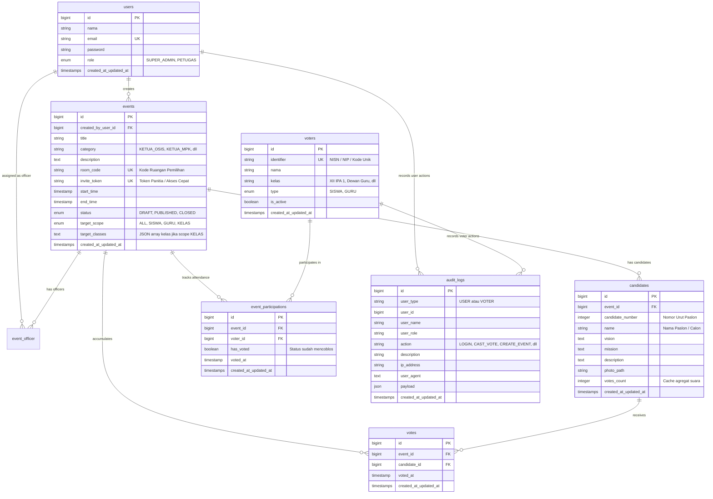

# RINGKASAN ARSITEKTUR SOFTWARE & SISTEM E-VOTING SEKOLAH
> **Dokumen Spesifikasi Teknis & Panduan Konteks AI (AI Ingestion Document)**  
> **Repository:** `fidzzz222/evoting` | **Framework:** Laravel 13.x | **PHP:** 8.3+ | **Database:** SQLite  

---

## 1. Executive Summary & Visi Proyek

Aplikasi **School E-Voting System** adalah platform pemilihan umum digital terpadu berbasis web yang dirancang khusus untuk institusi pendidikan (SMA/SMK/MA/SMP). Sistem ini menggantikan pemilihan konvensional berbasis kertas (pencoblosan fisik di TPS) untuk agenda pemilihan seperti:
- **Ketua & Wakil Ketua OSIS** (Organisasi Siswa Intra Sekolah)
- **Ketua Majelis Perwakilan Kelas (MPK)**
- **Ketua Ekstrakurikuler**
- **Perwakilan Angkatan / Tingkat / Kelas**

### Prinsip Asas Pemilu: LUBER & JURDIL
1. **Langsung & Bebas:** Pemilih mengakses bilik suara digital secara mandiri menggunakan nomor identitas resmi (`identifier`: NISN bagi siswa, NIP bagi dewan guru) beserta kode bilik suara (`room_code`), tanpa password dan tanpa perantara.
2. **Umum:** Seluruh warga sekolah (Siswa & Guru) yang terdaftar dalam DPT (Data Pemilih Tetap) terakreditasi mendapatkan hak pilih sesuai batasan audiens agenda pemilihan (`target_scope`).
3. **Rahasia (*Vote Anonymity Guarantee*):** Menerapkan **Pemisahan Data Fisik (*Decoupling*)**. Tabel pencatatan surat suara (`votes`) **sama sekali tidak memiliki relasi `voter_id`**. Tabel ini hanya menyimpan `event_id`, `candidate_id`, dan `voted_at`. Jejak kehadiran pemilih dicatat di tabel terpisah (`event_participations`). Dengan rancangan ini, **bahkan Super Admin atau Database Administrator tidak dapat mengetahui siapa memilih siapa**.
4. **Jujur & Adil (*Integrity & Zero Double-Voting*):** Transaksi pencoblosan suara dieksekusi dengan **Penguncian Baris Pesimis (*Pessimistic Row Locking - `lockForUpdate`*)** di dalam transaksi database atomik. Begitu hak suara digunakan, status partisipasi langsung terkunci (`has_voted = true`), menjamin terhindar dari *race condition* atau percobaan suara ganda (*double voting*).

---

## 2. Tech Stack & Software Inventory

### 2.1 Backend Runtime & Libraries
- **Language & Runtime:** PHP 8.3+
- **Framework:** Laravel 13.x (Latest Laravel Architecture)
- **Database Engine:** SQLite 3 (`database/database.sqlite`) dengan dukungan foreign key cascade, WAL mode, dan transactional locking.
- **Authentication & API Guard:** 
  - Session-based Multi-Guard (Guard `web` untuk User internal dan Guard `voter` untuk DPT).
  - Laravel Sanctum untuk RESTful API Bearer Token Authentication.
- **Dokumentasi & Ekspor Laporan:** `barryvdh/laravel-dompdf` (PDF Generator Berita Acara & Rekapitulasi Suara).
- **Import Data:** Native Streaming & League CSV parser untuk import DPT massal.
- **Code Linter & Quality:** Laravel Pint (`composer lint`).
- **Testing Framework:** PHPUnit / Pest testing suite.

### 2.2 Frontend Stack & Tooling
- **CSS Framework:** Tailwind CSS v4 (`@tailwindcss/vite`)
- **JavaScript Framework:** Alpine.js v3 (`^3.17`) untuk reaktivitas UI komponen, modal, dropdown, dan tab switching tanpa overhead SPA yang berat.
- **Visualisasi & Grafik:** Chart.js (`^4.5`) untuk render perolehan suara *real-time* (*Quick Count & Bar/Donut Chart*).
- **HTTP Client:** Axios (`^1.11`) untuk request asinkron dan API consumption.
- **Ikonografi:** Lucide Icons / Heroicons via Blade SVG component.
- **Asset Bundler:** Vite 8 (`vite` & `laravel-vite-plugin`).

---

## 3. Arsitektur Multi-Guard Authentication & RBAC

Sistem membedakan aktor ke dalam **3 (tiga) peran utama** menggunakan konfigurasi `config/auth.php` multi-guard:

```
                  ┌────────────────────────────────────────────────────────┐
                  │                 E-VOTING SYSTEM GATEWAY                │
                  └───────────────────────────┬────────────────────────────┘
                                              │
                    ┌─────────────────────────┴─────────────────────────┐
                    │                                                   │
        [Guard: web (users provider)]                       [Guard: voter (voters provider)]
                    │                                                   │
          ┌─────────┴─────────┐                                         │
          ▼                   ▼                                         ▼
   Role: SUPER_ADMIN     Role: PETUGAS                        Role: VOTER (SISWA / GURU)
   (Akses Penuh)        (Akses Per-Event)                     (Portal Pemilih & Bilik Suara)
```

### 3.1 Detail Guard & Provider
1. **Guard `web` (Model: `App\Models\User` | Tabel: `users`):**
   - **`SUPER_ADMIN`:**
     - Mengelola master pengguna (tambah/edit/hapus Super Admin & Petugas).
     - Membuat, mengubah status, dan menghapus seluruh agenda pemilihan (`events`).
     - Mengelola seluruh Data Pemilih Tetap (DPT) lintas kelas/tipe.
     - Mengaudit seluruh log aktivitas sistem (`audit_logs`).
     - Mengunduh rekapitulasi dan berita acara resmi format PDF.
   - **`PETUGAS`:**
     - Bertindak sebagai panitia pemungutan suara (Panitia OSIS/MPK).
     - Hanya memiliki kewenangan pada agenda pemilihan (`events`) di mana `user_id` mereka didaftarkan pada relasi pivot `event_officer`.
     - Mengelola data kandidat/paslon, mengimpor DPT lokal event, dan memantau perolehan suara *real-time*.

2. **Guard `voter` (Model: `App\Models\Voter` | Tabel: `voters`):**
   - Mengotentikasi pemilih terdaftar (`type: SISWA` atau `type: GURU`).
   - Kredensial berupa `identifier` (NISN / NIP) tanpa password, dipadukan dengan `room_code` acara pemilihan (Direct-to-Booth).
   - Mengakses langsung bilik suara digital (`/bilik-suara/{roomCode}`) atau daftar bilik aktif (`/bilik`), membaca visi-misi kandidat, dan mencoblos surat suara digital.

3. **REST API Guard (Laravel Sanctum):**
   - Endpoint `/api/v1/auth/login` menghasilkan token untuk staf (`User`).
   - Endpoint `/api/v1/auth/voter/login` menghasilkan token untuk pemilih (`Voter`).
   - Token divalidasi via middleware `auth:sanctum`.

---

## 4. Skema Basis Data & Desain Entitas (Entity-Relationship)



### 4.1 Prinsip Desain Kunci Pada Skema
1. **Tidak Ada Kolom `voter_id` di Tabel `votes`:**  
   Pencatatan suara hanya menghubungkan `event_id` dan `candidate_id`. Keterangan pemilih mana yang memilih kandidat mana **hilang secara permanen sejak level desain database** demi memenuhi asas Rahasia (*Secret Ballot*).
2. **Unique Composite Constraint pada `event_participations`:**  
   `UNIQUE(event_id, voter_id)` memastikan satu pemilih hanya dapat terdaftar satu kali pada satu agenda pemilihan.
3. **Audit Trail Komprehensif:**  
   Tabel `audit_logs` menyimpan jejak audit non-repudiation (siapa melakukan apa, kapan, dari IP mana, dan browser/device apa).

---

## 5. Logika Bisnis & Alur Operasional Utama

### 5.1 Alur Transaksi Pencoblosan Suara (`CastVoteAction`)

Alur transaksi pencoblosan suara diimplementasikan dalam `App\Actions\CastVoteAction.php` untuk menjamin integritas data:

```
[Pemilih Menekan Tombol Coblos]
               │
               ▼
   [Buka Transaksi Database: DB::beginTransaction()]
               │
               ▼
   [Lock Baris Partisipasi: EventParticipation::lockForUpdate()]
               │
               ├─► Apakah Event Aktif (PUBLISHED) & now() berada di antara start_time & end_time?
               │     └─► [TIDAK] => Abort (422: Event tidak aktif / waktu habis)
               │
               ├─► Apakah Voter Memenuhi Syarat Kategori (target_scope & target_classes)?
               │     └─► [TIDAK] => Abort (403: Tidak berhak memilih di event ini)
               │
               ├─► Apakah has_voted == true?
               │     └─► [YA] => Abort (422: Suara ganda ditolak / Double voting prevented)
               │
               ▼
   [1. Update EventParticipation: has_voted = true, voted_at = now()]
               │
   [2. Insert ke Tabel votes: (event_id, candidate_id, voted_at)]
               │
   [3. Atomic Increment: candidates.votes_count += 1]
               │
   [4. Simpan Log Audit: Action = 'CAST_VOTE' (Tanpa payload kandidat)]
               │
               ▼
   [Commit Transaksi Database: DB::commit()]
               │
               ▼
   [Response: Sukses mencoblos + Redirect ke Halaman Bukti Partisipasi]
```

### 5.2 Manajemen Status Dinamis Event (`Event::syncDynamicStatus()`)
Status agenda pemilihan dikendalikan secara otomatis berdasarkan waktu server Indonesia (WIB - `Asia/Jakarta`) dan jumlah pasangan calon:
- **`DRAFT`:** Status awal pembuatan event, atau jika jumlah kandidat $< 2$.
- **`PUBLISHED`:** Event aktif berlangsung, berlaku jika:
  1. Jumlah kandidat terdaftar $\ge 2$ (syarat sah demokrasi pemilihan sekolah).
  2. Waktu server saat ini berada di antara `start_time` dan `end_time`.
- **`CLOSED`:** Event telah berakhir secara resmi (`now() > end_time`). Pemilih tidak dapat lagi masuk ke bilik suara, dan hasil akhir dapat dibekukan untuk dicetak ke PDF.

### 5.3 Filter Target Audiens Pemilih (`target_scope`)
Agenda pemilihan dapat dibatasi secara spesifik:
- **`ALL`:** Seluruh pemilih aktif (Siswa dan Guru) dapat memilih.
- **`SISWA`:** Hanya pemilih bertipe `SISWA`.
- **`GURU`:** Khusus dewan guru (`type = GURU`).
- **`KELAS`:** Terbatas pada daftar kelas yang dipilih (misal: hanya kelas `XII IPA 1`, `XII IPA 2`).

### 5.4 Import Massal DPT CSV (`VoterImportService`)
- Panitia dapat mengunggah berkas `.csv` berisi data ribuan siswa/guru.
- Format kolom yang didukung: `identifier`, `nama`, `kelas`, `type` (`SISWA`/`GURU`).
- Dilengkapi mekanisme pembersihan karakter tak terlihat (*BOM remover*), sanitasi teks, deteksi baris duplikat, dan *upsert/insert* berbasis transaksi batch.

---

## 6. Peta Rute & Arsitektur Endpoint (Route Catalog)

### 6.1 Antarmuka Web (Blade + Session Auth)

#### Area Publik (Guest)
| Method | URI | Fungsi / Halaman |
| :--- | :--- | :--- |
| `GET` | `/` | Landing page utama sistem e-voting sekolah |
| `GET` | `/login` | Formulir login Super Admin & Petugas |
| `POST` | `/login` | Proses otentikasi User internal (Guard: `web`) |
| `GET` | `/voter/login` | Formulir login pemilih (NISN / Kode Akses) |
| `POST` | `/voter/login` | Proses otentikasi Pemilih (Guard: `voter`) |
| `GET` | `/quick-count/{room_code}` | Tampilan publik grafik perolehan suara *real-time* |

#### Area Super Admin & Petugas (`/admin/*` | Guard: `web`)
| Method | URI | Hak Akses | Deskripsi Fitur |
| :--- | :--- | :--- | :--- |
| `GET` | `/admin/dashboard` | All Staff | Ringkasan statistik pemilihan, DPT, dan partisipasi |
| `GET/POST` | `/admin/events` | All Staff | Indeks & pembuatan agenda pemilihan baru |
| `GET/PUT/DEL` | `/admin/events/{event}` | Super Admin / Assigned | Detail, update jadwal/status, dan hapus event |
| `GET/POST` | `/admin/events/{event}/candidates` | Super Admin / Assigned | Manajemen pasangan calon (tambah, foto, visi-misi) |
| `GET` | `/admin/events/{event}/results` | All Staff | Monitoring *live count*, rekapitulasi, & turn-out rate |
| `GET` | `/admin/events/{event}/export-pdf` | All Staff | Unduh Berita Acara & Rekapitulasi Suara resmi (PDF) |
| `GET/POST` | `/admin/voters` | Super Admin | Manajemen master DPT siswa & dewan guru |
| `POST` | `/admin/voters/import` | Super Admin | Unggah & proses file CSV DPT massal |
| `GET` | `/admin/audit-logs` | Super Admin | Audit trail forensik seluruh aktivitas sistem |
| `GET/POST` | `/admin/users` | Super Admin | Manajemen akun petugas dan administrator |
| `POST` | `/logout` | All Staff | Logout session user |

#### Area Pemilih (`/bilik*` | Guard: `voter`)
| Method | URI | Deskripsi Fitur |
| :--- | :--- | :--- |
| `POST` | `/bilik/join` | Gabung langsung ke bilik suara menggunakan kode room |
| `GET` | `/bilik` | Daftar pemilihan/bilik suara aktif yang berhak diikuti siswa/guru |
| `GET` | `/bilik-suara/{roomCode}` | Bilik suara digital: tampilan kartu paslon & visi-misi |
| `POST` | `/bilik-suara/{roomCode}/vote` | Submit pencoblosan suara (Memanggil `CastVoteAction`) |
| `GET` | `/bilik-suara/{roomCode}/sukses` | Tampilan konfirmasi digital bahwa suara berhasil dicatat |
| `GET` | `/bilik-suara/{roomCode}/sudah-memilih` | Halaman peringatan jika pemilih sudah menggunakan hak pilih |
| `POST` | `/logout` | Logout session pemilih |

---

### 6.2 RESTful API v1 (`/api/v1/*` | Laravel Sanctum)

Format Response Standar JSON:
```json
{
  "success": true,
  "message": "Pesan deskriptif operasi",
  "data": { ... }
}
```

#### Endpoint Otentikasi API
- `POST /api/v1/auth/login`: Otentikasi admin/petugas -> mengembalikan token Sanctum.
- `POST /api/v1/auth/voter/login`: Otentikasi pemilih (NISN/NIP + kode room) -> mengembalikan token Sanctum pemilih.
- `POST /api/v1/auth/logout`: Revoke active token panitia/admin.
- `POST /api/v1/voter/auth/logout`: Revoke active token pemilih.

#### Endpoint Admin API (`auth:sanctum` + role check)
- `GET /api/v1/admin/events`: Daftar agenda pemilihan & statistik.
- `POST /api/v1/admin/events`: Buat agenda pemilihan baru.
- `GET /api/v1/admin/events/{id}`: Detail agenda pemilihan & kandidat.
- `POST /api/v1/admin/events/{id}/candidates`: Registrasi paslon via API.
- `GET /api/v1/admin/voters`: Query DPT dengan paginasi dan filter kelas.
- `GET /api/v1/admin/audit-logs`: Stream log audit sistem.

#### Endpoint Pemilih API (`auth:voters` - Voter Token)
- `GET /api/v1/voter/auth/me`: Data profil pemilih aktif.
- `POST /api/v1/voter/events/join`: Validasi partisipasi dan akses bilik via `room_code`.
- `GET /api/v1/voter/events/{eventId}`: Detail bilik suara dan daftar kandidat untuk event tertentu.
- `POST /api/v1/voter/events/{eventId}/vote`: Kirim surat suara digital secara asinkron.
- `GET /api/v1/voter/events/{eventId}/results`: Hasil perolehan suara event jika diperbolehkan.
- `POST /api/v1/voter/auth/logout`: Logout sesi token pemilih.

#### Endpoint Publik API
- `GET /api/v1/public/events/{room_code}/results`: Mengambil data perolehan suara terkini untuk layar proyektor / digital signage sekolah.

---

## 7. Fitur Keamanan, Integritas & Error Handling

1. **Proteksi Penyerangan Suara Ganda (*Anti Double-Voting*):**
   - Menggunakan `DB::transaction()` yang membungkus pengecekan dan pengubahan status `has_voted`.
   - Menggunakan database level lock `lockForUpdate()` pada entitas `EventParticipation`.
   - Unique Index pada database level `[event_id, voter_id]`.
2. **Kerahasiaan Pemilih (*Zero Knowledge Ballot*):**
   - Pemisahan fisik antara data suara (`votes`) dan partisipasi pemilih (`event_participations`).
   - Log audit pencoblosan suara tidak menyimpan parameter pilihan kandidat.
3. **Validasi Waktu Server (*Strict Server Time Validation*):**
   - Pencoblosan suara divalidasi terhadap waktu sistem server (`Asia/Jakarta`), bukan waktu pada perangkat klien/browser, mencegah manipulasi jam lokal pada gawai siswa.
4. **Audit Trail Tak Terhapus (*Immutable Audit Logs*):**
   - Setiap mutasi data penting (pembuatan agenda, perubahan jam, pencoblosan, import DPT) disimpan dengan `user_type`, `user_id`, `action`, `ip_address`, dan `user_agent`.
5. **Kebersihan Input & Sanitasi:**
   - Semua input form dan payload JSON divalidasi menggunakan Laravel `FormRequest`.
   - Proteksi CSRF aktif di seluruh rute Web.

---

## 8. Panduan Menjalankan & Menguji Proyek (Quick Start)

### 8.1 Persyaratan Sistem
- PHP >= 8.3
- Node.js >= 20.x & NPM
- SQLite 3
- Composer >= 2.x

### 8.2 Langkah Instalasi Lingkungan Lokal
```bash
# 1. Masuk ke direktori proyek
cd C:\Users\USER\evoting

# 2. Install dependensi backend & frontend
composer install
npm install

# 3. Setup file konfigurasi environment
cp .env.example .env
php artisan key:generate

# 4. Inisialisasi basis data dan data benih (seeder demo)
touch database/database.sqlite
php artisan migrate:fresh --seed

# 5. Build asset CSS/JS
npm run build
# atau untuk development:
npm run dev

# 6. Jalankan server lokal
php artisan serve
```

### 8.3 Kredensial Akun Default (Hasil DatabaseSeeder)
- **Super Admin:**
  - Email: `admin@evoting.sch.id`
  - Password: `password123`
- **Petugas Panitia OSIS:**
  - Email: `petugas@evoting.sch.id`
  - Password: `password123`
- **Petugas Panitia MPK:**
  - Email: `petugas2@evoting.sch.id`
  - Password: `password123`
- **Contoh Akun Pemilih (Siswa DPT):**
  - Identifier / NISN: `102401` s/d `102410` (Autentikasi langsung dengan NISN + Kode Ruangan Pemilihan, tanpa password)
- **Contoh Akun Pemilih (Guru DPT):**
  - Identifier / NIP: `19850101`, `19870202`, `19900303` (Autentikasi langsung dengan NIP + Kode Ruangan Pemilihan, tanpa password)

### 8.4 Perintah Uji & Verifikasi Kualitas Kode
```bash
# Menjalankan unit test dan feature test
php artisan test

# Memeriksa dan memformat standar kode PHP
composer lint
```

---

## 9. Petunjuk Prompt Ingesti Cepat Untuk AI Eksternal (AI Copy-Paste Prompt)

Jika Anda ingin memberikan pemahaman instan mengenai proyek ini kepada model AI lain (seperti ChatGPT, Claude, atau DeepSeek), salin ringkasan singkat berikut ke dalam pesan pertama Anda:

```text
Saya sedang mengembangkan proyek Laravel 13 (PHP 8.3 + SQLite + Tailwind CSS v4 + Alpine.js + Chart.js) bernama School E-Voting System. 
Aplikasi ini adalah sistem pemilihan umum sekolah (Ketua OSIS, MPK, Ekstrakurikuler) yang menerapkan asas LUBER-JURDIL.
Fitur & Arsitektur Utama:
1. Multi-Guard Auth: Guard 'web' (User: SUPER_ADMIN, PETUGAS) dan Guard 'voter' (Voter: SISWA, GURU via NISN/Kode).
2. Vote Decoupling: Tabel 'votes' (event_id, candidate_id, voted_at) terpisah mutlak tanpa foreign key voter_id, sementara status kehadiran disimpan di 'event_participations' (event_id, voter_id, has_voted) demi menjamin asas rahasia (Secret Ballot).
3. Anti-Race Condition: Pencoblosan suara menggunakan DB::transaction dan pessimistic row lock (lockForUpdate) pada EventParticipation dan Candidate.
4. Dynamic Event Lifecycle: Sinkronisasi otomatis status DRAFT/PUBLISHED/CLOSED berbasis waktu Asia/Jakarta dan syarat minimal 2 kandidat.
5. Target Scope: Pembatasan hak pilih (ALL, SISWA, GURU, atau KELAS spesifik).
6. Dual Interfaces: Tampilan Web berbasis Blade/Alpine.js dan REST API v1 berbasis Laravel Sanctum.
7. Pelaporan: Rekapitulasi suara real-time dengan Chart.js dan ekspor Berita Acara PDF menggunakan barryvdh/laravel-dompdf.
Mohon bantu saya dengan mempertimbangkan arsitektur dan aturan bisnis di atas.
```

---
